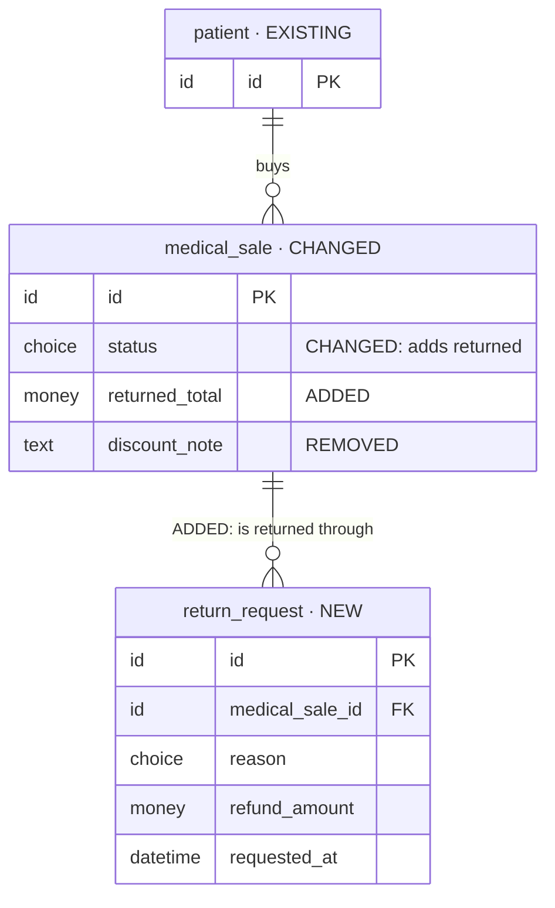
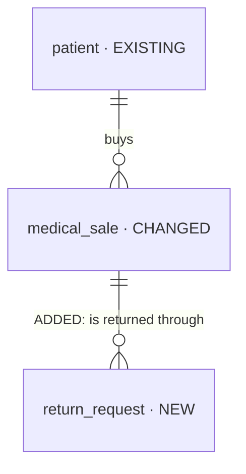

# Iteration planning (KICKOFF.md + plans/ from `iterations/<iteration>/intake-files/`)

The first half of the iteration workflow. **This skill writes the plan and writes no code;
`be-kickoff-iteration` implements it after the user approves.** Its outputs are
`iterations/<iteration>/KICKOFF.md` (the plan and its ordered ROUTE ledger) and
`iterations/<iteration>/plans/`, with a stop after every step.

The whole flow: [`docs/design-workflow/process/README.md`](../../../docs/design-workflow/process/README.md).
The iteration rules: [`iterations/README.md`](../../../iterations/README.md).

## Principle — WHAT must be true, never HOW

`plans/` and `KICKOFF.md` hold requirements and decisions only. **Never write:**

- SQL or DDL, physical column types, indexes, constraints
- endpoint paths, HTTP methods, status codes — **one exception:** `plans/route-changes.md` proposes
  each route as method + path (never status codes) so the API can be reviewed while planning; see
  Route changes below
- `src/` file paths, domain or sub-domain folder names — **one exception:** an entity label in
  `plans/db-changes.md` may carry its table's domain and name (`domain.table`) once the user has
  chosen them (Step 4)
- queue, job, event or worker names

**The one place for technical design is the route review**, `plans/routes-final.md` (Step 5): the
agreed design per sub-domain — tables and columns, indexes, routes, permission codes, folders — shaped by
[`routes-final-template.md`](../../../docs/design-workflow/process/routes-final-template.md) and
confirmed by the user one sub-domain at a time. It is still a proposal (below).

Each ROUTE row is a work item (one per sub-domain of the route review, or per table, background piece,
flow); any detail the route review leaves open is decided during implementation and recorded in
`AS-BUILT.md`.

## Under `--both`: one shared plan, this one owns the contract

When the iteration exists in both repositories, this plan is the only plan of the contract —
`plans/routes-final.md`, `route-changes.md`, `db-changes.md`, `worker-changes.md` and the
decisions behind them. The frontend's plan links to them and adds its screens; it never copies
them. Its requests (a field, a filter, an error it needs) come here as Step 4 questions or decision
rows, and the frontend builds against what is decided here.

## The plan proposes; agent-os decides

The plan's tables, fields, routes and background work are **proposals at the requirement level**. The
backend's **agent-os** — its skills, rules and agents under `agent-os/` — is the expert: whenever the
plan and agent-os disagree, or anything is unclear, agent-os wins. At kickoff it decides the physical
design and may change any detail on the way — table and field names, types, indexes, constraints, tenant rules, paths, statuses,
idempotency, job names (`be-schema-generator`, `be-sql-design-guard`, `be-db-migration-maintainer`,
`be-rls-tenant-isolation-guard`, `be-api-contract-guard`, `be-workers-events`, and the rest of each
row's chain). The plan never overrides them. Every such change is recorded in `AS-BUILT.md` and
synced back into `routes-final.md`, `db-changes.md`, `route-changes.md` and `worker-changes.md`, so the
plan ends as the true record. The route review is the exception: built **ditto**, and a disagreement stops
for the user before anything differs (`be-kickoff-iteration`); only a **scope** change (a row added or removed, an acceptance changed) stops for the
user (`be-kickoff-iteration` › Each ROUTE row).

## Inputs and mode

| Input | Used for |
| --- | --- |
| `iterations/<iteration>/README.md` | Type, Owner, Opened, Branch, Baseline, Status |
| `iterations/<iteration>/intake-files/PRD.md` | screens, flows, data, priorities, open questions |
| `iterations/<iteration>/intake-files/schema-routes.md` | entities, enums, operations, routes |
| `iterations/<iteration>/intake-files/design-overview.md` | optional — the designer's overview and "What changed" notes |
| `iterations/<iteration>/intake-files/BRIEF.md` | brief mode — the written change (what, why, affected screens / entities / routes, rules, acceptance criteria, out of scope) |
| the Baseline's `AS-BUILT.md` › Standing deviations | where the build already differs from the drop — plan against what was actually built |

`intake-files/` always holds a **full snapshot**, exactly as placed by `pnpm iteration:intake`. The
README's **Intake mode** says how it was built: `full` — the drop as received (always the launch);
`overlay` — only the changed files arrived, laid over the Baseline's snapshot; `brief` — no design
files, only a written change: the Baseline's snapshot plus `BRIEF.md`.

- **Baseline `none` → MODE initial** — the default for every iteration: plan everything.
- **Baseline `<iteration>` → MODE incremental** — only when the user named it. The delta
  depends on the Intake mode: `full` / `overlay` — the designer's "What changed" notes **plus**
  `pnpm iteration:diff <baseline> <iteration>`, which compares the two `intake-files/` folders and
  nothing else (anything the diff shows that the notes omit is a finding); `brief` — `BRIEF.md` is
  the change list, and the diff must show nothing but `BRIEF.md` added. The Baseline's
  `intake-files/` is therefore mandatory (`iteration:baseline` refuses a Baseline without it).

**Gate rule.** `pnpm iteration:intake <iteration> --check [--baseline <baseline>]` proves every
mandatory file is in the snapshot (and the Baseline's) and that nothing changed since the intake.
When it exits non-zero, stop now — write nothing, change no status, ask nothing else; print the
command's output and end the turn. A failing gate goes back to whoever placed the drop; the plan
never works around a missing or edited file.

## Outputs

```text
iterations/<iteration>/
├── KICKOFF.md                         the plan + the ROUTE ledger — frozen at approval
└── plans/
    ├── decisions.md                   every blocking answer and scope decision (add-only)
    ├── coverage.md                    Coverage · Reconciliation · Delta (incremental)
    ├── db-changes.md                  the Mermaid data diagrams — one file, kept current at every step
    ├── route-changes.md               the proposed routes — one file, kept current at every step
    ├── worker-changes.md              the background work — one file, kept current at every step
    ├── routes-final.md                the route review — the design per sub-domain, confirmed one sub-domain at a time (Step 5)
    ├── requirements/
    │   ├── data.md                    links to db-changes.md for its diagrams
    │   ├── access.md
    │   ├── operations.md
    │   ├── background.md              cross-cutting background rules; the list is worker-changes.md
    │   ├── notifications.md
    │   ├── realtime.md
    │   ├── integrations.md
    │   ├── files.md
    │   └── quality.md
    ├── features/<feature>/story.md
    └── acceptance.md
```

**`plans/decisions.md`** — add-only; a changed mind is a new row that supersedes an old one:

| Question | Options | Decision | Date | Who | Kind |
| --- | --- | --- | --- | --- | --- |

Kind is `RED` (answered by the user), `AMBER` (safe default, still open) or `SCOPE` (a scope
decision during implementation, written by `be-kickoff-iteration`).

**`plans/coverage.md` › Coverage** — planning is not done while any row is `open`:

| Source (file:line) | Item | Requirement | Feature | Acceptance | Status |
| --- | --- | --- | --- | --- | --- |

Status is `open`, `covered` or `out-of-scope` (with a link to the decision that put it there).

**`plans/requirements/`** — every file present; one that does not apply says `n/a — <reason>`.
Each requirement gets a dotted identifier — `data.patient-scope`, `access.refund-approval`,
`background.expiry-sweep` — which coverage rows, stories and ROUTE rows cite.

**Before → after for requirements.** Each requirement is `NEW`, `CHANGED` or `REMOVED` against what
exists today — the Baseline's plans and `AS-BUILT.md` (incremental), or what the platform already does
(initial). Every file in `requirements/` ends with a `## Before → after` section, one row per
`CHANGED` or `REMOVED` requirement, so a change reads without opening two documents:

| Requirement | Before | After | Why |
| --- | --- | --- | --- |
| `access.membership-roles` | a member holds exactly one role | a member holds one or more roles; access is their union | D5 |

A file with nothing changed says `none — every requirement here is NEW`.

| File | Answers |
| --- | --- |
| `data.md` | what is stored, owned by whom, related how, kept how long, removed how |
| `access.md` | which role may see or do what, scoped to what |
| `operations.md` | what users can do: create, change, cancel, approve, list, search, filter, sort |
| `background.md` | the rules every piece of background work follows (timing, retries, quiet hours) — the list of background work itself is `worker-changes.md` |
| `notifications.md` | who is told what, through which channel, when |
| `realtime.md` | what must update on screen without a refresh |
| `integrations.md` | outside systems — payments, messaging, mail, storage |
| `files.md` | uploads, images, prints, exports |
| `quality.md` | audit, privacy, retention, limits, idempotency, performance expectations |

**`plans/features/<feature>/story.md`** — one per feature, kebab-case folder. Screen features own
entities; flow features (the PRD's end-to-end flows) come after the entities they involve.

```markdown
Status: draft | ready
Kind: screen | flow
Depends on: <features, or none>

## Stories
- As a <role> I want <capability> so that <outcome>.

## Rules
- <business rule> (requirement identifier)

## Acceptance criteria
- <observable result> — intake-files/PRD.md:<line>

## Work items
- <requirement identifiers this feature delivers>
```

**`plans/acceptance.md`** — one row per acceptance criterion; Result and Evidence stay empty until
built:

| Item | Source | Result | Evidence |
| --- | --- | --- | --- |

## Data diagrams — Mermaid, in `plans/db-changes.md`

The iteration's database changes live in **one file**, `plans/db-changes.md`, and nowhere else:
`requirements/data.md` links to it instead of repeating the diagrams. It is written **on the go** —
created at Step 1 with the overview **and one section per table, stage by stage** (the intake already
carries every entity's fields), then updated in the same step as anything that changes the data model
(a Step 3 verdict, each Step 4 answer, each sub-domain of the Step 5 route review, the Step 6 detail) — so it always shows the plan as it stands. It freezes with `KICKOFF.md` at approval; implementation records what was actually
built in `AS-BUILT.md`. `pnpm db:viewer` draws it in plan mode — the iteration as a dashed future
version after Latest, diffed against the live schema — while the iteration is not `frozen`.

- **One overview** `erDiagram`: entities and relationships, no fields.
- **Stage-wise, one section per table.** After the overview, the tables are grouped into **build
  stages** in dependency order — the order the ROUTE ledger builds them (Step 6). Each table has its
  own section: **Holds** (what it stores and why) · **Table** (the `domain.table` proposal; `app.<plural>`
  until the user chooses) · **Sources** (`file:line`) · **Added** / **Replaced** (what decisions or
  requests changed against the drop) · **Open** (the questions still open for it) · and its own
  `erDiagram` with every field. A feature's story names the tables it uses — there is no separate
  per-feature diagram.
- **Reference field**: `<entity>_id` with `FK`, and the target in its comment when the name does not
  say it — `id doctor_id FK "→ user"`.
- **Entity label**: `name["name · NEW|CHANGED|EXISTING|REMOVED"]`, plus `· domain.table` once the
  user has chosen where the table lives — `patient["patient · NEW · clinical.patients"]`. `EXISTING`
  is context only.
- **Table names follow the repository**: plural snake_case, like every existing table (`branch` →
  `branches`, `medical_sale` → `medical_sales`). The domain is the Postgres schema the table goes
  under (like `tenancy`, `billing`). Until the user chooses, a new entity has no `domain.table` and
  the DB Viewer draws it under `app` with its plural name.
- **Field comment** (taken from the diff): `"ADDED"`, `"CHANGED: <what>"` or `"REMOVED"`. An
  unchanged field has no comment.
- **Relationship label** for a change: `"ADDED: <name>"` or `"REMOVED: <name>"`.
- **Logical types only**: `id`, `text`, `number`, `money`, `date`, `datetime`, `boolean`, `choice`,
  `json`, `file`. `choice` is one value from a list of allowed values — never a database enum type
  (`be-sql-design-guard`: stored as text with its allowed values). A list that clinics can change
  (sections, categories, reasons a clinic adds) is a table or catalog of its own, not a `choice`.
- **Names the viewer matches**: an entity is the singular snake_case name of the record
  (`patient`, `medical_sale`); a `CHANGED`, `EXISTING` or `REMOVED` entity is matched to its label's
  `domain.table`, else to the live table of the same name, singular or plural (`organization` →
  `organizations`). A reference field is `<entity>_id`.
- An existing or changed entity shows only its key, the changed fields, and the fields other
  entities reference.

Worked example — a pharmacy-returns iteration:



The overview for the same iteration:



## Route changes — `plans/route-changes.md`

The iteration's API changes live in **one file**, `plans/route-changes.md`, written on the go the same
way as `db-changes.md`: drafted at Step 1 from the operations, updated in the same step as any verdict
or answer that changes a route, matched to the route review at Step 5, completed at Step 6, frozen at approval. It is the one place a plan
names paths — as **proposals**: kickoff confirms each route when it builds it, records any change in
`AS-BUILT.md`, and the built truth is `docs/routes.txt`.

- Header: iteration, mode, Intake hash, date, then a count table — NEW / CHANGED / REMOVED per area.
- One `## <area>` section per area (Patients, Appointments, Payments, …), each a table:

  | # | Change | Method | Path | Access | Operation | Source |
  | --- | --- | --- | --- | --- | --- | --- |
  | RC-1 | NEW | GET | `/api/v1/…/patients` | patients · view | listPatients | `schema-routes.md:1619` |

  - **Change**: `NEW`, `CHANGED` (say what changes, and the current path) or `REMOVED`.
  - **Path** follows the API contract (`be-api-contract-guard`): snake_case semantic params
    (`{patient_id}`, never `{id}`), no organization segment, plural resources.
  - **Access**: the permission (section · action) or role it needs — never a status code.
  - **Operation**: the schema-routes operation (or Appendix / decision) it serves; **Source** is its
    `file:line`.
- **Before → after** — one section after the area tables, one row per `CHANGED` route, so a route
  that changes only in part reads at a glance:

  | # | Route | What changes | Before | After | Why |
  | --- | --- | --- | --- | --- | --- |
  | RC-12 | `PATCH /api/v1/…/memberships/{membership_id}` | roles | one role | one or more roles | D5 |

  "What changes" names the part — path, method, access, input, output or behaviour — and Before /
  After say it in plain words. A `REMOVED` route lists what replaces it, if anything.
- A route no requirement reaches is a finding; an operation no route serves is a coverage gap.

## Worker changes — `plans/worker-changes.md`

The iteration's background work — everything that happens without a user: schedules, reminders,
automatic tasks, retries, clean-ups, outgoing messages — lives in **one file**,
`plans/worker-changes.md`, written on the go like the other two. It stays **WHAT**, never HOW: plain
words, no queue, job, event or worker names (kickoff names them and records them in `AS-BUILT.md`).
`requirements/background.md` keeps only the rules all background work follows and links here.

- Header: iteration, mode, Intake hash, date, then a count table — NEW / CHANGED / REMOVED.
- One table, one row per piece of background work:

  | # | Change | Background work | When it runs | What it touches | On failure | Who is told | Requirement | Source |
  | --- | --- | --- | --- | --- | --- | --- | --- | --- |
  | WC-1 | NEW | create the aftercare call task | the day after a treatment, 10:00 clinic time | Task | retried; never doubled | the treating therapist | `background.aftercare-call` | `PRD.md:125` |

  - **When it runs**: the trigger (an event — "a check-in scores 4 or less") or the schedule, in
    clinic-local time.
  - **On failure**: retried, given up and flagged, or safe to skip — and whether a repeat could do the
    work twice.
  - **Who is told**: the person or role notified, through which channel — or "nobody".
- **Before → after** — one row per `CHANGED` piece, like routes:
  `| # | Background work | What changes | Before | After | Why |`.

## Route review — `plans/routes-final.md`

The route review turns the plan into the design the user agrees to, **one sub-domain at a time**, before
`KICKOFF.md` is written. Its shape is
[`routes-final-template.md`](../../../docs/design-workflow/process/routes-final-template.md) — copy
it, then replace its two invented sub-domains with the iteration's own.

- **One folder per sub-domain** (`src/domains/app/sub-domains/<sub-domain>/`); each nested sub-domain
  is a folder directly inside it (`<sub-domain>/<nested-sub-domain>/`, as `CLAUDE.md` lays them out).
  The plan uses the code's words — domain → sub-domain → nested sub-domain, never "module". Grouped by
  connection: what a record owns is a nested sub-domain of it (its table carries the parent's prefix, its
  routes nest under the parent), and a sub-domain comes after every sub-domain it points at.
- **Twelve sections per sub-domain, eleven per nested sub-domain** — decisions, open questions, tables and
  relations, permissions, common to every route, objects returned, routes, request details, errors,
  rules worth knowing, code changes (+ nested sub-domains for a sub-domain).
- **Read the code first.** Every decision says what the code does today, so each reads before →
  after, and offers the recommended option plus any real alternative. RED questions go to the user
  (AskUserQuestion); the user's standing answer "go with your recommendation" takes the recommended
  options and says so.
- **Agent-os up front.** Each sub-domain follows `be-api-contract-guard`, `be-sql-design-guard`,
  `be-rls-tenant-isolation-guard`, `be-workers-events` and the naming rules while it is written, so
  kickoff confirms the design instead of redesigning it.
- **Status per sub-domain**: `rev n — awaiting your OK` → `final (rev n, confirmed <date>)` only after
  the user confirms that sub-domain in chat; reopening a final sub-domain bumps its rev. A sub-domain's
  confirmation is one `plans/decisions.md` row (Kind `RED`).
- **One file, current at every stop**: the file's header keeps the sub-domains table (folder, paths,
  route count, builds on, status), the app total, the code layout, the tables without routes, the
  rules that hold across sub-domains and the connections overview in step with the sub-domains below it.
- The three change files say the same as the confirmed sub-domains — `db-changes.md` (tables),
  `route-changes.md` (routes) and `worker-changes.md` (background work) are updated in the same stop.

## The three change files

`db-changes.md`, `route-changes.md` and `worker-changes.md` are what the user reviews; each is one file
per iteration, current at every step, with before → after wherever something existing changes.

## Step review — at every stop, no PR diff needed

Every step ends with the same short review, so the user can check everything in place and ask for a
change before the next step. **The step reviews are the plan's review of record:** the approval
(`ready-for-approval → approved`) confirms what they already accepted and what changed after the
last one — it does not ask for a second full read of `KICKOFF.md` and `plans/`.

1. **What changed** — each file this step wrote or changed, as a clickable link, with one line on
   what changed in it (counts, not dumps).
2. **Review links** — whenever a change file changed:
   - **DB changes:** the DB Viewer URL in plan mode — start it (`pnpm db:viewer`, or the
     `db-viewer` preview), give the tokened URL it prints, and say which iteration to click under
     ◇ Plans (dashed = not built yet; the diff against Latest is the plan); plus a link to
     `plans/db-changes.md`.
   - **Routes:** a link to `plans/route-changes.md` and the NEW / CHANGED / REMOVED counts that
     moved in this step.
   - **Background work:** a link to `plans/worker-changes.md` and the counts that moved.
   - **Route review:** a link to the sub-domain's section in `plans/routes-final.md`, its route count
     and its status.
3. **What needs you** — the open questions and findings, or "nothing".
4. **Continue or change** — ask with **AskUserQuestion**: continue to the next step (recommended
   when nothing is open), or change something. A requested change is made in the files — a changed
   decision is a new `plans/decisions.md` row that supersedes the old one — and the step review is
   shown again before moving on.

## Lite mode — a fix planned in one step

When the README's Process is `lite` (a `fix` opened with `pnpm iteration:new fix <topic> --lite`):

1. **Step 0** as below — confirm the iteration (Baseline `none` unless the user names one), and run
   the gate when a drop was placed.
2. **One step, then one stop:** read the current code the fix touches; write `KICKOFF.md` with its
   ROUTE rows, `plans/decisions.md` (what is decided and why) and `plans/acceptance.md` (what proves
   the fix — a failing test turned green, at least); keep `plans/db-changes.md`,
   `plans/route-changes.md` and `plans/worker-changes.md` when the fix changes tables, routes or
   background work. Show it all in one step review and ask the user's go with **AskUserQuestion**.
3. No `ready-for-approval` and no `approved`: on the go, be-kickoff-iteration moves it
   `planning → implementing` and builds the rows. If the fix turns out bigger than a fix (a new
   table, a new route surface), stop and say so — it becomes a `change` with the full procedure.

## Procedure — stop after every step, with its step review, and wait

### Step 0 — Confirm the iteration, then stop until confirmed

Run `pnpm iteration:list` and show:

| Iteration | Type | Baseline | Status | Eligible | Why |
| --- | --- | --- | --- | --- | --- |

- Eligible = Status `planning`. Recommend the earliest-opened eligible iteration (the launch always
  comes first). If the user named one, check it against the rule.
- **Incremental — only when the user names a Baseline** ("build on <iteration>"): record it with
  `pnpm iteration:baseline <iteration> <baseline>` (it needs a complete `intake-files/`). Never
  suggest or ask for one: without one the iteration is from scratch (MODE initial).
  An `overlay` or `brief` snapshot was built on the Baseline recorded at intake; picking another
  means rebuilding it (the gate fails until
  `pnpm iteration:intake <iteration> <source> --mode <mode> --replace` has run).
- Always ask with **AskUserQuestion** — never pick silently.

Then **the gate** — and the gate rule above:

```bash
pnpm iteration:intake <iteration> --check                         # MODE initial
pnpm iteration:intake <iteration> --check --baseline <baseline>   # MODE incremental
```

### Steps 1–3 — Read the drop: inventory, delta, reconcile — then one stop

The three run back to back and end with **one** step review: they read the drop and write the
same three files, and nothing in them needs the user's answer before the next part (questions wait
for Step 4).

#### Step 1 — Inventory

- The gate passed, so the snapshot is complete and unedited; extras the intake warned about are
  findings.
- Read **every** intake file **in full** — no skimming, no grep-only — `BRIEF.md` first in brief
  mode.
- Draft `plans/coverage.md` › Coverage with one row per PRD screen, flow, must-have and open
  question, and per `schema-routes.md` entity, enum and operation — each with its `file:line`.
- Create `plans/db-changes.md` with the overview diagram and one section per table, grouped into
  build stages (fields from the intake, logical types); draft `plans/route-changes.md` — one
  proposed route per operation row (initial: all `NEW`) — and `plans/worker-changes.md` — one row per
  piece of background work the intake names (rules, reminders, automatic tasks, schedules).

Keep the counts for the step review at the end of Step 3.

#### Step 2 — Delta (MODE incremental only)

MODE initial: write `n/a — initial` and continue. MODE incremental — by the README's Intake mode:

- **`full` / `overlay`** — run `pnpm iteration:diff <baseline> <iteration>` (`--json` for the
  structured summary) and read the designer's "What changed" notes. In `plans/coverage.md` › Delta,
  classify every entity, field, enum and operation **added, changed or removed**; plan only those.
  Anything the diff shows that the notes omit is a **finding** — list it.
- **`brief`** — `BRIEF.md` is the change list: what changes, why, the affected screens, entities
  and routes, the rules, the acceptance criteria and what is out of scope. `pnpm iteration:diff`
  must show only `BRIEF.md` added; anything else is a finding to resolve before planning. There is
  no new design source, so reconcile the brief against the carried-forward `PRD.md` /
  `schema-routes.md` and the current code.
- **Always** — read the Baseline's `AS-BUILT.md` › Standing deviations: wherever the build already
  differs from the drop, plan against what was actually built. List the ones this change touches
  in `KICKOFF.md` (section 8).

#### Step 3 — Reconcile

List every `PRD.md` ↔ `schema-routes.md` mismatch in `plans/coverage.md` › Reconciliation:

| # | Item | PRD says (file:line) | schema-routes says (file:line) | Verdict | Action |
| --- | --- | --- | --- | --- | --- |

No verdict without evidence on both sides — a verdict without a line number is an opinion.

When the drop holds more than `PRD.md` and `schema-routes.md` (screen specs, the prototype), list
their conflicts with those two files the same way, and weigh them against the frontend's approved
reading of the same drop (its `KICKOFF.md` reconciliation and backend requests) — `schema-routes.md`
is the frontend's detailed data and URL contract. Only an approved source settles a row: `PRD.md`
for scope and behaviour, `schema-routes.md` for data, value lists, limits and URLs, a frontend
request the user accepted, or a decision in `plans/decisions.md`. **Anything only the screens or the
prototype say gets no verdict — it is a question for the user** (Step 4), with a proposed default,
and every change-file entry that rests on it is marked *pending your answer* until it is answered.

**Stop** — one step review for Steps 1–3: the inventory counts, the delta and its findings, the
reconciliation rows and the questions they raise for Step 4.

### Step 4 — Blocking questions, then stop when every RED is answered

- **RED** — never guess: ownership; scope (the organization, or narrower — a branch, a patient,
  the owner); lifecycle and delete policy; who may do what; background timing; notification
  channels; realtime needs; outside systems; **where new tables live** — the domain (Postgres schema)
  for each group of new tables, and their names, proposed in the repository's plural snake_case
  (the answers go on the `db-changes.md` labels as `domain.table`). Ask with **AskUserQuestion** — at most 4 per call, one
  recommended option each, quoting the evidence (`file:line`).
- **AMBER** — a safe default exists: take it and log it as open. When the item is in neither
  `PRD.md` nor `schema-routes.md` (it comes only from the screens or the prototype), the user still
  confirms the default in a Step 4 group — it is never applied silently.

Every answer goes in `plans/decisions.md`; every answer that changes the data model updates
`plans/db-changes.md`, every answer that changes a route updates `plans/route-changes.md`, and every
answer that changes background work updates `plans/worker-changes.md`, in the same step.

### Step 5 — Route review, sub-domain by sub-domain, then stop after each sub-domain

Write `plans/routes-final.md` from the template (Route review above), in the sub-domains' build order:

1. Draft the file header — the sub-domains table with every sub-domain `draft`, the code layout, the
   tables without routes, the connections overview.
2. For each sub-domain: read its code today, write its twelve sections and each nested sub-domain's eleven,
   run the template's hand-over checks, update the three change files, and stop with the step
   review. Ask the sub-domain's RED questions with **AskUserQuestion**.
3. On the user's OK, mark the sub-domain `final (rev n, confirmed <date>)`, add its `plans/decisions.md`
   row, and move to the next. A change asked for reopens the sub-domain (`rev n+1`).

Continue to Step 6 only when every sub-domain in scope is final. **Stop after each sub-domain.**

When the last sub-domain turns final, put the approval line under the file's title —
`**Route review final — <date>.** …` (template › File header) — and say so in the step review:
under `--both` it is the frontend's signal to kick off on these routes now, without waiting for
this plan's approval. A later change reopens its sub-domain, removes the line until it is final
again, and is a decision row the frontend's iteration is told about.

### Step 6 — Write KICKOFF.md and plans/, then stop

Write every `plans/requirements/*.md` (dotted identifiers; `data.md` links to the per-table
sections in `plans/db-changes.md`),
one `plans/features/<feature>/story.md` per feature, and `plans/acceptance.md`.

Then write `KICKOFF.md`. Every section is present — a section may say `n/a — <reason>`, never be
absent:

1. **Header** — iteration, mode, Baseline, intake (`Intake mode`, `Intake note`, `Drop placed`,
   `Intake hash`, `Schema-routes` from the README), date.
2. **Goal and scope** — what this iteration achieves; in scope; out of scope (with decision links).
3. **Locked decisions** — a one-line summary of each RED answer, linked to `plans/decisions.md`.
4. **Features and order** — screen features before the flow features that involve them.
5. **ROUTE** — the ordered ledger, one row per work item (table, background piece, flow):

   | # | Work item | Kind | Depends on | Skill/driver | Acceptance | Assignee | Status |
   | --- | --- | --- | --- | --- | --- | --- | --- |

   Kind is `sub-domain`, `table`, `feature`, `background` or `flow`. With a route review, the schema
   and feature rows follow its sub-domains in order — one `sub-domain` row per sub-domain (or one per
   nested sub-domain when a sub-domain is large), citing its section (`routes-final.md` § 5.A) as the spec and
   its code changes as the checklist. Status starts `open`. The order follows the
   route shape in `be-kickoff-iteration`: schema first (tables in dependency order — the stages of
   `db-changes.md`, one table row per table section) → features →
   background work → flows → acceptance; incremental — schema changes first, then changed features,
   changed background work, affected flows. Driver: NEW table → the staged-build prompt; CHANGE
   table, flow, background work → `/be-build-requirement`.
6. **Requirements index** — every dotted identifier, linked to its `plans/requirements/` file.
7. **Open AMBER items** — the safe defaults still open.
8. **Standing deviations** — the Baseline's deviations this change touches (item · design says ·
   built as · since iteration · decision), and whether this iteration keeps or resolves each.
9. **Definition of done** — every ROUTE row `done` (or `deferred` with the user's OK);
   `plans/acceptance.md` filled; the `AS-BUILT.md` summary and Standing deviations written; the
   repository's gates green.
10. **Verification** — the gates that close the iteration and the acceptance check: by Intake mode,
    `full` / `overlay` → the PRD's acceptance traced in `plans/acceptance.md`; `brief` → the
    `BRIEF.md` acceptance criteria; MODE incremental, every mode → the existing end-to-end tests
    for everything touched.

**Stop.**

### Step 7 — Self-check, then stop

Fix before presenting, never after:

- [ ] The gate (`pnpm iteration:intake <iteration> --check`) passed, and every intake file was read in full
- [ ] MODE incremental: the delta follows the Intake mode (full / overlay: `iteration:diff` ⟷ "What changed"; brief: `BRIEF.md`, nothing else changed), every omission raised as a finding
- [ ] The Baseline's Standing deviations were read, and the ones this change touches are in `KICKOFF.md`
- [ ] Every `plans/coverage.md` row is `covered` or `out-of-scope`
- [ ] Every RED is answered in `plans/decisions.md`; every open AMBER is in `KICKOFF.md`
- [ ] Every requirement identifier is used by a feature and reached by a ROUTE row
- [ ] Every `CHANGED` or `REMOVED` requirement has its before → after row (each `requirements/` file ends with the section)
- [ ] Every acceptance criterion traces to a line in `intake-files/PRD.md` (brief mode: in `intake-files/BRIEF.md`)
- [ ] `plans/db-changes.md` matches `data.md` and every decision; incremental field comments match the diff
- [ ] `plans/db-changes.md` is stage-wise: every table has its section (holds, table, sources, added / replaced, open, diagram), and the stages follow the ROUTE order
- [ ] `plans/route-changes.md` serves every operation in scope, each route has access and a source line, every path follows the API contract, and every `CHANGED` route has its before → after row
- [ ] `plans/worker-changes.md` lists every piece of background work in scope with when, on failure and who is told, no queue / job / worker names, and before → after for every `CHANGED` piece
- [ ] `plans/routes-final.md` follows the template: every sub-domain in scope `final`, sections 1–12 per sub-domain and 1–11 per nested sub-domain, no repeated or dangling ids, route counts matching its sub-domains table, and the three change files saying the same
- [ ] Every step ended with its step review (what changed, review links, what needs you, continue or change)
- [ ] Every `KICKOFF.md` section is present; every ROUTE row has a driver and acceptance
- [ ] No technical design anywhere (see the Principle)

Run `pnpm iteration:status <iteration> ready-for-approval` and **stop.** On the user's go-ahead run
`pnpm iteration:status <iteration> approved` and log the approval in `plans/decisions.md`. Changes
requested instead → revise while it stays `ready-for-approval`, or send it back with
`pnpm iteration:status <iteration> planning --reason "<why>"`. Never edit the Status row by hand.

From approval on, `KICKOFF.md` is frozen: only its ROUTE Status column and "revised → AS-BUILT #n"
markers change, and `intake-files/` is locked.

## Failure modes this skill exists to prevent

| Failure | Prevention here |
| --- | --- |
| The wrong iteration planned, or against a Baseline nobody named | Step 0 table + AskUserQuestion; Baseline `none` unless named (`iteration:baseline`) |
| A plan built on an incomplete or edited intake | Step 0 gate (`iteration:intake --check`) |
| A plan against the design where the build already differs | Step 2 — the Baseline's Standing deviations |
| A change in the drop the designer didn't mention | Step 2 diff vs notes → findings |
| PRD and schema-routes disagree and the build picks one | Step 3 reconciliation with evidence |
| Guessed ownership, scope, access or timing → rework | Step 4 RED gate |
| A plan that decides implementation before the code is read | the Principle; Step 7 check |
| The design argued again row by row during the build | Step 5 route review — every sub-domain confirmed before `KICKOFF.md` |
| A ROUTE that misses a requirement | Step 7 — every identifier reached by a row |
| The data model, API or background work only readable in a PR diff | `db-changes.md`, `route-changes.md`, `worker-changes.md` — kept current, before → after for changes, with the step review at every stop |

## Related

- **`be-kickoff-iteration`** — implements the approved `KICKOFF.md`, one ROUTE row at a time
- [`iteration-planning-prompt.md`](../../../docs/design-workflow/prompts/iteration-planning-prompt.md) — the paste prompt
- [`iteration-guide.md`](../../../docs/design-workflow/process/iteration-guide.md) — every step with its questions
- [`routes-final-template.md`](../../../docs/design-workflow/process/routes-final-template.md) — the route review's shape, with two invented sub-domains
- [`iterations/README.md`](../../../iterations/README.md) — the iteration rules and commands
