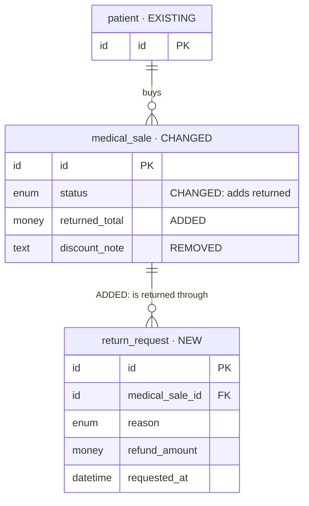
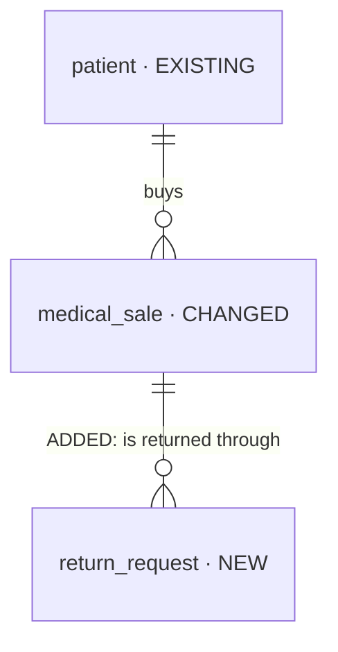

# Iteration planning (KICKOFF.md + plans/ from `iterations/<iteration>/intake-files/`)

The first half of the iteration workflow. **This skill writes the plan and writes no code;
`be-kickoff-iteration` implements it after the user approves.** Its outputs are
`iterations/<iteration>/KICKOFF.md` (the plan and its ordered ROUTE ledger) and
`iterations/<iteration>/plans/`, with a stop after every step.

The whole flow: [`docs/design-workflow/process/README.md`](../../../docs/design-workflow/process/README.md).
The iteration rules: [`iterations/README.md`](../../../iterations/README.md).

## Principle — WHAT must be true, never HOW

`plans/` and `KICKOFF.md` hold requirements and decisions only. **Never write:**

- SQL or DDL, physical column types, indexes, constraints
- endpoint paths, HTTP methods, status codes
- `src/` file paths, domain or sub-domain folder names
- queue, job, event or worker names

Each ROUTE row is a work item (one per table, background piece, flow); its technical design is
decided during implementation and recorded in `AS-BUILT.md`, not here.

## Inputs and mode

| Input | Used for |
| --- | --- |
| `iterations/<iteration>/README.md` | Type, Owner, Opened, Branch, Baseline, Status |
| `iterations/<iteration>/intake-files/PRD.md` | screens, flows, data, priorities, open questions |
| `iterations/<iteration>/intake-files/schema-routes.md` | entities, enums, operations, routes |
| `iterations/<iteration>/intake-files/design-overview.md` | optional — the designer's overview and "What changed" notes |

`intake-files/` always holds the **full drop**, exactly as delivered — every iteration, not only the
launch.

- **Baseline `none` → MODE initial** — the first iteration in this repository: plan everything.
- **Baseline `<iteration>` → MODE incremental** — the Baseline the user confirms at Step 0. The delta
  is the designer's "What changed" notes **plus** `pnpm iteration:diff <baseline> <iteration>`, which
  compares the two iterations' `intake-files/` only. The Baseline's `intake-files/` is therefore
  mandatory (`iteration:baseline` refuses a Baseline without it). Anything the diff shows that the
  notes omit is a finding.

## Outputs

```text
iterations/<iteration>/
├── KICKOFF.md                         the plan + the ROUTE ledger — frozen at approval
└── plans/
    ├── decisions.md                   every blocking answer and scope decision (add-only)
    ├── coverage.md                    Coverage · Reconciliation · Delta (incremental)
    ├── requirements/
    │   ├── data.md                    + the Mermaid data diagrams
    │   ├── access.md
    │   ├── operations.md
    │   ├── background.md
    │   ├── notifications.md
    │   ├── realtime.md
    │   ├── integrations.md
    │   ├── files.md
    │   └── quality.md
    ├── features/<feature>/story.md
    └── acceptance.md
```

**`plans/decisions.md`** — add-only; a changed mind is a new row that supersedes an old one:

| Question | Options | Decision | Date | Who | Kind |
| --- | --- | --- | --- | --- | --- |

Kind is `RED` (answered by the user), `AMBER` (safe default, still open) or `SCOPE` (a scope
decision during implementation, written by `be-kickoff-iteration`).

**`plans/coverage.md` › Coverage** — planning is not done while any row is `open`:

| Source (file:line) | Item | Requirement | Feature | Acceptance | Status |
| --- | --- | --- | --- | --- | --- |

Status is `open`, `covered` or `out-of-scope` (with a link to the decision that put it there).

**`plans/requirements/`** — every file present; one that does not apply says `n/a — <reason>`.
Each requirement gets a dotted identifier — `data.patient-scope`, `access.refund-approval`,
`background.expiry-sweep` — which coverage rows, stories and ROUTE rows cite.

| File | Answers |
| --- | --- |
| `data.md` | what is stored, owned by whom, related how, kept how long, removed how |
| `access.md` | which role may see or do what, scoped to what |
| `operations.md` | what users can do: create, change, cancel, approve, list, search, filter, sort |
| `background.md` | what happens without a user, and when |
| `notifications.md` | who is told what, through which channel, when |
| `realtime.md` | what must update on screen without a refresh |
| `integrations.md` | outside systems — payments, messaging, mail, storage |
| `files.md` | uploads, images, prints, exports |
| `quality.md` | audit, privacy, retention, limits, idempotency, performance expectations |

**`plans/features/<feature>/story.md`** — one per feature, kebab-case folder. Screen features own
entities; flow features (the PRD's end-to-end flows) come after the entities they involve.

```markdown
Status: draft | ready
Kind: screen | flow
Depends on: <features, or none>

## Stories
- As a <role> I want <capability> so that <outcome>.

## Rules
- <business rule> (requirement identifier)

## Acceptance criteria
- <observable result> — intake-files/PRD.md:<line>

## Work items
- <requirement identifiers this feature delivers>
```

**`plans/acceptance.md`** — one row per acceptance criterion; Result and Evidence stay empty until
built:

| Item | Source | Result | Evidence |
| --- | --- | --- | --- |

## Data diagrams — Mermaid, inside `plans/requirements/data.md`

- **One overview** `erDiagram`: entities and relationships, no fields.
- **One per feature**: the entities it touches, with fields.
- **Entity label**: `name["name · NEW|CHANGED|EXISTING|REMOVED"]`. `EXISTING` is context only.
- **Field comment** (taken from the diff): `"ADDED"`, `"CHANGED: <what>"` or `"REMOVED"`. An
  unchanged field has no comment.
- **Relationship label** for a change: `"ADDED: <name>"` or `"REMOVED: <name>"`.
- **Logical types only**: `id`, `text`, `number`, `money`, `date`, `datetime`, `boolean`, `enum`,
  `json`, `file`.
- An existing or changed entity shows only its key, the changed fields, and the fields other
  entities reference.

Worked example — a pharmacy-returns iteration:



The overview for the same iteration:



## Procedure — stop after every step and wait

### Step 0 — Confirm the iteration, then stop until confirmed

Run `pnpm iteration:list` and show:

| Iteration | Type | Baseline | Status | Eligible | Why |
| --- | --- | --- | --- | --- | --- |

- Eligible = Status `planning`. Recommend the earliest-opened eligible iteration (the launch always
  comes first). If the user named one, check it against the rule.
- **Incremental:** suggest the Baseline — the latest `done` / `frozen` iteration in this repository
  with a complete `intake-files/` (`pnpm iteration:diff <iteration>` prints the suggestion). The user
  confirms it or picks another; save it with `pnpm iteration:baseline <iteration> <baseline|none>`.
- Always ask with **AskUserQuestion** before Step 1 — never pick silently.

### Step 1 — Intake check and inventory, then stop

- `pnpm iteration:intake <iteration> iterations/<iteration>/intake-files --dry-run` must pass — the
  required set (`PRD.md`, `schema-routes.md`) is present. A missing file → stop and say so.
- Read **every** intake file **in full** — no skimming, no grep-only.
- Draft `plans/coverage.md` › Coverage with one row per PRD screen, flow, must-have and open
  question, and per `schema-routes.md` entity, enum and operation — each with its `file:line`.
- Draft the overview diagram in `plans/requirements/data.md`.

Report the counts. **Stop.**

### Step 2 — Delta (MODE incremental only), then stop

Run `pnpm iteration:diff <baseline> <iteration>` (`--json` for the structured summary) and read the
designer's "What changed" notes. In `plans/coverage.md` › Delta, classify every entity, field,
enum and operation **added, changed or removed**; plan only those. Anything the diff shows that the
notes omit is a **finding** — list it. MODE initial: write `n/a — initial` and continue.

### Step 3 — Reconcile, then stop

List every `PRD.md` ↔ `schema-routes.md` mismatch in `plans/coverage.md` › Reconciliation:

| # | Item | PRD says (file:line) | schema-routes says (file:line) | Verdict | Action |
| --- | --- | --- | --- | --- | --- |

No verdict without evidence on both sides — a verdict without a line number is an opinion.

### Step 4 — Blocking questions, then stop when every RED is answered

- **RED** — never guess: ownership; scope (the organization, or narrower — a branch, a patient,
  the owner); lifecycle and delete policy; who may do what; background timing; notification
  channels; realtime needs; outside systems. Ask with **AskUserQuestion** — at most 4 per call, one
  recommended option each, quoting the evidence (`file:line`).
- **AMBER** — a safe default exists: take it and log it as open.

Every answer goes in `plans/decisions.md`; update the diagrams with it.

### Step 5 — Write KICKOFF.md and plans/, then stop

Write every `plans/requirements/*.md` (dotted identifiers, the per-feature diagrams in `data.md`),
one `plans/features/<feature>/story.md` per feature, and `plans/acceptance.md`.

Then write `KICKOFF.md`. Every section is present — a section may say `n/a — <reason>`, never be
absent:

1. **Header** — iteration, mode, Baseline, intake (`Drop placed`, `Schema-routes` from the README),
   date.
2. **Goal and scope** — what this iteration achieves; in scope; out of scope (with decision links).
3. **Locked decisions** — a one-line summary of each RED answer, linked to `plans/decisions.md`.
4. **Features and order** — screen features before the flow features that involve them.
5. **ROUTE** — the ordered ledger, one row per work item (table, background piece, flow):

   | # | Work item | Kind | Depends on | Skill/driver | Acceptance | Assignee | Status |
   | --- | --- | --- | --- | --- | --- | --- | --- |

   Kind is `table`, `feature`, `background` or `flow`. Status starts `open`. The order follows the
   route shape in `be-kickoff-iteration`: schema first (tables in dependency order) → features →
   background work → flows → acceptance; incremental — schema changes first, then changed features,
   changed background work, affected flows. Driver: NEW table → the staged-build prompt; CHANGE
   table, flow, background work → `/be-build-requirement`.
6. **Requirements index** — every dotted identifier, linked to its `plans/requirements/` file.
7. **Open AMBER items** — the safe defaults still open.
8. **Definition of done** — every ROUTE row `done` (or `deferred` with the user's OK);
   `plans/acceptance.md` filled; the repository's gates green.
9. **Verification** — the gates that close the iteration and the acceptance check.

**Stop.**

### Step 6 — Self-check, then stop

Fix before presenting, never after:

- [ ] Every `plans/coverage.md` row is `covered` or `out-of-scope`
- [ ] Every RED is answered in `plans/decisions.md`; every open AMBER is in `KICKOFF.md`
- [ ] Every requirement identifier is used by a feature and reached by a ROUTE row
- [ ] Every acceptance criterion traces to a line in `intake-files/PRD.md`
- [ ] The diagrams match `data.md`; incremental field comments match the diff
- [ ] Every `KICKOFF.md` section is present; every ROUTE row has a driver and acceptance
- [ ] No technical design anywhere (see the Principle)

Run `pnpm iteration:status <iteration> ready-for-approval` and **stop.** On the user's go-ahead run
`pnpm iteration:status <iteration> approved` and log the approval in `plans/decisions.md`. Changes
requested instead → revise while it stays `ready-for-approval`, or send it back with
`pnpm iteration:status <iteration> planning --reason "<why>"`. Never edit the Status row by hand.

From approval on, `KICKOFF.md` is frozen: only its ROUTE Status column and "revised → AS-BUILT #n"
markers change, and `intake-files/` is locked.

## Failure modes this skill exists to prevent

| Failure | Prevention here |
| --- | --- |
| The wrong iteration planned, or against an unconfirmed Baseline | Step 0 table + AskUserQuestion + `iteration:baseline` |
| An incomplete drop planned | Step 1 `iteration:intake --dry-run` |
| A change in the drop the designer didn't mention | Step 2 diff vs notes → findings |
| PRD and schema-routes disagree and the build picks one | Step 3 reconciliation with evidence |
| Guessed ownership, scope, access or timing → rework | Step 4 RED gate |
| A plan that decides implementation before the code is read | the Principle; Step 6 check |
| A ROUTE that misses a requirement | Step 6 — every identifier reached by a row |

## Related

- **`be-kickoff-iteration`** — implements the approved `KICKOFF.md`, one ROUTE row at a time
- [`iteration-planning-prompt.md`](../../../docs/design-workflow/prompts/iteration-planning-prompt.md) — the paste prompt
- [`iteration-guide.md`](../../../docs/design-workflow/process/iteration-guide.md) — every step with its questions
- [`iterations/README.md`](../../../iterations/README.md) — the iteration rules and commands
