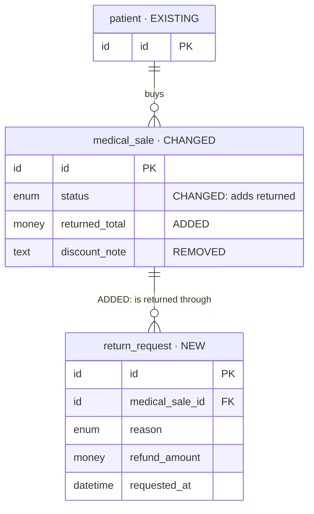
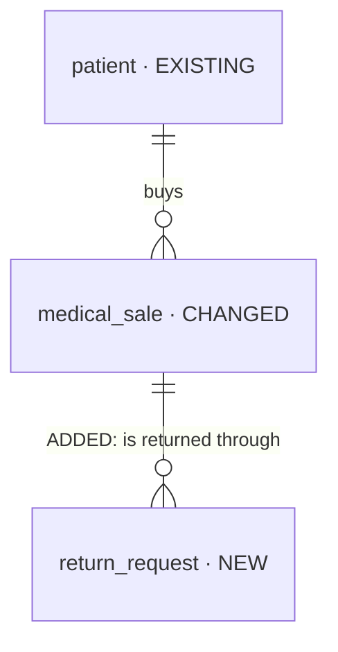

# Iteration planning (requirements from `iterations/<iteration>/`)

The first half of the iteration workflow. **This skill writes requirements; `be-kickoff-iteration`
turns them into a technical plan; the build comes after both.** Its output is
`iterations/<iteration>/plans/`, and a stop after every step.

The whole flow on one page: [`docs/design-workflow/process/README.md`](../../../docs/design-workflow/process/README.md).
The iteration rules (naming, Baseline, lifecycle): [`iterations/README.md`](../../../iterations/README.md).

## Principle — WHAT must be true, never HOW

Requirements and decisions only. A plan that names an implementation has decided something the
kickoff must decide against the code. **Never write:**

- SQL or DDL, physical column types, indexes, constraints
- endpoint paths, HTTP methods, status codes
- `src/` file paths, domain or sub-domain folder names
- queue, job, event or worker names

Write instead what must hold: who may do what, what is stored and for how long, what happens in
the background and when, who is told, what outside system is involved.

## Inputs and mode

| Input | Used for |
| --- | --- |
| `iterations/<iteration>/README.md` | Type, Owner, Opened, Branch, Baseline, Status |
| `iterations/<iteration>/PRD.md` | screens, flows, data, priorities, open questions |
| `iterations/<iteration>/schema-routes.md` | entities, enums, operations, routes the design implies |

- **Baseline `none` → MODE initial** (the launch): plan everything.
- **Any other Baseline → MODE incremental**: read the Baseline iteration and every iteration merged
  after it — with the launch they are the current state — and plan **only this iteration's
  changes**. The merged iterations, in merge order:

  ```bash
  git log main --reverse --diff-filter=A --name-only --format= -- 'iterations/*/README.md'
  ```

**Stop and tell the user** if an input is missing, the README has no Baseline, or a non-launch
iteration names Baseline `none`.

## Output — `iterations/<iteration>/plans/`

```text
plans/
├── product-plan.md          goal · in / out of scope · feature list + order · open AMBER items · definition of done
├── coverage.md              Coverage · Reconciliation · Overlap (incremental only)
├── decisions.md             add-only decision log
├── requirements/
│   ├── data.md              + the Mermaid data diagrams
│   ├── access.md
│   ├── operations.md
│   ├── background.md
│   ├── notifications.md
│   ├── realtime.md
│   ├── integrations.md
│   ├── files.md
│   └── quality.md
├── features/<feature>/story.md
└── acceptance.md
```

**`coverage.md` › Coverage** — one row per source item; planning is not done while any row is
`open`:

| Source (file:line) | Item | Requirement | Feature | Acceptance | Status |
| --- | --- | --- | --- | --- | --- |

Status is `open`, `covered`, or `out-of-scope` (with a link to the decision that put it there).

**`decisions.md`** — add-only; a changed mind is a new row that supersedes an old one, never an
edit:

| Question | Options | Decision | Date | Who | Kind |
| --- | --- | --- | --- | --- | --- |

Kind is `RED` (blocking, answered by the user) or `AMBER` (safe default, still open).
`be-kickoff-iteration` appends `TECH` rows.

**`requirements/`** — every file is present. A file that does not apply says
`n/a — <reason>`; it is never absent. Each requirement gets a dotted identifier —
`data.patient-scope`, `access.refund-approval`, `background.expiry-sweep` — which coverage rows
and stories cite.

| File | Answers |
| --- | --- |
| `data.md` | what is stored, owned by whom, related how, kept how long, removed how |
| `access.md` | which role may see or do what, scoped to what |
| `operations.md` | what users can do: create, change, cancel, approve, list, search, filter, sort |
| `background.md` | what happens without a user, and when |
| `notifications.md` | who is told what, through which channel, when |
| `realtime.md` | what must update on screen without a refresh |
| `integrations.md` | outside systems — payments, messaging, mail, storage |
| `files.md` | uploads, images, prints, exports |
| `quality.md` | audit, privacy, retention, limits, idempotency, performance expectations |

**`features/<feature>/story.md`** — one per feature, kebab-case folder:

```markdown
Status: draft | ready
Kind: screen | flow
Depends on: <features, or none>

## Stories
- As a <role> I want <capability> so that <outcome>.

## Rules
- <business rule> (requirement identifier)

## Acceptance criteria
- <observable result> — PRD.md:<line>

## Work items
- <requirement identifiers this feature delivers>
```

**`acceptance.md`** — one row per acceptance criterion; Result and Evidence stay empty until the
build:

| Item | Source | Result | Evidence |
| --- | --- | --- | --- |

## Data diagrams — Mermaid, inside `requirements/data.md`

- **One overview** `erDiagram`: entities and relationships, no fields.
- **One per feature**: the entities it touches, with fields.
- **Entity label**: `name["name · NEW|CHANGED|EXISTING|REMOVED"]`. `EXISTING` is context only.
- **Field comment**: `"ADDED"`, `"CHANGED: <what>"` or `"REMOVED"`. An unchanged field has no
  comment.
- **Relationship label** for a change: `"ADDED: <name>"` or `"REMOVED: <name>"`.
- **Logical types only**: `id`, `text`, `number`, `money`, `date`, `datetime`, `boolean`, `enum`,
  `json`, `file`.
- An existing or changed entity shows only its key, the changed fields, and the fields other
  entities reference.

Worked example — a pharmacy-returns change:



The overview for the same change:



## Procedure — stop after every step and wait

### Step 0 — Confirm the iteration, then stop until confirmed

Run `pnpm iteration:list` and show:

| Iteration | Type | Baseline | Status | Eligible | Why |
| --- | --- | --- | --- | --- | --- |

- Planning: eligible = Status planning.
- Kickoff: eligible = Status approved, not yet implementing, and Baseline none or done/frozen.

Recommend the earliest-opened eligible iteration (launch always comes first). If the user
named one, check it against the rule. Always ask the user to confirm (AskUserQuestion)
before Step 1 — never pick silently.

### Step 1 — Inventory, then stop

Read **every** input **in full** — no skimming, no grep-only. Draft `coverage.md` › Coverage with
one row per:

- PRD screen, flow, must-have and open question
- `schema-routes.md` entity, enum and operation

each with its `file:line`. Draft the overview diagram in `requirements/data.md`. Report the counts
(screens, flows, must-haves, open questions, entities, enums, operations, rows). **Stop.**

### Step 2 — Reconcile, then stop

List every PRD ↔ `schema-routes.md` mismatch in `coverage.md` › Reconciliation:

| # | Item | PRD says (file:line) | schema-routes says (file:line) | Verdict | Action |
| --- | --- | --- | --- | --- | --- |

No verdict without evidence on both sides — a verdict without a line number is an opinion.

Incremental: also compare the change with the current state, and fill `coverage.md` › Overlap with
every entity or operation that an iteration merged after the Baseline also changed. **Stop.**

### Step 3 — Blocking questions, then stop when every RED is answered

- **RED** — never guess: ownership, scope, lifecycle, who may do what, background timing,
  channels, realtime needs, outside systems. Ask with **AskUserQuestion**, at most 4 questions per
  call, one recommended option each, quoting the evidence (`file:line`).
- **AMBER** — a safe default exists: take it and log it as open.

Every question, RED or AMBER, goes in `decisions.md`. Update the diagrams with the answers.
**Stop when every RED is answered.**

### Step 4a — Requirements, then stop for approval

Write every `requirements/*.md` file (or its `n/a — <reason>`), with a dotted identifier per
requirement and the per-feature diagrams in `data.md`. **Stop for approval.**

### Step 4b — Features, then stop for approval

- **Screen features** own entities.
- **Flow features** (the PRD's end-to-end flows) come after the entities they involve.

Write the feature list and its order in `product-plan.md` and one `features/<feature>/story.md`
each, every acceptance criterion traced to a PRD line. **Stop for approval.**

### Step 5 — Self-check, then stop

Fix before presenting, never after:

- [ ] Every `coverage.md` row is `covered` or `out-of-scope`
- [ ] Every RED is answered in `decisions.md`
- [ ] Every open AMBER is listed in `product-plan.md`
- [ ] Every requirement identifier is used by at least one feature
- [ ] Every acceptance criterion traces to a PRD line
- [ ] The diagrams match `data.md` — every entity, field and relationship
- [ ] No technical design anywhere (see the Principle above)

Write `acceptance.md`, run `pnpm iteration:status <iteration> ready-for-approval` and **stop.**
On the user's go-ahead, run `pnpm iteration:status <iteration> approved` and log the approval in
`decisions.md` (who, when). Changes requested instead → the iteration stays `ready-for-approval`
while you revise, or goes back with `pnpm iteration:status <iteration> planning --reason "<why>"`.
Never edit the Status row by hand — the command checks the move and signs the README's History.
The next step is **`be-kickoff-iteration`**.

## Failure modes this skill exists to prevent

| Failure | Prevention here |
| --- | --- |
| A screen, flow or entity silently missing from the plan | Step 1 coverage rows |
| PRD and schema-routes disagree and the build picks one | Step 2 reconciliation with evidence |
| Guessed ownership, access or timing → rework | Step 3 RED gate |
| A plan that decides implementation before the code is read | the Principle; Step 5 check |
| An incremental plan that re-plans unchanged parts or misses an overlap | MODE incremental + Overlap |
| "Done" with nothing to verify against | `acceptance.md`, traced to PRD lines |

## Related

- **`be-kickoff-iteration`** — the technical half: `KICKOFF.md` and its ledger, after approval
- [`iteration-planning-prompt.md`](../../../docs/design-workflow/prompts/iteration-planning-prompt.md) — the paste prompt
- [`iterations/README.md`](../../../iterations/README.md) — the iteration rules; `pnpm iteration:new` opens one, `pnpm iteration:list` lists them
- [`requirement-intake.md`](../../../docs/getting-started/requirement-intake.md) — requirements that do not come from an iteration
