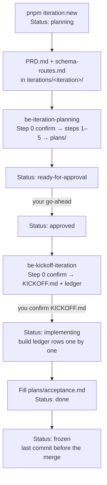

# Iteration → clinozy-be process

How a design iteration becomes built, verified backend work — requirements first, then a technical
plan, then one ledger row at a time. The iteration rules (naming, Baseline, lifecycle) are in
[iterations/README.md](../../../iterations/README.md).

## The flow

| Step | Who / what | Output | Stops for |
| --- | --- | --- | --- |
| Open | `pnpm iteration:new <type> [topic]` | the folder + README (`Status: planning`) | the opening questions ([guide](iteration-guide.md)) |
| Inputs | Claude Design (in clinozy-fe) | `PRD.md`, `schema-routes.md` copied byte-for-byte | — |
| Plan | **be-iteration-planning**, [prompt](../prompts/iteration-planning-prompt.md) | `plans/` — coverage, decisions, requirements, stories, acceptance; `Status: ready-for-approval` | which iteration (Step 0); every step; RED questions |
| Approve | you — `pnpm iteration:status <iteration> approved` | `Status: approved`, logged in `plans/decisions.md` | — |
| Kick off | **be-kickoff-iteration**, [prompt](../prompts/kickoff-iteration-prompt.md) | `KICKOFF.md` + ledger | which iteration (Step 0); every step; TECH questions |
| Build | one ledger row at a time | `Status: implementing` once you confirm `KICKOFF.md`; code, migrations, tests | each row |
| Accept | the build | `plans/acceptance.md` filled; `Status: done` | — |
| Freeze | the last commit before the merge | `Status: frozen`; never edited again | — |

## Rules that hold the flow together

- **Requirements before design.** The planning skill writes what must be true, never how — no
  SQL, endpoint paths, `src/` paths or queue names. The kickoff decides those against the code.
- **Confirm the iteration first (Step 0).** Both skills start with a `pnpm iteration:list` table of
  which iterations are eligible and why, recommend the earliest-opened eligible one (the launch
  always first) and wait for your confirmation — never pick silently. Planning takes `planning`
  iterations; a kickoff takes `approved` ones whose Baseline is `none` or `done`/`frozen`.
- **Schema first.** The kickoff plans tables, enums and the migration order before contracts and
  flows; foreign keys that break a cycle go last.
- **Every work item has a driver.** A NEW table is built with the
  [staged-build prompt](../../getting-started/staged-build-prompt.md); a CHANGE table, a flow or an
  async piece with `/be-build-requirement` ([requirement intake](../../getting-started/requirement-intake.md)).
- **Status moves through one command.** `pnpm iteration:status <iteration> <status>` allows one
  step forward at a time (or back to `planning` with `--reason`) and signs the README's History.
- **The ledger is the definition of done.** No success is reported while any row is open.
- **Agents never push, open a PR or merge.** You raise the PR.

Walking through it for the first time? The [step-by-step guide](iteration-guide.md) lists every
command and the questions to answer at each step, and `/be-iteration` walks it with you.

## Related

- Skills: [`be-iteration-planning`](../../../agent-os/skills/be-iteration-planning/SKILL.md) ·
  [`be-kickoff-iteration`](../../../agent-os/skills/be-kickoff-iteration/SKILL.md)
- Prompts: [iteration-planning-prompt.md](../prompts/iteration-planning-prompt.md) ·
  [kickoff-iteration-prompt.md](../prompts/kickoff-iteration-prompt.md)
- Building a table: [staged-build-prompt.md](../../getting-started/staged-build-prompt.md)
- Requirements outside an iteration: [requirement-intake.md](../../getting-started/requirement-intake.md)
- The iteration rules: [iterations/README.md](../../../iterations/README.md)
