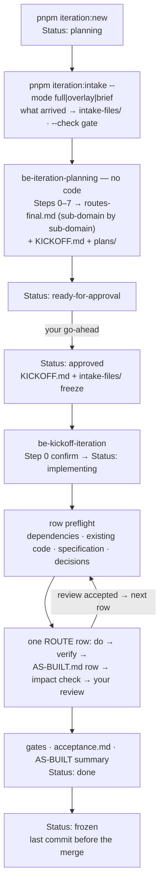

# Iteration → clinozy-be process

How a design iteration becomes built, verified backend work — two phases: **planning** writes the
plan (no code), **kickoff** implements it one ROUTE row at a time. The iteration rules (naming,
folder, Baseline, lifecycle — the lite one for a small `fix` included — commands) are in [iterations/README.md](../../../iterations/README.md);
every step with its questions is in the [step-by-step guide](iteration-guide.md).

## The flow

| Step | Who / what | Output | Stops for |
| --- | --- | --- | --- |
| Open | `pnpm iteration:new <type> [topic]` | the folder + README (`Status: planning`) | the opening questions ([guide](iteration-guide.md)) |
| Intake | `pnpm iteration:intake <iteration> <source> [--mode full\|overlay\|brief]` | what arrived in `intake-files/` (the snapshot resolves from it); the README's Drop, Intake and Schema-routes rows | a missing mandatory file; a different snapshot already there |
| Plan | **be-iteration-planning**, [prompt](../prompts/iteration-planning-prompt.md) | `plans/routes-final.md` (the route review, [template](routes-final-template.md)), `KICKOFF.md` (plan + ROUTE ledger) and `plans/`; `Status: ready-for-approval` | which iteration and Baseline (Step 0); every step; RED questions; your OK on each sub-domain of the route review |
| Approve | you — `pnpm iteration:status <iteration> approved` | `Status: approved`, logged in `plans/decisions.md` | — |
| Kick off | **be-kickoff-iteration**, [prompt](../prompts/kickoff-iteration-prompt.md) | `Status: implementing` | which iteration (Step 0) |
| Build | one ROUTE row at a time | code, migrations, tests; one `AS-BUILT.md` row each | your review after every row; any scope change |
| Close | the gates, `/be-pre-merge-review` (review only) | `plans/acceptance.md` filled, `AS-BUILT.md` summary, `plans/frontend-route-map.md` (`pnpm iteration:frontend-map`); `Status: done` | — |
| Freeze | the last commit before the merge | `Status: frozen`; never edited again | — |

## Document ownership — write once, reference elsewhere

Each document has a distinct purpose. Link to the relevant module, requirement, decision or
execution row instead of copying its details into several files.

| Document | Owns | Other documents should reference |
| --- | --- | --- |
| `intake-files/` | The received requirements snapshot, locked after approval | The source requirement; never rewrite the snapshot to match implementation |
| `plans/routes-final.md` | The approved module/sub-domain design and API contracts | Its module section; do not repeat contracts in `KICKOFF.md` or `AS-BUILT.md` |
| `KICKOFF.md` | Work order, dependencies, acceptance references and ROUTE status | The row number; implementation details belong in the specification or execution record |
| `plans/db-changes.md`, `route-changes.md`, `worker-changes.md` | Focused change views for database, routes and background work | Specification sections for design details; AS-BUILT rows for execution evidence |
| `plans/decisions.md` | Agreed decisions, including scope changes | The decision identifier; explanations are written here once |
| `AS-BUILT.md` | What each row actually built, technical decisions, deviations, verification evidence and standing deviations | Its row/section; avoid repeating an unchanged specification |
| `plans/acceptance.md` | Each criterion's result and evidence reference | The verification evidence in AS-BUILT; do not copy command logs |

During execution, keep the required change views current with concise final names and `Built`
references to AS-BUILT and the commit. Record a deviation's explanation once, then link to it.
An unchanged design needs a reference and a verified result, not another full description.
Approved specification changes still require agreement before implementation; these ownership
rules do not unfreeze the plan or alter the intake.

## Row execution and review

Before each row, check that its prerequisites are done, compare existing code with its approved
module specification, and identify unresolved decisions and affected tests. Implement the approved
row as a complete reviewable unit; do not silently split, combine or reorder ROUTE rows.

Run focused tests while building, then the row's acceptance checks, affected regression tests and
required validation before review. Include tenant isolation, permission denial, invalid transitions
and idempotency checks where applicable. Run the full closing gates at completion; focused checks
do not replace required gates or justify skipping a failed check.

Write the verification commands, outcomes and acceptance references once in the AS-BUILT row or
an adjacent verification section. Link to durable results when available; summarize logs and keep
credentials out of records. The user review contains the same concise information each time:

- What changed and which approved contracts it implements.
- Tests and acceptance outcomes, with a link to the recorded evidence.
- Deviations, unresolved issues and effects on upcoming rows.
- The next row after the user's review is accepted.

## Rules that hold the flow together

- **The snapshot is always full.** Whatever arrived — the whole drop (`full`), only the changed
  files (`overlay`) or only a written change (`brief`, a `BRIEF.md`) — `intake-files/` holds a full
  snapshot. An incremental delta is the designer's "What changed" notes plus
  `pnpm iteration:diff <baseline> <iteration>` (brief: `BRIEF.md`, and nothing else changed) — a diff
  of `intake-files/` only, so the Baseline's `intake-files/` is mandatory. Anything the diff shows
  that the notes omit is a finding.
- **The gate comes first.** Planning and kickoff run `pnpm iteration:intake <iteration> --check`
  before anything else and stop when it fails: a missing mandatory file or an Intake hash that no
  longer matches goes back to whoever placed the drop.
- **Deviations are carried forward.** `AS-BUILT.md` › Standing deviations lists where the code
  differs from the drop; the next iteration copies it and plans against what was actually built.
- **Baseline `none` unless the user names one.** Nothing suggests or asks for a Baseline; when the
  user says "build on <iteration>", it is recorded with `pnpm iteration:baseline`.
- **Confirm the iteration first.** Both skills start with a `pnpm iteration:list` table of which
  iterations are eligible and why, recommend the earliest-opened one (the launch always first), and
  wait for your confirmation — never pick silently.
- **Reviewable as it goes.** Planning keeps the database changes (`plans/db-changes.md`, drawn by
  the DB Viewer's plan mode), the proposed routes (`plans/route-changes.md`) and the background work
  (`plans/worker-changes.md`) current at every step, with before → after for anything that changes,
  and every step ends with a step review — what changed, the review links, continue or change — so
  nothing waits for a PR diff.
- **Planning is WHAT, never HOW — except the route review.** `KICKOFF.md` and `plans/` hold
  requirements and decisions — no SQL, endpoint paths (the proposals in `plans/route-changes.md` are
  the exception), `src/` paths or queue names. The design itself lives in one place,
  `plans/routes-final.md`: sub-domain by sub-domain, each confirmed by you before `KICKOFF.md` is written.
  Anything it leaves open is decided while the row is built and recorded in `AS-BUILT.md`.
- **Route review before the plan.** Planning Step 5 writes `plans/routes-final.md` from the
  [template](routes-final-template.md) — one folder per sub-domain, grouped by connection, twelve
  sections per sub-domain and eleven per nested sub-domain, a recommendation on every decision — and stops after
  each sub-domain for your OK. The ROUTE then builds those sub-domains in order.
- **Schema first.** The ROUTE runs tables (in dependency order) → features → background work →
  flows → acceptance; an incremental ROUTE runs schema changes first and never edits an existing
  migration.
- **A route review is built ditto.** Kickoff builds each sub-domain exactly as `plans/routes-final.md` says;
  where agent-os cannot, the row stops and asks, and the agreed change goes into the review first.
- **Every ROUTE row has a driver.** A NEW table goes through the
  [staged-build prompt](../../getting-started/staged-build-prompt.md); a CHANGE table, a flow or
  background work through `/be-build-requirement` ([requirement intake](../../getting-started/requirement-intake.md)).
- **Scope changes stop and ask.** A row added or removed, an acceptance changed or the order changed
  is recorded in `plans/decisions.md` and `AS-BUILT.md` only after you agree. `KICKOFF.md` itself is
  frozen at approval.
- **Status moves through one command** — `pnpm iteration:status`, one step at a time (or back to
  `planning` with `--reason`); it signs the README's History.
- **Agents never push, open a PR or merge.** You raise the PR.

## Related

- Skills: [`be-iteration-planning`](../../../agent-os/skills/be-iteration-planning/SKILL.md) ·
  [`be-kickoff-iteration`](../../../agent-os/skills/be-kickoff-iteration/SKILL.md)
- Prompts: [iteration-planning-prompt.md](../prompts/iteration-planning-prompt.md) ·
  [kickoff-iteration-prompt.md](../prompts/kickoff-iteration-prompt.md)
- Every step with its questions: [iteration-guide.md](iteration-guide.md) — `/be-iteration` walks it
- The route review's shape, with two invented sub-domains: [routes-final-template.md](routes-final-template.md)
- Building a NEW table: [staged-build-prompt.md](../../getting-started/staged-build-prompt.md)
- Requirements outside an iteration: [requirement-intake.md](../../getting-started/requirement-intake.md)
- The iteration rules: [iterations/README.md](../../../iterations/README.md)
