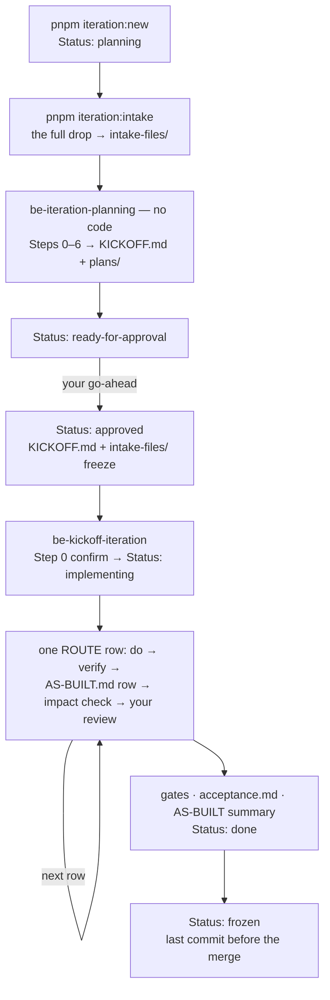

# Iteration → clinozy-be process

How a design iteration becomes built, verified backend work — two phases: **planning** writes the
plan (no code), **kickoff** implements it one ROUTE row at a time. The iteration rules (naming,
folder, Baseline, lifecycle, commands) are in [iterations/README.md](../../../iterations/README.md);
every step with its questions is in the [step-by-step guide](iteration-guide.md).

## The flow

| Step | Who / what | Output | Stops for |
| --- | --- | --- | --- |
| Open | `pnpm iteration:new <type> [topic]` | the folder + README (`Status: planning`) | the opening questions ([guide](iteration-guide.md)) |
| Intake | `pnpm iteration:intake <iteration> <source-folder>` | the full drop in `intake-files/`; the README's Drop rows | a missing required file; a conflict |
| Plan | **be-iteration-planning**, [prompt](../prompts/iteration-planning-prompt.md) | `KICKOFF.md` (plan + ROUTE ledger) and `plans/`; `Status: ready-for-approval` | which iteration and Baseline (Step 0); every step; RED questions |
| Approve | you — `pnpm iteration:status <iteration> approved` | `Status: approved`, logged in `plans/decisions.md` | — |
| Kick off | **be-kickoff-iteration**, [prompt](../prompts/kickoff-iteration-prompt.md) | `Status: implementing` | which iteration (Step 0) |
| Build | one ROUTE row at a time | code, migrations, tests; one `AS-BUILT.md` row each | your review after every row; any scope change |
| Close | the gates, `/be-pre-merge-review` (review only) | `plans/acceptance.md` filled, `AS-BUILT.md` summary; `Status: done` | — |
| Freeze | the last commit before the merge | `Status: frozen`; never edited again | — |

## Rules that hold the flow together

- **The drop is always full.** `intake-files/` holds the whole drop, exactly as delivered, in every
  iteration. An incremental delta is the designer's "What changed" notes plus
  `pnpm iteration:diff <baseline> <iteration>` — a diff of `intake-files/` only, so the Baseline's
  `intake-files/` is mandatory. Anything the diff shows that the notes omit is a finding.
- **The user confirms the Baseline.** Planning Step 0 suggests the latest `done` / `frozen`
  iteration in this repository; the user confirms it or picks another
  (`pnpm iteration:baseline`).
- **Confirm the iteration first.** Both skills start with a `pnpm iteration:list` table of which
  iterations are eligible and why, recommend the earliest-opened one (the launch always first), and
  wait for your confirmation — never pick silently.
- **Planning is WHAT, never HOW.** `KICKOFF.md` and `plans/` hold requirements and decisions — no
  SQL, endpoint paths, `src/` paths or queue names. Each row's technical design is decided while it
  is built and recorded in `AS-BUILT.md`.
- **Schema first.** The ROUTE runs tables (in dependency order) → features → background work →
  flows → acceptance; an incremental ROUTE runs schema changes first and never edits an existing
  migration.
- **Every ROUTE row has a driver.** A NEW table goes through the
  [staged-build prompt](../../getting-started/staged-build-prompt.md); a CHANGE table, a flow or
  background work through `/be-build-requirement` ([requirement intake](../../getting-started/requirement-intake.md)).
- **Scope changes stop and ask.** A row added or removed, an acceptance changed or the order changed
  is recorded in `plans/decisions.md` and `AS-BUILT.md` only after you agree. `KICKOFF.md` itself is
  frozen at approval.
- **Status moves through one command** — `pnpm iteration:status`, one step at a time (or back to
  `planning` with `--reason`); it signs the README's History.
- **Agents never push, open a PR or merge.** You raise the PR.

## Related

- Skills: [`be-iteration-planning`](../../../agent-os/skills/be-iteration-planning/SKILL.md) ·
  [`be-kickoff-iteration`](../../../agent-os/skills/be-kickoff-iteration/SKILL.md)
- Prompts: [iteration-planning-prompt.md](../prompts/iteration-planning-prompt.md) ·
  [kickoff-iteration-prompt.md](../prompts/kickoff-iteration-prompt.md)
- Every step with its questions: [iteration-guide.md](iteration-guide.md) — `/be-iteration` walks it
- Building a NEW table: [staged-build-prompt.md](../../getting-started/staged-build-prompt.md)
- Requirements outside an iteration: [requirement-intake.md](../../getting-started/requirement-intake.md)
- The iteration rules: [iterations/README.md](../../../iterations/README.md)
