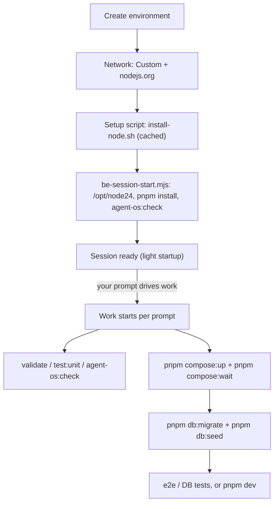

# Claude Code on the web — environment for clinozy-be

Use this when you run **[Claude Code on the web](https://code.claude.com/docs/en/claude-code-on-the-web)** (cloud sessions at claude.ai/code) against this repository. It describes the environment you must create so `pnpm install`, the validation gates, and the test suite work — and what to add when you need a database or live third-party calls.

The Cursor equivalent is [cursor-cloud-agent-environment.md](cursor-cloud-agent-environment.md); local human setup is [SETUP.md](../../SETUP.md).

---

## TL;DR — the environment to create

For day-to-day work (lint, typecheck, unit tests, and the `agent-os` / route / tsdoc gates):

| Lever | Value |
| ----- | ----- |
| **Network access** | **Custom** — keep the default allowlist and add `nodejs.org` |
| **Setup script** | `bash tooling/setup/agent/install-node.sh` |
| **Environment variables** | none required |
| **Runtime services** | none — static checks and unit tests need no database |

That makes `pnpm install` → `pnpm validate` / `pnpm test:unit` / `pnpm agent-os:check` / `pnpm routes:catalog:check` / `pnpm tsdoc:check` work. Add a database and env vars only for DB-bound tests (Tier 2), and third-party hosts only for live integrations (Tier 3).

---

## Why a setup script is required

The cloud image ships **Node 20, 21, and 22**; clinozy-be's `engines` require **Node 24+** (pinned in [`.nvmrc`](../../.nvmrc)). Node 24 is **not** pre-installed, so a setup script must install it. [`tooling/setup/agent/install-node.sh`](../../tooling/setup/agent/install-node.sh) installs the `.nvmrc` version into `/opt/node24` — the same layout the image uses and exactly where the [`be-session-start.mjs`](../../agent-os/hooks/be-session-start.mjs) hook looks — so the hook switches `PATH` to it and runs `pnpm install` automatically. The repo's Node version is unchanged.

The hook's switch reaches only the Bash tool, and only when the hook loads — a session that holds both repos loads none. So `install-node.sh` also links the pinned `node`, `npm`, `npx`, `corepack` and `pnpm` into `~/.local/bin`, which the image puts ahead of its own `/opt/node22/bin`: every shell runs Node 24, Claude Code's own process (the MCP servers) included. It links only when the `node` on `PATH` is the image's (`/opt/node<major>`), so a Node from nvm is left alone; `NODE_LINK_USER_BIN=0` turns it off.

When no Node 24 is on disk at session start (the Setup script is not configured, or its cache predates the pin), the hook runs `install-node.sh` itself before the dependency install — one `nodejs.org` download per fresh container — so the session still comes up on the pinned Node. The cached Setup script stays the faster path: it does the download once per environment instead of once per session.

---

## The four levers

Set these in the environment settings dialog (web UI). See the [configuration docs](https://code.claude.com/docs/en/claude-code-on-the-web#the-cloud-environment).

1. **Network access** — `None` / `Trusted` / `Full` / `Custom`. `Trusted` (the default) allows a built-in allowlist of registries, GitHub, and cloud SDKs.
2. **Environment variables** — `.env` format, one `KEY=value` per line, **no quotes**. Stored in the environment config and visible to anyone who can edit it (there is no secrets store), so use **test** keys, never live secrets.
3. **Setup script** — Bash, runs **as root before the session launches**, and its filesystem result is **cached** (it re-runs only when you change the script or the allowlist, or after roughly seven days). Use it for runtimes and system packages.
4. **Runtime services** — PostgreSQL and Redis are **pre-installed but not running**, and Docker is available. Setup-script *processes* do not persist (only the filesystem), so start services **per session**.

---

## Network access

The default **Trusted** allowlist already covers what `pnpm install` and image pulls need:

| Need | Host(s) already in Trusted |
| ---- | -------------------------- |
| pnpm / npm | `registry.npmjs.org` |
| Git / GitHub | `github.com` (plus the GitHub proxy) |
| S3 (uploads) | `*.amazonaws.com` |
| Docker images (Postgres / Redis) | `registry-1.docker.io` (Docker Hub) |
| Google OAuth | `accounts.google.com` |

Add the rest via **Custom** (tick "Also include default list of common package managers"):

- `nodejs.org` — **always**, for the Node 24 download in the setup script. Without it the install is blocked.
- Tier 3 only (live calls; contract tests mock these, so usually unnecessary): `api.stripe.com`, `api.resend.com`, `sentry.io` / `*.ingest.sentry.io`, `us.i.posthog.com` (PostHog events — blocked by default, so they are silently dropped).
- Agent tooling: `semgrep.dev` (`pnpm security:sast` downloads its `--config auto` rules), `context7.com` (the Context7 docs MCP), `openaipublic.blob.core.windows.net` (Headroom's tiktoken token counter downloads its vocabulary here).

> **Do not use `None`** — it blocks `pnpm install` entirely.

---

## Setup script

**One script for everything (shared with Cursor)** —
[`bootstrap.sh`](../../tooling/setup/agent/bootstrap.sh). In the Setup script field:

```bash
bash tooling/setup/agent/bootstrap.sh --install-only
```

`--install-only` runs steps 1–8 — Node 24 into `/opt/node24`, `pnpm install`, gh, the Docker
CLI + mirror + compose images, CodeGraph, Headroom + the default MCP pair, gitleaks, semgrep, k6, and the
`.env.local` scaffold — and stops before Docker, so the result is cached. In every web session the session-start hook
then runs the same script **without** the flag in the background — those steps again (fast: each
is idempotent and already at its pin), then the stack, fully live. See
[Session startup — the live playground](#session-startup--the-live-playground).

**Both repos in one environment.** The Setup script runs once for the environment, so name each repo's
script by its path — the clones sit side by side (in this setup `/home/user/clinozy-be` and
`/home/user/clinozy-fe`):

```bash
bash /home/user/clinozy-be/tooling/setup/agent/bootstrap.sh --install-only
bash /home/user/clinozy-fe/agent-os/cloud-environment/install.sh
```

clinozy-fe's script also builds its codegraph index; the first build takes about 2–3 minutes, later
runs only sync it.

Both scripts also register the session's hooks (`pnpm agent-os:session-hooks`,
[`tooling/agent-os/session-hooks.ts`](../../tooling/agent-os/session-hooks.ts)). A session that holds
both repos runs from `/home/user`, so it takes hooks from `/home/user/.claude/settings.json`, never from
a repo's own `.claude/settings.json`. The script writes there every hook of both repos, with absolute
paths and `CLAUDE_PROJECT_DIR` set to the hook's own repo, and both repos' permission rules (a
repo's own settings contribute none in that layout either). It keeps any other hook in that file and
backs the file up to `settings.json.bak` before a change, and `--dry-run` prints the file without
writing it. In a single-repo checkout it writes nothing.

- **Each repo's hooks judge only its own files.** clinozy-be's import, `NODE_ENV` and generated-file
  rules and clinozy-fe's Prettier pass never touch the other repo. The secret and destructive-command
  guards, and the ask on edits to hook wiring, still cover every path.
- **Check it in a new session (canary).** The session context has one "session ready" line per repo,
  each naming the root its hooks ran from (`clinozy-be session ready (hooks from /home/user/clinozy-be)`).
  `grep session-start /home/user/clinozy-*/agent-os/hooks/.telemetry.log` shows one row per repo.
  Whether a cloud session reads `/home/user/.claude/settings.json` is not documented, which is why
  the canary exists.
- **The live stack starts too.** Once hooks load, a two-repo session brings the stack up in the
  background like a single-repo one.

On the first session the cached Node 24 is already on disk, [`be-session-start.mjs`](../../agent-os/hooks/be-session-start.mjs) switches `PATH` to `/opt/node24`, and runs `pnpm install`. Do **not** start Postgres / Redis here — setup-script processes do not persist; start them per session (below).

**GitHub CLI (optional).** [`install-gh.sh`](../../tooling/setup/agent/install-gh.sh) adds `gh` as an in-session fallback for reading Actions logs, checking CI, and merging (the GitHub MCP tools already cover this). It belongs in the cached **setup script**, not `be-session-start.mjs` — a per-session `apt install` would not cache and would slow every startup. Set `GH_TOKEN` in the environment's **Variables** (least-privilege: `contents` + `pull_requests` + `actions:read`; env vars are not a secrets store). The script first installs the **github.com release binary** (reachable on the default Trusted allowlist, so no extra allowlist entry is normally needed); its `cli.github.com` apt-repo path is only a last resort.

**gitleaks (recommended if you commit).** The pre-commit guard's "Staged secrets scan" step shells out to `gitleaks protect --staged …` and hard-errors when the binary is missing, so a cloud session cannot commit until gitleaks is installed. The cloud image does not ship it. [`install-gitleaks.sh`](../../tooling/setup/agent/install-gitleaks.sh) installs the **github.com release binary** (reachable on the default Trusted allowlist), pinned to the same version as the CI `security-secrets` job. If that download fails it falls back to `go install` — which must use gitleaks's **legacy self-declared module path** `github.com/zricethezav/gitleaks/v8` (the current `github.com/gitleaks` repo path fails Go's module-path check).

**semgrep + k6 (optional).** [`install-semgrep.sh`](../../tooling/setup/agent/install-semgrep.sh) (via `uv`) makes `pnpm security:sast` runnable — the scan itself also needs `semgrep.dev` on the allowlist. [`install-k6.sh`](../../tooling/setup/agent/install-k6.sh) installs the **github.com release binary** for the `pnpm load:*` scenarios. Both install the version pinned in [`tool-versions.sh`](../../tooling/setup/agent/tool-versions.sh) — see [Tool versions](#tool-versions-pinned-checked-at-install).

**CodeGraph MCP on PATH.** The Claude Code process that launches MCP servers keeps the image `PATH`, which lacks `/opt/node24/bin`, so [`install-codegraph.sh`](../../tooling/setup/agent/install-codegraph.sh) links `codegraph` into `~/.local/bin` (on that `PATH`) — otherwise `codegraph serve --mcp` fails with `ENOENT` at session start.

### Tool versions (pinned, checked at install)

Every agent tool the bootstrap installs — `codegraph`, `headroom`, `semgrep`, `gitleaks`, `k6` — is pinned in **one file**, [`tooling/setup/agent/tool-versions.sh`](../../tooling/setup/agent/tool-versions.sh): plain `KEY=value` lines (a version, plus a SHA-256 per architecture for each downloaded binary). Node stays in `.nvmrc`, pnpm in `package.json` `packageManager`, Docker images in the compose files (Dependabot).

| Piece | What it does |
| ----- | ------------ |
| `install-*.sh` (via [`tool-install.lib.sh`](../../tooling/setup/agent/tool-install.lib.sh)) | **Moves the machine to the pin**: installs when missing, **reinstalls when the installed version differs** (a cached environment never freezes on an old version), and refuses a release download whose SHA-256 does not match. |
| CI ([`pr-ci.yml`](../../.github/workflows/pr-ci.yml), [`scheduled-k6-load-slo.yml`](../../.github/workflows/scheduled-k6-load-slo.yml)) | Appends the same file to `$GITHUB_ENV` and runs the same installers — CI and cloud sessions run identical versions, with no second copy to drift. |
| `pnpm tool:agent-tools --smoke --outdated` | Run by `bootstrap.sh` at **every install**: each tool vs its pin, the `.mcp.default.json` servers started for real (`initialize` + `tools/list`), and **which pins have a newer release** — with the paste-ready lines (version + checksums) to bump. Report only; it never upgrades. |
| Session-start banner | `tools 5/5 at pin`, or names the drifted tool (`k6 2.2.0≠2.3.0 — run bash tooling/setup/agent/install-k6.sh`). Local `--version` calls only. |
| [`agent-tool-versions.policy.unit.test.ts`](../../src/tests/unit/tooling/agent-tool-versions.policy.unit.test.ts) | Fails on an unpinned install, a hardcoded version, a missing checksum, or a tool added to one place but not the others. |

**Upgrade flow — what if something breaks?**

```text
bootstrap reports "⬆ k6 2.3.0 → 2.4.0 available" + the lines to paste
  → one-line PR to tool-versions.sh → CI installs and runs 2.4.0 → merge
  → every session moves to 2.4.0 on its next bootstrap
  → broken? revert the line → sessions move back on their next bootstrap
```

- **Nothing changes under you:** a tool moves only when its pin moves, and only through a reviewed PR that CI has exercised.
- **Trial before you bump:** set the key (and, for a binary, its `*_SHA256_*` keys) as **variables on a separate cloud environment** — an environment variable overrides the pin, so a canary session runs the new version with no commit. A version override without its checksum is refused.
- **Not pinned by this:** semgrep's `--config auto` / `p/default` rules come from the registry at scan time, so results can change on the same semgrep version.

---

## Environment variables

**A cloud session runs as `local` on development values — except the database and Redis.**

- **Do not set `NODE_ENV`.** Unset means `local`: the loader reads `.env.local` — created by
  `pnpm setup:local --only-env` in the Setup script, with generated JWT keys and
  `SECRETS_ENCRYPTION_KEY` and localhost `DATABASE_URL` / `DATABASE_MIGRATION_URL` / `REDIS_URL`
  for the compose Postgres + Redis — as its primary file **without** override, so the
  environment's **Variables** beat it. (With `NODE_ENV=development` the loader looks for
  `.env.development`, which a fresh clone lacks, then lays `.env.local` over the Variables with
  `override: true`: the session still runs as `local`, but loses the Variables.)
- **Set the development values as the environment's Variables** — every key from your
  `.env.development` except `NODE_ENV`, every `DATABASE_*_URL` (`DATABASE_URL`,
  `DATABASE_MIGRATION_URL`, `DATABASE_MAINTENANCE_URL`, `DATABASE_OPERATOR_URL`), `REDIS_URL` and
  `DATABASE_SSL_ENABLED` (those follow the session's own Postgres + Redis). `pnpm setup:local`
  (and so `bootstrap.sh`, with or without `--install-only`) stops when a Variable sets a `DATABASE_*_URL` that is
  remote or logs in as another role, or a remote `REDIS_URL` — the Variable would beat
  `.env.local` and point the session at the hosted database or Redis. Third-party keys
  (Resend, Stripe test mode, OAuth, S3, Sentry DSN, …) then match development. A blank `KEY=`
  placeholder in `.env.local` no longer deletes a Variable
  ([`load-env-files.ts`](../../src/shared/config/load-env-files.ts), pinned by
  `src/tests/unit/config/load-env-files.unit.test.ts`).
- **Running the frontend in the same session?** Keep `ALLOWED_ORIGINS` / `FRONTEND_URL` local
  (`http://localhost:5173`) instead of development's hosted origin, or the browser's requests to
  this API are refused.
- If development enables metrics, set `METRICS_SCRAPE_TOKEN` too (or `METRICS_ENABLED=false`).
- Never set the multi-line JWT PEMs as Variables — `setup:local` generates them. Environment
  Variables are not a secrets store: use test-mode, least-privilege credentials.

**Tests need none.** [`src/tests/setup.ts`](../../src/tests/setup.ts) bakes in test RS256 JWT PEMs
and sets every other value (`??=` or hard override), and
[`src/tests/global-setup.ts`](../../src/tests/global-setup.ts) forces `DATABASE_URL` to the local
Docker DB and prepares it the one way every database is set up (`src/scripts/ops/db-prepare.ts`:
create, migrate, the permission catalog, one database per test worker). So the full suite runs
with **only Postgres + Redis up**.

The full variable surface and how to obtain real values: [`.env.example`](../../.env.example) and
[credentials-and-env.md](credentials-and-env.md).

---

## Runtime services (Postgres, Redis)

Use the repo's compose scripts — the **same ones you run locally** — so the cloud session matches local exactly. Run per session (or from a SessionStart hook):

```bash
pnpm compose:up      # start Postgres + Redis (same as local)
pnpm compose:wait    # block until Postgres accepts connections
pnpm db:seed         # create, migrate, the database logins, the reference rows (or pnpm db:seed:full)
```

`pnpm compose:up` also starts the local SonarQube container unless you set `SONAR=0`. The cloud bring-up runs `SONAR=0 pnpm compose:up` (just Postgres + Redis) and starts SonarQube in the background once the stack is live (see [Session startup](#session-startup--the-live-playground)). Stop everything with `pnpm compose:down`.

> **Docker image pulls in the cloud.** Docker Hub serves image *blobs* from a CDN (`production.cloudfront.docker.com`) that is **not** on the default allowlist, so a bare `pnpm compose:up` fails with `403 Forbidden` while pulling `postgres:<v>-alpine` / `redis:<v>-alpine` (AWS ECR Public has the same `*.cloudfront.net` problem). Run [`install-docker-images.sh`](../../tooling/setup/agent/install-docker-images.sh) in the Setup script: it points the Docker daemon at Google's Docker Hub pull-through mirror (`https://mirror.gcr.io` — reachable on the default allowlist, byte-identical images / same digests) and pre-pulls the compose images, so `pnpm compose:up` runs the **same** pinned images you use locally with no compose changes. Alternatively add `production.cloudfront.docker.com` to the Custom network allowlist to pull straight from Docker Hub. Note Postgres **17+** is required by `pnpm db:migrate`, so the cloud image's native Postgres 16 is not a substitute.

**Restricted cloud Docker.** [`bootstrap.sh`](../../tooling/setup/agent/bootstrap.sh) calls the shared [`ensure-docker-daemon.sh`](../../tooling/setup/agent/ensure-docker-daemon.sh) helper before compose. If a cloud-agent container denies Docker bridge/NAT setup or overlay layer extraction, the helper falls back to restricted networking, then `vfs` storage when needed, and `bootstrap.sh` uses the shared [`docker-compose.cloud-agent.yml`](../../tooling/setup/agent/docker-compose.cloud-agent.yml) host-network override for Postgres + Redis.

---

### One-command bring-up + verify

The session-start hook runs this for you in every web session (below). To run it yourself — after `pnpm dev:stack:stop` — use the orchestrator; it logs a ✓/✗ after each step and records the running step for `pnpm dev:stack:status`:

```bash
bash tooling/setup/agent/bootstrap.sh        # setup → Postgres + Redis → migrate → demo seed → API + worker, left running
```

A re-run is safe: a lock stops a second bring-up from racing the first, and an API or worker that already answers is kept. A lock whose bring-up is gone — or that came from another boot inside a cached environment — is stale: `pnpm dev:stack:status` says so and the next run clears it ([`stack-lock.lib.sh`](../../tooling/setup/agent/stack-lock.lib.sh)). A live run after an install with the same inputs (the Setup script, or an earlier run in this container) skips steps 2–8, so it neither redoes the installs nor restarts dockerd; a changed input runs them again. Measured on 17 Oct on a resumed container (API and worker stopped, containers down, volumes kept): 82 s before these changes, 41 s on the first run after them (installs run, stamp written; warmer caches), 18 s once the stamp matches — with a stale lock planted whose pid named another process, which the old code waited on forever. To verify health on its own, run [`healthcheck.sh`](../../tooling/setup/agent/healthcheck.sh): it polls `GET /livez` then `GET /readyz` (set `HEALTHCHECK_URL=http://127.0.0.1:9090` for the worker) and exits non-zero unless Postgres + Redis + BullMQ are all reachable. Only `--install-only` belongs in the Setup-script *field* (that runs before any service can be running).

## Tiers — what to enable for which goal

| Tier | Goal | Network | Services | Env vars |
| ---- | ---- | ------- | -------- | -------- |
| **1** | Lint, typecheck, unit tests, the gates | Custom: defaults + `nodejs.org` | none | none |
| **2** | Full test suite (e2e / integration), migrations, seed | same | `pnpm compose:up` (Postgres + Redis) | none — tests self-provision |
| **3** | Run the app (`pnpm dev` / `pnpm dev:worker`) | same | `pnpm compose:up` | the boot block above |
| **4** | Live Stripe / Resend / S3 / Sentry calls | + their API hosts | + Postgres / Redis | + real test keys |

---

## Session startup — the live playground

A web session is a playground: it brings itself **fully live** before the work starts, without
delaying the session. [`be-session-start.mjs`](../../agent-os/hooks/be-session-start.mjs) runs on startup
and resume (not after `/clear` or a compact), runs `pnpm install` when dependencies are missing,
then launches `bootstrap.sh` **detached** before anything slow — the bring-up starts the Docker
daemon itself at [9], so the hook never waits for it — starts the `pnpm agent-os:check` gate and
the tool-pin probes in the background (the banner shows their last result), and returns:

```text
session starts → session-start hook (returns at once) → bootstrap.sh, detached
  [1] Node   [2–8] skipped when the install stamp matches (the Setup script ran them;
             [8] writes .env.local with TEST_MODE on, so the sign-in code screen fills itself in)
  [9] Docker daemon, then Postgres + Redis  [10] migrate + database logins
  [11] full demo seed, with the API and worker already starting alongside
  [12] API on :3000 — kept running   [13] worker, health on :9090 — kept running
  → "live" + the playground card (API, /reference, /admin/queues, worker, logs)
  → start-sonarqube.sh, detached: once the bring-up's lock clears, SonarQube for the pre-push gate
clinozy-fe in the same session → its own hook starts Vite on :5173 (pnpm dev), detached,
  and its own start-sonarqube.sh (the same script), which waits for the same lock
```

| You want | Do |
| -------- | -- |
| Follow it step by step | `tail -f /tmp/agent-stack/bootstrap.log`, or ask the agent to watch the stack |
| Follow the frontend | `tail -f /tmp/agent-stack/frontend.log`; stop it with `pkill -s "$(cat /tmp/agent-stack/frontend.pid)"` (the pid is its session's: Vite runs in another process group) |
| Sign in without the email | the code screen fills itself in: `TEST_MODE` is on in `.env.local`, so send-code echoes `debug_verification_code` |
| Know where it is | `pnpm dev:stack:status` — the running step (or `live`), API + worker `/livez` · `/readyz`, containers, logs |
| Stop the API + worker | `pnpm dev:stack:stop` (Postgres + Redis stay; `pnpm compose:down` stops them) |
| Bring it back | `bash tooling/setup/agent/bootstrap.sh` |
| A scratch database again | `pnpm dev:stack:reset-db` — drops and recreates the local Compose database, then migrate, logins, seed, API and worker (the installs are skipped) |
| A known demo password | set `DEMO_PASSWORD` in the environment's variables (`demo@example.com`) |
| Follow SonarQube | `tail -f /tmp/agent-stack/sonarqube-backend.log` (clinozy-fe's: `sonarqube-frontend.log`). [`start-sonarqube.sh`](../../tooling/setup/agent/start-sonarqube.sh) waits until no bring-up holds the lock and Docker answers, then starts the server, so the first push finds it up instead of waiting about two minutes. `SONAR=0` in the environment's variables skips it |

The banner shows `Stack: starting…` / `live` and tells the agent to wait for `live` before any
database or API work; `docker starting (bootstrap.sh starts it)` means the bring-up has the
daemon in hand. A resumed session whose API already answers, or a bring-up already
running, is left alone; a stale lock does not count as one, so a resumed container goes live
with no manual step. Local sessions are unchanged (`Stack: on demand`).

## How to tell a session is provisioned

The `be-session-start.mjs` banner (top of every session) leads with **`environment provisioned: yes|no`** — `yes` means the cached toolchain the Setup script builds (Node ≥ `.nvmrc` + installed deps) is live in this session. The same line reports `Node`, `deps`, `gh`, `codegraph`, `gitleaks`, `agent-os`, and `docker` status. Manual cross-checks: `node -v` (expect 24.x), `gh --version`, `ls /opt/node24`.

A `no` means the Setup script has not built this cache yet (e.g. Node still 22, deps missing) — configure the Setup script + `nodejs.org` allowlist, then start a fresh session.

## Setup flow



---

## clinozy-be gotchas

- **Node 24 is not pre-installed** — the setup script is mandatory; without it the session is stuck on Node 22 and `engines` rejects it.
- **`nodejs.org` is not in the default Trusted allowlist** — the most common miss.
- **Husky activates after `pnpm install`** (its `prepare` step), so a properly configured session gets the **same** pre-commit / pre-push gates as local — including the pre-commit SonarQube gate (mandatory, no bypass), which needs Docker for `pnpm sonar:up`: the gate starts SonarQube on first use, and starts the Docker daemon first when it is down; the Setup script pre-pulls the SonarQube and scanner images (about 1 GB) so the first commit that touches `src/` does not wait on the download. Before deps install (e.g. a session still on Node 22) Husky is inactive and commits skip the hooks.
- **Branch creates are allowed; branch deletes are not.** The git proxy accepts a push to any branch name, but refuses every form of branch delete. Rename the session's `claude/*` branch **before the first push** — see [be-git-branch-naming.mdc](../../agent-os/rules/be-git-branch-naming.mdc).

---

## GitHub prerequisites (and why creating a PR prompts)

A cloud session can touch GitHub only after the platform is **authorized** on this repo, and opening a PR is a deliberate, gated step — not something the agent does unprompted.

- **One-time authorization (the connect-GitHub prompt).** Install / authorize the platform's GitHub App or connector on `albetrios/clinozy-be` with **least-privilege** scopes — `contents` (read/write the working branch), `pull_requests` (open/update PRs), and `actions: read` (CI status / logs). Without it the session cannot fetch, push, or open a PR.
- **The branch name is yours to choose — but only before the first push.** The cloud git proxy does **not** pin a session to its assigned `claude/<slug>` branch: a push to any conventional `<type>/<slug>` name succeeds. What it does refuse is **deletes** — `git push --delete`, `git push :ref`, and `DELETE /git/refs/…` all fail (the last with `403 Write access to this GitHub API path is not permitted through this proxy`). A `claude/*` branch that has already been pushed therefore cannot be removed from inside the session; it disappears only when the PR squash-merges. Rename with `git branch -m <type>/<slug>` **before** pushing, per [be-git-branch-naming.mdc](../../agent-os/rules/be-git-branch-naming.mdc), which keeps `claude/*` allowlisted as the fallback.
- **"Create PR" asks first — by design.** Opening a pull request is an outward-facing action, so the agent won't do it unsolicited; it confirms first (Claude Code web uses the scoped **GitHub MCP** tools rather than `gh`). Ask explicitly when you want the PR opened, then drive CI to green per [trunk-based-workflow.md](../process/trunk-based-workflow.md).

---

## MCP servers

In Claude Code on the web the live MCP server set is loaded by the **platform at session start** from your account / environment MCP settings — **not** the repo's [`.mcp.json`](../../.mcp.example.json). Installing a server's CLI in-session (e.g. CodeGraph) does not make its tools appear until a fresh session starts with that server configured in the web UI.

The repo splits the MCP set into two tiers:

- **Default auto-start pair — `be-codegraph` + `be-headroom`** (committed in [`.mcp.default.json`](../../.mcp.default.json)). Two zero-config, agent-only servers (local CLIs, no token): CodeGraph (semantic code index) and Headroom (context compression). `pnpm setup:local` and the cloud bootstrap ([`install-codegraph.sh`](../../tooling/setup/agent/install-codegraph.sh) + [`install-headroom.sh`](../../tooling/setup/agent/install-headroom.sh)) install their CLIs and declare both in `.mcp.json`, so a session is useful with no setup.
- **On-demand set — everything else.** [`.mcp.example.json`](../../.mcp.example.json) (mirrored at [`agent-os/mcp/mcp.example.json`](../../agent-os/mcp/mcp.example.json)) lists the full set: `context7`, `clinozy-be:api`, `neon`, `sentry`, `railway`, `aws`, `stripe`, `semgrep`, `sonarqube`, `redis`, `postman`, `resend`, `codegraph`, `headroom`. Most need a provider token (put them in the environment **Variables**) and several need `uvx` / `docker`, so connect only the subset a task needs. Scaffold them into a local `.mcp.json` with **`pnpm mcp:setup`** — all, or a subset by name (`pnpm mcp:setup stripe sentry`); `pnpm mcp:setup:default` for just the pair, `pnpm mcp:setup --list` to see status. The full catalog (per-server runtime + token) is in [agentic-third-party-tooling.md](agentic-third-party-tooling.md#setting-up-mcp-locally-pnpm-mcpsetup).

### Configure the web environment (one-time, in the web UI)

Because the platform — not `.mcp.json` — drives a cloud session's MCP, set these in the environment's MCP settings:

1. **Add the default pair so they auto-connect every session:** `codegraph` (command `codegraph serve --mcp`) and `headroom` (command `headroom mcp serve`). Their CLIs are installed by the Setup script above, both in `~/.local/bin` (on the platform's `PATH`). Check them in-session with `pnpm tool:agent-tools --smoke` — it starts each server the way a client does and lists its tools.
2. **Add any on-demand server a task needs** from `.mcp.example.json`, supplying its token via the environment **Variables**.
3. **Do not add `Composio`, `Descript`, or `Slack`.** They are intentionally not part of this project's tooling — use `gh` / the GitHub MCP for GitHub, and keep any personal-account servers at the user level, separate from the repo. (See [agentic-third-party-tooling.md](agentic-third-party-tooling.md).)

## Related documentation

- [cursor-cloud-agent-environment.md](cursor-cloud-agent-environment.md) — the Cursor cloud-agent equivalent (`Dockerfile.agent`).
- [SETUP.md](../../SETUP.md) — local human setup, env vars, testing, CI/CD.
- [agent-os/hooks/README.md](../../agent-os/hooks/README.md) — the SessionStart hook and the other Claude Code hooks in this repo.
- [Claude Code on the web docs](https://code.claude.com/docs/en/claude-code-on-the-web) — setup scripts, network policies, environment caching.
