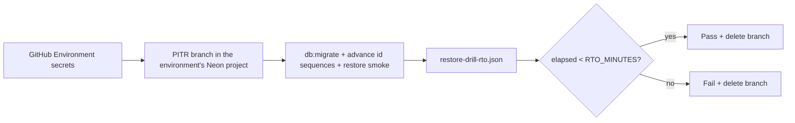

# Backup and restore drills

Operational procedure for monthly disaster-recovery verification. Targets align with [dr-runbook.md](dr-runbook.md): **RPO ≤ 15 minutes**, **RTO ≤ 1 hour** for API + worker availability.

The **[scheduled-monthly-restore-rto.yml](../../.github/workflows/scheduled-monthly-restore-rto.yml)** workflow runs on the **1st of each month** (06:00 UTC) and on **`workflow_dispatch`**. It is fully automated — no human input.

---

## RTO threshold (`RTO_MINUTES`)

| Setting | Default | Where |
| --- | --- | --- |
| `RTO_MINUTES` | `60` | Workflow `env` in [scheduled-monthly-restore-rto.yml](../../.github/workflows/scheduled-monthly-restore-rto.yml) |

Elapsed restore time must be **strictly less than** `RTO_MINUTES × 60` seconds. The workflow **fails** when elapsed time meets or exceeds the threshold.

---

## What gets measured (automated)

| Step | Automated action |
| ---- | ---------------- |
| **Parent branch** | The only branch of the resolved **GitHub Environment**'s Neon project (`main` → **`production`** → project `clinozy-be-production`, branch `production`; the drill runs from `main` only) |
| **Install** | Node, pnpm and dependencies — before the branch exists, so the copy of production lives only as long as the restore steps |
| **Branch create** | Child branch from that parent at **15-minute** PITR lookback; its id is recorded first, so the delete step finds it even if a later step fails |
| **Recovery** | `pnpm db:migrate` over the branch's **direct** endpoint (the migration advisory lock needs one backend), then `pnpm db:sequences:advance` (the [DR runbook](dr-runbook.md#advance-the-id-sequences-after-a-restore) step), then `pnpm db:restore:smoke` over the **pooled** endpoint, as in production: every migration applied, every table reads, the seeded reference rows (permission codes, plans) present, every id sequence past its ids, and a sign-in round trip on the booted app that must reach an organization with permissions — nothing deleted, no test suite (their setup truncates every table). The weekly restore smoke runs the same three |
| **RTO clock** | Starts at branch creation; ends after smoke passes |
| **Cleanup** | Ephemeral branch deleted; it also expires **1 hour** after creation |

Each GitHub Environment has its own Neon project, and every name derives from it: project `clinozy-be-<environment>`, branch `<environment>`, database `clinozy_be_<environment>`, and the drill branch logs in as the roles clinozy-infra provisions — `clinozy_be_migrator` (migrations and the smoke's checks), `clinozy_be_app` and `clinozy_be_maintenance` (the app) — never Neon's project owner. Nothing is named after a git branch or Neon's defaults.

**Public logs.** This repository is public, and so are its Actions logs. The drill branch is a full copy of production, so the drill keeps it out of them:

- The branch's URLs, password and endpoint are masked (`::add-mask::`) before any step can print them.
- `db:sequences:advance` prints every sequence's value — production's row counts — so the drill shows only its last line, how many sequences moved.
- The Neon API key is set only on the steps that call Neon (the secret check, create, delete), never job-wide where dependency install scripts and test code could read it.

---

## GitHub Environment secrets (required)

Set in `.env.development` / `.env.production` under the **GitHub Secrets** half and push with `pnpm github:sync` (see [credentials-and-env.md](../integrations/credentials-and-env.md)).

| Secret | Purpose |
| --- | --- |
| `MONTHLY_DATABASE_RESTORE_DRILL_NEON_API_KEY` | Neon API key — written by the infrastructure repository's setup; an **organization** key is preferred (with a personal key the drill looks up the key's only organization) |

Neon **project ID** is resolved automatically via the Neon API from the project name **`clinozy-be-<environment>`**. Single trunk: the workflow maps **`main` → `production`** (environment ≠ branch; there is no `dev` branch). Without the API key in the matching GitHub Environment, the monthly workflow **fails**.

---

## Artifacts and job summary

Open **Actions → Monthly backup restore & RTO drill**:

| Artifact                   | When                                              |
| -------------------------- | ------------------------------------------------- |
| `restore-drill-rto`        | Automated migrate + smoke completed               |
| `restore-drill-rto-report` | Consolidated JSON from **Record and publish RTO** |

Each JSON file includes `restore_seconds`, `rto_minutes`, `rto_target_seconds`, `parent_branch_name`, and `within_rto_target`.

---

## Acceptance

- Monthly scheduled run produces a measured RTO artifact using automated Neon PITR branch creation.
- Restore time is **recorded** in the workflow job summary and uploaded as JSON.
- Failed runs emit a workflow error notice and open (or comment on) a `ci-failure` issue — *Monthly restore drill failing* or *Weekly restore smoke failing*; the next green run of the same drill closes it.

Related: [restore-drill.md](../deployment/restore-drill.md), [dr-runbook.md](dr-runbook.md), [credentials-and-env.md](../integrations/credentials-and-env.md).
