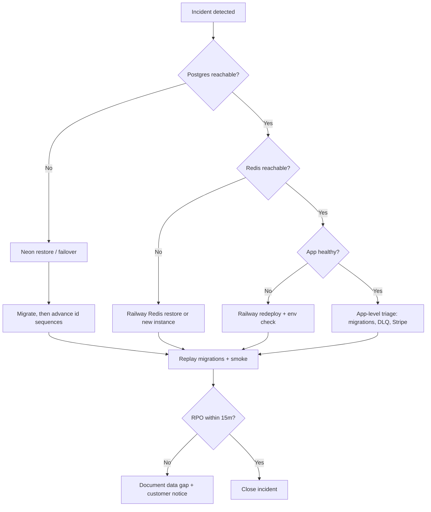

# Disaster recovery runbook

Targets for **clinozy-be** API and worker on Railway with Neon Postgres and Railway Redis (provisioned from Railway's `redis` database template).

| Metric                   | Target         | Notes                                                      |
| ------------------------ | -------------- | ---------------------------------------------------------- |
| **RTO** (recovery time)  | **1 hour**     | Restore service availability for authenticated API traffic |
| **RPO** (recovery point) | **15 minutes** | Maximum acceptable data loss window                        |

Neon point-in-time recovery (PITR) and Railway redeploys are the primary mechanisms. This runbook assumes backups and secrets are already provisioned per [cicd-and-deployment.md](../deployment/ci-cd/cicd-and-deployment.md).

---

## When to invoke

- Regional or provider outage affecting Neon, Railway Redis, or Railway
- Accidental destructive migration or data corruption confirmed in Postgres
- Complete loss of the production API or worker service with no healthy `/readyz`

---

## Roles and communication

1. **Incident lead** — coordinates timeline, RTO/RPO tracking, and customer comms.
2. **Platform** — Neon branch restore, Railway redeploy, env/secrets verification.
3. **Application** — migration replay, seed smoke, `pnpm test:api-smoke` against restored stack.

Post status updates in the team channel every **15 minutes** until RTO is met or scope is escalated.

---

## Decision tree



---

## Recovery procedures

### 1. Postgres (Neon) — RPO ≤ 15 minutes

1. Open Neon console → project **`clinozy-be-production`** → branch **`production`** → **Restore** to a point **≤ 15 minutes** before failure (history is kept 7 days). `production` is a **protected** branch, which blocks resets — turn protection off for the restore and back on straight after. An in-place restore keeps the host and database (`clinozy_be_production`), and the users' passwords are those at the restore point (unchanged unless rotated since), so the existing `DATABASE_*_URL`s keep working.
2. Only if you restored into a **new branch** instead: a branch created from a protected branch gets **new passwords** for every role, so take its URLs from Neon (`neonctl connection-string <branch> --project-id <id> --role-name <user>`), not from `.env.production` — then update `DATABASE_URL`, `DATABASE_MAINTENANCE_URL` and `DATABASE_MIGRATION_URL` in Railway (API + worker) and GitHub (`pnpm github:sync`).
3. Run `pnpm db:migrate` against the restored database (idempotent; fixes schema drift).
4. **Advance the id sequences** ([below](#advance-the-id-sequences-after-a-restore)) before the API and worker serve traffic on the restored database — if they kept running through the restore, do it straight away.
5. Check the restored database as the migration role (`clinozy_be_migrator`, which bypasses row-level security): `DATABASE_MIGRATION_URL=<restored database URL as clinozy_be_migrator> pnpm db:restore:smoke --database-only` — every migration applied, every table reads, the reference rows every deploy seeds (permission codes, plans) present, every id sequence past its ids. The drills run the same checks plus a sign-in round trip on their throwaway copy; `--database-only` leaves the live database without a drill user.
6. Verify row counts on critical tables (`tenancy.organizations`, `billing.subscriptions`, `auth.sessions`).

#### Advance the id sequences after a restore

A restore rewinds every table's id counter along with its rows, so the database would hand out again the ids it issued between the restore point and the incident. Logs do not rewind, and they still hold some of those ids:

| Where | What still holds an id from the lost window |
| ----- | ------------------------------------------- |
| Logs  | The audit-outbox and dead-letter ledger row ids their workers log (internal work tables, no public id) |

A reissued id points those at a different row: a log line about one outbox row reads as another's. Everything else logs public ids — users, organizations, audit rows, sessions, jobs — and Sentry events carry the public user and organization ids. Queued jobs, their job ids, post-commit dispatch tasks, the Redis auth counters (MFA failures, TOTP replay marks, email-code attempts) and the S3 audit exports are not at risk — they carry public ids or the mail row's random token, never a row id — and neither are keys sent to other services (Resend idempotency keys, email markers, audit export paths): a restore brings all of those back unchanged.

Jump every sequence far past anything issued before the incident. Ids are `bigint`, so a jump of one billion costs nothing and covers any lost window. Run this once, over the same connection `pnpm db:migrate` used in step 3 (`DATABASE_MIGRATION_URL` — the role that owns the sequences):

```bash
DATABASE_MIGRATION_URL=<restored database URL> pnpm db:sequences:advance
```

It prints one `<sequence>: old -> new` line per sequence — keep them in the incident record — and refuses to run when the role cannot read a sequence. Sequence changes are not transactional, and the command only moves values forward, so running it twice just jumps again, which is harmless. The monthly and weekly [restore drills](backup-drills.md) run the same command right after migrating, so it is exercised against a real restore.

The Redis key prefix (`<project>:<environment>:`) does not change on a restore, which is why the old jobs and counters are still there. After the worker restarts, a notification or mail job whose row was lost in the window completes as skipped (`notification.worker.not_found`, `mail.worker.not_found` at warn); a webhook delivery whose attempt row was lost completes as skipped too (`webhook.delivery.attempt_missing` at warn).

### 2. Redis (Railway Redis database)

1. If Redis is unavailable, provision or restore the Redis instance — or both, when queues have their own (see [redis-topology.md](../deployment/runbooks/redis-topology.md)).
2. Update `REDIS_URL` on API and worker services, and `REDIS_BULLMQ_URL` too when queues run on a dedicated instance (the recommended production topology); unset, BullMQ uses `REDIS_URL`.
3. Expect **cold** permission cache, idempotency keys, and session token cache — traffic may be slower until caches warm.
4. Inspect DLQ depth after workers restart ([dlq-runbook.md](dlq-runbook.md)).

### 3. Application (Railway)

1. Redeploy latest known-good image from `main` (or previous green deployment).
2. Confirm secrets: `JWT_*`, `STRIPE_*`, `SENTRY_DSN`, `ALLOWED_ORIGINS`, `DATABASE_URL`, `REDIS_URL`, `DEPLOYMENT_TOTAL_REPLICA_COUNT`.
3. Scale workers to normal count ([worker-scaling.md](../deployment/runbooks/worker-scaling.md)).
4. Hit `GET /readyz` until 200 with all dependencies available.

### 4. Validation (before closing)

| Check                 | Command / endpoint                                                                                                             |
| --------------------- | ------------------------------------------------------------------------------------------------------------------------------ |
| Migrations            | `pnpm db:migrate`                                                                                                              |
| Local gate (optional) | `pnpm verify:base` with restored URLs in `.env`                                                                                |
| Deployed smoke        | `SMOKE_BASE_URL=… pnpm test:api-smoke`                                                                                         |
| Stripe webhooks       | Reconcile stuck events — [stripe-subscription-reconciliation.md](../deployment/runbooks/stripe-subscription-reconciliation.md) |

---

## Post-incident

1. Record actual RTO/RPO achieved and root cause.
2. Open follow-up tasks for prevention (monitoring, migration guards, backup drill).
3. Log outcomes in the [quarterly review log](#quarterly-review-log) when the next scheduled review runs.

---

## Quarterly review log

Review this runbook at the start of each calendar quarter (January, April, July, October). Confirm RTO/RPO targets, Neon/Railway Redis/Railway steps, and cross-links still match production. Run or schedule the [monthly restore drill](backup-drills.md) in the same quarter when possible; the workflow records restore duration and fails when elapsed time is not below **`RTO_MINUTES`** (default 60).

| Quarter | Reviewer                    | Review date | Outcome | Notes                                                                                                    |
| ------- | --------------------------- | ----------- | ------- | -------------------------------------------------------------------------------------------------------- |
| 2026-Q2 | Production readiness verify | 2026-05-20  | Passed  | Linked from [docs/README.md](../README.md); procedures aligned with restore drill and migrations reference |

---

## Related

- [docs/README.md](../README.md) — documentation index (links here)
- [backup-drills.md](backup-drills.md) — monthly automated restore drill (`MONTHLY_DATABASE_RESTORE_DRILL_NEON_API_KEY`; one Neon project per environment, `clinozy-be-<environment>`, found by name; parent branch = its `<environment>` branch)
- [restore-drill.md](../deployment/restore-drill.md) — workflow secrets and CI artifact names
- [cicd-and-deployment.md](../deployment/ci-cd/cicd-and-deployment.md) — deploy and secrets
- [production-go-live.md](../deployment/runbooks/production-go-live.md) — production promotion
- [observability.md](../deployment/runbooks/observability.md) — Sentry and health signals
- [dlq-runbook.md](dlq-runbook.md) — queue recovery after Redis/worker outage
