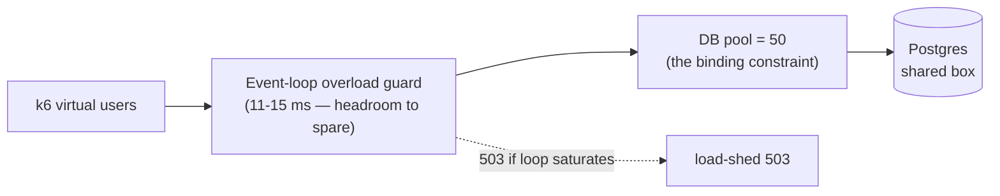

# Scalability & capacity

Measured capacity envelope of a single clinozy-be instance, where the throughput
ceiling comes from, and how to scale past it. Numbers are from the escalating
load + stress ladder (`comprehensive-journey` k6 scenario, 180 s/level, against a
single instance with `POSTGRES_MAX_CONNECTIONS`-backed pool = 50). Re-run the
ladder with [load-testing](../testing/load-testing.md) whenever the pool size,
instance count, or DB tier changes.

## Measured capacity (single instance)

| Virtual users | Throughput  | p95 latency | Event-loop lag | Server 5xx |
| ------------- | ----------- | ----------- | -------------- | ---------- |
| 100           | 718 req/s   | 57 ms       | 11 ms          | **0**      |
| 200           | 986 req/s   | 212 ms      | 13 ms          | **0**      |
| 300           | 959 req/s   | 492 ms      | 13 ms          | **0**      |
| 400           | 1,026 req/s | 611 ms      | 15 ms          | **0**      |

A warmer single-endpoint run has peaked at **1,104 req/s @ p95 176 ms**. Treat
**~1,000 req/s** as the steady-state ceiling for one instance on the reference box.

Read the curve, not the peak:

- **Throughput plateaus at ~200 VU.** Beyond it, adding load does not add
  req/s — it only adds latency (p95 57 → 611 ms from 100 → 400 VU). The instance
  is saturated, requests queue, and they drain in order.
- **The event loop never saturates** (11–15 ms at every level). The ceiling is
  **not** CPU- or event-loop-bound — so the [load-shed valve](#the-load-shed-valve)
  never fires and there are **zero server 5xx** at any level.
- **`http_req_failed` sits flat at ~13.8%** across all levels. That is **not**
  capacity failure: it is the per-organization write cap (100 writes/min/organization)
  returning `429`, which is workload-proportional and therefore constant as a
  fraction of a journey. Write-cap `429`s are rejected before route-level metrics,
  so they do not appear in `http_request_duration_seconds`.

## Where the ceiling is

The binding constraint is the **database**: the connection pool (50) and
Postgres throughput on the shared box, not the Node process. The app layer has
headroom (idle event loop) it cannot use because every journey is DB-bound.

This is confirmed by the **single-instance-vs-cluster** experiment: 8 replicas at
400 VU delivered **486 req/s — worse than one instance's 1,104** — and shed
**4,908 × 503** from the overload guard, because N replicas oversubscribed the
shared box's CPU while all contending for the same Postgres. **Horizontal API
scaling only pays off with a dedicated, independently-scaled DB tier.** On a
single box, more API processes make it slower.

## The load-shed valve

`overload-guard.middleware.ts` returns `503` with `Retry-After: 1` when
event-loop lag crosses its threshold, when in-flight database units of work reach
`ceil(DATABASE_POOL_MAX × OVERLOAD_DB_POOL_SHED_RATIO)`, or when the oldest unit
of work still waiting for a connection has waited `OVERLOAD_DB_ACQUIRE_WAIT_SHED_MS`
(default 2 s). The default ratio is ten; the count includes every pooled unit of
work — organization, user-only, session, maintenance and `withTransaction` —
waiting for a connection as well as running. The wait condition covers a slow
database: holds of seconds keep the queue short but undrained, so the ratio never
trips while each waiter would otherwise fail slowly at
`DATABASE_POOL_ACQUIRE_TIMEOUT_MS`. Liveness, readiness and metrics paths bypass
this guard.

The default pool of 30 therefore admits 300 in-flight units of work: a
synchronized burst of 240 distinct users queues for a connection (bounded by
`DATABASE_POOL_ACQUIRE_TIMEOUT_MS`) instead of receiving
`database_pool_overload` 503s. The previous default of three (90 units) shed part
of such a burst even with latency inside the SLO. Lower the ratio to fail fast
earlier under sustained overload; keep acquisition timeouts and event-loop
shedding enabled either way.

The API also opens its whole pool before it starts listening
(`primeDatabasePool()` in `server.ts`, best-effort: during a rolling deploy at `max_connections` the
connections that open stay, a warning names the rest, and only a database that accepts none fails
the boot), so a freshly started process does not pay
every connection handshake under its first burst.

The structured `request.service_unavailable` log identifies the triggering signal
as `event_loop_overload`, `database_pool_overload` or `database_pool_wait_overload`
in its `reason` field. When several cross their thresholds, they take precedence in
that order. Internal
reasons remain absent from the HTTP error body. A calm event loop therefore does
not rule out deliberate database-pressure shedding. Compare checkout pressure,
transaction duration and PostgreSQL activity before diagnosing the bottleneck;
the connection gauge named `waiting` is not an application pool queue count.

In the historical single-instance ladder the event-loop valve **never fired**;
in the oversubscribed cluster it fired ~4,900 times. See
[degraded-mode-runbook](degraded-mode-runbook.md).

## Statement planning on direct database connections

Drizzle's node-postgres session sends every statement unnamed: Postgres parses and plans it on each
execution and keeps nothing prepared between checkouts, so a transaction-mode pooler (Neon's
`-pooler` host) can serve the pool unchanged.
[`prepared-statements.integration.test.ts`](../../../src/tests/integration/database/prepared-statements.integration.test.ts)
checks that no prepared statement is left behind and that every statement in a transaction reads its
own transaction-local organization setting. Do not force PostgreSQL's `plan_cache_mode` globally:
parameter-sensitive queries may need custom plans.

## Concurrency correctness under stress

The ladder doubles as a concurrency soak. At 400 VU > pool size, delete-then-insert
and concurrent-create paths race their unique indexes (Postgres `23505`):

- **`PUT /users/me/notification-preferences`** — the replace-all cascade is now
  serialized per user with a transaction-scoped `pg_advisory_xact_lock`, so it
  held at **0 new `23505` 5xx** through the whole ladder.
- The other **24 `23505`s** observed during the run are concurrent-create races
  on idempotent paths (organization / session / MFA bootstrap) — every one is caught and
  resolved to 2xx success statuses. Recorded route statuses across the ladder were
  **success-only** (run predates the uniform-200 policy).

## Scaling past one instance

1. **Give Postgres its own tier.** The single-box ceiling is DB contention.
   A managed/dedicated Postgres (more cores, more IOPS) raises the ceiling before
   any API replica helps.
2. **Then add API replicas** behind the LB, each with a pool sized so
   `replicas × pool ≤ Postgres max_connections` (minus headroom). The pool is the
   throttle — oversizing it just moves contention into Postgres.
3. **Keep the per-organization write cap** — it is the fairness valve that kept
   `http_req_failed` proportional rather than letting one tenant starve the pool.
4. **Watch the event loop, not just throughput.** A rising `503` rate from the
   overload guard means the API tier is CPU-starved; a rising p95 with a calm loop
   means the DB tier is the limit. They have different fixes.

## Hardening follow-ups

| Item | Status |
| ---- | ------ |
| Index attribution FK columns (online user-delete cost) | **Done** — `migrations/20260623000000_attribution_fk_indexes.sql` |
| Index the remaining FKs (organization purge scanned `auth.sessions`; user purge scanned `webauthn_credentials`) | **Done** — `migrations/20260923152433_index_uncovered_foreign_keys.sql` |
| Retire redundant prefix indexes (four on `audit.logs` alone, maintained on every audit write) | **Done** — `migrations/20260923130000_drop_redundant_prefix_indexes.sql` |
| Keep both true | **Gated** — `src/tests/integration/database/index-hygiene.integration.test.ts` fails on an FK without a usable index, or a B-tree index that leads another |
| Centralize the per-worker `stalled` listener into `attachDeadLetterAndAlerting` | Proposed — 33 workers each attach identical boilerplate; centralizing makes it structural but changes log-event tags (`*.stalled` → `queue.job.stalled`), so it wants owner review |
| Partition `audit.logs` + `webhook_delivery_attempts` by time | Proposed — high-volume append tables; range partitioning keeps retention deletes and recent-window reads cheap at scale (owner decision: ops project) |

See also: [load-testing](../testing/load-testing.md) ·
[health-checks](health-checks.md) ·
[external-service-resilience](external-service-resilience.md) ·
[chaos-testing](chaos-testing.md)
