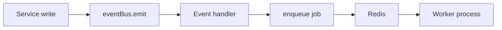

# Domain events and BullMQ workers

Event bus (in-process) and BullMQ workers (durable) are **not the same thing**. Mixing them up is the most common architectural mistake on this codebase.

Adding or changing a queue, worker, cron or sweep? Every rule — with the test that enforces it — is on one page: [queue-and-worker-rules.md](queue-and-worker-rules.md). This page explains the mechanisms behind them.

---

## Comparison

|                  | Event bus (in-process)                                            | BullMQ workers (durable)                                   |
| ---------------- | ----------------------------------------------------------------- | ---------------------------------------------------------- |
| **Where**        | `src/core/events/event-bus.ts`                                    | `src/infrastructure/queue/bootstrap.ts`, `pnpm dev:worker` |
| **When**         | Immediately after a successful service write                      | Async, retried, in a separate worker process               |
| **Runs in**      | API process                                                       | Worker process                                             |
| **Failure mode** | Handler enqueues side effects; **must not fail the HTTP request** | Retries → DLQ                                              |

**Typical flow:** `service` → `eventBus.emit` → handler → `recordOutboxEmail()` (+ `dispatchOutboxEmail()` on commit) → mail worker.

Workers and scripts (no HTTP request) call `recordOutboxEmail()` + `dispatchOutboxEmail()` directly — see [Post-commit enqueue](#post-commit-enqueue-transactional-outbox).



---

## Registration (two paths — bootstrap order matters)

1. **`buildApp()` → `registerEventHandlers()`** ([`register-event-handlers.ts`](../../../src/core/events/register-event-handlers.ts)) **before** routes. Handlers that only need `recordOutboxEmail()` or have no container deps (auth + tenancy email handlers).
2. **`registerRoutes()` → [`domain-containers.plugin.ts`](../../../src/domains/domain-containers.plugin.ts) → `createNotifyContainer()`**. Handlers that need repositories from DI (notify handlers today).

**Rule:** No container deps → path 1. Needs a repository from the composition root → path 2.

### Registrar reference

| Registrar                               | Example event types                                                   | Side effect             |
| --------------------------------------- | --------------------------------------------------------------------- | ----------------------- |
| `registerAuthMethodEventHandlers`       | `AUTH_EVENT.EMAIL_VERIFICATION_CODE_REQUESTED`, password reset, email verification | Mail queue              |
| `registerMemberInvitationEventHandlers` | `MEMBER_INVITATION_EVENT.CREATED`, `RESENT`                           | Mail queue              |
| `registerNotifyEventHandlers`           | `NOTIFY_EVENT.WEBHOOK_DELIVERY_REQUESTED`                             | BullMQ webhook delivery |
| `registerNotifyEventHandlers`           | `ORGANIZATION_EVENT.*`, `MEMBERSHIP_EVENT.*`, `SUBSCRIPTION_EVENT.*`   | PENDING webhook delivery attempts (organization-resource-webhook-flow) |

Billing side effects otherwise use BullMQ directly (for example [`stripe-webhook`](../../../src/domains/billing/sub-domains/stripe-webhook/)); its only domain events are `SUBSCRIPTION_EVENT.*`, and there is no top-level `billing/events/` aggregator.

Every unit of work releases its after-commit tasks only when it commits (`runInCommitUnit`, `src/core/events/on-commit-scope.ts`, wrapping each pooled transaction and `withSavepoint`): over HTTP into the request's `onResponse` flush, in a worker right after the commit, and never when it rolls back — so a delivery job never starts before its attempt row exists, and never for one that was rolled back.

---

## Core pattern

- **Services emit domain events** (in-process) after successful DB writes.
- **Event handlers enqueue BullMQ jobs** for side effects.
- **Workers process jobs** (pull-based) and interact with integrations/DB as needed.

Event handler failure must **not** fail the HTTP request (log and continue).

### Request id propagation

HTTP handlers pass `getRequestIdentifier(request)` into services as `context.requestId`. Services attach it when emitting:

```typescript
await eventBus.emit(buildDomainEvent({ type: EVENT_TYPE, payload, options: { requestId: context?.requestId } }));
```

Event handlers read `event.requestId` and pass it to `recordOutboxEmail()`, `enqueueNotification()`, `enqueueWebhookDelivery()`, etc. Job payloads store `requestId` (Zod-validated); workers log it on `mail.worker.processing` and **`email.sent`** so worker logs correlate with API `request.complete` (`requestId` field).

### Post-commit enqueue (transactional outbox)

When a handler runs inside an HTTP request, BullMQ enqueue helpers are scheduled with **`eventBus.onCommit(...)`** and run only after **`eventBus.flushOnCommit()`** in [`request-lifecycle.middleware.ts`](../../../src/shared/middlewares/core/request-lifecycle.middleware.ts) (once the response is sent — or, when the client left first, once the handler has finished). Mail uses a durable outbox row plus deferred `dispatchOutboxEmail`; webhook delivery, notification dispatch, and user-data export defer `queue.add` the same way. Outside HTTP scope (workers, scripts), use **`runEnqueueAfterCommit()`** from [`event-bus.ts`](../../../src/core/events/event-bus.ts) — it enqueues immediately when no onCommit scope is active.

Durable `scheduleCommitDispatch` tasks are appended to Redis at emit time (before commit) and recovered by the `commit-dispatch-recovery` sweeper if the process dies after commit. **On rollback / settle-failed**, `request-lifecycle.middleware.ts` calls **`eventBus.discardCommitDispatchOnRollback()`**, which purges both the in-memory marker and the durable Redis tasks (`purgeCommitDispatchTasks`) — the referenced rows were rolled back, so leaving the tasks would let the sweeper replay them against **phantom rows**, burning the worker retry budget and raising false final-failure DLQ alerts (audit-#M2). As a second line of defence, the mail and notification workers complete a job whose row is missing as **skipped** (warn log) rather than retrying it.

### When Redis refuses the enqueue

Producers fail fast while Redis is unreachable or full (`noeviction` rejects writes): the enqueue throws instead of buffering. What happens to the work then depends on whether a Postgres row already holds it — the row is the outbox, and a sweep re-enqueues rows whose job never arrived:

| Work | Held in Postgres | Recovered by |
| --- | --- | --- |
| Email | `auth.mail_outbox` row | `mail-outbox-sweeper` — re-enqueues `pending` rows older than `MAIL_OUTBOX_SWEEP_PENDING_MINUTES` (3), every 2 min |
| Stripe event | `billing.stripe_webhook_events` ledger row | `stripe-webhook-event-reclaim` (5 min) and `stripe-webhook-event-catchup`, which asks Stripe for events never received (15 min) |
| Outbound customer webhook | `notify.webhook_delivery_attempts` row, left `PENDING` | `webhook-delivery-reclaim` — re-enqueues attempts still `PENDING` after 5 min, every 5 min; the job id is the attempt's public id, so an attempt whose job exists is left alone |
| Seat sync | `subscriptions.seats` (the last quantity pushed to Stripe) | `subscription-seat-reconcile` — hourly, re-enqueues a seat sync for every Stripe-backed subscription whose `seats` differs from the seats in use |
| Notification | row written, then deleted when its dispatch fails | not recovered — dropped by design |
| Data export | `auth.user_data_exports` row, left `pending` | `reclaim-pending-user-data-exports` — a repeatable job on the export queue itself, every 5 min, re-enqueues exports still `pending` after 5 min; the job id is the export's public id |

An enqueue failure never marks an outbox row failed: it leaves the row for its sweep.

### Prometheus metrics (BullMQ)

When **`METRICS_ENABLED=true`**, workers export BullMQ telemetry to the shared Prometheus registry:

| Metric                                                | Source                                                                                                         |
| ----------------------------------------------------- | -------------------------------------------------------------------------------------------------------------- |
| `bullmq_queue_{waiting,active,delayed,failed}{queue}` | `refreshBullMQQueueGauges()` — called from `refreshMetricsBeforeScrape()` before `GET /metrics`                |
| `bullmq_job_duration_seconds{queue,job_name}`         | `attachBullMQJobMetrics()` on worker `completed` — attached to every worker by `bootstrap.ts`, with the dead-letter hook and the heartbeat |
| `bullmq_provider_outage_parked_jobs_total{queue,provider,reason}` | `createProviderPausableWorker` — each job parked by a provider outage or throttle ([Provider outage pause](#provider-outage-pause)) |

Queue depth gauges cover every worker queue — `WORKER_QUEUE_NAMES` in [`queue-catalog.ts`](../../../src/infrastructure/queue/queue-catalog.ts), the one list the gauges, the DLQ depth sampler and trim, the heartbeat read-out and Bull Board share, pinned to the registry by `queue-catalog.coverage.unit.test.ts`. See [observability runbook](../../deployment/runbooks/observability.md) for scrape setup and metric names.

---

## Naming conventions

- **Event types**: `"<domain>.<verb>"` (e.g. `organization.created`)
- **Queue names**: `"<domain>"` (e.g. `organization`)
- **Job names**: `"<domain>.<action>"` (e.g. `organization.created`)
- **Payload fields**: prefer **snake_case** in event payloads (e.g. `organization_id`, `created_by`)
- **Full names only**: `repository` not `repo`, `organization` not `org`, `database` not `db`

---

## Resilience settings

There is no project-wide default: every queue sets `attempts` and `backoff` in its enqueue
options, caps `removeOnComplete` / `removeOnFail`, and adds retry jitter
(`QUEUE_RETRY_JITTER_RATIO`, 20%). Current settings:

| Queue | Attempts | Backoff |
| ----- | -------- | ------- |
| `notification`, `user-data-export` | 3 | exponential from 5 s |
| `subscription-seat-sync` | 5 | exponential from 5 s |
| `stripe-webhook` | 5 | custom, doubling from 10 s (`stripe-webhook-backoff.util.ts`) |
| `mail` | 8 | custom, doubling from 5 s (`mail-backoff.util.ts`) |
| `webhook-delivery` | 8 | custom schedule, 1 min → 10 h (`WEBHOOK_DELIVERY_RETRY_DELAYS_MS`) |

Attempts are spent only on failures that are the job's own. A provider outage spends none — see
[Provider outage pause](#provider-outage-pause).

### Provider outage pause

A queue whose every job calls one third-party provider is built with
`createProviderPausableWorker` ([`provider-outage-pause.util.ts`](../../../src/infrastructure/queue/worker-runtime/provider-outage-pause.util.ts)).
While that provider is down the whole queue pauses — on every replica — and retries every five
minutes until the provider is back; then everything that waited is processed.

| Queue | Provider (circuit) |
| ----- | ------------------ |
| `mail` | `resend` |
| `stripe-webhook`, `subscription-seat-sync` | `stripe` |
| `user-data-export` | `s3` |

- **What counts as an outage** (`toProviderOutageError`): the provider's circuit is open (the call
  never left), or a failure leaves the circuit not CLOSED — it tripped it, or it was a half-open probe
  that failed. A failure while the circuit stays CLOSED, a refusal of this one request
  (`countsAsCircuitFailure: false`) and `UnrecoverableError` are the job's own and take the queue's
  attempts and backoff as before.
- **What happens:** the queue-wide pause is set in Redis for `PROVIDER_OUTAGE_PAUSE_MS` (5 minutes)
  and the job moves to `delayed` for the same time without spending an attempt (`job.moveToDelayed` +
  `DelayedError`). It re-enters at the back of the line, so a job that keeps failing as the probe
  cannot hold the queue — the job behind it probes next.
- **Why a limiter:** BullMQ enforces a queue-wide pause in its Lua only for a worker that declares a
  limiter. Every pausable worker declares `PROVIDER_OUTAGE_PAUSABLE_LIMITER` (a million jobs a
  second — never reached). Without it the pause held only the replica that set it, and only for
  BullMQ's 30-second `maximumRateLimitDelay`.
- **Throttle ≠ outage:** a provider saying "slow down" (Resend 429 `rate_limit_exceeded`) is not
  an outage. It does not count against the circuit; the processor reports it with the provider's
  `Retry-After` (`ProviderOutageError.retryAfterMs`) and the queue pauses only that long. A pause
  only ever extends — a one-second throttle never cuts a five-minute outage pause short. Resend's
  daily and monthly quota 429s are outages: they last until the quota resets.
- **Pacing:** the `mail` worker's limiter is `RESEND_MAX_REQUESTS_PER_SECOND` (default 10 — Resend's
  per-team limit), enforced across every replica, so a burst is spread out instead of throttled.
  The other pausable workers keep `PROVIDER_OUTAGE_PAUSABLE_LIMITER`.
- **The probe:** when the pause ends the next job runs. The circuit (its reset window is shorter than
  five minutes) is half-open by then, so that job is the probe: it succeeds and the queue drains, or
  it fails and the queue pauses again.
- **Mail:** the processor releases the outbox claim on an outage or throttle — even on the last
  attempt — so the row waits for Resend instead of being failed (and its body scrubbed). The row has
  one live job: `enqueueMailOutboxJob` deduplicates on the row's token, so the outbox sweeper's
  re-enqueue on every pass of a long outage adds nothing. Mail has two lanes: notification fan-out
  goes out `bulk` (BullMQ priority `MAIL_BULK_LANE_PRIORITY`), everything else `transactional`
  (no priority) — and BullMQ takes a job without a priority first, so a sign-in code never waits
  behind a broadcast.
- **Seen from outside:** a `queue.provider_outage.paused` warn log (`queue.provider_throttle.paused`
  at info for a throttle) and `bullmq_provider_outage_parked_jobs_total{queue,provider,reason}` per
  parked job, the queue's `delayed` and `waiting` counts growing, and the circuit-breaker transitions.
  `getProviderPauseLeftMs(queue)` (BullMQ `getRateLimitTtl(Number.MAX_SAFE_INTEGER)`, which never
  reports the limiter's ordinary per-second count) answers how long a queue's pause has left.
- **Stripe:** the `stripe-webhook` ingress and reclaim adds deduplicate on the event id, so the
  reclaim sweep — which re-enqueues ledger rows left `processing` — adds nothing while the event's
  job is parked for an outage (it used to add one job per event every five minutes).
- **Readiness:** a paused queue's waiting jobs do not count toward a "stalled" worker
  (`getQueuesWaitingJobCount` skips it) — its work waits by design, and a worker restarted for it
  would only pause again. `/readyz` reports `provider_pause_ms` per throughput queue.
- **Not paused:** scheduled sweeps (a failed run retries on the next tick) and `webhook-delivery` —
  one customer's endpoint being down is not an outage of every other customer's.

---

## Worker concurrency and exactly-once side effects

When the same BullMQ job can be processed concurrently (retries, stalls, or multiple worker processes), processors must not double-apply side effects (duplicate email, duplicate outbound webhook HTTP, duplicate subscription sync).

| Worker               | Claim mechanism                                                                              | Terminal skip                                                                                  |
| -------------------- | -------------------------------------------------------------------------------------------- | ---------------------------------------------------------------------------------------------- |
| **Stripe webhook**   | `StripeWebhookEventRepository.tryClaimEvent()` in the worker — the ingress only records the row (`recordAtIngress`, `ON CONFLICT DO NOTHING`) and never claims it | `processed_duplicate` → no handler                                                             |
| **Webhook delivery** | `WebhookDeliveryAttemptRepository.tryMarkSending()` — any status but `SENT` → `SENDING` (`attempt_count + 1`) | `already_sent` → no HTTP; a `SENDING` row is re-claimed at once (BullMQ runs one execution per job id, so it belongs to a crashed one); receivers dedupe on `X-Webhook-Delivery-Id` |
| **Mail**             | `tryClaimPendingMailOutbox()` — `pending` → `sending` update                                 | `already_sent` → no Resend call                                                                |
| **Seat sync**        | None needed per run — it pushes an absolute quantity. Jobs for one organization never overlap: the enqueue deduplicates on `seat-sync-<organization>` with `keepLastIfActive` (`subscriptionSeatSyncDeduplication`), so a burst collapses into one job and a change that lands mid-run is synced once more after it | — (each run reads the live member count; before the key, two replicas could run one organization at once and the stale count could finish last) |

Stuck `sending` rows (worker crash after claim) are reclaimed to `pending` by the repeatable **mail-outbox-sweeper** job (`reclaimStaleSendingMailOutboxTokens`) before re-enqueue.

Regression tests: `src/tests/integration/worker-race/*.integration.test.ts` (`pnpm test:integration`).

---

## Worker Postgres context (RLS)

HTTP requests set `app.current_organization_public_id` per unit of work: the auth middleware derives the organization from the signed `org` claim, and the service opens `withAppDatabaseContext` with the request's scope. **Workers do not** have a request — each job must use an explicit context wrapper before querying FORCE RLS tables.

| Context wrapper                                                             | GUC / purpose                                                            |
| --------------------------------------------------------------------------- | ------------------------------------------------------------------------ |
| `withAppDatabaseContext` (organization job scope) / `runOrganizationScopedWorkerJob` | `app.current_organization_public_id` — tenant mutations and reads               |
| `MAINTENANCE_SCOPE.GLOBAL_RETENTION_CLEANUP` / `runGlobalRetentionWorkerJob` | `app.global_retention_cleanup` — cross-tenant tombstone retention       |
| `withAppDatabaseContext` (user job scope) / `runUserScopedWorkerJob`  | `app.current_user_public_id` — GDPR export                                      |
| `MAINTENANCE_SCOPE.SESSION_RETENTION_CLEANUP`                               | `app.session_retention_cleanup` — session cleanup worker                 |
| `withMaintenanceDatabaseContext(MAINTENANCE_SCOPE.SYSTEM_TABLE_WORKER)`     | No tenant RLS — `auth.mail_outbox`, `billing.stripe_webhook_events` only |

`src/worker.ts` sets `CLINOZY_BE_RUNTIME=worker`. Calling `getRequestDatabase()` without a pinned ALS session throws `WorkerDatabaseContextError`. Pass `databaseHandle` into `createWorker*Repository(databaseHandle)` for tenant-scoped work.

FORCE RLS table list: `src/infrastructure/database/utils/force-rls-tables.constants.ts`. Security regression: `src/tests/security/rls/worker-rls-context.security.test.ts`.

---

## Worker registry and queue families

Every BullMQ worker is registered exactly once in [`worker-registration.registry.ts`](../../../src/infrastructure/queue/worker-runtime/worker-registration.registry.ts) — the **single source of truth** for **worker startup** (`bootstrap.ts`), **Postgres connection budgeting** (`worker-connection-budget.ts`), **scheduler filtering** (`scheduler.ts`), and **scheduler ↔ registry consistency** (`scheduler-registry-audit.ts`). A registration declares:

| Field                             | Purpose                                                                                                                                                                                                                                                                                 |
| --------------------------------- | --------------------------------------------------------------------------------------------------------------------------------------------------------------------------------------------------------------------------------------------------------------------------------------- |
| `queueName`                       | BullMQ queue (unique per worker)                                                                                                                                                                                                                                                        |
| `family`                          | One of `mail`, `notify`, `webhook`, `stripe`, `retention`, `observability` — used by `WORKER_QUEUE_FAMILIES` to split processes                                                                                                                                                         |
| `usesPostgres`                    | If `true`, the worker holds a Postgres pool checkout per concurrent job                                                                                                                                                                                                                 |
| `scheduled`                       | `true` for cron-driven workers (entry exists in `scheduler.ts`); `false` for event-driven or orphan workers. Cross-checked at startup — mismatches log `worker.registry.scheduler_mismatch`                                                                                             |
| `criticality`                     | `throughput` (drives user-visible latency), `maintenance` (cron / retention), or `observability` (metrics only)                                                                                                                                                                         |
| `holdsConnectionDuringExternalIo` | `true` when the Postgres checkout is held during an outbound HTTP/S3/Resend/Stripe call (e.g. S3-bound retention/export workers). Slow externals on these workers translate to pool starvation; surfaced in pool-pressure alerts as `workerPeakPostgresConcurrencyHoldingExternalIo`. Webhook delivery is **not** in this set: it claims and records in separate short transactions, so the outbound POST runs with no open checkout |
| `resolvePostgresConcurrency()`    | Concurrency contribution to the per-process pool budget                                                                                                                                                                                                                                 |
| `isEnabled()`                     | Optional skip (e.g. mail/Stripe disabled by env)                                                                                                                                                                                                                                        |
| `create()`                        | Factory invoked by bootstrap                                                                                                                                                                                                                                                            |

Currently **33 workers** are registered (**30** use Postgres, **3** are Redis-only — `idempotency-cardinality`, `dlq-depth`, `commit-dispatch-recovery`; **27** are cron-scheduled, **6** are event-driven). Add a new worker by appending one entry — bootstrap, scheduler filtering, connection budgeting, and the scheduler-registry audit pick it up automatically — and add its queue constant to `WORKER_QUEUE_NAMES` in [`queue-catalog.ts`](../../../src/infrastructure/queue/queue-catalog.ts) (plus `WORKER_THROUGHPUT_QUEUE_NAMES` for a throughput worker), which gives it a depth gauge, a sampled and trimmed DLQ, a heartbeat read-out and a Bull Board entry. `queue-catalog.coverage.unit.test.ts` fails until you do.

Every worker the bootstrap starts carries three hooks: the dead-letter + Sentry `failed` listener, the job-duration histogram, and the queue heartbeat (`worker:queue:<name>:last_job_at`, written at most every 5 s per queue). `/readyz` answers `stalled` when every recorded throughput heartbeat is older than `WORKER_HEALTH_STALL_TIMEOUT_MS` while jobs wait in a throughput queue that is not paused for its provider.

The worker's `/readyz` reports `workersRegistered` as the handles its process started: the repeatable-job scheduler plus each worker of its `WORKER_QUEUE_FAMILIES` that is enabled. A process running every family with every secret set therefore shows one more than the registry; a worker skipped for a missing secret (`mail` without `RESEND_API_KEY`, `stripe-webhook` without `STRIPE_WEBHOOK_SECRET`) or a family not selected shows fewer ([health-checks.md](../reliability/health-checks.md#worker-get-livez-and-get-readyz)).

Operational sizing per family is documented in [resource-limits.md → Worker Postgres pool demand](../../deployment/runbooks/resource-limits.md#worker-postgres-pool-demand-per-process). Split-service deployment guidance is in [worker-scaling.md](../../deployment/runbooks/worker-scaling.md#splitting-worker-services-by-family).

---

## Files and locations

| Concern                                                                             | Path                                                                                                                                                  |
| ----------------------------------------------------------------------------------- | ----------------------------------------------------------------------------------------------------------------------------------------------------- |
| Event bus                                                                           | `src/core/events/event-bus.ts`                                                                                                                        |
| Queue connection, scheduler, DLQ, bootstrap                                         | `src/infrastructure/queue/connection.ts`, `scheduler.ts`, `dead-letter.ts`, `bootstrap.ts`                                                            |
| Worker registry (families, Postgres demand, scheduled flag, criticality, factories) | `src/infrastructure/queue/worker-runtime/worker-registration.registry.ts`                                                                             |
| Worker connection budget                                                            | `src/infrastructure/queue/worker-runtime/worker-connection-budget.ts`                                                                                 |
| Scheduler ↔ registry audit                                                          | `src/infrastructure/queue/worker-runtime/scheduler-registry-audit.ts`                                                                                 |
| Worker family parsing                                                               | `src/infrastructure/queue/worker-runtime/worker-queue-family.util.ts`                                                                                 |
| Worker options                                                                      | `src/infrastructure/queue/worker-runtime/worker-options.ts` — `getDefaultWorkerOptions()`, `getWebhookWorkerOptions()`, `getRetentionWorkerOptions()` |
| Redis                                                                               | `src/infrastructure/cache/redis.client.ts`                                                                                                            |
| Domain aggregator                                                                   | `src/domains/<domain>/events/index.ts` → `register*EventHandlers()`                                                                                   |
| Event types + handlers                                                              | `src/domains/<domain>/sub-domains/<sub-domain>/events/*`                                                                                              |
| Queues + enqueue                                                                    | `src/domains/<domain>/sub-domains/<sub-domain>/queues/*`                                                                                              |
| Workers                                                                             | `src/domains/<domain>/sub-domains/<sub-domain>/workers/*` (or domain root for flat domains)                                                           |
| Worker entrypoint                                                                   | `src/worker.ts`                                                                                                                                       |
| BullMQ Prometheus gauges/histogram                                                  | `src/infrastructure/observability/metrics/bullmq-metrics.ts`, `prometheus-metrics.ts`                                                                         |

**Queue ownership:** `src/infrastructure/queue/` wires Redis, repeatable retention registration (`scheduler.ts`), dead-letter (`dead-letter.ts`), and worker startup only. **Processors** and event-driven **queue definitions + enqueue helpers** live in domain sub-domains — never in `infrastructure/queue/processors/` (that path does not exist).

**Repeatable / cron jobs:** register every `upsertJobScheduler` entry in `scheduler.ts` only. Domain worker files define the `Worker` processor (same queue name as in `scheduler.ts`).

| Scheduler id          | Queue             | Default cron (UTC)                 | Doc                                                              |
| --------------------- | ----------------- | ---------------------------------- | ---------------------------------------------------------------- |
| `daily-audit-export`  | `audit-export`    | `15 2 * * *` (`AUDIT_EXPORT_CRON`) | [audit-export.md](../security/audit-export.md)                   |
| `daily-audit-cleanup` | `audit-retention` | `0 3 * * *`                        | [data-lifecycle-deletion.md](../data/data-lifecycle-deletion.md) |

---

## Dead-letter queue and alerting

- A failure is **final** when retries are exhausted (`job.attemptsMade >= (job.opts.attempts ?? 1)`) or the job threw BullMQ `UnrecoverableError` (a job that can never succeed — a missing row, an unreadable secret). `attachDeadLetterAndAlerting` then records it in `audit.dead_letter_jobs` (with its `replay_depth`) and mirrors it to **`<source-queue-name>-dlq`** with a snake_case snapshot (`original_queue`, `original_job_id`, `original_data_summary`, `failed_reason`, `replay_depth`, …).
- Transient failures: `queue.job.retry` at **warn**. Final failures: `queue.job.final_failure`, one Sentry event per failure (fingerprint `worker_final_failure` + queue + job name). An error that declares `expectedFinalFailure: true` (a customer webhook endpoint that never accepted the delivery) is recorded the same way but logged `queue.job.final_failure_expected` at **warn** with no Sentry event. Do not call `captureException` from per-job `failed` handlers (duplicates across retries).
- The `dlq-auto-retry` sweeper replays each ledger row of a replayable queue (`webhook-delivery`, `notification`; mail and Stripe webhook rows carry their own retry) once, after the cooldown, through the source queue's own producer, one level deeper in its lineage (`dlqReplayAttempt`); a lineage stops at `DLQ_AUTO_RETRY_MAX_COUNT`. See [dlq-runbook.md](../../process/dlq-runbook.md).
- Workers return `{ worker, queueName, close }` (`WorkerHandle` in `bootstrap.ts`).
- Bull Board lists each `-dlq` next to its source queue when enabled.
- **Mirror bounds:** no worker consumes a `-dlq` mirror, so its snapshots stay `waiting` and BullMQ's `removeOnComplete` / `removeOnFail` never fire for them. A mirror holds at most `DEAD_LETTER_MIRROR_MAX_JOBS` (1,000) snapshots — past that a final failure is still recorded in `audit.dead_letter_jobs` and alerted, only not mirrored (`queue.dead_letter.mirror_full`) — and `trimDeadLetterQueueMirrors` removes snapshots older than 30 days on every DLQ-depth tick (`queue.dead_letter.trimmed`). A failure storm cannot fill the Redis every queue runs on.
- On shutdown: close workers, then `closeDeadLetterQueues()`, then Redis (`src/worker.ts`).
- **Poison messages** (payload that fails `*.job.schema.ts` validation) never burn the retry budget: each worker entry point validates `job.data` via `parseJobDataOrDeadLetter` (`src/infrastructure/queue/dlq/poison-job.util.ts`), which records the dead-letter (Postgres + Redis mirror) and throws BullMQ `UnrecoverableError`, marked `markDeadLetterRecorded`, so remaining attempts are skipped. `attachDeadLetterAndAlerting` alerts on it without a second record. The producer-side `parseBullMQJobData` still throws a plain error — enqueue is not a retry path.

## Distributed tracing across the queue

Every `enqueue*` helper injects the active W3C trace context (`captureTraceContextForPropagation`) into the job payload (`traceparent` / `tracestate`, shared `traceContextJobFieldsSchema`); each worker re-enters that context with `runWithPropagatedTraceContext` (`src/infrastructure/observability/tracing/trace-context.util.ts`), so the worker span is a child of the originating API request. Jobs enqueued outside an active span (or with tracing off) simply omit the fields and run without a new span.

---

## Canonical examples

**Tenancy — member invitation**

```text
member-invitation.service.ts  →  eventBus.emit(tenancy.member_invitation.created|resent)
tenancy/sub-domains/member-invitation/events/*.ts  →  recordOutboxEmail() + onCommit(dispatchOutboxEmail)
tenancy/events/index.ts  →  registerTenancyEventHandlers()
```

**Auth — transactional email**

```text
email-login.service.ts / auth-method.service.ts  →  eventBus.emit(auth.*.requested)
auth/sub-domains/auth-method/events/*.ts  →  recordOutboxEmail() + onCommit(dispatchOutboxEmail)
auth/events/index.ts  →  registerAuthEventHandlers()
```

**Billing — Stripe webhooks (BullMQ, not event bus)**

```text
stripe-webhook.routes  →  stripe-webhook.service  →  enqueueStripeWebhookJob()
billing/sub-domains/stripe-webhook/workers/stripe-webhook.worker.ts  →  processor
```

**Notify — webhook delivery (event bus)**

```text
emitWebhookDeliveryRequested()  →  notify/sub-domains/webhook/events/
webhook-delivery.event-handlers.ts  →  enqueueWebhookDelivery()
```

**Outbound webhook SSRF:** `webhook-delivery.worker` uses `createPinnedWebhookFetch()` (`src/shared/utils/security/webhook-outbound-fetch.util.ts`). DNS is resolved once per delivery via `resolveAndPinWebhookUrl()`; the HTTP client connects to the pinned public IP while sending the original `Host` / TLS SNI. `validateWebhookUrl()` at create/update time uses `ipaddr.js` to normalize IPv4-mapped IPv6 literals (e.g. `[::ffff:127.0.0.1]`) before range checks, and rejects private, link-local, CGNAT, loopback, and other non-routable targets. Optional `WEBHOOK_URL_ALLOWLIST` (comma-separated host suffixes) further restricts hostnames in production.

`src/core/events/register-event-handlers.ts` calls each domain’s `register*EventHandlers()` from `buildApp()` before routes.

---

## Implementation checklist

The full rule set is [queue-and-worker-rules.md](queue-and-worker-rules.md); in order:

1. **Emit** — After DB write in service: `eventBus.emit({ type, payload, timestamp })` with snake_case payload.
2. **Handle** — Register once via `registerEventHandlers()`; validate payload, enqueue job, catch/log (do not throw to HTTP).
3. **Work** — Worker: switch on `job.name`, structured logs, idempotent when possible. A queue whose every job calls one third-party provider is created with `createProviderPausableWorker` ([Provider outage pause](#provider-outage-pause)).
4. **Bootstrap** — Retention schedules in `scheduler.ts`; domain workers in `bootstrap.ts` (from `src/worker.ts`).
5. **Shutdown** — SIGTERM/SIGINT: close workers, `closeDeadLetterQueues()`, close Redis, exit 0.

---

## Don'ts

- Don't call integrations directly from services (emit events instead).
- Don't push jobs from HTTP controllers; keep enqueue in services/events.
- Don't place **processors** in `src/infrastructure/queue/` — use `src/domains/.../workers/*`. Event-driven queue + enqueue helpers belong in `src/domains/.../queues/*`.
- Don't register repeatable processors outside `scheduler.ts` (schedulers only, no processors there).

---

## Related

- [documentation-system.md](../architecture/documentation-system.md) — ownership map
- [CLAUDE.md](../../../CLAUDE.md) §6 — short pointer
- `.cursor/skills/be-workers-events/SKILL.md` — orchestration checklist
