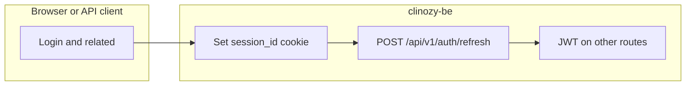
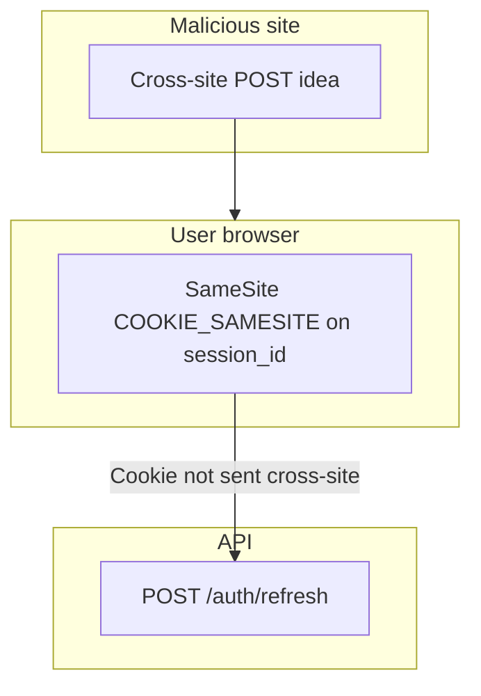

# CSRF and session cookies

clinozy-be uses **JWT Bearer tokens** for most authenticated API calls and an **httpOnly session cookie** only for **refreshing** those tokens. This page describes how that split affects **cross-site request forgery (CSRF)** and what to do if cookie rules change.

---

## Request flow

---

## Session cookies

### `session_id` (httpOnly)

| Attribute    | Value                | Purpose                                                                                                         |
| ------------ | -------------------- | --------------------------------------------------------------------------------------------------------------- |
| **Name**     | `session_id`         | Opaque session public identifier (not signed in cookie layer).                                                  |
| **Path**     | `/api/v1/auth`       | Cookie is sent only to auth routes, not the whole API.                                                          |
| **HttpOnly** | `true`               | JavaScript cannot read the value (mitigates XSS token theft).                                                   |
| **Secure**   | `true` in production | Cookie is sent only over HTTPS in production.                                                                   |
| **SameSite** | `COOKIE_SAMESITE` (default `Strict`) | Not sent on cross-site subrequests (primary CSRF mitigation for browser-driven abuse of refresh). |

### `csrf_token` (double-submit, readable by SPA)

| Attribute    | Value                | Purpose                                                                                                         |
| ------------ | -------------------- | --------------------------------------------------------------------------------------------------------------- |
| **Name**     | `csrf_token`         | Random token mirrored by the SPA into `X-CSRF-Token` on cookie-auth routes in production when `Origin` is absent. |
| **Path**     | `/api/v1/auth`       | Same scope as `session_id`.                                                                                     |
| **HttpOnly** | `false`              | SPA reads the value and sends it as `X-CSRF-Token` (double-submit pattern).                                     |
| **Secure**   | `true` in production | Sent only over HTTPS in production.                                                                     |
| **SameSite** | `COOKIE_SAMESITE` (default `Strict`) | Tracks the session cookie — the two must match or double-submit breaks silently.                                                                                |

Implementation: [`src/domains/auth/auth.http.util.ts`](../../../src/domains/auth/auth.http.util.ts) (`getSessionCookieOptions`, `getCsrfCookieOptions`, `SESSION_COOKIE_NAME`, `CSRF_COOKIE_NAME`).

Routes that set or clear the cookie include login, email verification-code verify, OAuth callback, MFA challenge completion, and logout (clear). **`POST /api/v1/auth/refresh`** reads the cookie and returns a new access token.

### Refresh-secret rotation and reuse detection

The `session_id` cookie value is `<session public id>.<refresh secret>`. Every refresh rotates the secret; the previous one stays accepted for a short grace window so concurrent tabs do not trip reuse detection.

Each secret is `<random>~<mac>`: 32 random bytes plus an HMAC that binds them to the session's user (key derived from `SECRETS_ENCRYPTION_KEY`; `generateRefreshSecret` / `isIssuedRefreshSecret` in `auth.http.util.ts`). The MAC is what makes reuse detection safe:

- A secret the server **issued** that no longer rotates — its MAC verifies, or it is the session's stored previous secret — is a replay of a retired, possibly stolen secret. The user's whole session family is revoked (RFC 9700 reuse detection).
- A secret the server **did not issue** proves nothing: anyone who learns a session id (a stolen bearer can list them) could invent one. It gets a plain `401` — no session is revoked and no token cache is touched. Destructive session actions stay behind the strong step-up of the explicit session-revocation routes.

Implementation: `AuthSessionService.refreshSessionCredentials`; end-to-end coverage: `src/domains/auth/__tests__/integration/refresh-reuse-detection.integration.test.ts`.

---

## CSRF threat model

| Credential                    | Typical CSRF risk               | Why                                                                                                                                                                                                           |
| ----------------------------- | ------------------------------- | ------------------------------------------------------------------------------------------------------------------------------------------------------------------------------------------------------------- |
| **`Authorization: Bearer …`** | Low for classic CSRF            | Malicious sites do not automatically attach arbitrary `Authorization` headers on cross-origin requests the way they do with cookies.                                                                          |
| **`session_id` cookie**       | Mitigated for cross-site misuse | **`SameSite`** (default `Strict`) prevents the browser from including this cookie on cross-site requests in modern browsers, which blocks the usual “evil.com submits a hidden form to your API” pattern against refresh. |

**CORS:** [`src/shared/middlewares/security/cors.middleware.ts`](../../../src/shared/middlewares/security/cors.middleware.ts) uses **`credentials: true`** and an **`ALLOWED_ORIGINS`** allowlist (required in production). That aligns credentialed browser calls with known frontend origins.

**Defense in depth:** When **`ALLOWED_ORIGINS`** is non-empty, **`POST /api/v1/auth/refresh`** requires a trusted source origin:

| Client signal | Rule |
| ------------- | ---- |
| **`Origin` present** | Must match the allowlist (takes precedence over `Referer`). |
| **`Origin` absent (production)** | **`X-CSRF-Token`** header must match the **`csrf_token`** cookie (timing-safe compare). **`Referer` is not accepted** in production. |
| **`Origin` absent (non-production)** | Parse **`Referer`** as a URL; its origin must match the allowlist. Malformed `Referer` → **403**. |
| **Both absent** | **403** in all environments (not only production). |

Login and other session-establishing routes set both **`session_id`** and **`csrf_token`**. **`POST /api/v1/auth/refresh`** rotates **`csrf_token`** on success. Logout clears both cookies.

See [`src/shared/middlewares/session/cookie-session-origin.pre-handler.ts`](../../../src/shared/middlewares/session/cookie-session-origin.pre-handler.ts) (`requireAllowedSourceOriginForCookieSessionRoute`).

---

## Configuring `SameSite`

`COOKIE_SAMESITE` (`strict` | `lax` | `none`, default `strict`) drives both the session and CSRF
cookies. They always share one value — a mismatch breaks double-submit silently while login still
appears to succeed.

`strict` assumes the SPA reaches this API **same-site**: the same registrable domain
(`app.example.com` → `api.example.com`), or the API proxied through the SPA's own origin. If the SPA
is served from a different site, the browser strips the cookie from every cross-site request and the
cookie-authenticated routes under `/api/v1/auth` fail after a successful login.

`none` is the only value a browser sends cross-site. It requires `COOKIE_SECURE=true` and every
`ALLOWED_ORIGINS` entry to be absolute `https://` — both enforced in `env-schema.ts`, because at
`none` the Origin allowlist becomes the primary CSRF control on the cookie-session route.

> **`none` is a stopgap, not a destination.** Safari's ITP blocks third-party cookie *setting* by
> default and Chrome is restricting third-party cookies, so a cross-site SPA will still lose its
> session for some users regardless of this setting. The durable fix is same-site hosting
> (`app.example.com` + `api.example.com`) or proxying `/api` through the SPA origin. Prefer those;
> reach for `none` only to unblock a deployment you cannot yet move.

## When SameSite-only mitigation is not enough

You **must** add an explicit **anti-CSRF mechanism** (for example **double-submit cookie** or **synchronizer token**) on any state-changing route that relies on cookies if you:

- Set **`SameSite=None`** (cross-site or embedded flows that must send the session cookie across sites), or
- Support user agents or modes where `SameSite` behavior is weaker than expected.

Document the new mechanism here and in release notes when that happens.

---

## Local development notes

`SameSite=Strict`, **path scoping**, and **Secure** interact with how you run the SPA and API (different `localhost` ports, HTTP vs HTTPS). If the refresh cookie does not appear or `refresh` returns **401**, verify the browser is sending the cookie to the correct host/path and that **`ALLOWED_ORIGINS`** includes your frontend origin (see [`src/tests/setup.ts`](../../../src/tests/setup.ts) for tests).

---

## Related code

- Frontend integration: [frontend-auth-guide.md](../api/frontend-auth-guide.md) — how a SPA handles refresh + CSRF in practice
- Cookie plugin: [`src/shared/middlewares/session/cookie.middleware.ts`](../../../src/shared/middlewares/session/cookie.middleware.ts)
- CORS: [`src/shared/middlewares/security/cors.middleware.ts`](../../../src/shared/middlewares/security/cors.middleware.ts)
- Refresh route: [`src/domains/auth/auth.routes.ts`](../../../src/domains/auth/auth.routes.ts)
- [`src/domains/auth/sub-domains/auth-session/auth-session.overview.md`](../../../src/domains/auth/sub-domains/auth-session/auth-session.overview.md) — session lifecycle invariants, JWT-per-session rule, retention
- [`src/POLICIES.md`](../../../src/POLICIES.md) — `JWT_*`, `SESSION_*` policy constants
