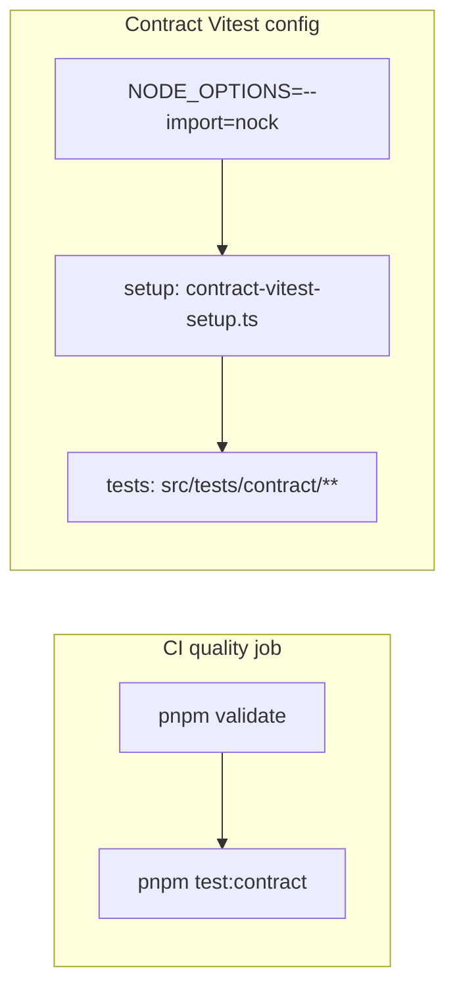

# Outbound contract tests (Stripe, Resend, S3)

Vitest specs under **`src/tests/contract/`** assert our wrappers stay aligned with third-party HTTP behavior using **nock 15** and **curated JSON fixtures**—no real network in CI. Every Vitest run, not just this slice, refuses non-loopback hosts (`src/tests/helpers/harness-provider-env.ts`); the opt-in live provider run (`pnpm test:contract:live`, below) is the one mode that reaches the network.

## Commands

| Command                     | Purpose                                                                                                             |
| --------------------------- | ------------------------------------------------------------------------------------------------------------------- |
| `pnpm test:contract`        | Run the contract slice only (`CONTRACT_TESTS_ENABLED=true`, dedicated Vitest config, `NODE_OPTIONS=--import=nock`). |
| `pnpm test:contract:live`   | Opt-in, never in CI: the `*.live.contract.test.ts` specs against the real sandboxes (see **Live provider checks**). |

Default **`pnpm test`** **excludes** `src/tests/contract/**` so the main suite does not require nock preload ordering.

## Runtime wiring

- **`CONTRACT_TESTS_ENABLED=true`** (set by the npm script): `src/tests/setup.ts` pins placeholder keys and bucket names; `src/tests/global-setup.ts` skips DB provisioning when only contracts run.
- **`stripe.client`**: Under contract-only test runs, the Stripe SDK uses **`Stripe.createFetchHttpClient`** so requests go through **fetch / undici**, which nock intercepts faithfully. Through the default Node `http` client, nock 15 hands an intercepted connection error back raw (`ERR_NOCK_NO_MATCH`, not a `StripeConnectionError`), and nock 14 could **hang** it (upstream: stripe-node#2211, nock#2785).
- **Loopback is never intercepted**: nock 15 intercepts every socket, not only HTTP. The pinned `@mswjs/interceptors` patch (`patchedDependencies` in `pnpm-workspace.yaml`) lets loopback and local IPC connections reach Node.js as-is — the harness's Postgres, Redis and Toxiproxy proxies — so a nock scope for `localhost` / `127.0.0.1` never matches; mock only third-party hosts. `harness-network-isolation.unit.test.ts` checks the behaviour and `patched-dependencies.policy.unit.test.ts` the installed patch, so a nock bump cannot drop it unnoticed.
- **Body matchers**: nock passes **`querystring.parse` objects** for `application/x-www-form-urlencoded` bodies; helpers in **`helpers/stripe-form.ts`** decode strings, buffers, and parsed objects.

## Live provider checks

`pnpm test:contract:live` sets `LIVE_PROVIDER_CONTRACTS=true` and runs only `src/tests/contract/*.live.contract.test.ts` — `pnpm test:contract` and CI exclude them. The run keeps the provider keys the env loader found (`pnpm setup:local` copies the development ones into the machine-local env file), takes nock out entirely, and refuses a non-`sk_test_` Stripe key, a bucket whose name says production, and any lane but the contract slice (`harness-provider-env.ts`). Each spec calls through our own wrappers and cleans up what it creates:

| Spec | Provider | What it proves |
| ---- | -------- | -------------- |
| `stripe.live.contract.test.ts` | Stripe sandbox | customer → `pm_card_visa` → `default_incomplete` subscription (client secret) → invoice paid → active → quantity 2 → cancel at period end → resume → cancel; every response parses with `schemas/stripe.schemas.ts` |
| `resend.live.contract.test.ts` | Resend | `sendEmail` from `EMAIL_FROM_ADDRESS` to `delivered@resend.dev`; Resend reports it `sent` or `delivered` |
| `s3-object-storage-adapter.live.contract.test.ts` | S3 (configured bucket) | presigned POST upload → verify → ranged read → conditional copy → presigned download → delete, under `contract-live/<run id>/` |
| `turnstile.live.contract.test.ts` | Cloudflare siteverify | Cloudflare's always-pass and always-fail **test** secrets (no account key) read as a pass and an `invalid-input-response` refusal |
| `telemetry.live.contract.test.ts` | Sentry, PostHog | one tagged event each through our modules; Sentry answers 200, PostHog reports no transport error |

Recording a new fixture is a live run with `nock.recorder.rec({ output_objects: true })` around the calls, redacted before it is committed under `fixtures/`.

## Layout

| Path                 | Role                                                           |
| -------------------- | -------------------------------------------------------------- |
| `*.contract.test.ts` | Specs per integration                                          |
| `fixtures/**`        | Static JSON (request/response shapes)                          |
| `schemas/**`         | Zod contracts for payloads                                     |
| `helpers/`           | Nock isolation, circuit reset, Stripe form/signature utilities |

See **`src/tests/contract/README.md`** for a short developer checklist.

## Related

- [`src/tests/contract/contract.overview.md`](../../../src/tests/contract/contract.overview.md) — suite scope, fixture organisation, dependencies
- [`src/infrastructure/payment/payment.overview.md`](../../../src/infrastructure/payment/payment.overview.md), [`src/infrastructure/mail/mail.overview.md`](../../../src/infrastructure/mail/mail.overview.md), [`src/infrastructure/storage/storage.overview.md`](../../../src/infrastructure/storage/storage.overview.md) — wrappers under test
