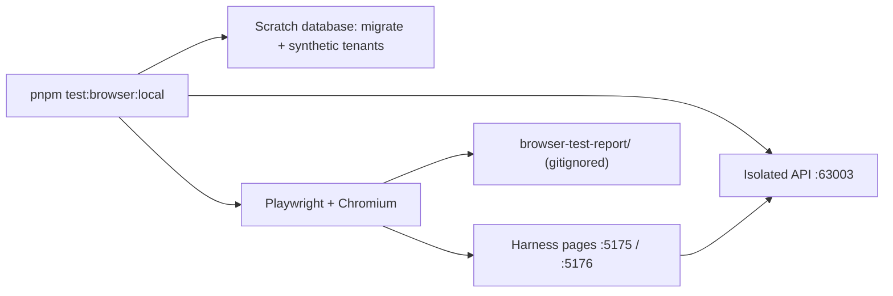
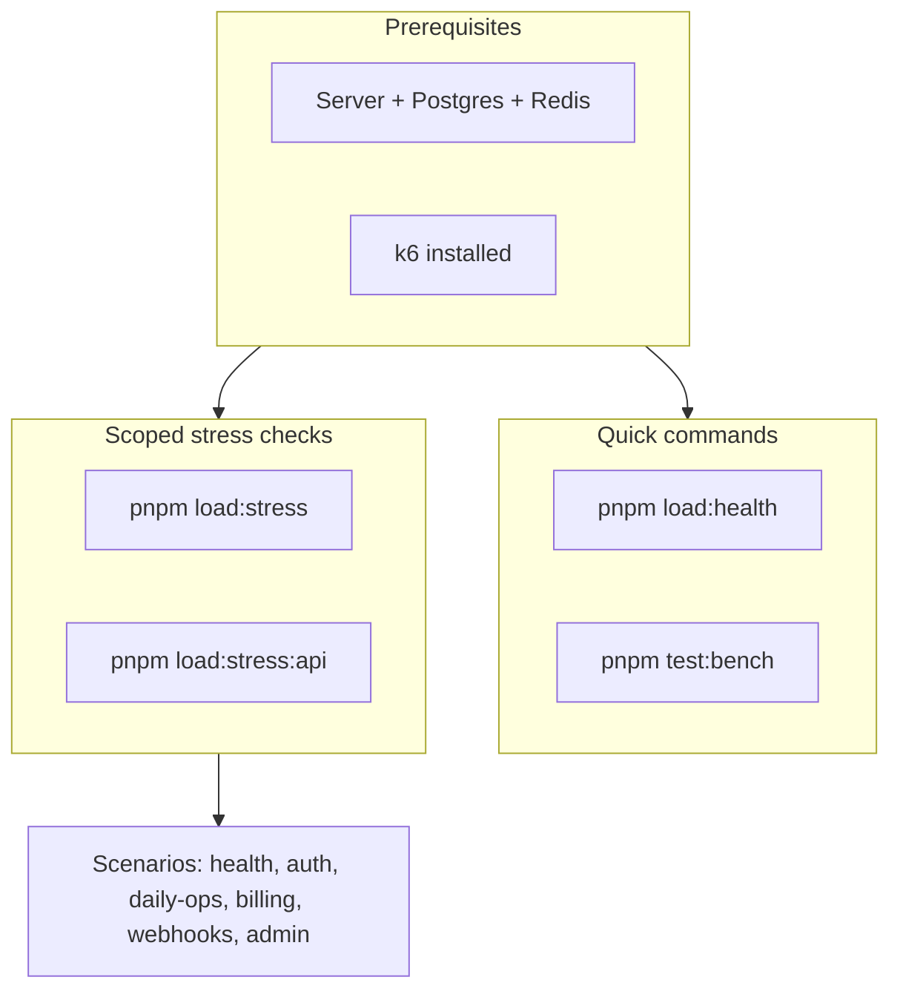

# Load testing

Load tests use [k6](https://k6.io/) and Autocannon. Keep this doc in sync with [src/tests/load/k6/README.md](../../../src/tests/load/k6/README.md).

**Test layout:** Vitest suites (unit, integration, e2e, security, performance) and k6 load assets live under `src/tests/`; domain route tests live under `src/domains/*/__tests__/`. k6 scenarios are in `src/tests/load/k6/` (not Vitest — run via `pnpm load:*`).

---

## Browser contracts (Playwright)

`pnpm test:browser:local` runs the repository-owned Playwright suite in Chromium against its own
isolated backend, independently of agent browser tools. Install Chromium once with
`pnpm test:browser:install`. The runner:

1. drops and recreates a `<database>_browser_test` scratch database on the local PostgreSQL,
   migrates it and bulk-seeds synthetic tenants (`pnpm db:seed:loadtest`), writing their
   credential pool beside the report — never the `pnpm dev` database or the default k6 pool;
2. starts an API on `localhost:63003` with `CAPTCHA_PROVIDER=disabled`,
   `SESSION_ORIGIN_CSRF_REQUIRED=true`, `COOKIE_SECURE=false`,
   `ALLOWED_ORIGINS=http://localhost:5175`, its own Redis key prefix and no telemetry;
3. runs `pnpm test:browser`, then stops the API.

Results, failure screenshots and traces land in the gitignored `browser-test-report/`
(`BROWSER_TEST_REPORT_DIR` overrides it); traces can hold credentials and session data, so
never commit them. `BROWSER_TEST_DATABASE` (must end in `_test`) and `BROWSER_TEST_API_PORT`
override the database and port. Against a backend you started yourself, run
`pnpm test:browser` with `BROWSER_TEST_API_URL` and `BROWSER_TEST_CREDENTIAL_POOL` (two
distinct tenants, the load-pool fields).

The harness serves pages on localhost ports 5175 (allowed) and 5176 (denied);
`BROWSER_TEST_ORIGIN` / `BROWSER_TEST_DENIED_ORIGIN` override them — keep the API allowlist
aligned. The suite verifies login and input/authentication rejection, credentialed CORS,
HttpOnly/path cookies, session refresh, organization binding and foreign-tenant denial,
originless CSRF double-submit handling and logout revocation. It exercises backend browser
contracts, not the product frontend; trusted HTTPS, Secure/cross-site cookies, real OAuth,
CAPTCHA, physical authenticators and provider-hosted SCA need separate evidence. Retries are
disabled so failures stay visible.



## Flow overview



Prerequisites → Quick (health, bench) vs Scoped stress checks (stress, stress:api) → Scenarios.

---

## Route coverage and test intent

Count distinct **method + route template** pairs actually requested, and compare API pairs with the current [route catalogue](../../routes.txt). Scenario files and optional branches are potential coverage; they are not executed coverage. `api-stress.js` exercises five reads, `rls-concurrency-beyond-pool.js` exercises one of those membership reads, and `session-refresh-journey.js` adds login, refresh, and logout. Increasing VUs does not increase route coverage or the number of identities.

`pnpm load:read-surface` adds 24 nondestructive GET routes across auth, user, tenancy, billing, and notify. Supply `TEST_TOKEN` scoped to `TEST_ORG_ID`; setup verifies a TEAM tenant and the required permissions. Defaults are 10 concurrent clients and 20 complete journeys (`VUS` / `ITERATIONS`). Every route must execute, return HTTP 200, and pass its basic response-shape checks. This is functional read load, not full business-invariant or production capacity certification. It excludes destructive writes, admin routes, resource details, and live Stripe/S3 calls.

Load scenarios must fail on missing prerequisites and gate semantic checks as well as HTTP/latency metrics. API/RLS stress now require credentials and request counts; membership denial cannot pass as an authorized success. The session journey preserves the current rotated cookies before logout, replays them with valid CSRF, and requires 401 for both refresh and bearer access. Clearing the client cookie or receiving 403/429 does not prove server revocation.

Report separately: executed route coverage, concurrency profile, fixture/identity/tenant counts, status distribution, semantic check results, latency percentiles, and exclusions. An all-green run means no failures in those checks; it does not imply an error-free backend.

## Fixture-backed lifecycle coverage

The nightly workflow additionally gates six lifecycle scenarios, each with four virtual users and five iterations. They require 100% checks, zero unexpected HTTP failures, zero dropped iterations and exactly 20 completed journeys per scenario.

| Scenario | Verified behavior |
| --- | --- |
| `auth-security-lifecycle.js` | Session revocation, linked methods, password change/restore, real TOTP enrollment, verification/replay, recovery-code consumption and MFA removal |
| `account-onboarding-lifecycle.js` | Real email-code redemption, password reset/replay, settings read, onboarding persistence, export request/status and account deletion |
| `tenant-membership-lifecycle.js` | Team creation, invitations/resend/acceptance, suspension, ownership transfer, leave, invitation revocation, membership removal and team deletion |
| `admin.js` | Real super-admin context, ordinary-user denials, user search/detail/update/readback, global audit and deletion |
| `webauthn-lifecycle.js` | Genuine P-256 registration and signed authentication, challenge replay denials, identity binding, credential listing and revocation |
| `upload-asset-lifecycle.js` | Actual PNG bytes, upload ownership denials, confirmation, avatar/logo attach/readback/detach and upload deletion |

Run `pnpm build` first. Generate a credential pool against the seeded source database. Stop every connection to that source before cloning it, then run:

```bash
LOAD_TEST_DATABASE=clinozy_load_lifecycle LOAD_TEST_CREATE_DATABASE=true \
  node src/tests/load/k6/run-lifecycle.mjs
```

Cloning requires PostgreSQL CREATEDB permission. To use an already prepared scratch database, omit `LOAD_TEST_CREATE_DATABASE`. The runner refuses the configured application database and requires a database name containing an underscore-delimited `load` or `test` segment. It redirects **all four** configured database URLs, including `DATABASE_MAINTENANCE_URL`, to the scratch database, uses a unique Redis namespace, checks that ports 3002–3005 are free, and stops only its own API and fixture processes. Scratch data and reports are retained for investigation; the runner does not drop databases. Reports default to `k6-lifecycle/`; override with `LOAD_TEST_REPORT_DIR`.

The authenticated loopback mailbox reads tokens from actual committed mail-outbox records and can create a provider-free local subscription for newly created load teams. This preserves seat-quota enforcement without making payment-provider requests. No worker is started and no live email is sent. The loopback storage fixture handles actual bytes and the application's HEAD/GET/copy/delete requests, but does not validate AWS signatures. Export testing verifies the persisted queued request and status, not worker completion or downloadable contents. The loopback virtual authenticator generates genuine P-256 keys, CBOR attestation and signed assertions; the API uses its real WebAuthn verifier. It does not cover browser UI or physical authenticators. Live payment-provider flows and OAuth completion require separate validation.

Source coverage is a route-inventory guard, not proof that each route executed successfully. Keep raw samples and exact journey counters alongside each result. Expected 400/401/403/404 responses prove specific denial or replay behavior and must not be counted as successful positive-route coverage.

## Nightly CI gate (GitHub Actions)

Workflow: [.github/workflows/scheduled-k6-load-slo.yml](../../../.github/workflows/scheduled-k6-load-slo.yml) (`Scheduled k6 API load & SLO`)

Runs **daily at 02:00 UTC** (`cron`) and **on demand** (`workflow_dispatch`, which tests the ref it is started on). The job starts Postgres and Redis service containers, migrates, runs `pnpm db:seed:full` with `DEMO_PASSWORD=DemoPassword123!` (the demo user) and `pnpm db:seed:demo-admin` for `ops@example.com` (the super_admin on `GLOBAL_ADMIN_EMAILS` that the admin scenarios sign in as), boots the API with `RATE_LIMIT_MAX=10000`, then runs k6.

The service containers are plaintext and the connection is the superuser, while the schema defaults are production-safe (TLS on, boot-time safety checks enforced). So the shared `test-env` action exports `DATABASE_SSL_ENABLED=false`, and `start-api-server` relaxes the boot-time checks for its ephemeral boot, as the Docker smoke boot does. Without them the run dies before k6 — the seed fails in the TLS handshake — which kept this nightly red on every run from its first one.

| Role                 | Scenarios                                                                                                                                                                                                                                                                                                                                                                                                                                                                                                                | Job outcome                                                          |
| -------------------- | ------------------------------------------------------------------------------------------------------------------------------------------------------------------------------------------------------------------------------------------------------------------------------------------------------------------------------------------------------------------------------------------------------------------------------------------------------------------------------------------------------------------------ | -------------------------------------------------------------------- |
| **Gate (must pass)** | `health-stress.js`, `api-stress.js`, `login-smoke.js`, `permission-cached.js`, `stripe-webhook-ingest.js`, `idempotency-storm.js`                                                                                                                                                                                                                                                                                                                                                                                        | Workflow **fails** if any k6 threshold fails                         |
| **Informational**    | `auth-onboarding.js`, `passwordless-signup.js`, `daily-ops.js`, `billing.js`, `webhooks.js`; the organization-scoped set (`audit-list.js`, `organization-membership-list.js`, `notification-policy-crud.js`, `billing-subscriptions-rls.js`, `user-data-export.js`, `rls-concurrency-beyond-pool.js`); and the organization writes (`member-role-permission-list.js`, `permission-write.js`, `tenancy-role-write.js`, `organization-settings-write.js`, `notification-write.js`, `organization-api-key-lifecycle.js`); and `fe-full-surface.js`, every call clinozy-fe makes, walked once by each of 20 pool users (the job seeds the pool with `pnpm db:seed:loadtest` and starts the API with `AUTH_STATIC_VERIFICATION_CODE_ACCEPT_ENABLED=true`) | `continue-on-error`; failures do not fail the workflow by themselves |

**SLO-style thresholds (k6):** Scenarios define `http_req_duration` percentiles on tagged requests and `http_req_failed` (see each file under `src/tests/load/k6/scenarios/`). A `{name:<tag>}` threshold only measures requests sent with exactly that `name` tag; on a tag no request carries it has no samples, reports p(95)=0s and always passes, so `k6-coverage.policy.unit.test.ts` fails on any threshold its scenario never tags. The gate enforces:

- **Health stress**: `health/live` p(95)&lt;200ms, p(99)&lt;500ms; `health/ready` p(95)&lt;500ms, p(99)&lt;1000ms; global failure rate &lt;1%.
- **API stress**: Per-route p(95)&lt;500ms for users/me, organizations, notifications, unread-count, and the active-organization memberships (`/tenancy/organization/memberships`); global p(95)&lt;500ms and failure rate &lt;1%.

Artifacts (`k6-*.json` summaries and `server.log`) are uploaded for 14 days. Optional email: set the `RESEND_API_KEY` and `TEST_RESULT_EMAIL_TO` secrets on the `development` environment; the workflow then invokes `pnpm tool:send-load-test-results-email` with `K6_USE_SUMMARIES=1` (reads the `k6-*.json` summaries — no second k6 run). A red scheduled run opens (or comments on) a `ci-failure` issue titled *Nightly k6 load SLO failing*; the next green nightly closes it.

**Writes, paced.** Every organization write route carries a 100-per-minute cap per (organization, actor) that `RATE_LIMIT_RELAXED_CAPS` does not lift, and a k6 run is one actor (the demo user). The write scenarios therefore use the `pacedWrites` profile in `helpers/config.js` (one iteration per second) rather than 10 closed-loop VUs, which measured the rate limiter (429) instead of the route. Writes take their `X-Idempotency-Key` from `idempotencyKey()` in `helpers/idempotency.js`: the API requires 16–255 characters, and a timestamp keeps a key from replaying an earlier run.

**Route coverage.** `pnpm load:coverage` matches every request the scenario files make — method and path — against `docs/routes.txt`; `pnpm load:coverage --nightly` counts only the files this workflow runs. It skips ROLE and TOKEN routes and public infrastructure routes (OAuth, email sign-in, WebAuthn, the Stripe webhook, health). The nightly count is a ratchet: `tooling/ci/load-coverage-budget.json` records it, and `k6-coverage.policy.unit.test.ts` fails when the nightly load-tests fewer routes — raise the budget when a change adds coverage. The workflow references all 104 eligible catalog routes; this static inventory does not prove every route passed at runtime. Stripe-backed writes and signed outbound webhook delivery run in the separate provider contract gate. Account deletion, organization leave/ownership transfer and S3 transport writes now run in the isolated lifecycle gate. The runner provisions a distinct real super-admin session per virtual user and permits at most five deletion iterations per admin, respecting the five-deletions-per-five-minutes protection.

**Reproduce locally:** `pnpm compose:up`, `pnpm db:migrate`, `pnpm setup:local --only-env`, `DEMO_PASSWORD=DemoPassword123! pnpm db:seed:full`, `pnpm dev:loadtest`, then `pnpm tool:load-test-credentials`, export `TEST_TOKEN` / `TEST_ORG_ID`, and run `pnpm load:stress` and `pnpm load:stress:api` (same thresholds as CI).

---

## Scoped load coverage

To gain confidence in the **whole system** (not just health endpoints), run both infrastructure stress and API stress:

1. **Health + infra stress** (no auth): `pnpm load:stress`
   - Hits `GET /livez` and `GET /readyz` with up to 100 VUs.

2. **API stress** (authenticated): set credentials, then run `pnpm load:stress:api`
   - Get credentials: `pnpm tool:load-test-credentials` (server up, `pnpm db:seed:full` done).
   - Export and run:

     ```bash
     export TEST_TOKEN="<paste from script>"
     export TEST_ORG_ID="<paste from script>"
     pnpm load:stress:api
     ```

   - Hits: `GET /api/v1/users/me`, `GET /api/v1/users/me/organizations`, `GET /api/v1/notify/notifications`, `GET /api/v1/notify/notifications/unread-count`, `GET /api/v1/tenancy/organization/memberships` with up to 100 VUs. The active organization rides the token's `org` claim, so `TEST_ORG_ID` scopes the token (via `switchToOrganization`) rather than appearing in the path.

3. **Optional — auth flow**: `pnpm load:auth`
   - Stresses login + profile + list organizations (ramping load profile; see thresholds in `src/tests/load/k6/scenarios/auth-onboarding.js`).

Passing these scenarios establishes their named health and API checks, not capacity or correctness across every API route.

### Failure rate and how to handle it

- **Health stress:** Failure rate is typically **0%** (no auth, no rate limit on health).
- **API stress:** You may see a **high failure rate (~95%+)** if the global **rate limit** is hit. The app uses `RATE_LIMIT_MAX` requests per `RATE_LIMIT_WINDOW_MS` (default **100 per 60 seconds per IP**). k6 runs from one IP with 100 VUs, so you can send thousands of requests per minute; after the first 100 in a window, the server returns **429 Too Many Requests**, which k6 counts as failed.

**How to handle:**

1. **For load-test runs only:** Start the server with a higher limit so API stress can complete without 429s:

   ```bash
   pnpm dev:loadtest
   ```

   (Or `RATE_LIMIT_MAX=10000 pnpm dev`.) Then run `pnpm load:stress:api` (with `TEST_TOKEN` and `TEST_ORG_ID`). Do not use a sky-high limit in production.

2. **In production:** Keep `RATE_LIMIT_MAX` at a level that protects the API (e.g. 100–500 per minute per IP, or use Redis-backed per-user limits). The 429 response is correct behavior when the limit is exceeded; clients should back off or use exponential backoff.

   **Per-route limits:** High-risk routes use tighter caps than the global limit (e.g. login, invitations, data export, webhook test delivery). Values live in [`src/shared/middlewares/rate-limit/rate-limit-presets.constants.ts`](../../../src/shared/middlewares/rate-limit/rate-limit-presets.constants.ts). k6 or scripts that hammer those paths may see 429 sooner than the global budget implies.

3. **Optional — longer-lived token for long runs:** JWT from login expires in 15 minutes. For runs under 15 minutes you don't need to change anything. For longer runs, mint a fresh token between blocks, as the nightly does (`pnpm tool:load-test-credentials` before each block). `pnpm tool:admin-token` is no way around it: a super_admin token lives only `GLOBAL_ADMIN_ACCESS_TOKEN_EXPIRY_SECONDS` (default 5 minutes).

## Interpreting results: co-located load generation

When k6 runs on the **same host** as the API (the common local setup), the load generator and the server compete for the same CPU cores. This caps measured throughput and inflates latency in a way that is **not** an application bottleneck:

- **Symptom:** authenticated-route throughput plateaus (e.g. a few hundred req/s) and server-side compute time (`Server-Timing: app;dur`, mirrored by k6's `http_req_duration`) climbs under high VUs — **even though** Postgres, Redis, the DB connection pool, the libuv threadpool, and the Node event loop all still show headroom.
- **Why:** with the cores saturated by k6 + the server + kernel networking (localhost / Docker-bridge softirq), the OS de-schedules the server mid-request, so its own wall-clock per request grows without any internal resource being saturated. Cached endpoints (`/livez`, `/readyz`) barely notice because their handlers are trivial; authenticated routes do more per-connection work and so reveal a lower co-located ceiling first.
- **Confirm it's the environment, not the app:** raise `DATABASE_POOL_MAX` and `UV_THREADPOOL_SIZE` — if throughput does not move, the pool and crypto/threadpool are not the limit. Compare `app;dur` at low vs high concurrency: if it is small at low load and balloons only under high VUs while infra stays idle, the cap is CPU contention from co-location.

**For true capacity numbers**, run k6 from a **separate host** (so the generator never steals the server's CPU), size the API box to **cores ≥ replicas (+~2 for OS/IO)**, scale processes with `cluster-run.mjs` / `DEPLOYMENT_API_REPLICA_COUNT`, and keep Postgres/Redis on low-latency links (not a localhost port-forward). Treat single-box numbers as **lower bounds and regression signals**, not absolute capacity.

## Load Testing Monitoring (local)

`pnpm load:monitor` starts a recording reverse proxy on **:4985** that forwards to the API on
:3000 and serves a live dashboard of everything passing through it. Point a load run at :4985
instead of :3000 and each call appears as it happens, grouped per route.

```bash
pnpm load:monitor                 # proxy + dashboard on 127.0.0.1:4985 — open the URL it prints
BASE_URL=http://127.0.0.1:4985 VUS=50 k6 run src/tests/load/k6/scenarios/fe-login-to-organization.js
```

**Port 4985 is fixed and not configurable.** It sits beside the DB viewer's 4984 so the loopback
dev tools occupy one obvious band, and it is deliberately not read from the environment: a bare
`PORT` is the API server's own variable (env schema, default 3000), so a shell exporting it for
the API would silently move this proxy too. `LOAD_MONITOR_UPSTREAM` (default
`http://localhost:3000`) still points it at a different API when you need to.

Loopback development tool, and it enforces that:

- it listens on `127.0.0.1` only — never on a LAN interface;
- the dashboard URL it prints carries a **per-boot session token**, which every `/__monitor/*`
  endpoint requires (as `?token=` or the `x-session-token` header), together with a loopback
  `Host` and, from a browser, a loopback `Origin` — the same guard as the DB Viewer
  (`tooling/dev/loopback-guard.mjs`). The proxy path needs no token, and neither does the run
  announcement a k6 scenario `POST`s to `/__monitor/run` (k6 sends no `Origin`; a cross-origin page
  does and is refused);
- recorded bodies, query strings and sensitive headers go through the application's own redactor
  (`redactSensitive`, as for logs and Sentry) before they are stored, so a proxied login keeps
  `"password": "[REDACTED]"`, never the password; a body that cannot be parsed for redaction is
  withheld.

It runs under `tsx` (for that redactor) and keeps everything in memory; never point it at anything
but a local API.

| Endpoint | Purpose |
| -------- | ------- |
| `/` | Dashboard — per-route calls, ok/error/429 counts, avg, p95, max, total time (open it with the printed `?token=` URL) |
| `/__monitor/stream` | Server-sent events feed of calls as they land (token) |
| `/__monitor/stats` | Per-route aggregates as JSON (token) |
| `/__monitor/calls` | Recorded calls (`?limit=`) with redacted headers and bodies (token) |
| `/__monitor/clear` | `POST` — reset counters between runs (token) |
| `/__monitor/run` | `POST` — a scenario announces its shape (no token); `GET` reads it (token) |

Because it sits in the request path it adds a small amount of latency and a second event loop to the
same box; treat its timings as directionally accurate and compare monitor-to-monitor, not
monitor-to-direct.

## Trusting a result

A load-test number is only worth reporting once you know it reproduces. On a co-located single-box
setup this repo has measured a **2.07x spread between two runs of an identical configuration**
(2,697 ms vs 5,590 ms per journey). Any single-run comparison smaller than that is indistinguishable
from noise.

**Before reporting a before/after, satisfy all four:**

1. **Replicate each side at least twice.** A one-shot A/B has produced a confident 3.7x "improvement"
   here that disappeared entirely when the faster side was re-run — the first number was an outlier,
   not a result.
2. **Control for ordering.** Journeys that create rows (organizations, memberships, audit entries)
   leave the database bigger than they found it, so a later run is working against more data than an
   earlier one. Run the pair in both orders; if the effect survives the reversal it is real, and if it
   only appears in one order it was the data growth.
3. **Check the journey against what the client actually calls.** A step the real client never issues
   inflates the route it targets and adds load that does not exist in production. `POST
   /auth/switch-to-organization` returns the active-organization context inline and clinozy-fe writes it straight
   into its cache, so a `GET /auth/me/context` after a switch measures a request the app never makes.
4. **Hold the auth method constant, and know what it costs.** `POST /auth/login` verifies with
   argon2id — roughly 100 ms of deliberate CPU per call. Node runs one thread, so 50 concurrent
   password logins queue several seconds of CPU that inflates *every other route in the run* and can
   trip `overloadGuardMiddleware` into shedding 503s. A journey using password auth and one using
   email-code auth are not comparable, and the difference between them is not an application change.

**Diagnosing a failing journey**

| Symptom | Usual cause |
| ------- | ----------- |
| Login returns `401` for every pool user | Seed data is missing, not a broken feature — the anti-enumeration path returns an **identical** 401 for an unknown email as for a wrong code. Check `auth.users` before debugging the auth code. |
| Login returns `200` but the VU stops right after | The body is an `mfa_required` envelope with `mfa_session_token`, not an `access_token`. See the MFA note under [Obtaining credentials](#obtaining-credentials). |
| Every route inflates by a similar factor | Queueing on the single Node event loop, not a slow endpoint. Uniform inflation is the signature. |
| Only `/auth/refresh` fails, with 429 | `REFRESH_RATE_LIMIT` is a hardcoded 30/min **per IP** and does not honour `RATE_LIMIT_RELAXED_CAPS`, so every VU on one host shares one budget. The limiter working, not the endpoint failing. |

**Report the whole picture.** A journey-level "success rate" counts only VUs that completed *every*
step, so one rate-limited step at the end can read as a 6% success rate while all business routes were
100% healthy. Quote per-route results alongside it.

## Measuring a performance change that is already merged

The section above tells you how to trust a before/after. This one is about the case where there is
no "before" left to run: the change shipped, `main` contains it, and someone asks whether it helped.

**You need two checkouts, not one.** Pick the last commit before the first change in the campaign
and treat it as the baseline; `main` is the other side. Each side needs its own `db:migrate` and
`db:seed:full`, because the database state has to match the code that reads it. Then apply the four
rules above in full — replicate each side twice, run the pair in both orders. That is four runs
minimum, and on a co-located box the 2.07x identical-configuration spread means anything less is
not a measurement.

**Budget the wall clock honestly.** Four journey runs plus two seeds is not a thing to slot between
other work, and a box that is also running a browser or an editor is not a box that can produce the
number. Check `vm.loadavg` and `vm.swapusage` with the cluster down first; uniform inflation across
every route is the signature that you measured the machine instead of the code.

### What to read, for a caching or transaction-count change

| Metric | What it tells you |
| --- | --- |
| Per-route p95 | The user-visible effect. Read this **before** the aggregate — a change to three routes barely moves a mix of sixteen. |
| `db_pool_connections{state="waiting"}` | Requests queued for a connection. This is the ceiling a transaction-count change is aimed at. |
| `database_rls_active_checkouts` | Should fall if contexts were folded. |
| `database_rls_checkout_hold_seconds` | How long each checkout pins its connection. |
| `read_cache_requests_total{cache,result}` | The hit ratio, per cache. |

**A cache's hit ratio is its falsification test, and it must come from a realistic journey.** A
synthetic loop against one endpoint will show a ratio near 100% and prove nothing — the number only
means something when writes are invalidating at the rate they really do. A ratio near zero under a
real journey means that cache is paying a Redis round trip to still ask Postgres, and the correct
response is to remove it. Measuring it exists to make that outcome possible, not to confirm a
decision already made.

**Counts are not throughput.** A transaction-per-request budget (see
[`request-transaction-budget.integration.test.ts`](../../../src/tests/integration/database/request-transaction-budget.integration.test.ts))
proves a route stopped taking two pool checkouts. It does not prove the service got faster, and the
two claims should not be reported as if they were the same one.

## Post-run settle check (drain + assert clean)

The k6 journeys exercise the API; the worker runtime's volume behaviour is covered by `src/tests/performance/queue-throughput.performance.test.ts` (real Redis, two replicas): 10,000 jobs drained exactly once, and a 2,000-job backlog held through a provider outage and drained exactly once afterwards.

After a load (or e2e) batch, `pnpm load:settle-check` proves the async fabric finished every job the run started — nothing stuck in a queue, the event-bus / outbox side effects flushed, and nothing dead-lettered. Run it against the **same** API + worker the load test hit (workers must be running so the backlog can drain):

```bash
pnpm load:settle-check
```

It polls the throughput queues (`mail`, `webhook-delivery`, `notification`, `stripe-webhook`) until `waiting + active + delayed = 0` and the mail outbox has no pending rows, then asserts — once — that **no** queue and **no** `<queue>-dlq` is holding a failed job. Exit code `0` = clean, `1` = did not settle within the timeout or a failure remains (CI-gateable). Scheduled retention/tombstone queues are intentionally excluded: their next repeatable run always sits in `delayed`, so they never reach zero — their health is covered instead by the cluster-wide dead-letter assertion.

| Env | Default | Purpose |
| --- | ------- | ------- |
| `SETTLE_CHECK_TIMEOUT_MS` | `120000` | Max wait for the backlog to drain before reporting a timeout |
| `SETTLE_CHECK_POLL_INTERVAL_MS` | `2000` | Poll cadence while waiting |
| `SETTLE_CHECK_QUEUES` | throughput queues | Comma-separated queue-name override |

The same signals are observable live via `GET /readyz` (verbose), `GET /metrics` (`bullmq_queue_*`, `mail_outbox_pending`, `dlq_depth`), and Bull Board — see the [observability runbook](../../deployment/runbooks/observability.md). The settle check turns those gauges into a single pass/fail gate.

## Prerequisites

- **Server**: Run the API with `pnpm dev` (and optionally `pnpm dev:worker` for background jobs).
- **Postgres + Redis**: Required for auth and organization-dependent scenarios. Start with `docker compose up -d` or your own instances.
- **Database**: Migrations applied (`pnpm db:migrate`). For auth and organization scenarios, run full seed: `pnpm db:seed:full` (creates demo user `demo@example.com` / `DemoPassword123!` and a demo organization).
- **k6**: Install [k6](https://k6.io/docs/get-started/installation/) for scenario runs.

## Quick commands (no auth)

- **Autocannon** (single endpoint): `pnpm test:bench` — hits `http://localhost:3000/readyz`.
- **k6 health**: `pnpm load:health` — runs `src/tests/load/k6/scenarios/health.js` (`/livez` and `/readyz`). No env vars needed.

## Scenarios (all eight)

### 1. Health

- **File**: `src/tests/load/k6/scenarios/health.js`
- **Auth**: None
- **Env**: Optional `BASE_URL` (default `http://localhost:3000`)
- **Run**: `pnpm load:health` or `k6 run src/tests/load/k6/scenarios/health.js`

### 2. API stress (five-route coverage)

- **File**: `src/tests/load/k6/scenarios/api-stress.js`
- **Auth**: Bearer token (TEST_TOKEN) + TEST_ORG_ID for memberships
- **Env**: `TEST_TOKEN` (required), `TEST_ORG_ID` (required for memberships). Get via `pnpm tool:load-test-credentials`.
- **Run**: `pnpm load:stress:api` after exporting TEST_TOKEN and TEST_ORG_ID.
- **Routes**: users/me, users/me/organizations, notify/notifications, notify/notifications/unread-count, tenancy/organization/memberships (active organization from the token claim; `TEST_ORG_ID` scopes the token, not the path). Stress profile: 20→50→100 VUs.

### 3. Auth onboarding

- **File**: `src/tests/load/k6/scenarios/auth-onboarding.js`
- **Auth**: Login with email/password, then profile and list organizations
- **Env**: `DEMO_EMAIL`, `DEMO_PASSWORD` (defaults `demo@example.com` / `DemoPassword123!`, matching `DEMO_PASSWORD=DemoPassword123! pnpm db:seed:full`)
- **Run**: `pnpm load:auth` (uses demo credentials by default) or `k6 run src/tests/load/k6/scenarios/auth-onboarding.js`

### 4. Daily ops

- **File**: `src/tests/load/k6/scenarios/daily-ops.js`
- **Auth**: Bearer token scoped to the active organization (the `org` claim; scope via `TEST_ORG_ID`)
- **Env**: `TEST_TOKEN` (required), `TEST_ORG_ID` (default `test-organization-id`). Use the helper script to get token and organization id: `pnpm tool:load-test-credentials` (see below).
- **Run**: `pnpm load:daily-ops` with `TEST_TOKEN` and `TEST_ORG_ID`, or `TEST_TOKEN=<token> TEST_ORG_ID=<org_public_id> k6 run src/tests/load/k6/scenarios/daily-ops.js`

### 5. Billing

- **File**: `src/tests/load/k6/scenarios/billing.js`
- **Auth**: First request (list plans) is public; rest require `TEST_TOKEN` and `TEST_ORG_ID`
- **Env**: `TEST_TOKEN`, `TEST_ORG_ID` (optional; if missing, only list-plans is exercised)
- **Run**: `pnpm load:billing` with `TEST_TOKEN` and `TEST_ORG_ID`, or `TEST_TOKEN=<token> TEST_ORG_ID=<org_public_id> k6 run src/tests/load/k6/scenarios/billing.js`

### 6. Webhooks

- **File**: `src/tests/load/k6/scenarios/webhooks.js`
- **Auth**: Bearer token scoped to the active organization (the `org` claim; scope via `TEST_ORG_ID`)
- **Env**: `TEST_TOKEN` (required), `TEST_ORG_ID` (default `test-organization-id`)
- **Run**: `pnpm load:webhooks` with `TEST_TOKEN` and `TEST_ORG_ID`, or `TEST_TOKEN=<token> TEST_ORG_ID=<org_public_id> k6 run src/tests/load/k6/scenarios/webhooks.js`

### 7. Admin

- **File**: `src/tests/load/k6/scenarios/admin.js`
- **Auth**: A `super_admin` session. Sign-in grants that role only to an email on `GLOBAL_ADMIN_EMAILS`; `pnpm tool:admin-token` signs in as one (see below).
- **Env**: `ADMIN_TOKEN` (required)
- **Run**: `pnpm load:admin` with `ADMIN_TOKEN`, or `ADMIN_TOKEN=<token> k6 run src/tests/load/k6/scenarios/admin.js`. Obtain token via: `pnpm tool:admin-token` (see below).

### 8. clinozy-fe full journey

Walks the complete front-end user journey once per virtual user, so **VUs are users** — 50 VUs means
50 people each performing the journey a single time, not 50 people looping.

- **File**: `src/tests/load/k6/scenarios/fe-login-to-organization.js`
- **Auth**: `AUTH=code` (default) logs in with `AUTH_STATIC_VERIFICATION_CODE_ACCEPT_ENABLED`; `AUTH=password` uses
  `POST /auth/login`; `AUTH=otp` does the real `send-code` → read `debug_verification_code` → login
  round trip (needs `TEST_MODE=true`).
- **Credentials**: the pool at `src/tests/load/k6/data/credential-pool.json` — build it with
  `pnpm db:seed:loadtest`.
- **Routes** (16): guest refresh → send-code → login → me/context → profile patch → create organization →
  onboarding complete → switch organization → me/context again → workspace and dashboard reads →
  authed refresh → logout.

| Env | Default | Purpose |
| --- | ------- | ------- |
| `VUS` | `50` | Virtual users; each performs the journey once |
| `POOL` | — | `DATABASE_POOL_MAX` the API was started with; printed in the header for the record |
| `AUTH` | `code` | `code` \| `password` \| `otp` |
| `STATIC_CODE` | `TEST24` | Must match the API's `AUTH_STATIC_VERIFICATION_CODE_ACCEPT_ENABLED` |
| `STAGGER` | `5` | Milliseconds between VU starts, to avoid a synthetic thundering herd |
| `RESULT_TAG` | — | Label recorded with the run |

**`send-code` is measured but not depended on.** The journey issues it because the real client always
does and its cost belongs in the numbers, but login presents `AUTH_STATIC_VERIFICATION_CODE_ACCEPT_ENABLED` rather
than the code `send-code` issued, so the two calls stay independent and a non-200 on `send-code` does
not abort the journey.

**The second `me/context` after the organization switch is a benchmark, not a fidelity claim.** clinozy-fe does
**not** make that call — `switch-to-organization` already returns the active-organization context inline and
the client writes it into its cache with `setQueryData` (verified against live responses: the switch
payload's `active_organization` and `my_permissions` are byte-identical to what the re-read returns).
The step exists because that route is
the largest single consumer of API time in the run — 100 calls / ~16% of total — which makes it the
benchmark any caching work has to beat. Of its four reads only `my_permissions` is Redis-cached
today. When reading the report, treat step 09 as a **caching target**, not as production traffic, and
subtract it before quoting a per-user total as what a real session costs — see point 3 under
[Trusting a result](#trusting-a-result).

Requires the API started with `TEST_MODE=true` and `AUTH_STATIC_VERIFICATION_CODE_ACCEPT_ENABLED` turned on:

```bash
TEST_MODE=true AUTH_STATIC_VERIFICATION_CODE_ACCEPT_ENABLED=true DATABASE_POOL_MAX=50 pnpm dev
# then
BASE_URL=http://localhost:3000 VUS=50 POOL=50 k6 run src/tests/load/k6/scenarios/fe-login-to-organization.js
```

### Org-scoped / RLS-heavy (informational, CI nightly)

Org-scoped scenarios resolve the tenant from the token's `org` claim — no organization path segment and no
any organization header. `TEST_ORG_ID` is used to **scope the token** to that organization (the helpers
call `switchToOrganization` / `loginScopedToOrganization`), not to build the path.

| File | Env | Routes |
| ---- | --- | ------ |
| `audit-list.js` | `ADMIN_TOKEN` | `GET /api/v1/audit/logs` |
| `organization-membership-list.js` | `TEST_TOKEN`, `TEST_ORG_ID` | `GET /api/v1/tenancy/organization/memberships` |
| `member-role-permission-list.js` | `TEST_TOKEN`, `TEST_ORG_ID`, `TEST_ROLE_ID` | `GET /api/v1/tenancy/organization/roles/:role_id/permissions` |
| `notification-policy-crud.js` | `TEST_TOKEN`, `TEST_ORG_ID` | `GET /api/v1/tenancy/organization/notification-policies` |
| `billing-subscriptions-rls.js` | `TEST_TOKEN`, `TEST_ORG_ID`, optional `TEST_SUBSCRIPTION_ID` | `GET /api/v1/billing/subscriptions` |
| `upload-list.js` | `TEST_TOKEN`, optional `TEST_UPLOAD_PUBLIC_ID` | `GET /api/v1/uploads/:id` |
| `user-data-export.js` | `TEST_TOKEN` | `POST /api/v1/users/me/data-export` |

CI runs a subset in the **organization-scoped routes** job step (see `scheduled-k6-load-slo.yml`).

### RLS concurrency beyond pool size

- **File**: `src/tests/load/k6/scenarios/rls-concurrency-beyond-pool.js`
- **Auth**: Bearer token scoped to the active organization (the `org` claim; scope via `TEST_ORG_ID`)
- **Env**: `TEST_TOKEN`, `TEST_ORG_ID` (required); optional `DATABASE_POOL_MAX` (default `10`), `BEYOND_POOL_FACTOR` (default `4`), `BEYOND_POOL_VUS` (explicit VU override)
- **Run**: `RATE_LIMIT_MAX=10000 pnpm dev` (or `pnpm dev:loadtest`), then `pnpm load:rls-concurrency` with `TEST_TOKEN` and `TEST_ORG_ID`
- **Rate limit**: This scenario drives `DATABASE_POOL_MAX × BEYOND_POOL_FACTOR` VUs (default 40) with a short `sleep`, so it sends far more than the default global limit of `RATE_LIMIT_MAX` (100) requests per `RATE_LIMIT_WINDOW_MS` (60s) per IP. Without raising `RATE_LIMIT_MAX`, k6 will count `429 Too Many Requests` as failures and breach the `http_req_failed < 1%` threshold even when the pool is healthy. Match the server's `DATABASE_POOL_MAX` when overriding it on the k6 side.
- **Purpose**: Validates production-readiness audit item #5 (per-request RLS transaction pinning). It ramps concurrent VUs to `DATABASE_POOL_MAX × BEYOND_POOL_FACTOR` against an organization-scoped (RLS) endpoint (`GET .../memberships`) and asserts `http_req_failed` stays below 1%. The connection checkout is held only for the unit of work, so the pool absorbs several multiples of concurrent requests.
- **CI**: Runs nightly as part of the **organization-scoped routes** informational step in `scheduled-k6-load-slo.yml` (seeded full demo data guarantees `TEST_ORG_ID`; the workflow already boots the API with `RATE_LIMIT_MAX=10000`). Pair a manual run with the `database_rls_active_checkouts` / `database_rls_checkout_hold_seconds` metrics from the [resource-limits runbook](../../deployment/runbooks/resource-limits.md) to confirm checkout hold time stays short.

## Obtaining credentials

- **TEST_TOKEN and TEST_ORG_ID**: Run `pnpm tool:load-test-credentials` (with server up and full seed). It logs in as the demo user, lists organizations, and prints `TEST_TOKEN` and `TEST_ORG_ID` for copy-paste.
- **Credential pool**: Run `pnpm db:seed:loadtest` (bulk seed + pool export). The generator **excludes MFA accounts** — both `users.is_mfa_enabled` and membership of an organization whose `security_policy.mfa_required` is true, mirroring the login gate in `completeFirstFactorAuth`. Such an account returns HTTP 200 with an `mfa_required` envelope instead of an `access_token`, so a VU drawing one would read no token and quietly abandon its journey. The bulk seeder sets `mfa_required` on a share of its organizations, so without the filter roughly a third of the pool is unusable.
- **ADMIN_TOKEN**: Create the account once with `DEMO_EMAIL=<admin email> pnpm db:seed:demo-admin` (it takes `DEMO_PASSWORD`) and put the email on `GLOBAL_ADMIN_EMAILS`. Then, with the server up, run `pnpm tool:admin-token`. It signs in as `ADMIN_EMAIL` (default: the first `GLOBAL_ADMIN_EMAILS` entry) with `ADMIN_PASSWORD` (default: `DEMO_PASSWORD`) and prints the access token, refusing unless the role is `super_admin`. The token belongs to a real session: the auth middleware refuses a token whose session does not exist, which is why the self-signed token this tool used to print failed every admin request. It lives `GLOBAL_ADMIN_ACCESS_TOKEN_EXPIRY_SECONDS` (default 5 minutes).

## Optional env (all scenarios)

- `BASE_URL`: API base URL (default `http://localhost:3000`). k6 reads this as `__ENV.BASE_URL`.

### Strict lifecycle and distinct-user validation

`tenancy-role-write.js` requires scoped `TEST_TOKEN` and `TEST_ORG_ID`. Each
journey sends concurrent duplicate creates, requires one persisted role and the
same replay id, reads back updates and exact permissions, then deletes and
checks absence. `organization-api-key-lifecycle.js` checks persisted renaming,
secret omission from detail responses, fresh rotation secrets, new-key authentication, old/deleted-key rejection,
read-only scope enforcement, and deletion.
Both enforce 100% checks, a completed-journey minimum (`MIN_COMPLETED`, default 1),
and zero dropped iterations. `DURATION` overrides the default two-minute run.
These scenarios share one actor; their VUs are concurrent clients, not distinct users.

`multi-tenant-membership-read.js` uses the generated credential pool and runs two
journeys per distinct user (`VUS`, default 20). It verifies user/tenant binding,
two nonempty disjoint cursor pages belonging to that tenant, and member detail and resolved permissions, and a foreign
membership returning 404. Setup requires at least two tenants and fails on an
undersized pool. The pool generator chooses one deterministic membership per
user; the reader rejects duplicate identities and incomplete credentials.
Use a separate seeded database and Redis namespace. Generated credentials and
raw response secrets must never be committed. Successful assertions do not
establish production capacity; dataset size, API pool size, user count, tenant
count, and latency threshold results must accompany every report.

Example (from the repository root, with the API using the same isolated database):

```sh
VUS=20 BASE_URL=http://localhost:3002 k6 run src/tests/load/k6/scenarios/multi-tenant-membership-read.js
DURATION=20s MIN_COMPLETED=20 k6 run src/tests/load/k6/scenarios/tenancy-role-write.js
```

For 240-user capacity investigations, record the admission ceiling as
`ceil(DATABASE_POOL_MAX × OVERLOAD_DB_POOL_SHED_RATIO)`: this counts running and
waiting organization-scoped database work, rather than database connections alone.
The lifecycle runner honors explicit `DATABASE_POOL_MAX` and
`OVERLOAD_DB_POOL_SHED_RATIO` process variables and records their effective values
in `runtime.json`; its fallback remains pool 60 / ratio 3. That fallback starts
shedding at 180 in-flight units and cannot promise error-free admission of a
synchronized 240-user burst.

On the four-core cloud host, pool 30 / ratio 10 (a bounded ceiling of 300) eliminated
unexpected HTTP errors across repeated 240-user bursts. The organization access
check now fetches the row and checks owner/active membership in one query, with
FORCE RLS regression coverage. Three consecutive bursts on one API process passed
p95 <500 ms / p99 <1000 ms (p95 489.71, 436.58, 404.97 ms), but fresh-process runs
still failed the 500 ms p95 gate. This configuration is an **HTTP-error mitigation,
not a complete latency fix**. Keep cold-process and warm-process results separate;
do not prewarm a benchmark, dilute cold samples, or relax thresholds to claim a fix.
Connection warming, TCP_NODELAY, a larger libuv thread pool, combined summary queries,
and two/four API processes did not produce repeatable cold-burst passes on this host.
Keep the monolithic worker's independently budgeted pool (60 in `.env.example`);
do not apply the API's smaller pool to that worker.

Queue recovery and future clinic workflows require additional controlled fixtures.
Provider-backed billing and signed outbound webhook processing use the separate
provider journeys described below.

The nightly workflow runs the strict notification and tenant journeys after
bulk seeding and before front-end scenarios consume those fixtures. Notification
writes require seeded unread rows for every selected user, assert a one-item
unread-count decrement, mark all read, verify zero, and delete an owned item.
Policy and webhook CRUD require completed lifecycles and persisted updates;
policy conflicts fail instead of skipping work. Settings/profile toggles use one writer,
check independent readback, and restore settings, profile fields, organization
name, and the complete notification-preference set. Billing reads
require nonempty plan/subscription fixtures and matching tenant-scoped details.
Billing uses two ordinary bulk-seeded tenants and proves foreign subscription
access returns 404. It does not send fake seed customer IDs to live payment
providers; invoice and payment-method reads are compared with independent provider records
in `billing-provider-lifecycle.js`.
These strict steps fail the job; earlier informational scenarios retain their
separate purpose. The idempotency storm reuses the strict role journey instead
of treating billing validation rejections as successful idempotency coverage.

Webhook CRUD never invokes test delivery. `WEBHOOK_TEST_BASE_URL` can select a
public numeric HTTPS fixture to isolate backend latency from external hostname
DNS latency; the default remains `https://example.com`. SSRF checks still apply.
Hostname DNS behavior and public-network delivery still need separate measurements.
The provider contract gate below verifies local signed delivery and persisted attempts.

Timestamp keysets select `cursor_created_at` using
`cursorTimestampSelection(created_at)` and pass it through cursor creation.
It preserves PostgreSQL microseconds in the encrypted cursor; API serializers
omit this internal field. Ordering and predicates still use the original indexed
timestamp column and id tie-breaker. Cursor comparison does not look up the
boundary row, so deletion between pages does not change its sort position.

## Sustained distinct-user validation

Set `VUS` to the number of distinct credential-pool users. Set `DURATION=10m` for `multi-tenant-membership-read.js` to run sustained journeys instead of two iterations per user. The scenario requires every check to pass, zero unexpected HTTP failures, zero dropped iterations, and p95 below 500 ms / p99 below 1000 ms. It verifies tenant scope, pagination, permissions and foreign-tenant denial. The sustained run requires every configured distinct user to finish their first complete journey (`tenant_read_distinct_users_completed == VUS`), as well as the total completion gate. Setup rejects duplicate user identities. Short bursts and sustained runs are separate results; a passing soak does not waive a failed burst or certify different pool/admission settings.

Measure RSS and file descriptors for the actual API process, after warm-up. The existing memory-soak helper measures its orchestration process and is insufficient evidence of API memory stability. Raising overload admission can remove 503 responses while increasing latency; retain the latency thresholds and report both outcomes.

For managed HTTP proxies on Node 24, start the API with `NODE_USE_ENV_PROXY=1` and retain loopback addresses in `NO_PROXY`. The Stripe production SDK uses the platform HTTPS agent so these proxy settings apply; retain platform CA trust.

## Stripe provider and outbound webhook validation

`pnpm test:stripe:load` builds the API and prepares everything it needs
(`src/tests/load/k6/prepare-provider-fixtures.mjs`): a fresh migrated
`<database>_stripe_load_test` scratch database; synthetic tenants made with the repository test
factories — separate sandbox, contract and k6 actor sets, each actor with an all-permission TEAM
and its own PERSONAL organization; and, when `STRIPE_SECRET_KEY` is an `sk_test_` key, the
four-plan sandbox catalog, reusing this account's products marked
`metadata.purpose=load-validation` and creating only what is missing. It then runs the
real-sandbox lane and the local contract lane against that database (`VUS=1`, `ITERATIONS=7`).
A missing key or a failed provider run still produces local results, but the command exits
nonzero until both lanes pass. Live keys are rejected. Keys stay in environment configuration;
the gitignored `k6-stripe-validation/` report holds modes, exit codes and results — its private
pools and catalog manifest are `0600` — never key values. `LOAD_TEST_DATABASE` and
`LOAD_TEST_REPORT_DIR` override the scratch database and report directory.

The lifecycle runner rejects the application database, redirects all four database URLs,
namespaces Redis and owns its API, Stripe worker and fixtures. Sandbox subscriptions, customers
and catalog objects stay in the Stripe test account after the run; unrelated provider objects are
never modified.

The configured-key run uses Stripe's actual test account: independently retrieves
an existing owned catalog, creates synthetic customers and subscriptions, confirms
a virtual Visa payment for paid subscriptions, retrieves
the real provider activation event, signs it locally and sends it through the real
ingress and BullMQ worker. It checks payment/setup secrets, idempotency replay,
foreign-tenant denial, plan change, cancel/resume and final provider/local agreement.
It proves provider API behavior and local webhook processing; it does not prove
Stripe can initiate delivery to a public tunnel. Billing's provider latency budget
is p95 below 3000 ms, separately from the tenant-read p95 below 500 ms.

### Four-plan billing matrix

The approved sandbox catalog has distinct Free, Starter, Growth and Pro titles and
descriptions. Monthly USD prices are 0, 10, 30 and 99; annual USD prices are 100,
300 and 990 for the paid tiers. Free annual is not advertised. Set
`LOAD_PROVIDER_CATALOG_FILE` to its private JSON manifest with
`realStripeSandbox: true` and four `products` containing provider `id`,
`title`, `description`, and `prices` with provider `id`/`cycle`. Sandbox setup
independently checks active, non-live products and all seven price amounts,
currencies and recurring intervals. It reuses these objects and never creates
replacement products or prices. Contract setup models this catalog locally.

`prepare-provider-fixtures.mjs` builds both private inputs: the catalog manifest
(`LOAD_PROVIDER_CATALOG_FILE`: `realStripeSandbox: true` and four products with provider `id`,
`title`, `description` and `prices[{ id, cycle }]`) and the `LOAD_PROVIDER_CREDENTIAL_POOL` object
with separate `sandbox` and `contract` actor arrays — distinct, unsubscribed teams, the last actor
of each being the foreign tenant. Every organization switch returns a rebound token; the journey
uses that token for subsequent requests.

Seven sequential journeys cover all advertised plan/cycle combinations, 18
directed same-cycle plan changes and 24 cross-cycle requests. Change-plan rejects
`billing_cycle` with 400; those cases establish schema rejection, not cycle
migration. Exact counters require every combination and transition, every check,
zero unexpected HTTP errors, zero drops and all journeys completing. Backend
p95 remains below 500 ms for contract mode and 3000 ms for real sandbox mode.

```bash
LOAD_TEST_DATABASE=clinozy_load_billing_contract \
LOAD_TEST_REPORT_DIR=/absolute/path/to/new-private-contract-report \
LOAD_PROVIDER_MODE=contract \
LOAD_PROVIDER_CREDENTIAL_POOL=/absolute/path/to/fresh-private-pool.json \
VUS=1 ITERATIONS=7 \
node src/tests/load/k6/run-lifecycle.mjs src/tests/load/k6/scenarios/billing-provider-lifecycle.js
```

For the real lane, use a separately prepared scratch database/pool, set
`LOAD_PROVIDER_MODE=sandbox` and `LOAD_PROVIDER_CATALOG_FILE`, and retain test-only
Stripe credentials in private environment configuration. A k6 archive freezes
execution options: explicitly pass VUS, ITERATIONS, provider mode and the private
pool while creating it, then verify its metadata. Keep archives private because
they contain credentials. Normal direct execution does not need an archive.

The matrix checks replay markers/stable IDs, the specific 422
`idempotency_key_reuse` conflict, duplicate-subscription409, unauthenticated401,
explicit PERSONAL422, foreign-tenant404 and invalid payload/unknown-plan denials.
Zero-price subscriptions have no payment secret; paid subscriptions use actual
PaymentIntents. Account IDs are compared with independent provider reads. Cancel
and resume both compare API, database and provider state, including the expected
period-end cancellation flag.

Five bounded payment probes cover decline, insufficient funds, expired card,
requires-action and canceled states; the three declines recover with a valid
virtual method. These are standalone owned USD1 PaymentIntents, not subscription
invoice failure/dunning tests. API `requires_action` does not prove completed
browser SCA. Locally signing retrieved provider events proves ingress/worker
processing, not Stripe-initiated public delivery. Eventual cancellation, invoice
totals/proration, seat-cap enforcement, wider IAM/provider failures and public
ingress require separate evidence. A plan cycle without a configured Stripe price is
rejected with 422 `planNotAvailableForBillingCycle` before any provider call.

The local mode (`LOAD_PROVIDER_MODE=contract`) exercises those same API writes
against an authenticated stateful loopback Stripe model. The outbound webhook
journey intercepts only the final HTTP transport to a public-IP fixture. Production
URL validation, signing and delivery-history writes remain active: a private URL
is rejected, a forged signature fails, a valid timestamped HMAC reaches the owned
receiver and the persisted delivery attempt records HTTP 200. The receiver then returns 503: the API must report failure and persist a FAILED attempt. A subsequent manual test delivery recovers, secret rotation must use the new HMAC, and old-secret or correctly signed stale requests are rejected. Delivery history must retain all four attempts with three SENT/200 and one FAILED/503. This tests synchronous test-delivery recovery; automatic BullMQ retries and public transport need separate evidence. No tunnel or ngrok
credential is required. This contract gate uses p95 below 500 ms, zero unexpected
HTTP failures and every check passing. Billing requires at least seven prepared
journey actors plus a foreign tenant; the example uses exactly seven completed
journeys (`VUS=1`, `ITERATIONS=7`). The separate outbound scenario defaults to 20
completed journeys (`VUS=4`, `ITERATIONS=5`). Provider runs remain separate from the six existing
lifecycle scenarios so the Stripe worker does not alter their queue assertions.

Same-second subscription events reconcile against current provider truth outside
SQL transactions. The subsequent write compares PostgreSQL's exact MVCC version,
keeps the watermark from regressing and retries concurrent changes. Older seconds
and terminal subscriptions retain their stale-event and non-resurrection guards.

Contract fixtures pin item-level billing-period timestamps from the configured
Stripe API version and assert the dates and status passed to the writer. The worker
also accepts valid subscription-level timestamps from older webhook endpoint API
versions. Missing items, malformed timestamps and reversed periods fail before a
database write; they do not manufacture a billing period or pass Invalid Dates to SQL.
