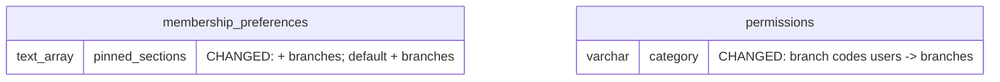

# DB changes — change-branches-in-navbar-2026-10-14-zrml

The iteration's database changes, in one file. Mode initial (Baseline `none`). No table is added or
removed; no column is added or removed. See it drawn in the DB Viewer's plan mode: `pnpm db:viewer`,
then click this iteration under ◇ Plans.

Status: **built, 2026-10-14**.

**1 table changes a rule and a default, 1 table changes data:**

| Table | Before | After | Decision |
| --- | --- | --- | --- |
| `app.membership_preferences` — CHECK `chk_membership_preferences_pinned_sections` | `pinned_sections <@ ['today', 'contacts', 'activity', 'leads', 'appointments', 'patients', 'medical', 'stock', 'payments', 'tasks', 'offerings', 'users']` and at most 10 | the same list **+ `'branches'`** (after `users`), at most 10 | [BN1](decisions.md), [BN5](decisions.md) |
| `app.membership_preferences.pinned_sections` — default | `{appointments, leads, patients, payments}` | `{appointments, leads, patients, payments, branches}` | [BN2](decisions.md) |
| `tenancy.permissions` — rows `branch:read`, `branch:create`, `branch:update`, `branch:delete` | `category = 'users'` | `category = 'branches'` | [BN1](decisions.md), [BN6](decisions.md) |

Migrations: `20261014185437_membership_preferences_branches_section.sql`,
`20261014185440_permissions_branches_category.sql` ([BN6](decisions.md)).

## Overview

