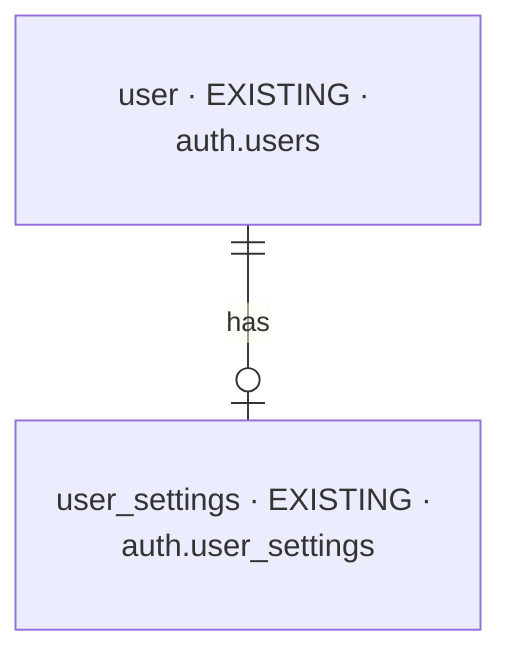
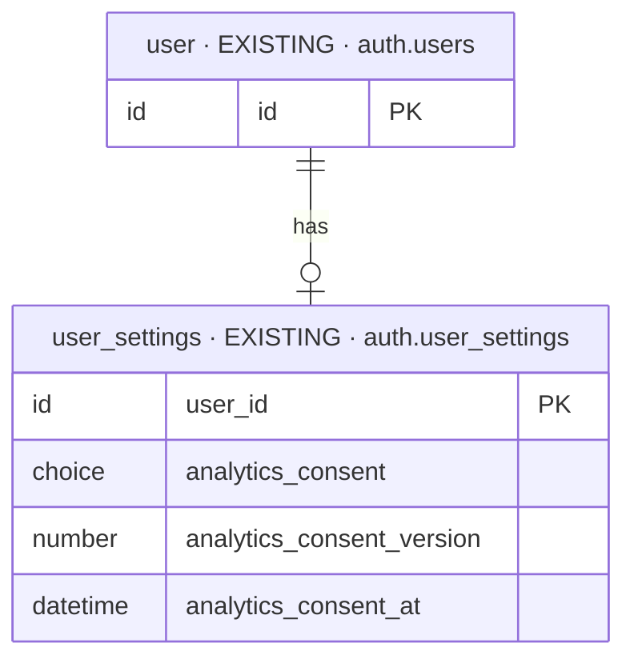

# change-cookie-consent-2026-10-13-fmal — database changes

Iteration `change-cookie-consent-2026-10-13-fmal` · MODE incremental on `launch-2026-09-30-jxmr` ·
Intake mode `brief` · Intake hash `a8a0e5889cc1` · 2026-10-13.

| NEW | CHANGED | REMOVED |
| --- | --- | --- |
| 0 | 0 | 0 |

**No database change** ([CC2](decisions.md)). The one table the change is about is drawn for context
only: the account's consent record stays exactly as the launch built it (D85, launch ROUTE #177) —
its meaning moves from "the person's consent, applied at sign-in" to "a receipt of the last answer
given while signed in". The browser's answer is a cookie the frontend owns; the backend stores
nothing about it.

## Overview

## Stage 1 — context only

### `user_settings`

- **Holds:** a person's own settings; the three consent fields are the receipt of the last analytics
  answer they gave while signed in (the decision, the policy version it answered, when — the time set
  by the database). Every decision is also its own audit row.
- **Table:** `auth.user_settings` (unchanged).
- **Sources:** `BRIEF.md:42–44`, `:108`; Baseline D85.
- **Added / Replaced:** nothing — the meaning is documented anew ([CC1](decisions.md),
  [CC2](decisions.md)).
- **Open:** none.

