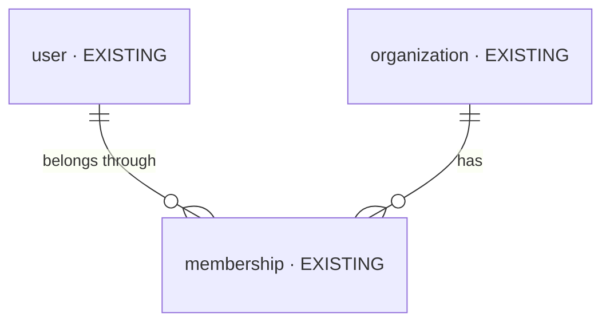

# DB changes — change-shell-polish-and-sign-in-2026-10-13-ojjp

The iteration's database changes, in one file (`be-iteration-planning` › Data diagrams). Mode
incremental (Baseline `launch-2026-09-30-jxmr`) · Intake mode `brief` · Intake hash `bc5d68b3628f` ·
2026-10-13.

| Change | Tables |
| --- | --- |
| NEW | 0 |
| CHANGED | 0 |
| REMOVED | 0 |

**No table, field, relationship or value list changes** ([D5](decisions.md)): the brief is
presentation only (`BRIEF.md:52`, `:57–58`, `:88`).

## Overview

Context only — the records a sign-in reads, all `EXISTING` and unchanged:

## Stages

None — there is no table to build.
