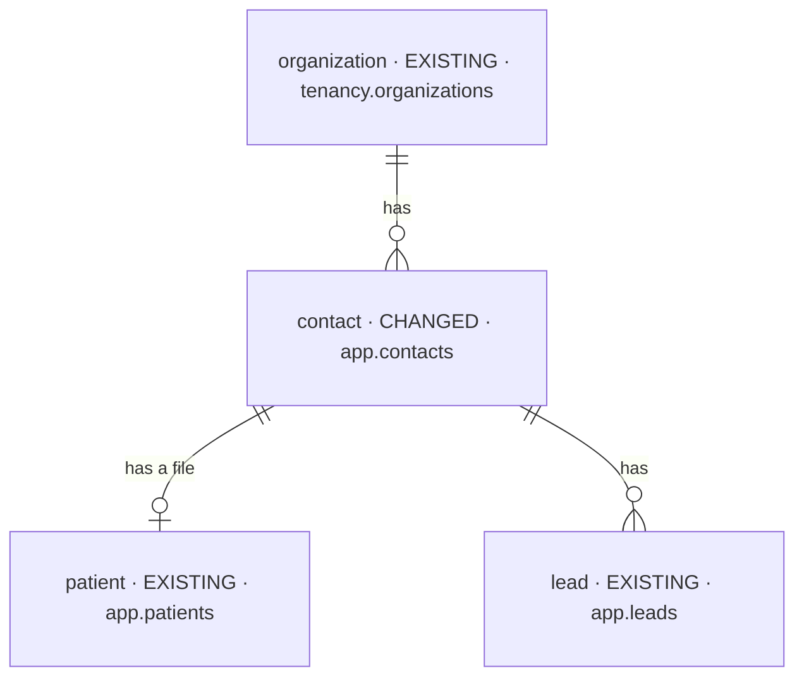

# feat-approximate-age-2026-10-31-kayj — database changes

Iteration `feat-approximate-age-2026-10-31-kayj` · MODE initial (Baseline `none`, [AA1](decisions.md)) ·
Intake mode `brief` · Intake hash `1ece1c50c902` · 2026-10-31.

| NEW | CHANGED | REMOVED |
| --- | --- | --- |
| 0 | 1 | 0 |

## Overview

## `contact` — CHANGED

| Column / constraint | Before | After |
| --- | --- | --- |
| `date_of_birth` | `date`, null, `chk_contacts_date_of_birth_past` | unchanged — holds a real or an approximate birth date |
| `date_of_birth_is_approximate` | — | **NEW** `boolean NOT NULL DEFAULT false` — true when the date came from a typed age ([AA2](decisions.md)) |
| `chk_contacts_date_of_birth_approximate` | — | **NEW** `NOT date_of_birth_is_approximate OR date_of_birth IS NOT NULL` ([AA9](decisions.md)) |

- Migration: `ADD COLUMN … NOT NULL DEFAULT false` (constant default — metadata only, no rewrite),
  the CHECK `NOT VALID` then `VALIDATE` (every row holds false).
- No index ([AA7](decisions.md)). RLS unchanged: `app.contacts` keeps its FORCE RLS organization policy.
- A later Cresence backfill writes `date_of_birth` + `date_of_birth_is_approximate = true` directly.
