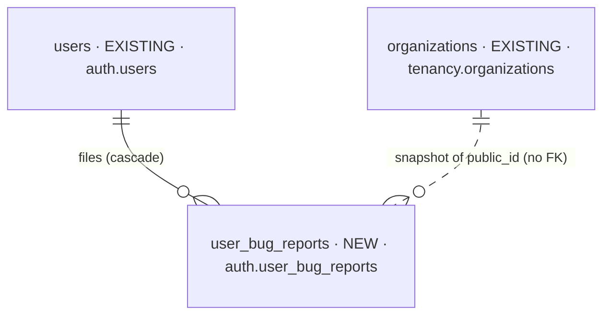
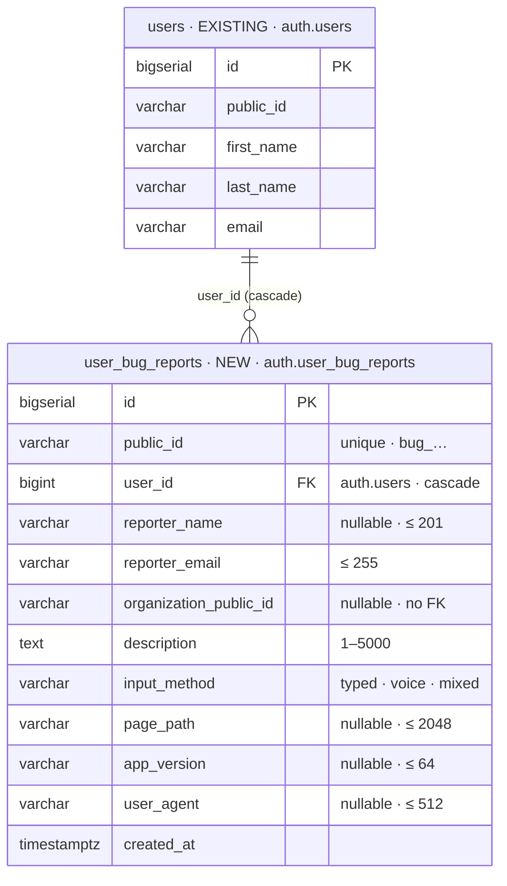

# feat-bug-report-2026-10-13-dgnx — database changes

Iteration `feat-bug-report-2026-10-13-dgnx` · MODE initial (Baseline `none`) · no intake files ·
2026-10-13.

| NEW | CHANGED | REMOVED |
| --- | --- | --- |
| 1 | 0 | 0 |

## Overview

## Stage 1 — the report

### `user_bug_reports`

- **Holds:** one bug report a signed-in person filed — what they wrote (typed or dictated), where
  they were, which release, and who they are (stamped from the session).
- **Table:** `auth.user_bug_reports` — schema `auth` with the `user` domain's other tables.
- **Sources:** the request (2026-10-13); [BR3](decisions.md) – [BR11](decisions.md).
- **Row-level security:** ENABLE + FORCE; `user_bug_reports_owner_access` — `FOR ALL`, `USING` and
  `WITH CHECK` `user_id = (SELECT id FROM auth.users WHERE public_id = current_setting('app.current_user_public_id', true) AND deleted_at IS NULL)`,
  no bypass arm ([BR8](decisions.md)).
- **Indexes:** `idx_user_bug_reports_user_id_created_at` (`user_id`, `created_at`) — the foreign key
  (the cascade from an account purge) and the export's newest-first read.
- **Checks:** `user_bug_reports_description_check` (1–5000 characters, not blank),
  `user_bug_reports_input_method_check` (`typed` · `voice` · `mixed`).
- **Open:** none.

## Before → after

| Table | Before | After | Why |
| --- | --- | --- | --- |
| `auth.user_bug_reports` | — (reports went to Sentry's feedback inbox, outside Postgres) | NEW | Postgres is the only source of truth; the reporter is stamped from the session ([BR4](decisions.md)) |
