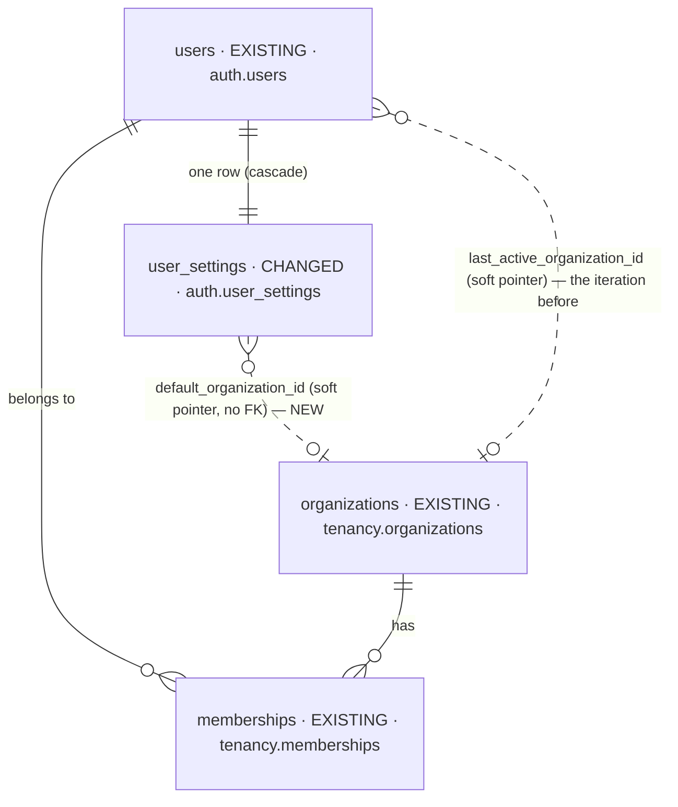
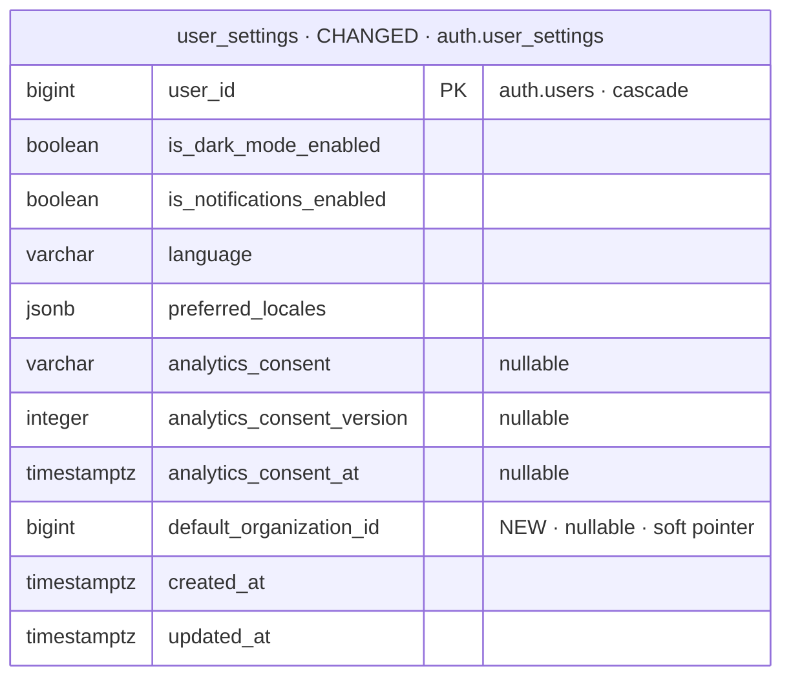

# feat-choose-default-clinic-2026-10-15-yizz — database changes

Iteration `feat-choose-default-clinic-2026-10-15-yizz` · MODE initial (Baseline `none`) · no intake
files · 2026-10-15.

| NEW | CHANGED | REMOVED |
| --- | --- | --- |
| 0 | 1 | 0 |

## Overview



## `auth.user_settings` — CHANGED

- **Before:** `user_id` (PK), `is_dark_mode_enabled`, `is_notifications_enabled`, `language`,
  `preferred_locales`, the analytics-consent receipt, timestamps.
- **After:** the same, plus **`default_organization_id bigint NULL`** — the clinic the person pinned
  to open at sign-in; `NULL` = automatic (the clinic used last) ([CD3](decisions.md),
  [CD4](decisions.md)).
- **Migration:** `migrations/<timestamp>_user_settings_default_organization.sql` —
  `ALTER TABLE auth.user_settings ADD COLUMN IF NOT EXISTS default_organization_id bigint;`
  (nullable, no default: a metadata-only change, no table rewrite).
- **Row-level security:** unchanged — `user_settings_owner_access` (owner only, `USING` and
  `WITH CHECK`).
- **Integrity:** no foreign key, as `auth.users.last_active_organization_id` (avoids a cross-schema
  cycle). Writes are validated ([CD6](decisions.md)); reads only honour it through an active
  membership in an active clinic ([CD7](decisions.md), [CD8](decisions.md)).
- **Index:** none — read by the row's primary key.



## The login default — before → after

```text
Before  ORDER BY personal-last, remembered, joined_at DESC
After   ORDER BY personal-last, pinned, remembered, joined_at DESC      (team organizations on)
                 personal-first, pinned, remembered, joined_at DESC     (team organizations off)
```

`pinned` is `organizations.id IS NOT DISTINCT FROM user_settings.default_organization_id`, read
through a LEFT JOIN on the caller's own settings row (no row, or a hidden one, pins nothing).
