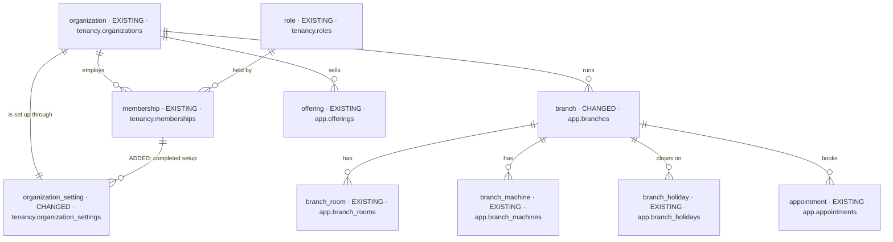
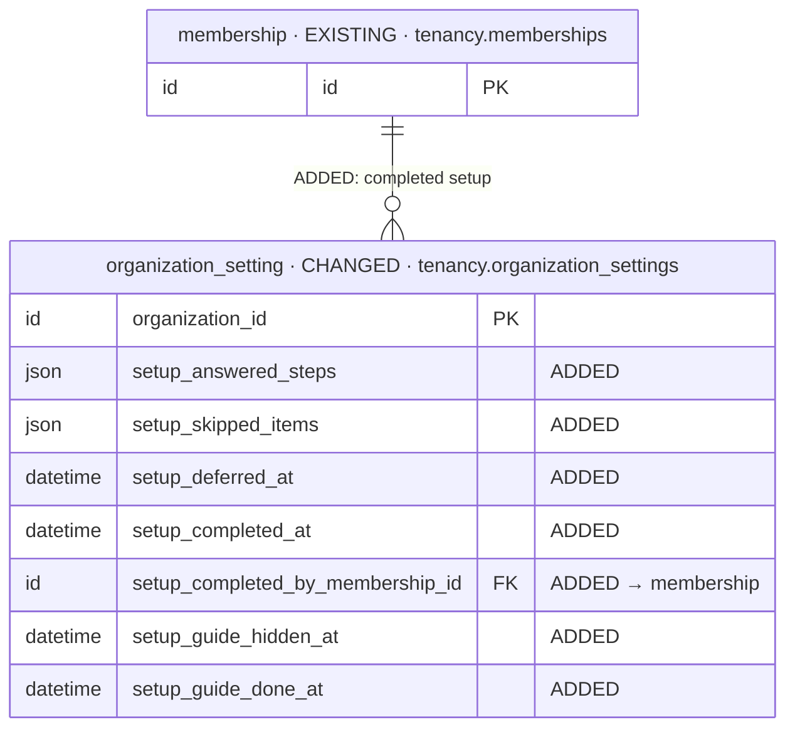
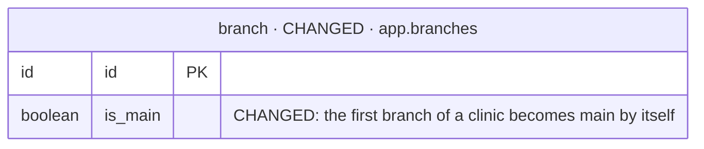

# DB changes — feat-clinic-setup-2026-10-13-sltd

The iteration's database changes, in one file, kept current at every planning step
(`be-iteration-planning` › Data diagrams). Logical types only — these are proposals: at kickoff the
backend's agent-os (its skills, rules and agents — the expert, which wins wherever this plan differs or
is unclear) decides each table's physical design (types, indexes, constraints, tenant rules); the
differences go into `AS-BUILT.md` and this file is synced with the final table and field names. See it drawn in the DB
Viewer's plan mode: `pnpm db:viewer`, then click this iteration under ◇ Plans.

Status: **Step 4, 2026-10-13** — every RED answered (D1–D23). Mode incremental (Baseline `launch-2026-09-30-jxmr`) · Intake mode `brief` ·
Intake hash `d5f100464051`. What exists is the launch as built — its route review
(`launch-2026-09-30-jxmr/plans/routes-final.md`, D9) and `AS-BUILT.md` — not the drop's wording.

**2 tables change, none is new:** `tenancy.organization_settings` gains the clinic's setup progress (D5);
`app.branches` changes one rule and no field (the first branch becomes main). Everything else setup touches is
**EXISTING** and only read or written through its own routes as built.

## Decided so far

| Change | Decision | What it changes here |
| --- | --- | --- |
| Setup progress lives with the clinic's settings | [D5](decisions.md) | seven `setup_*` fields ADDED to `tenancy.organization_settings`; no new table |
| The 7-day "✓ Set up" moment is stored | [D20](decisions.md) | `setup_guide_done_at` ADDED |
| The cash-drawer float is dropped from setup | [D17](decisions.md) | `day_float` is not an allowed value of the setup fields; `default_day_float` stays untouched (read by nothing, launch B25) |
| Only managers read the setup progress | [D19](decisions.md) | no member-facing read of these fields |
| Clinics that are ready when this ships count as set up | [D7](decisions.md) | a one-time fill of `setup_completed_at` in the same change (below) |
| Ticks are read from real records | BRIEF.md:129 | no "done" column per item — only answered steps, skipped items and the times |

## Stages

| Stage | Tables | ROUTE (draft) |
| --- | --- | --- |
| 1 — Setup progress and the main-branch rule | `organization_setting` (CHANGED), `branch` (CHANGED rule) | first rows of the ledger |
| — Read only | `organization`, `membership`, `role`, `offering`, `branch_room`, `branch_machine`, `branch_holiday`, `appointment` | — |

## Overview

## Stage 1 — Setup progress and the main-branch rule

### organization_setting · CHANGED

- **Holds:** the clinic's settings, one row per clinic (created on first read, as built). This iteration adds the
  clinic's **setup progress**: which setup steps were answered, which guide items were skipped, when setup was
  deferred ("Explore first"), when the essentials were completed and by whom, and when the guide was hidden.
- **Table:** `tenancy.organization_settings` (D5) — code `tenancy/sub-domains/organization/organization-settings/`
- **Sources:** BRIEF.md:49–52 (saved as you go, Explore first) · BRIEF.md:117–129 (the launcher, Hide, ticks from records) ·
  BRIEF.md:187–203 (states) · BRIEF.md:260–262 (scope: the clinic, not a person) · BRIEF.md:282–283 (existing clinics)
- **Added:**
  - `setup_answered_steps` — the answers that have no record of their own to read back: `clinic_type`,
    `opening_hours`, `you`, `team` (setup steps 1, 4, 5, 7 — `team` also when step 7 is skipped); the rest are read from
    records (main branch, services, someone to book). Names synced with the route review §2.A.3.
  - `setup_skipped_items` — guide items marked Skip: `invite_team`, `rooms`, `machines`, `holidays`, `gst`, `logo`,
    `review_links` (D17: no `day_float`).
  - `setup_deferred_at` — "Explore first" (or the drawer closed); the drawer stops opening by itself.
  - `setup_completed_at`, `setup_completed_by_membership_id` — the essentials done (refused while one is missing).
  - `setup_guide_hidden_at` — "Hide setup guide"; cleared when the guide is reopened.
  - `setup_guide_done_at` — the first time every guide item was done or skipped (D20); the launcher's ✓ "Set up"
    shows for 7 days after it.
- **Read, not changed:** `reminder_hour`, `lead_hold_days`, `retarget_after_days` (Settings › Clinic).
  `default_day_float` is not touched and not shown (D17).
- **One-time fill (D7):** every clinic that, when this ships, has an open main branch and at least one active service
  gets `setup_completed_at` = the time of the change (its settings row created if it has none).
- **Open:** none — the 7-day moment is stored (D20), only managers read the progress (D19), the float is dropped
  (D17). Written by the `onboarding-setup` sub-domain of the app domain through the tenancy settings service (D22).

### branch · CHANGED

- **Holds:** a clinic location (as built, launch routes-final §1.A).
- **Table:** `app.branches` — code `app/sub-domains/branches/`
- **Sources:** BRIEF.md:181–185 · users.md:132 ("if none is left main, the first branch becomes main") · launch
  routes-final §1.A.9 (a second main is a `409`)
- **Changed (rule, no field):** a clinic's **first** branch becomes its main branch even when the request does not
  send `is_main` — from setup or from Users › Branches.
- **Open:** none — keeping "at most one main" (§1.3) unchanged.

## Read only — what the setup guide ticks from

| Item (BRIEF.md:133–150) | Read from | As built |
| --- | --- | --- |
| Clinic type | `setup_answered_steps` ∋ `clinic_type`; `organization.specialties` | launch §12 |
| Main branch | an active `branch` with `is_main` | routes-final §1.A |
| Opening hours | `setup_answered_steps` ∋ `opening_hours` | — |
| Services | ≥ 1 active `offering` | routes-final §3.B |
| Someone to book (D15) | ≥ 1 active `membership` holding the Doctor or Therapist role (main or extra) | routes-final §2.B, §12 (D81 (4)) |
| Invite your team | ≥ 1 `membership` other than the owner's (invited or active) | routes-final §2.B |
| Add rooms · machines · holidays | ≥ 1 live `branch_room` / `branch_machine` at an open branch · ≥ 1 `branch_holiday` this year or later | routes-final §1.C–§1.E |
| GST on invoices · review & maps links | the main `branch`'s `gst_number` · `review_link`, `maps_link` | routes-final §1.A |
| Clinic logo | `organization.logo_url` | platform |
| Book your first appointment | ≥ 1 `appointment` | routes-final §6 |
