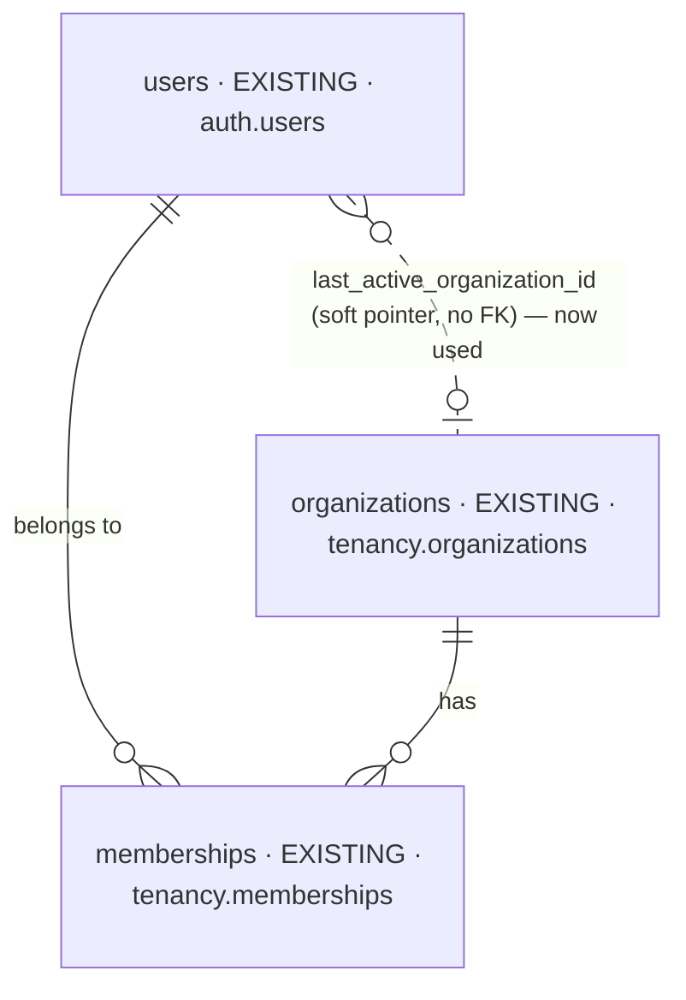

# feat-default-clinic-at-login-2026-10-14-cpjx — database changes

Iteration `feat-default-clinic-at-login-2026-10-14-cpjx` · MODE initial (Baseline `none`) · no
intake files · 2026-10-14.

| NEW | CHANGED | REMOVED |
| --- | --- | --- |
| 0 | 0 | 0 |

No table, column, index, constraint, policy or migration changes ([DC8](decisions.md)). An
existing, unused column starts being written and read.

## Overview



## `auth.users.last_active_organization_id`

- **Holds:** the clinic the person last switched to — their default clinic at login.
- **Before:** in the baseline migration and the Drizzle schema, documented as "restored as the
  default active organization at login", but never written or read.
- **After:** written by `POST /auth/switch-to-organization` ([DC5](decisions.md)) — only when the
  value changes; read by the login default ([DC6](decisions.md)).
- **Row-level security:** unchanged. The write runs in the person's own verified context and
  passes `users_self_or_admin_access` (`public_id = app.current_user_public_id`); the read joins
  the person's own row inside the verified login lookup.
- **Integrity:** still a soft pointer with no foreign key (it avoids a circular cross-schema FK).
  The read only matches an organization that already passed the active-membership filter, so a
  stale pointer — a clinic left, suspended or deleted — never selects it.

## The login default — before → after

```text
Before  ORDER BY (type = 'PERSONAL') DESC, joined_at DESC
After   ORDER BY [team organizations enabled]  (type = 'PERSONAL') ASC
                 [team organizations disabled] (type = 'PERSONAL') DESC
                 , (organizations.id IS NOT DISTINCT FROM users.last_active_organization_id) DESC
                 , joined_at DESC
```

`IS NOT DISTINCT FROM` keeps the comparison false (never `NULL`) when nothing is remembered —
Postgres sorts `NULL` first under `DESC`, which would otherwise put every row level with the
remembered one.
