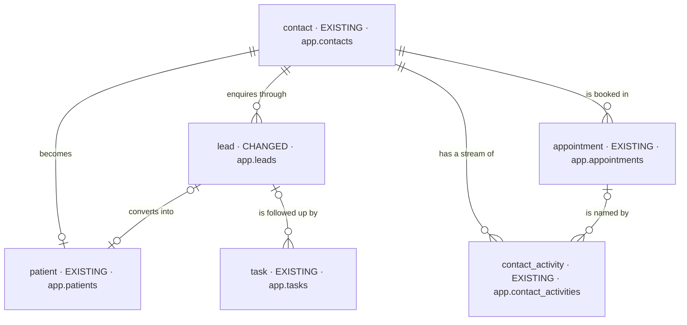
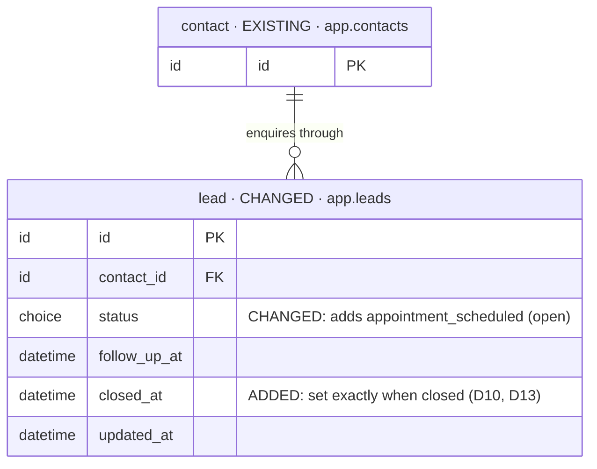

# DB changes — feat-lead-follows-bookings-2026-10-30-ytqj

The iteration's database changes, in one file, kept current at every planning step
(`be-iteration-planning` › Data diagrams). Logical types only — these are proposals: at kickoff the
backend's agent-os (its skills, rules and agents — the expert, which wins wherever this plan differs or
is unclear) decides each table's physical design (types, indexes, constraints, tenant rules); the
differences go into `AS-BUILT.md` and this file is synced with the final table and field names. See it drawn in the DB
Viewer's plan mode: `pnpm db:viewer`, then click this iteration under ◇ Plans.

Status: **Step 5, 2026-10-30** — the route review final (D16–D18); D10–D13 applied. Mode initial (Baseline `none`) · Intake mode `brief` · Intake hash
`5bae0977a19a`. What exists is the code as built (coverage.md › K1–K8), not a drop.

**1 table changes, none is new:** `app.leads` — its status gains `appointment_scheduled` (already written
in the first slice, D9) and it gains a **close date** (D7). Everything else this change touches is
**EXISTING** and only read or written as it is today.

## Decided so far

| Change | Decision | What it changes here |
| --- | --- | --- |
| A booking step on the lead | [D1](decisions.md) | `lead.status` CHANGED: adds `appointment_scheduled`, an **open** status (one open lead per contact counts it) |
| The 90-day win-back is measured from the close | [D2](decisions.md), [D7](decisions.md) | `lead.closed_at` ADDED — when the lead last entered a closing status; empty while open |
| A won-back lead is the visit's lead | [D2](decisions.md), [D15](decisions.md) | no field: the patient file's existing link to its lead (`patient.lead_id`) is written with the won-back lead when this check-in opens the file |
| Every closing status stamps the close date; a reopen empties it | [D10](decisions.md) | `closed_at` set exactly when `status` is `not_interested`, `invalid`, `lost` or `clinic_visited` |
| The close date is read-only output | [D11](decisions.md) | no write accepts it |
| The database holds it | [D13](decisions.md) | a `CHECK` on `lead` (set exactly when closing); existing closed leads backfilled from their last update |

## Stages

| Stage | Tables | ROUTE (draft) |
| --- | --- | --- |
| 1 — The lead's booking status and close date | `lead` (CHANGED) | first rows of the ledger |
| — Read or written as today | `contact`, `appointment`, `patient`, `contact_activity`, `task` | — |

## Overview

## Stage 1 — The lead's booking status and close date

### lead

- **Holds:** one enquiry and its working state for one contact (the launch's lead, as built).
- **Table:** `app.leads` (exists).
- **Sources:** BRIEF.md:56–66 (the booking status), BRIEF.md:78, 118–120 (the win-back window).
- **Added:** `status` adds `appointment_scheduled` — open, set and cleared only by the person's bookings
  (D1; built in the first slice, `6e92210`, migrations `20261028131034` and `20261028131036`, to be
  verified at kickoff); `closed_at` — when the lead last entered a closing status, emptied when it is
  reopened; existing closed leads take their last update as their close date (D7).
- **Replaced:** none.
- **Open:** none — D10 (every closing status), D11 (read-only output), D13 (a `CHECK`).

### Read or written as today

| Entity | What this change does with it |
| --- | --- |
| `appointment` · `app.appointments` | read: a booking still to happen (scheduled or confirmed, not removed) — no field changes |
| `patient` · `app.patients` | written as today when a check-in opens the file; its link to the lead now names a won-back lead too |
| `contact_activity` · `app.contact_activities` | written: one `system` line per move the server makes, naming why |
| `task` · `app.tasks` | the `follow_up` rule's tasks open and close as the lead moves — no field changes |
| `contact` · `app.contacts` | read only |
