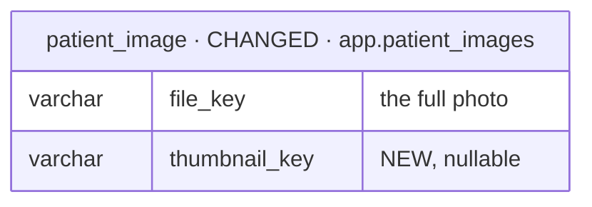

# feat-patient-image-thumbnails-2026-10-31-tibz — database changes

Iteration `feat-patient-image-thumbnails-2026-10-31-tibz` · Baseline `none` ([PT1](decisions.md)) ·
Intake mode `brief` · 2026-10-31.

| NEW | CHANGED | REMOVED |
| --- | --- | --- |
| 0 | 1 | 0 |

## `patient_image` — CHANGED (`app.patient_images`)

| Column | Before | After |
| --- | --- | --- |
| `thumbnail_key` | — | `varchar(512)`, nullable — the thumbnail object's key (`<file_key without extension>.thumb.webp`); null until the thumbnail job makes one, and again after a delete removes it |

- No index: the sweep and the backfill read by `id` keyset with `thumbnail_key IS NULL` on the
  organization's photos (the table is small per organization; the partial index can follow if a
  plan shows a need).
- RLS unchanged (`patient_images_tenant_isolation`, FORCE via the baseline; the retention-cleanup
  arm already lets the sweep read across organizations).
- Migration: `ALTER TABLE app.patient_images ADD COLUMN thumbnail_key varchar(512)` — additive,
  nullable, no rewrite, no backfill in SQL (the backfill script enqueues jobs, [PT13](decisions.md)).

