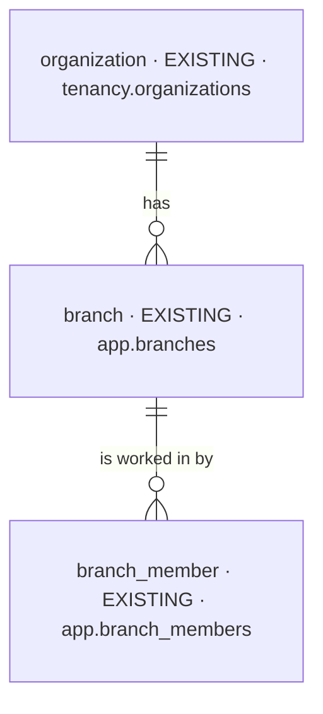
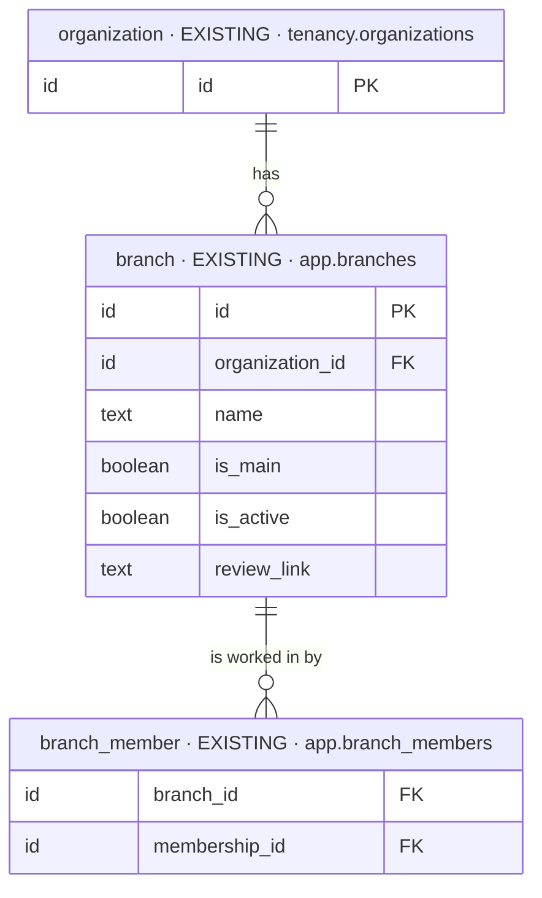

# feat-payment-celebration-2026-10-15-xpkw — database changes

Iteration `feat-payment-celebration-2026-10-15-xpkw` · MODE initial (Baseline `none`, [PC1](decisions.md)) ·
Intake mode `full` · Intake hash `992289e86d52` · 2026-10-15.

| NEW | CHANGED | REMOVED |
| --- | --- | --- |
| 0 | 0 | 0 |

**No database change** ([PC6](decisions.md)): no table, column, index, constraint, policy or
migration. The one table the change is about is drawn for context only — `app.branches.review_link`
exists (varchar(512), `chk_branches_review_link`: `https://` only, null when unset). What changes is
who can read it: every member, through `GET /app/branches/my` ([PC4](decisions.md)).

## Overview

## Stage 1 — context only

### `branch`

- **Holds:** one clinic location — its address, contacts, hours, default staff, and the maps and
  Google review links. The review link is what the clinic asks a patient to review it on.
- **Table:** `app.branches` (unchanged).
- **Sources:** `schema-routes.md:8–14`; `PRD.md:21–25`; `BRIEF.md:38–43`.
- **Added / Replaced:** nothing in the table. Read by every member through `/my` from now on
  ([PC4](decisions.md)); `branch_members` decides which branches a member reads (a `branch:read`
  holder reads every active branch), as today.
- **Open:** none.

