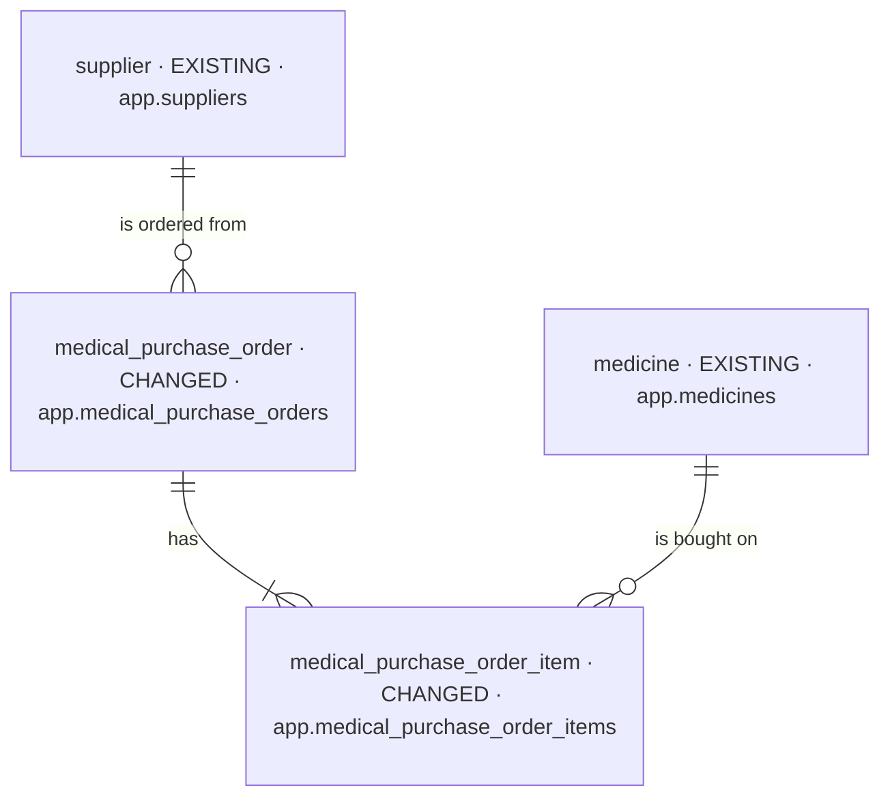
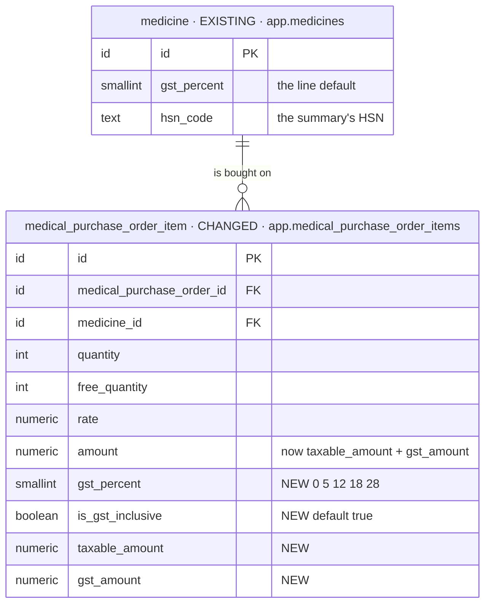
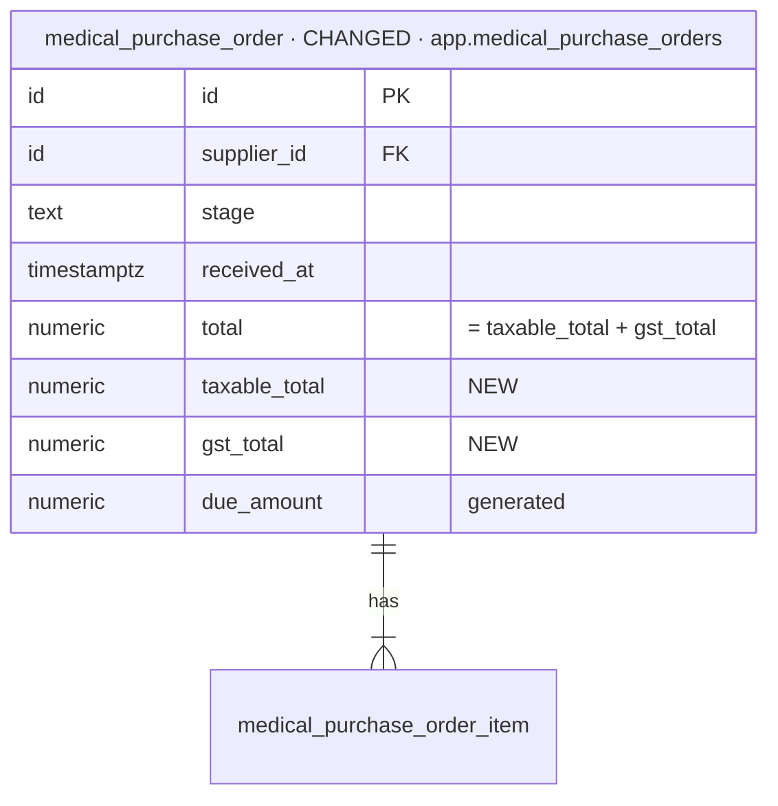

# feat-purchase-line-gst-2026-10-31-vcec — database changes

Iteration `feat-purchase-line-gst-2026-10-31-vcec` · MODE initial (Baseline `none`, [PG1](decisions.md)) ·
Intake mode `brief` · Intake hash `35ce19d3e29b` · 2026-10-31.

| NEW | CHANGED | REMOVED |
| --- | --- | --- |
| 0 | 2 | 0 |

Two tables gain columns, one migration fills them for the rows that exist ([PG8](decisions.md)), and
one partial index serves the monthly summary ([PG15](decisions.md)). No table, policy or permission
is added; RLS stays as it is on both tables.

## Overview

## Stage 1 — the purchase line and the order (ROUTE 1)

### `medical_purchase_order_item`

- **Holds:** one line of a purchase order — the medicine, packs ordered and free, the rate per pack,
  and now its GST: the rate, whether the rate includes it, the taxable value and the GST.
- **Table:** `app.medical_purchase_order_items` (CHANGED).
- **Sources:** `BRIEF.md:17–22`, `:51–56`.
- **Added / Replaced:** added `gst_percent` (smallint NOT NULL, one of 0, 5, 12, 18, 28 —
  `chk_medical_purchase_order_items_gst_percent`), `is_gst_inclusive` (boolean NOT NULL DEFAULT
  true), `taxable_amount`, `gst_amount` (numeric(12,2) NOT NULL, ≥ 0). Replaced
  `chk_medical_purchase_order_items_amount` (`amount = quantity × rate`) by: `amount =
  taxable_amount + gst_amount`, and `quantity × rate` is the amount when inclusive, the taxable
  amount when exclusive ([PG4](decisions.md)).
- **Open:** none.

### `medical_purchase_order`

- **Holds:** an order to a supplier, ordered then received; what it comes to and what is owed.
- **Table:** `app.medical_purchase_orders` (CHANGED).
- **Sources:** `BRIEF.md:23`, `:24–27`.
- **Added / Replaced:** added `taxable_total`, `gst_total` (numeric(12,2) NOT NULL DEFAULT 0, ≥ 0)
  with `chk_medical_purchase_orders_totals` (`total = taxable_total + gst_total`); added the
  partial index `idx_medical_purchase_orders_organization_received` (`organization_id,
  received_at` WHERE live and received) for the summary ([PG15](decisions.md)). `due_amount` and
  `payment_status` keep following `total`.
- **Open:** none.

## The migration's fill ([PG8](decisions.md))

| Step | What |
| --- | --- |
| 1 | add the columns nullable (the order totals with their default) |
| 2 | each line: `gst_percent` = its medicine's, `is_gst_inclusive` = true, `taxable_amount = round(amount × 100 ÷ (100 + gst_percent), 2)`, `gst_amount = amount − taxable_amount` |
| 3 | each order: `taxable_total` / `gst_total` = the sums over the lines that count in `total` (all while ordered; `is_received` once received) |
| 4 | `SET NOT NULL`, the checks, the index |
