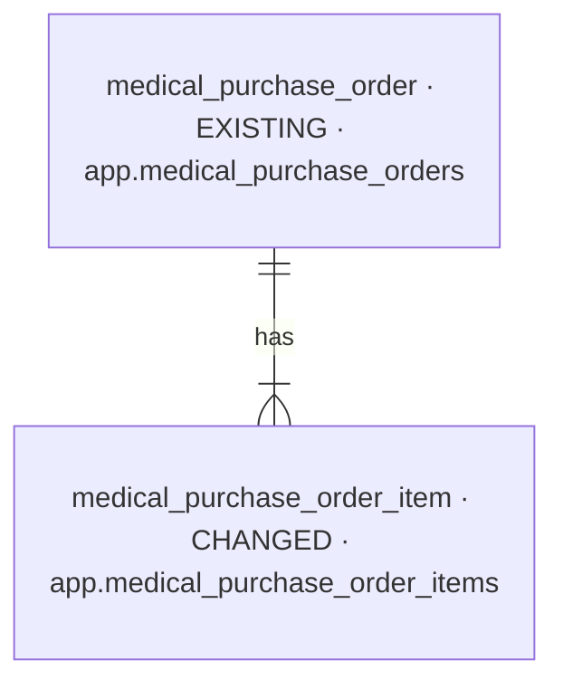
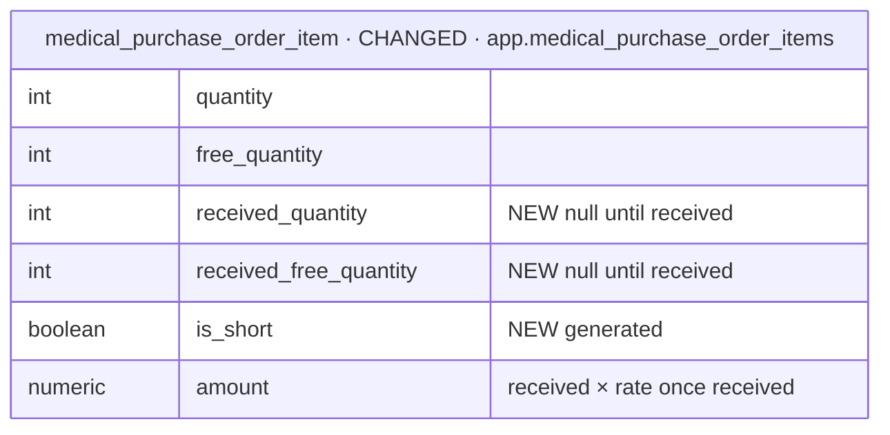

# feat-short-delivery-2026-11-01-qfnq — database changes

Iteration `feat-short-delivery-2026-11-01-qfnq` · MODE initial (Baseline `none`, [SD1](decisions.md)) ·
Intake mode `brief` · Intake hash `d03c5ab0bf5a` · 2026-11-01.

| NEW | CHANGED | REMOVED |
| --- | --- | --- |
| 0 | 1 | 0 |

## Overview

## Stage 1 — the purchase line (ROUTE 1)

### `medical_purchase_order_item`

- **Holds:** one line of an order — now also what arrived.
- **Table:** `app.medical_purchase_order_items` (CHANGED).
- **Sources:** `BRIEF.md:15–23`, `:42–48`.
- **Added / Replaced:** added `received_quantity`, `received_free_quantity` (integer, null until received;
  `chk_medical_purchase_order_items_received`: both set exactly when `is_received` is true, each 0 ≤ … ≤
  the ordered one) and `is_short` (boolean, generated: received and less than ordered); replaced
  `chk_medical_purchase_order_items_amount`'s `quantity × rate` by `coalesce(received_quantity, quantity) ×
  rate` ([SD11](decisions.md)). The migration fills received lines with received = ordered ([SD10](decisions.md)).
- **Open:** none.

