# DB changes — launch-2026-09-30-jxmr

The iteration's database changes, in one file, kept current at every planning step
(`be-iteration-planning` › Data diagrams). Logical types only — these are proposals: at kickoff the
backend's agent-os (its skills, rules and agents — the expert, which wins wherever this plan differs or
is unclear) decides each table's physical design (types, indexes, constraints, tenant rules); the
differences go into `AS-BUILT.md` and this file is synced with the final table and field names. See it drawn in the DB
Viewer's plan mode: `pnpm db:viewer`, then click this iteration under ◇ Plans.

Status: the 2026-10-03 plan, synced with the route review per sub-domain from 2026-10-08 (see Route review sync). Planning Step 5: D1–D44 and the Reconciliation P verdicts applied; each table has its ROUTE row in KICKOFF.md
([coverage.md › Reconciliation](coverage.md#reconciliation)); every screen-only field was answered. Mode initial
(Baseline `none`) · Intake hash `036cbb592ac5`.

**60 tables:** 54 NEW · 4 CHANGED (platform tables:
organizations, users, memberships, roles) · 2 EXISTING (the permission catalog and
role permissions — no schema change; the clinic section codes are seeded, D10).

**`choice`** = one value from a list of allowed values — never a database enum type (stored as text
with its allowed values, `be-sql-design-guard`). A list a clinic can change is a table or catalog of
its own (D10). Organized in build stages — dependency
order, the order the ROUTE ledger will follow. Each table lists what it holds, where that comes from
(`file:line`), what the frontend requests added (D3) and what is still open.

**Domains and table names** — not chosen yet; Step 4 asks which domain each group of new tables goes
under and confirms their names (plural snake_case, like the existing tables). Until then the DB Viewer
draws every new table under `app` with its plural name (`branch` → `app.branches`).

**Not drawn:** embedded lists stay `json` fields (prescription and invoice items, payment splits,
medicine batches and supplier rates, purchase lines, sale returns, stock purchase and count lines);
the common fields on every table (organization, created / updated time and by, soft delete with
reason — `schema-routes.md:126–134`, plus `updated_by` — `patients.md:28`) are not repeated.

## Route review sync (2026-10-08)

The route review ([routes-final.md](routes-final.md), [D46](decisions.md)) is the design now. Its tables, by sub-domain, as
its table designs name them (60 tables; the medical store's wait for its own review, [D49](decisions.md)):

| Sub-domain | Tables (route review) | Design | Built at |
| --- | --- | --- | --- |
| 1. Branches & places | `app.branches`, `app.branch_members`, `app.branch_rooms`, `app.branch_machines`, `app.branch_holidays` | §1 | #125 |
| 2. Team | `app.membership_preferences`, `app.membership_preference_branches`, `app.membership_saved_views`, `tenancy.memberships`, `tenancy.membership_additional_roles`, `tenancy.membership_invitations`, `tenancy.roles`, `tenancy.role_permissions`, `tenancy.permissions` | §2 | #126–#127 |
| 3. Offerings | `app.offering_groups`, `app.offerings`, `app.offering_branches`, `app.offers`, `app.offer_offerings`, `app.offer_branches` | §3 | #128 |
| 4. Contacts | `app.contacts`, `app.contact_phones`, `app.contact_members`, `app.contact_activities`, `app.contact_message_templates` | §4 | #129–#130 |
| 5. Leads | `app.leads`, `app.lead_involved_memberships` | §5 | #131 |
| 6. Appointments | `app.appointments` | §6 | #132 |
| 7. Patients | `app.patients`, `app.patient_clinical_notes`, `app.patient_prescriptions`, `app.prescription_kits`, `app.patient_diagnoses`, `app.patient_images`, `app.patient_reports`, `app.patient_treatments`, `app.patient_check_ins`, `app.patient_reviews`, `app.patient_feedback_actions`, `app.patient_offerings`, `app.patient_offering_suggestions` | §7 | #133–#135 |
| 8. Billing | `app.invoices`, `app.invoice_items`, `app.invoice_members`, `app.invoice_credit_notes`, `app.payments`, `app.payment_edits`, `app.pending_credits`, `app.day_closes`, `app.day_close_events` | §8 | #136 |
| 9. Stock | `app.stock_items`, `app.stock_item_movements`, `app.stock_counts`, `app.stock_count_lines`, `app.stock_purchases`, `app.stock_purchase_items`, `app.stock_vendors` | §9 | #137 |
| 10. Tasks & rules | `app.tasks`, `app.task_owner_changes`, `app.task_rule_settings` | §10 | #138 |

**Where this file and the route review differ, the route review wins** — the renames (`patient_*`, `contact_*`,
`stock_item_movements`, `invoice_credit_notes`, `invoice_members`, `patient_offerings` …), the new tables
(`app.contacts`, `app.contact_phones`, `app.contact_members`, `app.invoice_items`, the count and purchase lines …), and
the dropped ones (`app.visits`, `app.lead_reads`, `app.patient_notes`, `app.patient_ideas`, the old `medical_contacts`
link). The stage diagrams below are the 2026-10-03 plan; each sub-domain row redraws its tables here when it is built
(`be-kickoff-iteration` › Record), so this file ends as the true record.

## Decided so far

| Change | Decision | What it changes here |
| --- | --- | --- |
| organization · CHANGED | [D7](decisions.md), [D34, D35](decisions.md) | the platform organization gains specialties, timezone and currency (fixed INR), and the clinic settings: the reminder hour and the re-target days |
| membership · CHANGED | [D5](decisions.md), [D3](decisions.md) | a membership holds one or more editable roles, and the staff profile (seq, phone, tone, hours, commission, branches) |
| role · CHANGED | [D5](decisions.md), [D3](decisions.md) | the 9 clinic roles are seeded as editable roles with tone and purpose (lock pending) |
| permission, role_permission · EXISTING | [D10](decisions.md), [D12–D19](decisions.md) | clinic sections are codes in the permission catalog (dynamic, not a fixed list), and so are the role-named actions (D13), reviews (D16), the 11 special permissions (D18) and task rules (D19); the default matrix and presets are seed data (D12, D14–D18) — no schema change |
| user · CHANGED | [D4](decisions.md) | staff join by invitation; the user record gains presence only |
| invoice · NEW | [D20, D21, D23](decisions.md) | numbered per branch GSTIN and financial year (`INV/26-27/0001`); the overall discount is spread before tax; each line keeps whether its rate included GST |
| credit_note · NEW | [D22](decisions.md) | always against an invoice; a give-back with no invoice is a refund payment |
| day_close · NEW | [D24](decisions.md) | a reason when the counted cash differs |
| offering, medicine · NEW | [D21, D26, D27](decisions.md) | MRP includes GST; discounts stop at the lowest price (`minPrice`); seeded GST 0% on consultations, 18% on procedures |
| branch_holiday · NEW | [D41](decisions.md) | a branch's closed days; no slot is offered on them |
| room, machine · NEW; appointment · NEW | [D28](decisions.md) | each branch lists its rooms and machines; an appointment may name one of each (replaces schema-routes' fixed `room` list) |
| offering_group · NEW; offering · NEW | [D29](decisions.md) | a fixed kind for behaviour + clinic-defined groups for browsing |
| prescription · NEW | [D31](decisions.md) | draft → approved by a prescriber, with who and when |
| patient_idea · NEW | [D39](decisions.md) | AI ideas from a de-identified summary (Data consent only), rules as the fallback |
| every clinic table | [D36](decisions.md), [D38](decisions.md) | the domain stays the provisional `app` until kickoff; names follow the repository's rules (`mr_visit` → `medical_rep_visit`); deleted rows are purged after 7 days (a clinic setting) |
| 17 new tables beyond schema-routes | [D3](decisions.md) | visit, diagnosis, prescription kits, clinical note items, saved views, lead reads, message templates, payment edits, day-close events, supplier credits, task reassign history, task rule settings |

## Stages

| Stage | Tables |
| --- | --- |
| Stage 1 — Foundation: the organization, branches and the team | `organization`, `branch`, `branch_user_accesses`, `user`, `membership`, `role`, `permission`, `role_permission`, `user_preference`, `saved_view` |
| Stage 2 — Catalogue: what the clinic sells | `offering_group`, `offering`, `offer` |
| Stage 3 — People and conversations | `patient`, `lead`, `lead_message`, `lead_read`, `message_template` |
| Stage 4 — Scheduling and the visit | `branch_holiday`, `room`, `machine`, `appointment`, `visit` |
| Stage 5 — The clinical record | `diagnosis`, `patient_clinical_note`, `prescription`, `prescription_kit`, `patient_image`, `patient_report`, `patient_note` |
| Stage 6 — Billing and money | `invoice`, `patient_package`, `offering_suggestion`, `patient_idea`, `payment`, `payment_edit`, `credit_note`, `pending_credit`, `day_close`, `day_close_event` |
| Stage 7 — Treatments and feedback | `treatment`, `check_in`, `review`, `feedback_action` |
| Stage 8 — Medical store | `manufacturer`, `supplier`, `medical_rep`, `medical_rep_visit`, `medicine`, `medical_purchase_order`, `medical_contact`, `medical_sale`, `supplier_credit` |
| Stage 9 — Clinic stock | `stock_vendor`, `stock_item`, `stock_purchase`, `stock_movement`, `stock_count` |
| Stage 10 — Tasks and automation | `task`, `task_owner_change`, `task_rule_setting` |

## Overview

```mermaid
erDiagram
  organization["organization · CHANGED"]
  branch["branch · NEW"]
  user["user · CHANGED"]
  membership["membership · CHANGED"]
  role["role · CHANGED"]
  permission["permission · EXISTING"]
  role_permission["role_permission · EXISTING"]
  user_preference["user_preference · NEW"]
  saved_view["saved_view · NEW"]
  offering_group["offering_group · NEW"]
  offering["offering · NEW"]
  offer["offer · NEW"]
  patient["patient · NEW"]
  lead["lead · NEW"]
  lead_message["lead_message · NEW"]
  lead_read["lead_read · NEW"]
  message_template["message_template · NEW"]
  branch_holiday["branch_holiday · NEW"]
  room["room · NEW"]
  machine["machine · NEW"]
  appointment["appointment · NEW"]
  visit["visit · NEW"]
  diagnosis["diagnosis · NEW"]
  patient_clinical_note["patient_clinical_note · NEW"]
  prescription["prescription · NEW"]
  prescription_kit["prescription_kit · NEW"]
  patient_image["patient_image · NEW"]
  patient_report["patient_report · NEW"]
  patient_note["patient_note · NEW"]
  invoice["invoice · NEW"]
  patient_package["patient_package · NEW"]
  offering_suggestion["offering_suggestion · NEW"]
  patient_idea["patient_idea · NEW"]
  payment["payment · NEW"]
  payment_edit["payment_edit · NEW"]
  credit_note["credit_note · NEW"]
  pending_credit["pending_credit · NEW"]
  day_close["day_close · NEW"]
  day_close_event["day_close_event · NEW"]
  treatment["treatment · NEW"]
  check_in["check_in · NEW"]
  review["review · NEW"]
  feedback_action["feedback_action · NEW"]
  manufacturer["manufacturer · NEW"]
  supplier["supplier · NEW"]
  medical_rep["medical_rep · NEW"]
  medical_rep_visit["medical_rep_visit · NEW"]
  medicine["medicine · NEW"]
  medical_purchase_order["medical_purchase_order · NEW"]
  medical_contact["medical_contact · NEW"]
  medical_sale["medical_sale · NEW"]
  supplier_credit["supplier_credit · NEW"]
  stock_vendor["stock_vendor · NEW"]
  stock_item["stock_item · NEW"]
  stock_purchase["stock_purchase · NEW"]
  stock_movement["stock_movement · NEW"]
  stock_count["stock_count · NEW"]
  task["task · NEW"]
  task_owner_change["task_owner_change · NEW"]
  task_rule_setting["task_rule_setting · NEW"]

  organization ||--o{ branch : "has"
  branch }o--o{ user : "staffs"
  user }o--o{ role_permission : "is granted through roles"
  membership ||--|| user_preference : "keeps"
  user ||--o{ membership : "is a member through"
  membership }o--o{ role : "ADDED: holds one or more"
  branch |o--o{ lead : "receives"
  user |o--o{ lead : "owns"
  lead ||--o{ lead_message : "holds"
  task |o--o{ lead_message : "is noted in"
  patient |o--o{ lead : "is converted from"
  branch ||--o{ patient : "is home of"
  user |o--o{ patient : "is usual doctor of"
  patient |o--o{ patient : "refers"
  branch ||--o{ appointment : "hosts"
  user ||--o{ appointment : "sees as doctor"
  patient |o--o{ appointment : "books"
  lead |o--o{ appointment : "books"
  offering |o--o{ appointment : "is booked as"
  appointment |o--o{ appointment : "is copied to"
  patient ||--o{ prescription : "is prescribed"
  appointment |o--o{ prescription : "produces"
  prescription }o--o{ medicine : "lists"
  patient ||--o{ treatment : "receives"
  appointment |o--o{ treatment : "produces"
  offering |o--o{ treatment : "is performed as"
  patient_package |o--o{ treatment : "is used by"
  patient ||--o{ patient_image : "is photographed in"
  appointment |o--o{ patient_image : "is photographed in"
  patient ||--o{ patient_report : "has"
  patient ||--o{ patient_note : "has"
  patient ||--o{ offering_suggestion : "is planned"
  appointment |o--o{ offering_suggestion : "suggests"
  offering ||--o{ offering_suggestion : "is suggested as"
  offering_suggestion }o--o{ invoice : "is invoiced on"
  patient ||--o{ check_in : "gives"
  appointment |o--o{ check_in : "is checked on"
  treatment |o--o{ check_in : "is checked on"
  check_in }o--o{ offering : "suggests next"
  patient ||--o{ review : "writes"
  appointment |o--o{ review : "is reviewed in"
  check_in |o--o{ feedback_action : "is acted on by"
  review |o--o{ feedback_action : "is acted on by"
  offering }o--o{ offer : "is discounted by"
  branch }o--o{ offer : "runs"
  branch ||--o{ invoice : "bills"
  patient |o--o{ invoice : "is billed on"
  medical_contact |o--o{ invoice : "is billed on"
  prescription |o--o{ invoice : "is sold on"
  offering }o--o{ invoice : "is a line on"
  medicine }o--o{ invoice : "is a line on"
  invoice ||--o{ patient_package : "sells"
  offering ||--o{ patient_package : "is sold as"
  patient ||--o{ patient_package : "owns"
  branch ||--o{ payment : "records"
  patient |o--o{ payment : "pays or is refunded"
  invoice |o--o{ payment : "is paid by"
  invoice ||--o{ credit_note : "is refunded by"
  credit_note |o--o{ payment : "is paid out by"
  pending_credit |o--o{ payment : "is settled by"
  patient |o--o{ pending_credit : "is owed or owes"
  medical_purchase_order |o--o{ payment : "is paid by"
  stock_purchase |o--o{ payment : "is paid by"
  branch ||--o{ day_close : "closes"
  day_close |o--o{ payment : "locks"
  user |o--o{ task : "owns"
  patient |o--o{ task : "prompts"
  lead |o--o{ task : "prompts"
  manufacturer ||--o{ medicine : "makes"
  manufacturer }o--o{ supplier : "is distributed by"
  manufacturer }o--o{ medical_rep : "is represented by"
  medical_rep ||--o{ medical_rep_visit : "logs"
  supplier ||--o{ medical_purchase_order : "fulfils"
  supplier }o--o{ medicine : "quotes for"
  medicine }o--o{ medical_purchase_order : "is ordered on"
  invoice ||--o| medical_sale : "records"
  patient |o--o{ medical_sale : "buys"
  medical_contact |o--o{ medical_sale : "buys"
  prescription |o--o{ medical_sale : "is filled by"
  stock_vendor ||--o{ stock_purchase : "supplies"
  stock_vendor |o--o{ stock_item : "is usual vendor of"
  stock_item }o--o{ stock_purchase : "is bought on"
  stock_item ||--o{ stock_movement : "changes by"
  stock_purchase |o--o{ stock_movement : "receives"
  stock_count |o--o{ stock_movement : "adjusts"
  stock_item }o--o{ stock_count : "is counted in"
  patient |o--o{ stock_movement : "is used for"
  stock_movement |o--o| stock_movement : "reverts"
  membership ||--o{ saved_view : "saves"
  lead ||--o{ lead_read : "is read by"
  user ||--o{ lead_read : "reads"
  patient ||--o{ patient_clinical_note : "has"
  appointment ||--o| visit : "runs as"
  patient ||--o{ visit : "has"
  visit }o--o{ diagnosis : "records"
  user ||--o{ prescription_kit : "keeps"
  patient_package |o--o{ appointment : "is used by"
  payment ||--o{ payment_edit : "is changed by"
  day_close ||--o{ day_close_event : "logs"
  invoice |o--o{ pending_credit : "is settled through"
  supplier ||--o{ supplier_credit : "owes"
  medicine |o--o{ supplier_credit : "is returned as"
  lead |o--o{ medical_sale : "buys"
  task ||--o{ task_owner_change : "is reassigned through"
  branch ||--o{ room : "has"
  branch ||--o{ machine : "has"
  room |o--o{ appointment : "hosts"
  machine |o--o{ appointment : "is booked on"
  offering_group |o--o{ offering : "groups"
  patient ||--o| patient_idea : "has"
  branch ||--o{ branch_holiday : "closes on"
```

## Stage 1 — Foundation: the organization, branches and the team

### organization · CHANGED

- **Holds:** The clinic business (tenant). Read by every screen (header, print letterhead); written by Users › Branches (settings).
- **Table (built, ROUTE #1):** `tenancy.organizations` (the clinic profile) + `tenancy.organization_settings` (the clinic settings, with the organization's other settings — RC-201 writes them)
- **Sources:** schema-routes.md:138–149 · PRD.md:9 · D7
- **Added** (a frontend request, D3, unless a decision is named): `specialties` (D7), `timezone` (D7), `currency` (D7), `default_day_float` (payments.md:76, 327), `lead_hold_days` (leads.md:180, 402), `reminder_hour` (D34), `retarget_after_days` (D35), `deleted_record_purge_days` (D38)
- **Open:** none

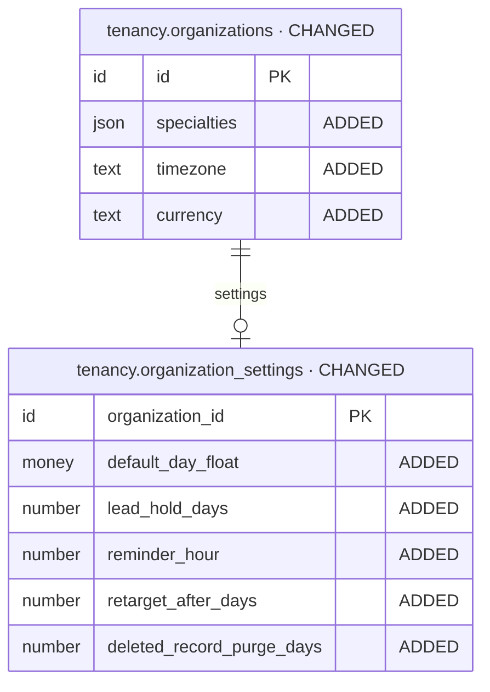

### branch · NEW

- **Holds:** A clinic location. Read by header branch picker, every drawer's Branch field, print sheets; written by Users › Branches.
- **Table (built, ROUTE #2):** `app.branches` — code `app/sub-domains/branches/`
- **Sources:** schema-routes.md:154–180 · PRD.md:151 · users.md:79–95, 126–156
- **Added** (a frontend request, D3, unless a decision is named): `maps_link` (leads.md:427–432), `review_link` (leads.md:427–432); soft delete `delete_reason`, `delete_note` (schema-routes.md:126–134)
- **Renamed at build** (repository rules): `address_line1/2` → `address_line_one/two`, `pin` → `postal_code`, `active` → `is_active`, `default_*_id` → `default_*_membership_id` (a membership is the staff member, D5)
- **Open:** none — own branches, Owner and Admin all (D9 → `app.branch_members`); maps and review links for templates (D3)

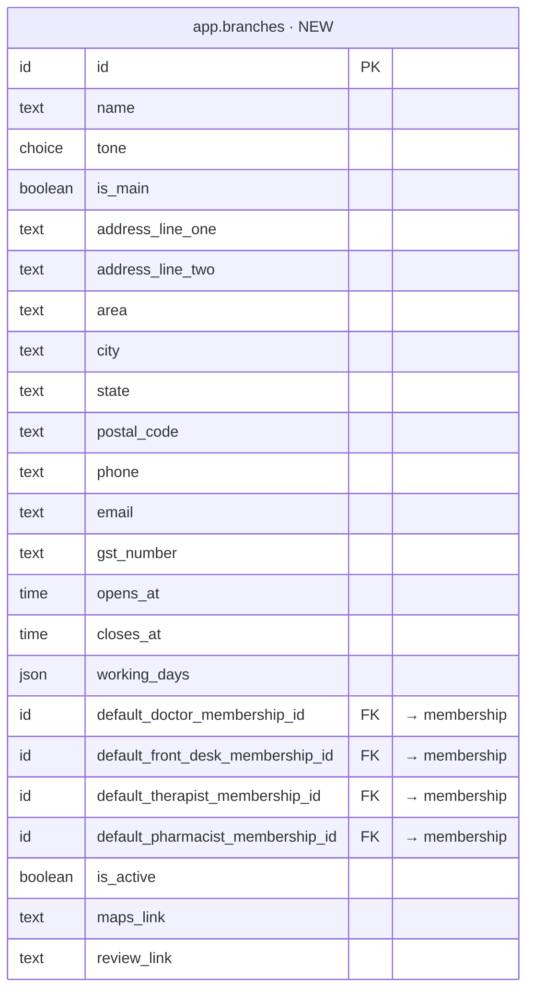

- **Built (ROUTE #125, sub-domain 1):** never deleted — `deleted_at`, `delete_reason`, `delete_note` and their checks dropped; a branch retires with `is_active` (D3, C16); the name-unique and one-main indexes cover every row. The four default-staff fields are keys `(organization_id, default_<role>_membership_id)` → `tenancy.memberships (organization_id, id)` `ON DELETE SET NULL` on the staff column only (K8), each with a partial index `idx_branches_organization_id_default_<role>_membership_id`; each names one of the branch's live members (D10, C10) and is cleared when that member stops working there or leaves (D14, C15). Code `app/sub-domains/branches/` (the branch at the folder root, D54).

### branch_user_accesses · NEW (built, not planned)

- **Holds:** Who works in which branch — one row per (branch, membership). Read by `GET /app/branches/my` (every member's branch picker); written by `PUT /app/branches/{branch_id}/members` and, at row #4, the staff invite and edit.
- **Table (built, ROUTE #2; renamed at ROUTE #125, D9):** `app.branch_members` — code `app/sub-domains/branches/branch-members/`
- **Sources:** D9 · users.md:126–156 (the plan held "branches" on the membership, row #4; built as a link table so each access is a real foreign key, user 2026-10-07)
- **Open:** none
- **Built (ROUTE #125, sub-domain 1):** key `(organization_id, membership_id)` → `tenancy.memberships (organization_id, id)` `ON DELETE CASCADE` (K8) with index `idx_branch_members_organization_id_membership_id`; an ended membership's rows stay but drop out of the members list and `/branches/my`, and a members `PUT` keeps them (D57); `POST /branches` writes the first rows from `membership_ids` (D13, C14).

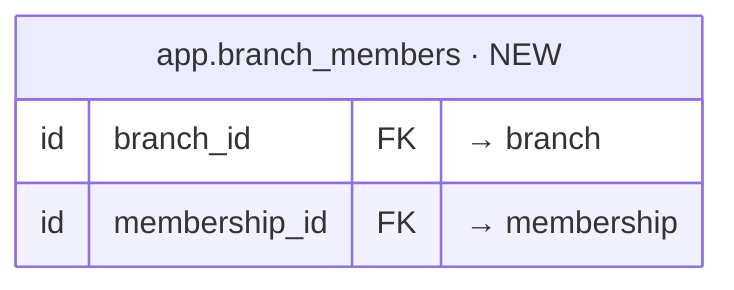

### user · CHANGED

- **Holds:** A staff member who signs in. Read by every person picker, avatars, Tasks owner; written by Users › Team.
- **Table (proposal):** `auth.users`
- **Sources:** schema-routes.md:184–207 · PRD.md:150 · users.md:26–40, 99–124 · D4
- **Added** (a frontend request, D3, unless a decision is named): `presence` (C8; shell.md:27), `last_active_at` (schema-routes.md:207)
- **Open:** none — presence per schema-routes (C8); staff fields live on the membership (D3)
- **Built (ROUTE #3):** `presence` varchar(10) NOT NULL DEFAULT `online`, CHECK `chk_users_presence` (`online`, `busy`, `away`); `last_active_at` already on `auth.users` — reused, not added

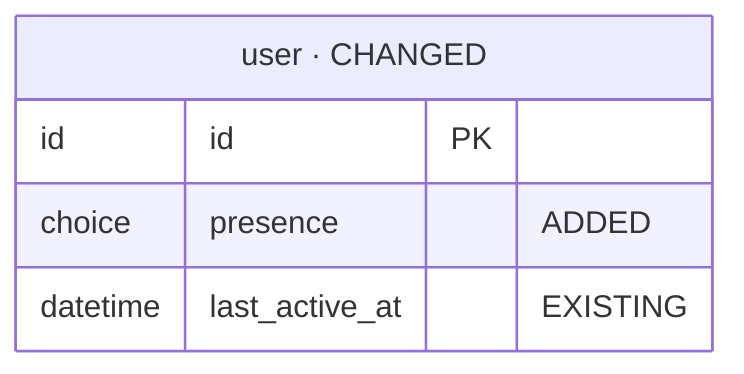

### membership · CHANGED

- **Holds:** A person's membership of the organization — now holds one or more roles (D5) and the staff profile (D3).
- **Table (proposal):** `tenancy.memberships`
- **Sources:** D4, D5 · users.md:26–40, 99–124
- **Added** (a frontend request, D3, unless a decision is named): `roles` (D5; users.md:110), `seq` (users.md:32), `phone` (users.md:106), `tone` (users.md:109), `working_days` (users.md:113), `starts_at` (users.md:114), `ends_at` (users.md:115), `commission_pct` (users.md:116), `branch_ids` (users.md:112)
- **Open:** none — the first role listed is the main one (D40)
- **Built (ROUTE #4):** `staff_number` integer (trigger `trg_memberships_staff_number`, unique per organization, never reused), `phone` varchar(16), `tone` varchar(10) (`sky`), `working_days` text[] (Mon–Sat), `work_starts_at` / `work_ends_at` time (10:00 / 19:00, ends after starts), `commission_percent` numeric(5,2) 0–100, `delete_reason` / `delete_note`; `roles` → main stays `role_id` + new `tenancy.membership_additional_roles` (membership_id, role_id, organization_id, position 1–9); `branch_ids` → `app.branch_user_accesses` (ROUTE #2); `seq` → `staff_number`, `starts_at`/`ends_at` → `work_starts_at`/`work_ends_at`, `commission_pct` → `commission_percent`
- **Built (ROUTE #124, K2–K8):** `display_name` varchar(120) NOT NULL (the login's first + last name, or its email, copied at join by `trg_memberships_display_name`; kept equal to the profile while live by `trg_users_sync_membership_display_names` on `auth.users`; frozen once ended), `delete_reason` gains `left` and `account_deleted`, unique `(organization_id, id)` (`idx_memberships_organization_id_id`) for the app's composite membership keys
- **Built (ROUTE #126, sub-domain 2):** `status` values lowercase — `invited`, `active`, `suspended` (T17; `chk_memberships_status`, `chk_memberships_joined`, default `invited`, the SQL resolvers that read it); `joined_at` set only by accepting the invite (T10); `trg_memberships_display_name` also fires when an ended membership is live again (restore, re-add — K3, K7); the invite table `tenancy.member_invitations` → **`tenancy.membership_invitations`** (T9 — indexes, checks `chk_membership_invitations_*`, policy, keys and its SQL resolvers renamed); the name sort reads `display_name` and the name-sort SECURITY DEFINER function is gone.

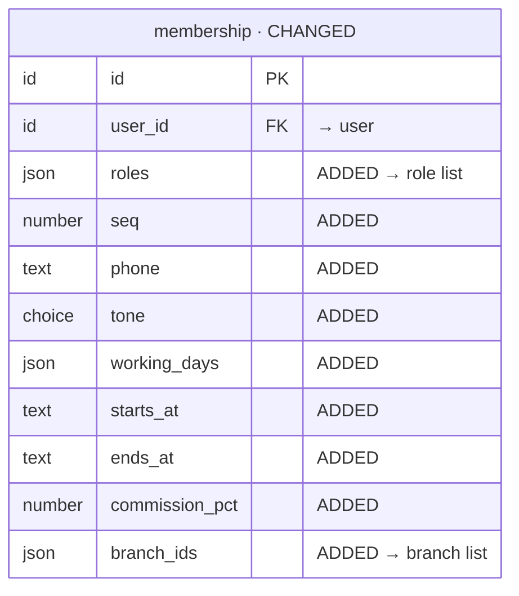

### role · CHANGED

- **Holds:** An editable organization role — the 9 clinic roles are seeded (D5); now also carries its tone, purpose, lock and special permissions (D3).
- **Table (proposal):** `tenancy.roles`
- **Sources:** D5, D8 · users.md:42–77
- **Added** (a frontend request, D3, unless a decision is named): `tone` (users.md:11, 49–50), `purpose` (users.md:50), `is_locked` (users.md:61; D40 — only Admin)
- **Open:** none — default matrix D12; special-permission presets D18, D25; only Admin is locked (D40)

- **Built:** `tone` varchar(10) (`sky`), `is_locked` boolean (false); `purpose` → existing `description` · ROUTE #5
- **Built (ROUTE #126, sub-domain 2):** `delete_reason` varchar(20) + `delete_note` varchar(280) with `chk_roles_delete_reason`, `chk_roles_delete_reason_when_deleted`, `chk_roles_delete_note_when_other` (T12 — a role is deleted with why and restorable until the tombstone purge).
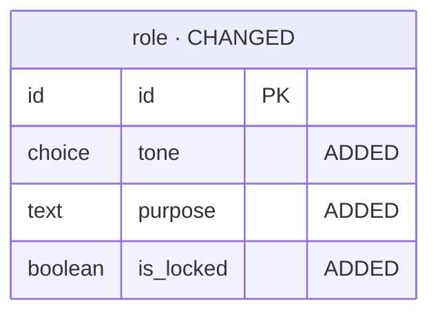

### permission · EXISTING

- **Holds:** The platform's permission catalog (code, name, category). The clinic sections and their actions — and, proposed, the special permissions — are new codes in it (D10), so sections stay a dynamic list, never a fixed one.
- **Table (proposal):** `tenancy.permissions`
- **Sources:** D10 · users.md:61–65, 71
- **Open:** none — no schema change; seeded codes: the 10 sections (D10, P68), the role-named actions (D13), reviews (D16), the 11 special permissions (D18), task rules (D19)

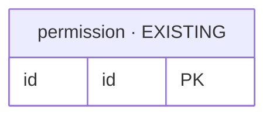

### role_permission · EXISTING

- **Holds:** Access matrix row (role × section). Read by the All sections list, route guards and Users › Roles; written by Users › Roles.
- **Table (proposal):** `tenancy.role_permissions`
- **Sources:** schema-routes.md:211–223 · PRD.md:26 · users.md:61–65 · D10
- **Open:** none — no schema change; a role holds catalog codes, seeded per D12, D13, D16–D19

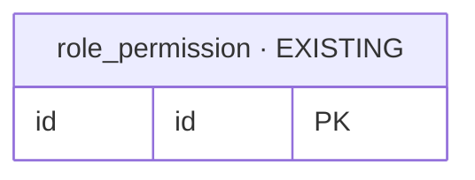

### user_preference · NEW

- **Holds:** A member's own UI state in one organization. Read on app load; written by header pin toggles, branch picker, Appearance, dropdown Recent.
- **Table (built, ROUTE #8; renamed at ROUTE #127, U1):** `app.membership_preferences` + `app.membership_preference_branches` — code `app/sub-domains/memberships/membership-preferences/`
- **Sources:** schema-routes.md:227–238 · shell.md:9, 26–27, 43
- **Open:** none — per membership (U1, the branch filter and pins belong to one organization); theme on the server with the rest (U4)
- **Built (ROUTE #127, sub-domain 2):** owned by `membership_id` (unique — the upsert's conflict target, U4) with key `(organization_id, membership_id)` → `tenancy.memberships (organization_id, id)` `ON DELETE CASCADE` (K8); `created_by_user_id` ownership and the soft-delete columns gone; `pinned_sections` Today + the matrix sections (≤ 10), `patient_file_pins` the 11 patient-file sections (≤ 11, default `clinical_notes, appointments, prescriptions, invoices`), `recent_picks` ≤ 60 (newest 3 per `room:field`, trimmed by the server); the branch filter `branch_filter_ids` → `branch_ids` on `app.membership_preference_branches (membership_preference_id, branch_id)`. RLS organization policy ENABLE + FORCE on both, no retention arm; out of the purge list; the leave step deletes the row (K4)

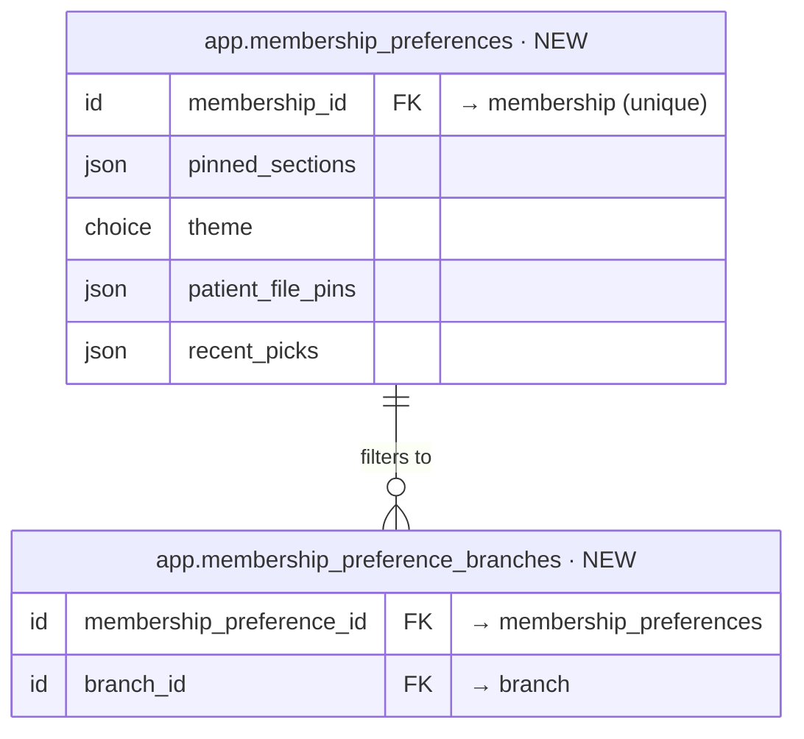

### saved_view · NEW

- **Holds:** A list's filters under a label + the columns it hides — a member's own shortcut on a list.
- **Table (built, ROUTE #9; renamed at ROUTE #127, U1):** `app.membership_saved_views` — code `app/sub-domains/memberships/membership-saved-views/`
- **Sources:** patients.md:129, 274 · payments.md:39 · H:968, 1545
- **Open:** none
- **Built (ROUTE #127, sub-domain 2):** owned by `membership_id` with key `(organization_id, membership_id)` → `tenancy.memberships (organization_id, id)` `ON DELETE CASCADE` (K8); `list_key` one of the registry's lists (`~ '^[a-z_]+$'`), `label` 1–60 unique per member and list case-insensitive (`(membership_id, list_key, lower(label))`), `filters` a JSON object of the list's query parameters, `hidden_columns` ≤ 40; index `(membership_id, list_key, created_at)`; no soft delete (U6 — removed for good); RLS organization policy ENABLE + FORCE, no retention arm; out of the purge list; the leave step deletes a member's views (K4)

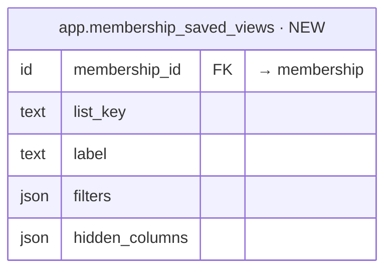

## Stage 2 — Catalogue: what the clinic sells

### offering_group · NEW

- **Holds:** A clinic-defined group for browsing offerings — Facial, Hair, Peel, Laser (D29).
- **Table (proposal):** `app.offering_groups` — domain not chosen yet (Step 4)
- **Sources:** PRD.md:169–173 · D29
- **Open:** none

- **Built:** `app.offering_groups` · ROUTE #10 (2026-10-07) — code `app/sub-domains/offerings/offering-groups/` since ROUTE #128 (OC17)
- **Built (ROUTE #128, sub-domain 3):** columns unchanged (`name` 1–60 unique per organization in any case among live groups, `sort_order` 0–9999); the menu-order index is now `idx_offering_groups_organization_sort_order_name` `(organization_id, sort_order, name, id)` for the default list order (O8); a group live offerings use cannot be deleted (O7 — a 409 from the service, no schema change).
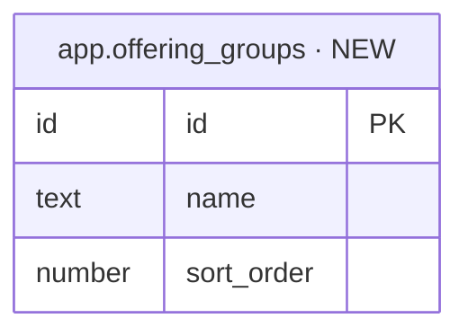

### offering · NEW

- **Holds:** A sellable service / package / product. Read by every service picker, invoices, plan card; written by Offerings.
- **Table (proposal):** `app.offerings` — domain not chosen yet (Step 4)
- **Sources:** schema-routes.md:557–577 · PRD.md:96–100, 139 · offerings.md:25–39, 59–89
- **Added** (a frontend request, D3, unless a decision is named): `group_id` (D29), `offer_price` (offerings.md:70), `branch_ids` (offerings.md:68), `gst_inclusive` (offerings.md:73), `search_terms` (offerings.md:80), `description` (offerings.md:81)
- **Open:** none — a fixed kind (consultation, treatment, package, product; lhr is a treatment) + clinic groups (D29); GST as a number (P71, D3); seeded rates (D27); discounts stop at minPrice (D26)

- **Built:** `app.offerings` · ROUTE #11 (2026-10-07)
- **Built (ROUTE #128, sub-domain 3):** `group_id` → `offering_group_id` (O1 — key `offerings_offering_group_id_offering_groups_id_fk` `ON DELETE SET NULL`, index `idx_offerings_offering_group_id`); `default_doctor_membership_id` and `default_room_id` dropped with their keys and indexes (O6); new CHECK `chk_offerings_min_price_within_offer_price` — with the two existing ones, `min_price` ≤ `offer_price` ≤ `price` (O4); `branch_ids` on `app.offering_branches` (none = every branch, O5). Code `app/sub-domains/offerings/` (the folder root, D54).
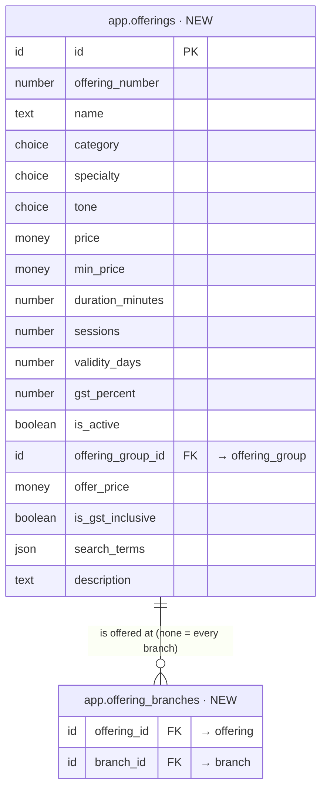

### offer · NEW

- **Holds:** A limited-time price on offerings. Read by Offerings › Offers, invoice pricing; written by Offer drawer.
- **Table (proposal):** `app.offers` — domain not chosen yet (Step 4)
- **Sources:** schema-routes.md:581–598 · offerings.md:41–55, 91–112
- **Open:** none

- **Built:** `app.offers` · ROUTE #12 (2026-10-07) — code `app/sub-domains/offerings/offers/` since ROUTE #128 (OC17)
- **Built (ROUTE #128, sub-domain 3):** `is_paused` → `is_active` (default true, O10; the response derives `status` — never stored); `chk_offers_value` → `chk_offers_value_for_kind` (`percent` whole 1–100, `amount` / `fixed` > 0, `extra` whole 1–99 — O11); `chk_offers_code` `^[A-Z0-9]+$` (no empty code) and unique index `idx_offers_organization_code_unique` `(organization_id, code)` on live offers with a code (O11); `idx_offers_organization_starts_on` now `(organization_id, coalesce(starts_on, '-infinity'), id)` on live offers — the `starts_on` sort keeps offers without a start. Links `app.offer_offerings` (1–50 live, active offerings — O12) and `app.offer_branches` (none = every branch — O5) unchanged.
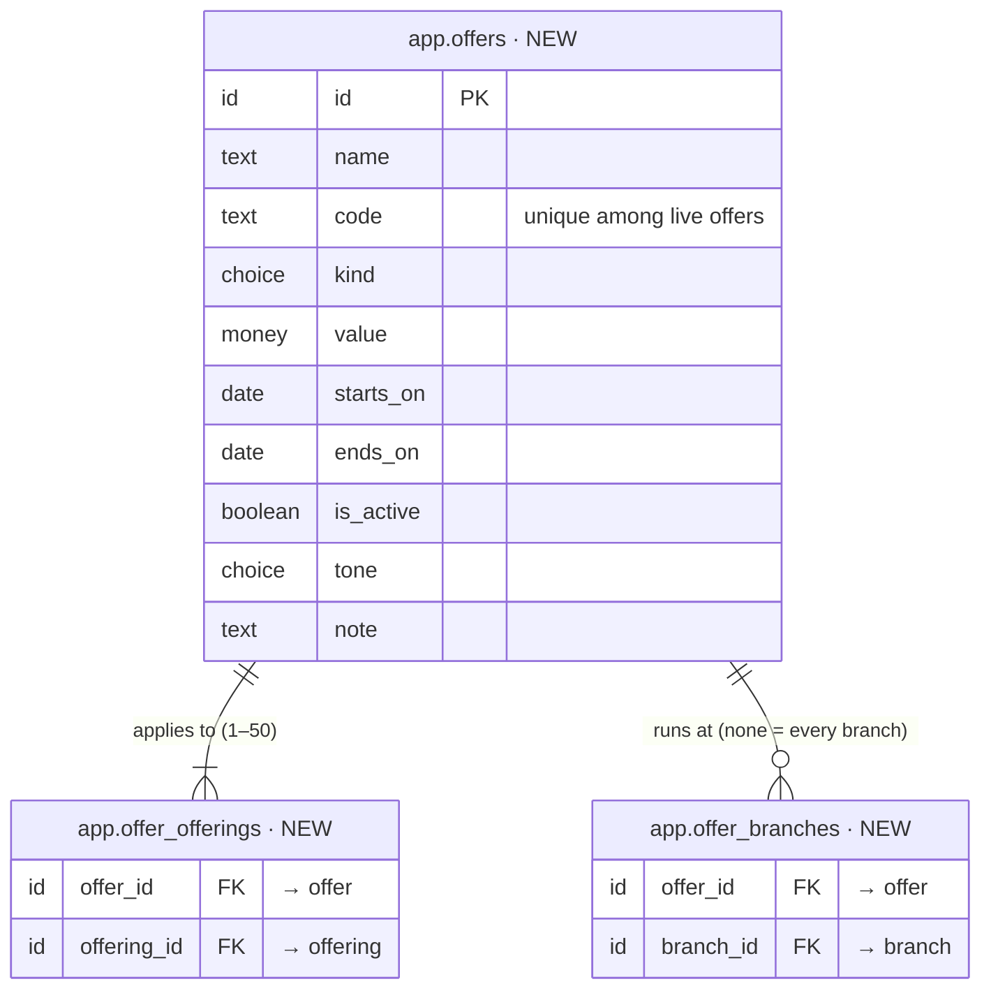

## Stage 3 — People and conversations

### patient · NEW

- **Holds:** A registered patient. Read by Patients, Patient file, every patient picker, contact card, print sheets; written by New/Edit patient drawer.
- **Table (proposal):** `app.patients` — domain not chosen yet (Step 4)
- **Sources:** schema-routes.md:287–317 · PRD.md:60–64, 134 · patients.md · patient-file.md:20–22
- **Added** (a frontend request, D3, unless a decision is named): `referred_by_name` (patients.md:55), `consent_data` (patients.md:79; patient-file.md:510), `consent_photos` (patients.md:79), `consent_marketing` (patients.md:79), `language` (patient-file.md:21), `phones` (patient-file.md:21, 509), `instagram_handles` (patient-file.md:509), `default_channel` (leads.md:415), `preferences` (leads.md:96–101), `household` (leads.md:440–442), `allergies` (today.md:134, 255), `contraindications` (today.md:255)
- **Replaced (schema-routes field → now):** `complaints` → patient_clinical_note, `diagnosis` → patient_clinical_note, `treatment_suggestions` → patient_clinical_note, `future_suggestions` → patient_clinical_note, `consent_given` → consent_data / consent_photos / consent_marketing, `phone2` → phones
- **Open:** none — access per D12, D15, D16

- **Built:** `app.patients` · ROUTE #13 (2026-10-07)
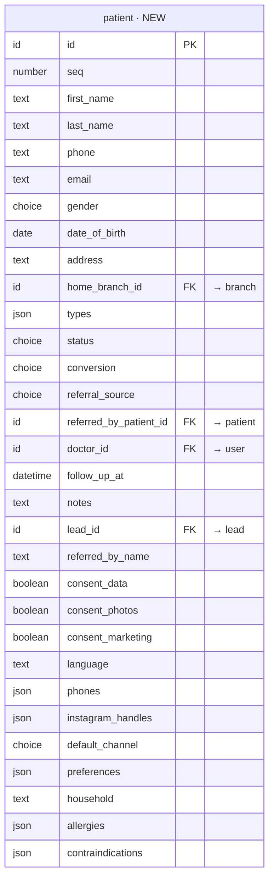

### lead · NEW

- **Holds:** An enquiry and its conversation until the person becomes a patient. Read by Leads, lead drawer, appointment form (connected leads), contact card; written by Leads, appointment check-in (status → clinic_visited), automations (re-target).
- **Table (proposal):** `app.leads` — domain not chosen yet (Step 4)
- **Sources:** schema-routes.md:242–264 · PRD.md:48–52, 133 · leads.md
- **Added** (a frontend request, D3, unless a decision is named): `last_touch_at` (leads.md:402; H:5738), `phones` (leads.md:96–101), `instagram_handles` (leads.md:96–101), `default_channel` (leads.md:96–101, 415), `preferences` (leads.md:96–101), `household` (leads.md:440–442)
- **Open:** none — Contacted on a first reply or a logged call (P21, D40); re-target leads daily, staff send the first message (D35); contact fields on Lead and Patient (P16, D3)

- **Built:** `app.leads` · ROUTE #14 (2026-10-07)
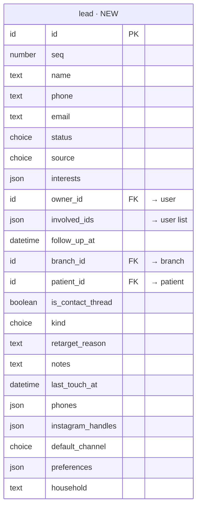

### lead_message · NEW

- **Holds:** One chat line in a lead / contact thread. Read by lead drawer chat, appointment form chat, Offering suggestions › Contact activity; written by lead drawer composer and system events.
- **Table (proposal):** `app.lead_messages` — domain not chosen yet (Step 4)
- **Sources:** schema-routes.md:268–283 · PRD.md:112 · leads.md:44–55, 109–120
- **Added** (a frontend request, D3, unless a decision is named): `record_type` (leads.md:54; tasks.md:83), `record_id` (leads.md:54; tasks.md:83)
- **Open:** none — real WhatsApp and Instagram (D32, D3); no SMS or email (D33); the provider is chosen at kickoff

- **Built:** `app.lead_messages` · ROUTE #15 (2026-10-07)
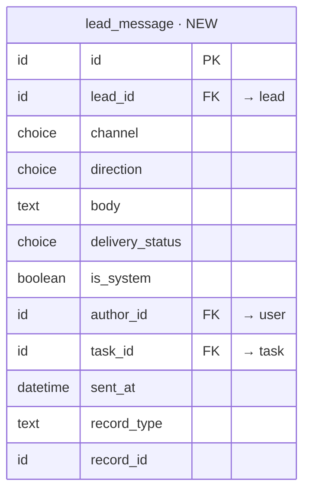

### lead_read · NEW

- **Holds:** Where each viewer last read a lead's conversation (per-viewer unread).
- **Table (proposal):** `app.lead_reads` — domain not chosen yet (Step 4)
- **Sources:** leads.md:32, 36
- **Open:** none

- **Built:** `app.lead_reads` · ROUTE #16 (2026-10-07)
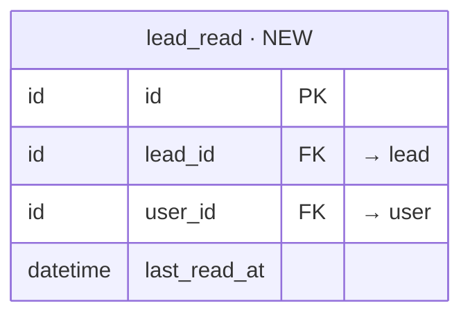

### message_template · NEW

- **Holds:** A reusable message (greeting, price, free slots, location, reminder, aftercare, follow-up, review) with fill-in placeholders.
- **Table (proposal):** `app.message_templates` — domain not chosen yet (Step 4)
- **Sources:** leads.md:427–432 · _patterns.md:178–183 · H:5743
- **Open:** none — Owner and Admin edit them (D40)

- **Built:** `app.message_templates` · ROUTE #17 (2026-10-07)
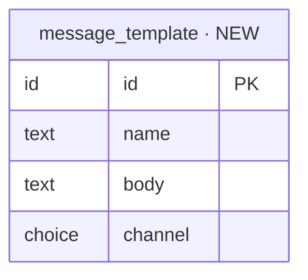

## Stage 4 — Scheduling and the visit

### branch_holiday · NEW

- **Holds:** A day a branch is closed — no slots are offered (D41).
- **Table (proposal):** `app.branch_holidays` — domain not chosen yet (Step 4)
- **Sources:** D41 · H:2349
- **Open:** none

- **Built:** `app.branch_holidays` · ROUTE #18 (2026-10-07); code moved to `app/sub-domains/branches/branch-holidays/`, served under `/branches/{branch_id}/holidays` · ROUTE #125 (2026-10-08)
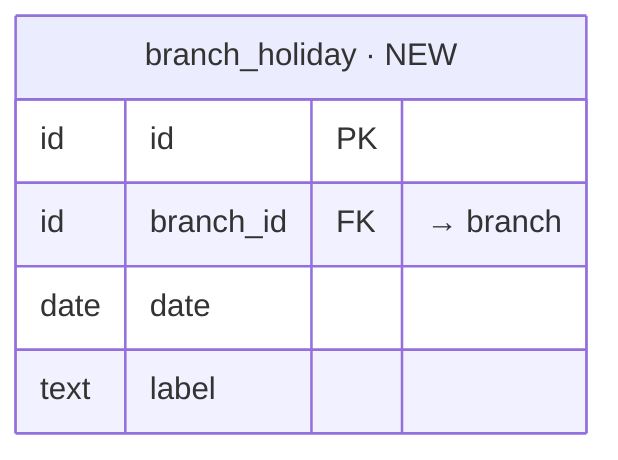

### room · NEW

- **Holds:** A bookable room of a branch (D28).
- **Table (proposal):** `app.rooms` — domain not chosen yet (Step 4)
- **Sources:** PRD.md:56–57 · D28
- **Open:** none

- **Built:** `app.rooms` · ROUTE #19 (2026-10-07) → **`app.branch_rooms`** (D9), code `app/sub-domains/branches/branch-rooms/`, served under `/branches/{branch_id}/rooms` · ROUTE #125 (2026-10-08)
```mermaid
erDiagram
  room["room · NEW"] {
    id id PK
    id branch_id FK "→ branch"
    text name
    boolean active
  }
```

### machine · NEW

- **Holds:** A bookable machine of a branch, e.g. a laser (D28).
- **Table (proposal):** `app.machines` — domain not chosen yet (Step 4)
- **Sources:** PRD.md:56–57 · D28
- **Open:** none

- **Built:** `app.machines` · ROUTE #20 (2026-10-07) → **`app.branch_machines`** (D9), code `app/sub-domains/branches/branch-machines/`, served under `/branches/{branch_id}/machines` · ROUTE #125 (2026-10-08)
```mermaid
erDiagram
  machine["machine · NEW"] {
    id id PK
    id branch_id FK "→ branch"
    text name
    boolean active
  }
```

### appointment · NEW

- **Holds:** A booking of a person with a doctor. Read by Today, Appointments, patient file, Tasks; written by appointment form, status strip, Cancel visit, check-in.
- **Table (proposal):** `app.appointments` — domain not chosen yet (Step 4)
- **Sources:** schema-routes.md:321–350 · PRD.md:54–58, 135 · appointments.md
- **Added** (a frontend request, D3, unless a decision is named): `room_id` (D28), `machine_id` (D28), `patient_package_id` (appointments.md:71, 73), `reminder_status` (appointments.md:30, 359–360), `confirmed_by_reply` (appointments.md:360; H:5971), `move_count` (appointments.md:30, 370)
- **Replaced (schema-routes field → now):** `room` → room_id → room (D28)
- **Open:** none — a room and a machine per branch (D28); no-show by staff after the start (D30); a confirm request + one reminder (D34); cancel reasons + rescheduling_later, booked_by_mistake (P9, D40); the package named on the appointment (B3, D40)

- **Built:** `app.appointments` · ROUTE #21 (2026-10-07)
```mermaid
erDiagram
  appointment["appointment · NEW"] {
    id id PK
    number seq
    id patient_id FK "→ patient"
    id lead_id FK "→ lead"
    id branch_id FK "→ branch"
    choice type
    id offering_id FK "→ offering"
    text service_label
    id doctor_id FK "→ user"
    id therapist_id FK "→ user"
    date date
    text start_time
    number duration_min
    choice status
    choice cancel_reason
    text cancel_note
    datetime rescheduled_from
    text reason
    text notes
    datetime follow_up_at
    datetime checked_in_at
    datetime completed_at
    id copied_from_id FK "→ appointment"
    id room_id FK "→ room"
    id machine_id FK "→ machine"
    id patient_package_id FK "→ patient_package"
    choice reminder_status
    boolean confirmed_by_reply
    number move_count
  }
```

### visit · NEW

- **Holds:** One visit in progress (frontend D18): the floor stage and when it changed, the consult note and the safety checks — shared by Today's Visit sheet and the patient file's visit flow.
- **Table (proposal):** `app.visits` — domain not chosen yet (Step 4)
- **Sources:** today.md:38–46, 78–121, 157–163 · patient-file.md:92–101, 392–404 · frontend D18, D20
- **Open:** none — the server moves a card only on an explicit stage call (P2, D40); lanes (P1, D3)

- **Built:** `app.visits` · ROUTE #22 (2026-10-07)
```mermaid
erDiagram
  visit["visit · NEW"] {
    id id PK
    id appointment_id FK "→ appointment"
    id patient_id FK "→ patient"
    choice stage
    datetime stage_changed_at
    datetime started_at
    datetime paused_at
    datetime completed_at
    datetime last_saved_at
    text consult_complaint
    text consult_findings
    text consult_plan
    json diagnoses
    boolean safety_consent_checked
    boolean safety_before_photos_taken
    boolean safety_allergies_checked
  }
```

## Stage 5 — The clinical record

### diagnosis · NEW

- **Holds:** The diagnosis catalogue the consult note picks from.
- **Table (proposal):** `app.diagnosises` — domain not chosen yet (Step 4)
- **Sources:** today.md:84
- **Open:** none — prescribers add entries (D14, D40)

- **Built:** `app.diagnoses` · ROUTE #23 (2026-10-07)
```mermaid
erDiagram
  diagnosis["diagnosis · NEW"] {
    id id PK
    text name
  }
```

### patient_clinical_note · NEW

- **Holds:** One short clinical note item (complaint, diagnosis, treatment suggestion, future suggestion) with who added it and when — replaces the four free-text fields on Patient.
- **Table (proposal):** `app.patient_clinical_notes` — domain not chosen yet (Step 4)
- **Sources:** patient-file.md:53, 225 · H:780
- **Open:** none — replaces Patient.complaints / diagnosis / treatment_suggestions / future_suggestions (D3)

- **Built:** `app.patient_clinical_notes` · ROUTE #24 (2026-10-07)
```mermaid
erDiagram
  patient_clinical_note["patient_clinical_note · NEW"] {
    id id PK
    id patient_id FK "→ patient"
    choice kind
    text text
    datetime added_at
    id added_by_id FK "→ user"
  }
```

### prescription · NEW

- **Holds:** A doctor's Rx for a patient. Read by patient file, Rx viewer, print, Medical "Prescriptions to fill"; written by Prescription drawer.
- **Table (proposal):** `app.prescriptions` — domain not chosen yet (Step 4)
- **Sources:** schema-routes.md:354–370 · PRD.md:116–120, 136 · patient-file.md:105–121 · today.md:78–93
- **Added** (a frontend request, D3, unless a decision is named): `status` (D31; today.md:59, 90–92), `approved_at` (D31), `approved_by_id` (D31), `print_language` (today.md:87; D40)
- **Open:** none — draft, then approved by a prescriber (D31); print language stored per prescription (D40); the prescribe code on Doctor and Admin (D13, D14)

- **Built:** `app.prescriptions` · ROUTE #25 (2026-10-07)
```mermaid
erDiagram
  prescription["prescription · NEW"] {
    id id PK
    number seq
    id patient_id FK "→ patient"
    id appointment_id FK "→ appointment"
    id doctor_id FK "→ user"
    date date
    json items
    text advice
    text lab_report
    text procedure_today
    date follow_up_date
    choice status
    datetime approved_at
    id approved_by_id FK "→ user"
    choice print_language
  }
```

### prescription_kit · NEW

- **Holds:** A doctor's one-tap prescription (kit / quick-add): a named set of medicine lines.
- **Table (proposal):** `app.prescription_kits` — domain not chosen yet (Step 4)
- **Sources:** patient-file.md:278 · today.md:86 · H:763, 4810
- **Open:** none

- **Built:** `app.prescription_kits` · ROUTE #26 (2026-10-07)
```mermaid
erDiagram
  prescription_kit["prescription_kit · NEW"] {
    id id PK
    id doctor_id FK "→ user"
    text name
    json items
  }
```

### patient_image · NEW

- **Holds:** A clinical photo. Read by patient Images tab, appointment form Photos card, viewer; written by upload + Photo details drawer.
- **Table (proposal):** `app.patient_images` — domain not chosen yet (Step 4)
- **Sources:** schema-routes.md:418–432 · PRD.md:138 · patient-file.md:59–68, 205–219
- **Added** (a frontend request, D3, unless a decision is named): `display_name` (P45, D40)
- **Open:** none — an editable display name (P45, D40); Private album per schema-routes (P46)

- **Built:** `app.patient_images` · ROUTE #27 (2026-10-07)
```mermaid
erDiagram
  patient_image["patient_image · NEW"] {
    id id PK
    id patient_id FK "→ patient"
    id appointment_id FK "→ appointment"
    choice album
    file file_url
    text file_name
    choice body_part
    date taken_on
    text caption
    text display_name
  }
```

### patient_report · NEW

- **Holds:** Lab / scan / consent document. Read + written in patient file Reports.
- **Table (proposal):** `app.patient_reports` — domain not chosen yet (Step 4)
- **Sources:** schema-routes.md:436–448 · patient-file.md:143–157
- **Open:** none

- **Built:** `app.patient_reports` · ROUTE #28 (2026-10-07)
```mermaid
erDiagram
  patient_report["patient_report · NEW"] {
    id id PK
    id patient_id FK "→ patient"
    choice type
    text name
    date date
    json files
    text notes
  }
```

### patient_note · NEW

- **Holds:** Timeline note on a patient. Read + written in patient file Notes.
- **Table (proposal):** `app.patient_notes` — domain not chosen yet (Step 4)
- **Sources:** schema-routes.md:468–476 · patient-file.md:81–90
- **Open:** none

- **Built:** `app.patient_notes` · ROUTE #29 (2026-10-07)
```mermaid
erDiagram
  patient_note["patient_note · NEW"] {
    id id PK
    id patient_id FK "→ patient"
    text body
  }
```

## Stage 6 — Billing and money

### invoice · NEW

- **Holds:** A bill (clinic, consultation or medical). Read by Payments, patient file Billing, preview/print, plan card; written by the one invoice drawer (openInv) and Medical sale.
- **Table (proposal):** `app.invoices` — domain not chosen yet (Step 4)
- **Sources:** schema-routes.md:602–620 · PRD.md:141 · payments.md:132–150
- **Added** (a frontend request, D3, unless a decision is named): `invoice_number` (D23), `financial_year` (D23)
- **Open:** none — numbered per branch GSTIN and financial year, own series without a GSTIN (D23, D40); overall discount before tax, GST-inclusive lines where marked (D20, D21) — to confirm with the accountant

- **Built:** `app.invoices` · ROUTE #30 (2026-10-07)
```mermaid
erDiagram
  invoice["invoice · NEW"] {
    id id PK
    number seq
    choice type
    id branch_id FK "→ branch"
    id patient_id FK "→ patient"
    id medical_contact_id FK "→ medical_contact"
    json team_ids "→ user list"
    json items
    money overall_discount
    date date
    text remark
    id prescription_id FK "→ prescription"
    id sale_id FK "→ medical_sale"
    text invoice_number
    text financial_year
  }
```

### patient_package · NEW

- **Holds:** A sold multi-session package. Read by patient file Packages, Offering suggestions (last purchases), Book; written by invoicing a package offering and by treatments using sessions.
- **Table (proposal):** `app.patient_packages` — domain not chosen yet (Step 4)
- **Sources:** schema-routes.md:452–464 · patient-file.md:70–79, 159–169
- **Open:** none — package before its invoice settled (P33, D3)

- **Built:** `app.patient_packages` · ROUTE #31 (2026-10-07)
```mermaid
erDiagram
  patient_package["patient_package · NEW"] {
    id id PK
    id patient_id FK "→ patient"
    id offering_id FK "→ offering"
    id invoice_id FK "→ invoice"
    number sessions_total
    number sessions_used
    date valid_until
  }
```

### offering_suggestion · NEW

- **Holds:** One row of a patient's plan ("Offering suggestions"). Read by appointment form, patient file, Today plan flag, invoice presets; written by the card (add / status / qty / price / link) and by invoice save (planLink).
- **Table (proposal):** `app.offering_suggestions` — domain not chosen yet (Step 4)
- **Sources:** schema-routes.md:480–496 · PRD.md:123–124, 140 · patient-file.md:53, 56, 515–519
- **Open:** none — A28 settled (derived); ideas come from patient_idea (D39)

- **Built:** `app.offering_suggestions` · ROUTE #32 (2026-10-07)
```mermaid
erDiagram
  offering_suggestion["offering_suggestion · NEW"] {
    id id PK
    id patient_id FK "→ patient"
    id offering_id FK "→ offering"
    number qty
    money price
    choice status
    text source_label
    id appointment_id FK "→ appointment"
    text reason
    id suggested_by_id FK "→ user"
    json invoice_links "→ invoice list"
  }
```

### patient_idea · NEW

- **Holds:** A patient's latest ideas from history — from the AI on a de-identified summary, or the rules as the fallback (D39); agent-os may hold it as a cache instead.
- **Table (proposal):** `app.patient_ideas` — domain not chosen yet (Step 4)
- **Sources:** D39 · schema-routes.md:1635 · H:4355–4367
- **Open:** none — the AI provider is chosen at kickoff (D39); only patients with Data consent; never name, phone, photos or note text

- **Built:** `app.patient_ideas` · ROUTE #33 (2026-10-07)
```mermaid
erDiagram
  patient_idea["patient_idea · NEW"] {
    id id PK
    id patient_id FK "→ patient"
    json ideas
    choice source
    datetime generated_at
  }
```

### payment · NEW

- **Holds:** One ledger entry — money in or out (PAY-####). Read by Payments, Medical › Payments, Day close, invoices; written by Receive, Pay, refunds, credit give-back, supplier bill payment.
- **Table (proposal):** `app.payments` — domain not chosen yet (Step 4)
- **Sources:** schema-routes.md:640–662 · PRD.md:84–88, 142 · payments.md:25–39, 95–130
- **Added** (a frontend request, D3, unless a decision is named): `bill_allocations` (P58, D40), `reference` (payments.md:103), `attachments` (payments.md:124), `checked_at_close` (payments.md:61, 67)
- **Open:** none — reversal per schema-routes (P77); an amount above the due is refused (P78); one payment may cover several supplier bills (P58, D40)

- **Built:** `app.payments` · ROUTE #34 (2026-10-07)
```mermaid
erDiagram
  payment["payment · NEW"] {
    id id PK
    number seq
    choice direction
    choice kind
    id branch_id FK "→ branch"
    money amount
    json splits
    id patient_id FK "→ patient"
    id invoice_id FK "→ invoice"
    text payee_name
    choice expense_category
    json bill_ref
    id credit_note_id FK "→ credit_note"
    id pending_credit_id FK "→ pending_credit"
    text note
    datetime paid_at
    id day_close_id FK "→ day_close"
    json bill_allocations
    text reference
    file attachments
    boolean checked_at_close
  }
```

### payment_edit · NEW

- **Holds:** One logged change to a payment ("Edited 1× · last ₹600 UPI → ₹700 UPI").
- **Table (proposal):** `app.payment_edits` — domain not chosen yet (Step 4)
- **Sources:** payments.md:29, 109, 129
- **Open:** none

- **Built:** `app.payment_edits` · ROUTE #35 (2026-10-07)
```mermaid
erDiagram
  payment_edit["payment_edit · NEW"] {
    id id PK
    id payment_id FK "→ payment"
    datetime edited_at
    id edited_by_id FK "→ user"
    text before
    text after
  }
```

### credit_note · NEW

- **Holds:** Issued for every refund to a patient. Read by Payments and invoice views; written by refund flow.
- **Table (proposal):** `app.credit_notes` — domain not chosen yet (Step 4)
- **Sources:** schema-routes.md:666–676 · PRD.md:88 · payments.md:179
- **Open:** none — only against an invoice (D22)

- **Built:** `app.credit_notes` · ROUTE #36 (2026-10-07)
```mermaid
erDiagram
  credit_note["credit_note · NEW"] {
    id id PK
    number seq
    id invoice_id FK "→ invoice"
    money amount
    text reason
  }
```

### pending_credit · NEW

- **Holds:** Money owed either way, not yet settled (Payments › Pending). Read + written by crNew drawer and its actions.
- **Table (proposal):** `app.pending_credits` — domain not chosen yet (Step 4)
- **Sources:** schema-routes.md:680–695 · PRD.md:143 · payments.md:41–55, 152–180
- **Added** (a frontend request, D3, unless a decision is named): `invoice_id` (payments.md:160), `settle_by` (payments.md:161), `settled_amount` (payments.md:45, 179), `party_kind` (payments.md:45, 157), `note` (payments.md:162)
- **Open:** none — reasons from the one stored set + additions (P35); a give-back with no invoice is a refund payment, not a credit note (D22)

- **Built:** `app.pending_credits` · ROUTE #37 (2026-10-07)
```mermaid
erDiagram
  pending_credit["pending_credit · NEW"] {
    id id PK
    number seq
    choice direction
    text party_name
    id patient_id FK "→ patient"
    money amount
    text reason
    id source_payment_id FK "→ payment"
    choice status
    id settled_payment_id FK "→ payment"
    id invoice_id FK "→ invoice"
    date settle_by
    money settled_amount
    choice party_kind
    text note
  }
```

### day_close · NEW

- **Holds:** One branch-day cash close. Read + written by Day close drawer.
- **Table (proposal):** `app.day_closes` — domain not chosen yet (Step 4)
- **Sources:** schema-routes.md:699–713 · PRD.md:88 · payments.md:57–80, 182–194
- **Added** (a frontend request, D3, unless a decision is named): `difference_reason` (D24), `reopened_at` (payments.md:191), `reopened_by_id` (payments.md:191), `auto_closed` (payments.md:277, 327, 331), `opening_accepted_by_id` (payments.md:76, 327)
- **Open:** none — a reason when the count differs (D24); a day nobody closed is closed at midnight after it (D40); the close-the-day code on Accountant, Owner, Admin (D13, D18)

- **Built:** `app.day_closes` · ROUTE #38 (2026-10-07)
```mermaid
erDiagram
  day_close["day_close · NEW"] {
    id id PK
    id branch_id FK "→ branch"
    date date
    money opening_cash
    choice opening_source
    datetime opening_accepted_at
    money counted_cash
    datetime closed_at
    id closed_by_id FK "→ user"
    text difference_reason
    datetime reopened_at
    id reopened_by_id FK "→ user"
    boolean auto_closed
    id opening_accepted_by_id FK "→ user"
  }
```

### day_close_event · NEW

- **Holds:** One line of a day's "What happened" log (opened, recounted, closed, reopened, auto-closed).
- **Table (proposal):** `app.day_close_events` — domain not chosen yet (Step 4)
- **Sources:** payments.md:327, 423
- **Open:** none

- **Built:** `app.day_close_events` · ROUTE #39 (2026-10-07)
```mermaid
erDiagram
  day_close_event["day_close_event · NEW"] {
    id id PK
    id day_close_id FK "→ day_close"
    datetime at
    id actor_id FK "→ user"
    text text
  }
```

## Stage 7 — Treatments and feedback

### treatment · NEW

- **Holds:** A procedure session record. Read by patient file Treatments, Tasks (aftercare calls); written by Treatment drawer.
- **Table (proposal):** `app.treatments` — domain not chosen yet (Step 4)
- **Sources:** schema-routes.md:394–414 · PRD.md:137 · patient-file.md:123–141 · today.md:95–108
- **Added** (a frontend request, D3, unless a decision is named): `status` (today.md:105, 107; P89, D40), `reversed_reason` (today.md:107; D40), `reversed_at` (today.md:107; D40)
- **Open:** none — reversed with a reason, never deleted (P89, D40); the treatments code on Doctor and Therapist (D12, D13)

- **Built:** `app.treatments` · ROUTE #40 (2026-10-07)
```mermaid
erDiagram
  treatment["treatment · NEW"] {
    id id PK
    id patient_id FK "→ patient"
    id appointment_id FK "→ appointment"
    id offering_id FK "→ offering"
    text name
    choice template
    datetime performed_at
    id doctor_id FK "→ user"
    id therapist_id FK "→ user"
    json body_parts
    number session_no
    json params
    text remark
    choice aftercare_call
    id package_id FK "→ patient_package"
    choice status
    text reversed_reason
    datetime reversed_at
  }
```

### check_in · NEW

- **Holds:** Visit / aftercare check-in feedback. Read by Feedback card, treatments table, Tasks; written by ckNew drawer and task outcome "Doing well".
- **Table (proposal):** `app.check_ins` — domain not chosen yet (Step 4)
- **Sources:** schema-routes.md:500–519 · PRD.md:125, 148 · patient-file.md:171–187
- **Open:** none — details up to 300 (P37, D40); score nullable (P32, D3)

- **Built:** `app.check_ins` · ROUTE #41 (2026-10-07)
```mermaid
erDiagram
  check_in["check_in · NEW"] {
    id id PK
    id patient_id FK "→ patient"
    id appointment_id FK "→ appointment"
    id treatment_id FK "→ treatment"
    text context
    choice feel
    number score
    choice followed
    text followed_note
    text now
    text next_plan
    json next_offering_ids "→ offering list"
    id by_id FK "→ user"
    date date
  }
```

### review · NEW

- **Holds:** A public / internal review. Read by Feedback card, contact card About; written by rvNew drawer.
- **Table (proposal):** `app.reviews` — domain not chosen yet (Step 4)
- **Sources:** schema-routes.md:523–538 · PRD.md:148 · patient-file.md:189–203
- **Open:** none — Marketing logs reviews through the reviews code (D16)

- **Built:** `app.reviews` · ROUTE #42 (2026-10-07)
```mermaid
erDiagram
  review["review · NEW"] {
    id id PK
    id patient_id FK "→ patient"
    id appointment_id FK "→ appointment"
    choice source
    number rating
    text text
    text link
    json files
    date date
    id by_id FK "→ user"
  }
```

### feedback_action · NEW

- **Holds:** The follow-up logged against negative feedback. Read + written by the Feedback card "Log action ⌄".
- **Table (proposal):** `app.feedback_actions` — domain not chosen yet (Step 4)
- **Sources:** schema-routes.md:542–553 · patient-file.md:521
- **Open:** none — additions settled (P34, D3)

- **Built:** `app.feedback_actions` · ROUTE #43 (2026-10-07)
```mermaid
erDiagram
  feedback_action["feedback_action · NEW"] {
    id id PK
    id check_in_id FK "→ check_in"
    id review_id FK "→ review"
    choice action
    text note
    id by_id FK "→ user"
  }
```

## Stage 8 — Medical store

### manufacturer · NEW

- **Holds:** Medicine brand on the pack. Read by medicine pickers, supplier/MR connections; written by Manufacturer drawer.
- **Table (proposal):** `app.manufacturers` — domain not chosen yet (Step 4)
- **Sources:** schema-routes.md:741–750 · medical.md:89–103, 208–222
- **Open:** none

- **Built:** `app.manufacturers` · ROUTE #44 (2026-10-07)
```mermaid
erDiagram
  manufacturer["manufacturer · NEW"] {
    id id PK
    text name
    choice tone
    boolean is_quick
  }
```

### supplier · NEW

- **Holds:** Medicine distributor (Medical). Read by PO, medicine rates, Pay bill picker; written by Supplier drawer.
- **Table (proposal):** `app.suppliers` — domain not chosen yet (Step 4)
- **Sources:** schema-routes.md:754–765 · medical.md:73–87, 190–206
- **Open:** none — one payment may cover several bills (P58, D40)

- **Built:** `app.suppliers` · ROUTE #45 (2026-10-07)
```mermaid
erDiagram
  supplier["supplier · NEW"] {
    id id PK
    text name
    text phone
    text gst_number
    json manufacturer_ids "→ manufacturer list"
    boolean is_quick
  }
```

### medical_rep · NEW

- **Holds:** Medical representative. Read + written by Medical › MRs.
- **Table (proposal):** `app.medical_reps` — domain not chosen yet (Step 4)
- **Sources:** schema-routes.md:769–779 · medical.md:105–119, 224–237
- **Open:** none

- **Built:** `app.medical_reps` · ROUTE #46 (2026-10-07)
```mermaid
erDiagram
  medical_rep["medical_rep · NEW"] {
    id id PK
    text name
    text phone
    json manufacturer_ids "→ manufacturer list"
    date next_visit_on
  }
```

### medical_rep_visit · NEW

- **Holds:** 
- **Table (proposal):** `app.medical_rep_visits` — domain not chosen yet (Step 4)
- **Sources:** schema-routes.md:783–791 · medical.md:239–252
- **Open:** none

- **Built:** `app.medical_rep_visits` · ROUTE #47 (2026-10-07)
```mermaid
erDiagram
  medical_rep_visit["medical_rep_visit · NEW"] {
    id id PK
    id mr_id FK "→ medical_rep"
    date date
    text samples
    text notes
  }
```

### medicine · NEW

- **Holds:** A medicine for sale in the Medical store. Read by Rx / sale / PO pickers, Medicines list; written by Medicine drawer, quick create, PO receive, sale (stock).
- **Table (proposal):** `app.medicines` — domain not chosen yet (Step 4)
- **Sources:** schema-routes.md:795–812 · PRD.md:144 · medical.md:41–55, 170–188
- **Added** (a frontend request, D3, unless a decision is named): `rx_only` (medical.md:177), `near_expiry_discount_pct` (medical.md:17, 45, 50)
- **Open:** none — expiry is a month, MM/YY (B2, D40); MRP includes GST (D21)

- **Built:** `app.medicines` · ROUTE #48 (2026-10-07)
```mermaid
erDiagram
  medicine["medicine · NEW"] {
    id id PK
    number seq
    text name
    text composition
    id manufacturer_id FK "→ manufacturer"
    money mrp
    number gst_pct
    number min_stock
    number max_stock
    json batches
    json supplier_rates "→ supplier list"
    boolean is_quick
    boolean rx_only
    number near_expiry_discount_pct
  }
```

### medical_purchase_order · NEW

- **Holds:** 
- **Table (proposal):** `app.medical_purchase_orders` — domain not chosen yet (Step 4)
- **Sources:** schema-routes.md:816–828 · PRD.md:145 · medical.md:57–71, 254–281
- **Open:** none

- **Built:** `app.medical_purchase_orders` · ROUTE #49 (2026-10-07)
```mermaid
erDiagram
  medical_purchase_order["medical_purchase_order · NEW"] {
    id id PK
    number seq
    id supplier_id FK "→ supplier"
    text supplier_bill_no
    date date
    choice stage
    json items
    money paid
    choice cancel_reason
  }
```

### medical_contact · NEW

- **Holds:** A walk-in customer of the medicine store (not a patient). Read by sale Customer picker, contact card; written by sale save.
- **Table (proposal):** `app.medical_contacts` — domain not chosen yet (Step 4)
- **Sources:** schema-routes.md:832–840 · medical.md:155
- **Open:** none

- **Built:** `app.medical_contacts` · ROUTE #50 (2026-10-07)
```mermaid
erDiagram
  medical_contact["medical_contact · NEW"] {
    id id PK
    text name
    text phone
  }
```

### medical_sale · NEW

- **Holds:** 
- **Table (proposal):** `app.medical_sales` — domain not chosen yet (Step 4)
- **Sources:** schema-routes.md:844–856 · medical.md:25–39, 150–168, 283–295
- **Added** (a frontend request, D3, unless a decision is named): `lead_id` (medical.md:155; payments.md:138)
- **Open:** none — void and return effects settled (P54, P55, D3)

- **Built:** `app.medical_sales` · ROUTE #51 (2026-10-07)
```mermaid
erDiagram
  medical_sale["medical_sale · NEW"] {
    id id PK
    number seq
    id invoice_id FK "→ invoice"
    id patient_id FK "→ patient"
    id medical_contact_id FK "→ medical_contact"
    id prescription_id FK "→ prescription"
    datetime sold_at
    datetime voided_at
    json returns
    id lead_id FK "→ lead"
  }
```

### supplier_credit · NEW

- **Holds:** A credit a medicine supplier owes the clinic for expiring stock returned to them.
- **Table (proposal):** `app.supplier_credits` — domain not chosen yet (Step 4)
- **Sources:** medical.md:200, 297–309
- **Open:** none

- **Built:** `app.supplier_credits` · ROUTE #52 (2026-10-07)
```mermaid
erDiagram
  supplier_credit["supplier_credit · NEW"] {
    id id PK
    id supplier_id FK "→ supplier"
    id medicine_id FK "→ medicine"
    text batch_no
    number quantity
    money amount
    datetime adjusted_at
  }
```

## Stage 9 — Clinic stock

### stock_vendor · NEW

- **Holds:** "Clinic vendor" for consumables (never shared with Medical suppliers).
- **Table (proposal):** `app.stock_vendors` — domain not chosen yet (Step 4)
- **Sources:** schema-routes.md:860–869 · clinic-stock.md:174–185
- **Open:** none

- **Built:** `app.stock_vendors` · ROUTE #53 (2026-10-07)
```mermaid
erDiagram
  stock_vendor["stock_vendor · NEW"] {
    id id PK
    text name
    text phone
    boolean is_quick
  }
```

### stock_item · NEW

- **Holds:** A clinic consumable / equipment item.
- **Table (proposal):** `app.stock_items` — domain not chosen yet (Step 4)
- **Sources:** schema-routes.md:873–890 · PRD.md:147 · clinic-stock.md:25–39, 105–124
- **Added** (a frontend request, D3, unless a decision is named): `last_rate` (Appendix F — no intake line found)
- **Open:** none — the last rate is an Appendix F request (D3)

- **Built:** `app.stock_items` · ROUTE #54 (2026-10-07)
```mermaid
erDiagram
  stock_item["stock_item · NEW"] {
    id id PK
    number seq
    text name
    choice category
    choice unit
    number size_per_unit
    choice measure_unit
    number qty_milli
    number min_qty
    number max_qty
    number usage_per_week_milli
    id vendor_id FK "→ stock_vendor"
    money last_rate
  }
```

### stock_purchase · NEW

- **Holds:** 
- **Table (proposal):** `app.stock_purchases` — domain not chosen yet (Step 4)
- **Sources:** schema-routes.md:894–905 · clinic-stock.md:41–55, 142–157
- **Open:** none — typing paid records the payment (P59, D40)

- **Built:** `app.stock_purchases` · ROUTE #55 (2026-10-07)
```mermaid
erDiagram
  stock_purchase["stock_purchase · NEW"] {
    id id PK
    number seq
    id vendor_id FK "→ stock_vendor"
    text bill_no
    date date
    json lines
    money bill
    money paid
  }
```

### stock_movement · NEW

- **Holds:** Signed stock change; every change is one row.
- **Table (proposal):** `app.stock_movements` — domain not chosen yet (Step 4)
- **Sources:** schema-routes.md:909–925 · clinic-stock.md:57–71, 89–103, 126–140
- **Added** (a frontend request, D3, unless a decision is named): `note` (clinic-stock.md:134)
- **Open:** none — Undo written as a reversing row (P60)

- **Built:** `app.stock_movements` · ROUTE #56 (2026-10-07)
```mermaid
erDiagram
  stock_movement["stock_movement · NEW"] {
    id id PK
    id item_id FK "→ stock_item"
    choice type
    number delta_milli
    text used_for
    id patient_id FK "→ patient"
    id purchase_id FK "→ stock_purchase"
    id stock_count_id FK "→ stock_count"
    id reverts_id FK "→ stock_movement"
    id reverted_by_id FK "→ stock_movement"
    choice revert_reason
    text note
  }
```

### stock_count · NEW

- **Holds:** 
- **Table (proposal):** `app.stock_counts` — domain not chosen yet (Step 4)
- **Sources:** schema-routes.md:929–935 · clinic-stock.md:73–85, 159–172
- **Open:** none

- **Built:** `app.stock_counts` · ROUTE #57 (2026-10-07)
```mermaid
erDiagram
  stock_count["stock_count · NEW"] {
    id id PK
    json lines
    datetime counted_at
  }
```

## Stage 10 — Tasks and automation

### task · NEW

- **Holds:** A human follow-up with owner and due time. Read by Tasks, header utility; written by Tasks, autoTask rules, outcomes.
- **Table (proposal):** `app.tasks` — domain not chosen yet (Step 4)
- **Sources:** schema-routes.md:717–737 · PRD.md:90–94, 149 · tasks.md
- **Added** (a frontend request, D3, unless a decision is named): `rule_key` (tasks.md:42–56), `resolved_by_id` (tasks.md:58, 78), `resolved_by_clinozy` (tasks.md:58), `result_text` (tasks.md:78, 185–227), `note` (tasks.md:78), `snooze_label` (tasks.md:178), `priority` (H:1877), `remind_before` (H:1878)
- **Open:** none — Mine = mine + my roles' unowned queue (P5, A23, D40); rules (P26, D3); rule settings by Owner and Admin (D19)

- **Built:** `app.tasks` · ROUTE #58 (2026-10-07)
```mermaid
erDiagram
  task["task · NEW"] {
    id id PK
    choice kind
    text title
    text why
    id owner_id FK "→ user"
    choice owner_role
    id patient_id FK "→ patient"
    id lead_id FK "→ lead"
    choice source_type
    id source_id
    datetime due_at
    choice status
    datetime snoozed_until
    choice outcome
    datetime resolved_at
    choice rule_key
    id resolved_by_id FK "→ user"
    boolean resolved_by_clinozy
    text result_text
    text note
    text snooze_label
    choice priority
    boolean remind_before
  }
```

### task_owner_change · NEW

- **Holds:** Reassign history of a task ("Was A → B").
- **Table (proposal):** `app.task_owner_changes` — domain not chosen yet (Step 4)
- **Sources:** tasks.md:38, 113
- **Open:** none

- **Built:** `app.task_owner_changes` · ROUTE #59 (2026-10-07)
```mermaid
erDiagram
  task_owner_change["task_owner_change · NEW"] {
    id id PK
    id task_id FK "→ task"
    id from_owner_id FK "→ user"
    id to_owner_id FK "→ user"
    datetime changed_at
  }
```

### task_rule_setting · NEW

- **Holds:** Per organization, whether each task rule is on and whether Clinozy handles it automatically.
- **Table (proposal):** `app.task_rule_settings` — domain not chosen yet (Step 4)
- **Sources:** tasks.md:148–162
- **Open:** none — Owner and Admin change them (D19)

- **Built:** `app.task_rule_settings` · ROUTE #60 (2026-10-07)
```mermaid
erDiagram
  task_rule_setting["task_rule_setting · NEW"] {
    id id PK
    choice rule_key
    boolean is_on
    boolean is_automatic
  }
```
