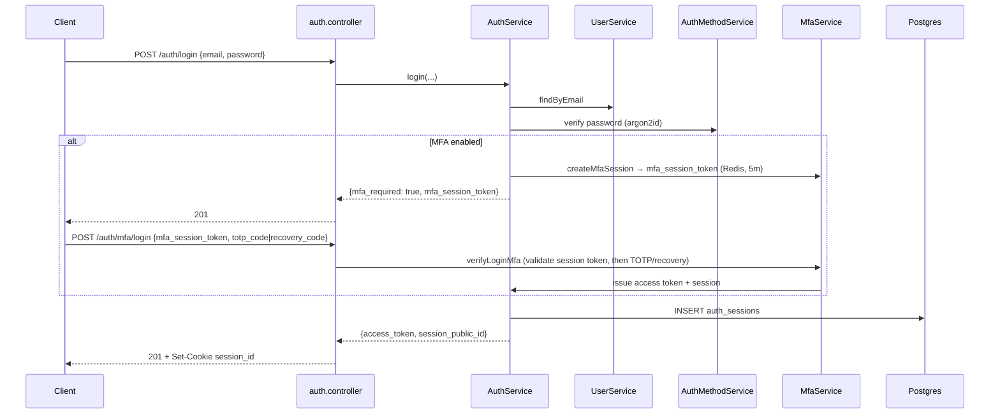
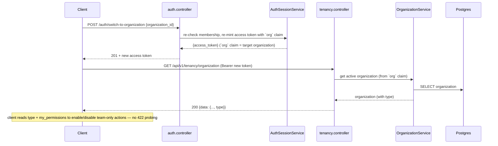
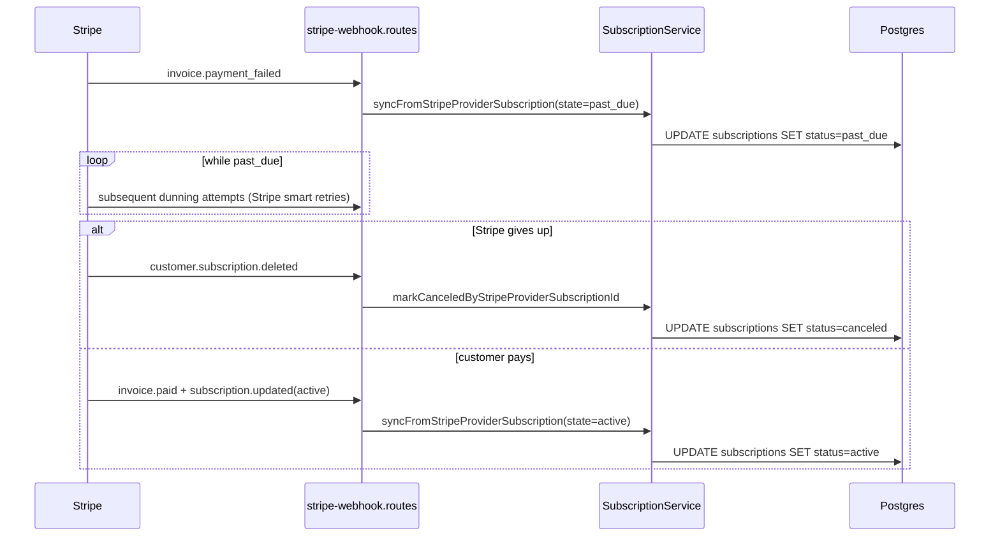
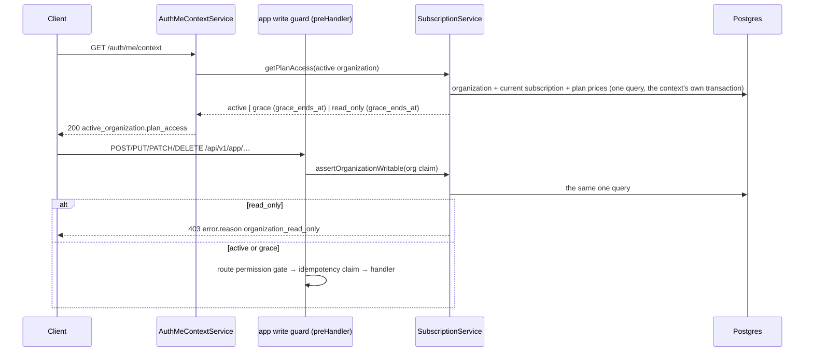
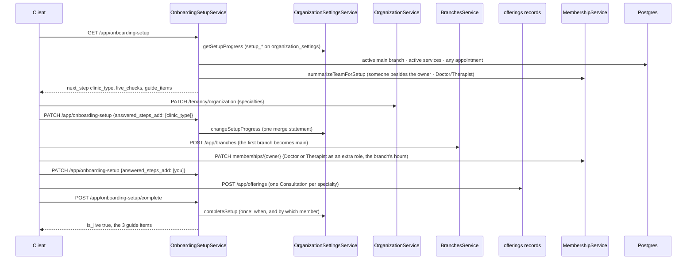

`src/`

# End-to-end feature flows

These are the multi-domain user journeys that touch more than one bounded context. Each flow lists the **trigger**, the **sequence** across domains, the **side effects** the platform produces, and the **failure modes** the platform tolerates.

When a domain `<folder>.overview.md` says **Cross-domain flows: signup-flow, subscription-change-flow**, it is asserting that the domain participates in the journeys documented here. Drift = bug.

> **Client-facing companion:** the sequences below show the **server internals** (services, DB, event bus, mail). For the **frontend** view of the auth journeys — the HTTP-only call sequence, the response body at each step, and how many calls each entry flow takes to land on the dashboard — see [docs/reference/api/frontend-auth-guide.md](docs/reference/api/frontend-auth-guide.md) (kept in step with `signup-flow`, `login-flow`, and the organization-switch flow below).

## signup-flow (unified email verification-code login)

### Trigger

Anonymous user submits an email at the unified login/sign-up form: `POST /api/v1/auth/email/send-code`.
There is no separate sign-up — an unknown email is auto-signed-up on first successful login.

### Sequence

```mermaid
sequenceDiagram
  participant Client
  participant Auth as auth.controller
  participant EL as EmailLoginService
  participant US as UserService
  participant DB as Postgres
  participant Bus as event-bus
  participant Mail as mail.processor
  participant Resend
  Client->>Auth: POST /auth/email/send-code {email}
  Auth->>EL: sendCode({email})
  EL->>US: findByEmail(email)
  US-->>EL: user | null
  alt user does not exist (auto-signup)
    EL->>DB: insert users (passwordless, is_email_verified=false) + auth_methods (EMAIL_CODE), atomic
    Note over EL: post-commit best-effort provisionPersonalOrganization (when enabled)
  end
  Note over EL: new and existing users converge on the same issue-code path
  EL->>DB: invalidateAllForUser (prior EMAIL_CODE codes) + insert verification_tokens (EMAIL_CODE, HMAC(pepper, type:user:code), expires_at = now + 15m)
  EL->>Bus: emit AUTH_EVENT.EMAIL_VERIFICATION_CODE_REQUESTED {email, verification_code, expires_in_minutes}
  Bus->>Mail: recordOutboxEmail (via event handler)
  EL-->>Auth: {messageKey: success:verificationCodeSent, expires_in_minutes: 15}
  Auth-->>Client: 201 (uniform — no account enumeration)
  Mail->>Resend: POST /emails (signed, alphanumeric code)
  Resend-->>Mail: 200
  Client->>Auth: POST /auth/email/login {email, code}
  Auth->>EL: login({email, code})
  EL->>US: findByEmail(email) + per-user attempt cap (Redis)
  EL->>DB: UPDATE verification_tokens SET used_at=NOW() WHERE user_id=$1 AND token_type='EMAIL_CODE' AND token_hash=$2 AND used_at IS NULL RETURNING *
  EL->>DB: invalidateAllForUser (single-use: redeeming one code kills the rest of the live set)
  EL->>DB: UPDATE users SET is_email_verified=true (when not already)
  EL->>DB: INSERT auth_sessions (or, when MFA enrolled, mint mfa_session_token instead — see /auth/mfa/login)
  Note over EL: post-commit best-effort provisionPersonalOrganization on FIRST login (claims a bare invited placeholder created without one; idempotent no-op for a brand-new user already provisioned at send)
  EL-->>Auth: {access_token, session_public_id} | {mfa_required, mfa_session_token}
  Auth-->>Client: 201 + Set-Cookie session_id
```

### Side effects

- `verification_tokens`: a single live code per user — each send invalidates the prior unused codes. Codes are stored only as a keyed, user-scoped HMAC (never plaintext, never bare SHA-256).
- `AUTH_EVENT.EMAIL_VERIFICATION_CODE_REQUESTED` event emitted on the in-process event bus.
- `mail_outbox` row inserted by the event handler (transactional outbox).
- Mail worker delivers via Resend (best-effort; retries via DLQ).
- On login: `auth_sessions` row + JWT issued (RS256, 15-minute access-token TTL); the user's other live codes are invalidated.

### Failure modes

- **Throttle / send cooldown** → uniform success returned to the client (no new code issued, no email). Anti-enumeration: response is identical for known and unknown emails.
- **Disposable email domain** → 400 `errors:disposableEmail`. Not silent because the user can fix it.
- **Mail enqueue failure** → does not fail the HTTP request; mail outbox sweeper retries.
- **Code replay** → atomic `UPDATE ... RETURNING` consumes the code on the first login; the post-consume `invalidateAllForUser` invalidates any other live code, keeping login single-use. Two concurrent `/email/login` requests yield exactly one session.
- **Wrong / expired code, or attempt cap exceeded** → 401 `errors:invalidOrExpiredVerificationCode`.
- **MFA enrolled** → login returns `mfa_required` + `mfa_session_token`; the client completes via `POST /auth/mfa/login`.

## login-flow

### Trigger

Returning user submits credentials: `POST /api/v1/auth/login`.

### Sequence



### Side effects

- Failed-attempt counter persisted on the user row (`users.failed_login_count`, per account). After `MAX_FAILED_LOGIN_ATTEMPTS` (10), the account locks for `ACCOUNT_LOCKOUT_MINUTES` (30 minutes). The lock is evaluated after password verification, so a correct password always bypasses it and clears the counter — the lock only rejects further wrong attempts (no victim-account DoS). Online brute force is bounded by the per-IP + per-email rate limits and CAPTCHA.
- On success: `auth_sessions` row + JWT issued; failed-attempt counter cleared; audit log row written via `audit-emission`.
- On MFA path: `mfa_session_token` written to Redis with `MFA_SESSION_TTL_SECONDS` (5 min).

### Failure modes

- **Wrong password** → 401, generic message; failed-attempt counter incremented.
- **Too many failed logins from one IP** (50 within 15 minutes of its first failure) → 429 `rate_limited` with `Retry-After` for the rest of that window, for every login from the IP; fails open when Redis errors.
- **Account locked + wrong password** → `errors:accountLocked` until the lockout window passes; a correct password during the window authenticates and lifts the lock.
- **MFA challenge expired, already used, or burned by a wrong code** → 401 `errors:mfaInvalidOrExpiredSession`; client must re-login.
- **Disabled or unverified user** → 401 with the appropriate message key; behavior identical to wrong-password from the client's perspective for non-existent emails (anti-enumeration).

## organization-switch-and-capability-discovery-flow

### Trigger

A signed-in user switches which organization is active — `POST /api/v1/auth/switch-to-organization { organization_id }` (or back to their personal workspace via `POST /api/v1/auth/switch-to-personal`).

### Sequence



### Side effects

- A new access token is minted with the target organization in the `org` claim (the prior token's organization is replaced). No DB write to the organization itself.
- `switch-to-organization` then remembers the organization as the caller's login default (`auth.users.last_active_organization_id`, written only when it changes). It is best-effort — the session is already re-bound to the new token, so a failed write is logged, never returned. Every later login (password, email code, OAuth, passkey, MFA) mints its token for that clinic while the membership is active, else the most recently joined clinic, else the personal organization — so the frontend lands on the clinic, not the organization picker. `switch-to-personal` does not change it.
- A clinic the person **pinned** (`PATCH /users/me/settings { default_organization_id }`, `auth.user_settings.default_organization_id`) comes before the remembered one at every login, while that membership and the clinic are active; `null` returns to the automatic choice. The remembered clinic keeps updating underneath, ready for when the pin is cleared.
- Both switch endpoints (`switch-to-organization` / `switch-to-personal`) return the **active-organization delta inline** — `{ access_token, active_organization, my_permissions, global_role }`, the organization carrying its `plan_access` as on `GET /auth/me/context` ([unpaid-clinic-read-only-flow](#unpaid-clinic-read-only-flow)) (`AuthMeContextService.getActiveOrganizationContext` post-gate read) — so the client repaints the dashboard for the new organization **without** a follow-up `GET /auth/me/context`. The omitted `user` / `organizations[]` are stable across a switch and reused from the client's initial context.
- Serialized organization responses (this `GET`, list, create, patch) carry the organization `type` (`PERSONAL` / `TEAM`) but **no** `capabilities` object. Clients derive team-only availability from `type` and gate the action on the caller's `my_permissions`. The personal-vs-team rule is enforced server-side by `assertTeamOrganization` in `src/domains/tenancy/sub-domains/organization/organization-capability.ts`.

### Failure modes

- **Not a member of the target organization** → switch is rejected (the token is not re-minted); the active organization is unchanged.
- **Client calls a team-only route on a personal organization** → the centralized guard `assertTeamOrganization` rejects with **422** (`unprocessable_entity`), not 409, because the organization `type` is immutable and retrying is futile. Clients hide/disable those actions up front from the organization `type` + permissions instead of probing for the 422. The team-only routes are the ones marked `team` in the `O` column of [docs/routes.txt](docs/routes.txt); the two that answer without the guard — `GET /api/v1/app/onboarding-setup` (404 `team_organization_required`) and membership restore — are noted under [ORGANIZATION_TYPE_CAPABILITY_MATRIX](src/POLICIES.md#organization_type_capability_matrix).

## organization-invitation-flow

### Trigger

Organization admin adds a teammate by email: `POST /api/v1/tenancy/organization/memberships {email, role_ids, expires_in_days?, …}` (REQ-1). That single call provisions/finds the user, creates the `INVITED` membership, and issues the invitation — there is no separate "create invitation" route.

### Sequence

```mermaid
sequenceDiagram
  participant Admin as Admin Client
  participant Mem as MembershipService
  participant Usr as UserService
  participant Inv as MembershipInvitationService
  participant DB as Postgres (RLS scoped to organization)
  participant Bus as event-bus
  participant Mail as mail.processor
  participant Invitee as Invitee Client
  participant Auth as auth (OAuth / email-code)
  Admin->>Mem: POST /organization/memberships {email, role_id}
  Mem->>Usr: findOrCreateInvitedByEmail(email)
  Usr->>DB: resolve by email (SECURITY DEFINER) — else INSERT auth.users (ACTIVE, is_email_verified=false, no auth method)
  Mem->>DB: BEGIN; SET LOCAL app.current_organization_public_id
  Mem->>DB: privilege-escalation guard; INSERT memberships (status=invited)
  Mem->>Inv: createForMembership(...)
  Inv->>DB: INSERT membership_invitations (token_hash, expires_at)
  Inv->>Bus: emitStrict MEMBERSHIP_INVITATION_EVENT.CREATED {email, raw_token, organization_name, ...}
  Mem->>DB: COMMIT
  Bus->>Mail: recordOutboxEmail (via event handler)
  Mail-->>Invitee: invitation email (raw_token in URL)

  Note over Invitee,Auth: invitee onboards (claims the pre-created user) via email verification-code login or OAuth — find-by-email reuses the row and email-code/OAuth set is_email_verified
  Invitee->>Inv: POST /tenancy/membership-invitations/:membership_invitation_id/accept {token} (authenticated)
  Inv->>Usr: requireUserRecordByPublicId(actingUser) — 403 if email unverified, 403 if email ≠ invitee
  Inv->>DB: BEGIN; SET LOCAL app.current_organization_public_id
  Inv->>DB: UPDATE membership_invitations SET accepted_at=NOW() WHERE token_hash=$1 (atomic, single-use)
  Inv->>DB: UPDATE memberships SET status=active, joined_at=NOW() (activateForInvitationAccept)
  Inv->>DB: COMMIT
  Inv-->>Invitee: 200 {invitation}
```

### Side effects

- New invitee → a bare ACTIVE `auth.users` row (`is_email_verified=false`, no auth method), claimed on first onboarding — **email verification-code login** or **OAuth**; an existing address resolves to that account.
- `invited` `memberships` row + `membership_invitations` row (hashed token; the raw token leaves the platform only via the email payload, parallel to the email verification code).
- `MEMBERSHIP_INVITATION_EVENT.CREATED` (emitStrict — a failed outbox write rolls back the whole organization transaction) → mail outbox → invitation email.
- Accept requires authentication, a **verified** email, and an email matching the invitee (sec-T4 + follow-up) — so a forwarded invite token alone, or a password-claim that has not yet verified, cannot join the organization. On accept the membership is activated (`status=ACTIVE`, `joined_at`) and the member's permission cache invalidated.
- On revoke (`DELETE /organization/memberships/:membership_id/invitation`): the invitation is revoked AND the auto-created `invited` membership is soft-deleted (no ghost invitee in the members table).

### Failure modes

- **Disposable email** → 400 `errors:disposableEmail`.
- **Already a member (active or live invited) for that email** → 409 `errors:membershipAlreadyExists`.
- **Personal organization** (single-member) → 422 (team-only route).
- **Token expired / invalid / revoked / already accepted** → `ValidationError` on accept.
- **Token reuse** → the atomic accept consumes the row on first accept; a second attempt fails validation.

## subscription-change-flow

### Trigger

Two paths:

- **Inbound (authoritative)**: Stripe sends `customer.subscription.updated` → `POST /api/v1/billing/webhook`.
- **User-initiated**: organization admin calls `POST /api/v1/billing/subscriptions/:subscription_id/change-plan` (active organization from the JWT `org` claim). The service calls Stripe; the inbound webhook lands shortly after and reconciles state.

A plan change or cancel writes the local row right after Stripe accepts the call (stamping `last_stripe_event_created_at` so an older webhook cannot roll it back); the webhook that follows is authoritative and reconciles anything that drifted. Plan changes to one subscription run one at a time (a Redis lock per subscription; a concurrent one gets `409 subscription_change_in_progress`), and a plan change never writes the billing period — that is Stripe's, synced by the webhook.

A new subscription bills every member the organization already has from its first invoice (Stripe `quantity` = ACTIVE + INVITED, at least 1). Only a failed local write cancels the just-created Stripe subscription; when the webhook's `.created` inserted the row first, the create returns that row instead.

### Sequence

```mermaid
sequenceDiagram
  participant Stripe
  participant Ingest as stripe-webhook (ingress + controller)
  participant SWS as StripeWebhookService
  participant Queue as stripe-webhook queue (BullMQ)
  participant Worker as stripe-webhook worker
  participant Sub as SubscriptionService
  participant DB as Postgres (RLS scoped to organization)

  Note over Stripe,Ingest: signature verified in the ingress plugin, before the handler
  Stripe->>Ingest: POST /api/v1/billing/webhook (Stripe-Signature)
  Ingest->>SWS: ingestEvent(event)
  SWS->>DB: insert stripe_webhook_events (status=processing) ON CONFLICT (event_id) DO NOTHING
  alt new event, or a redelivery still waiting for its run
    SWS->>Queue: enqueue stripe-webhook job (job id = event id)
  else already processed or abandoned
    Note over SWS: no enqueue; idempotent no-op
  end
  Note over SWS: the ingress records, never claims — the worker's first claim stays free
  Ingest-->>Stripe: 200

  Queue->>Worker: deliver job (async, separate process)
  Worker->>SWS: handleEvent → dispatchEvent
  SWS->>Sub: syncFromStripeProviderSubscription({ provider_subscription_id, data, stripe_event_created_at })
  Sub->>DB: BEGIN; SET LOCAL app.current_organization_public_id
  Sub->>DB: UPDATE subscriptions SET ... WHERE provider_subscription_id=$1
  Sub->>DB: COMMIT
  Worker->>DB: UPDATE stripe_webhook_events SET status=processed
```

### Side effects

- `stripe_webhook_events` row keyed by Stripe `event.id` (idempotent inbound).
- `subscriptions` table updated with the latest Stripe state.
- `subscription.updated` (or `subscription.cancelled` once the status is `CANCELED`) to the organization's subscribed webhooks — see `organization-resource-webhook-flow`.

### Failure modes

- **Invalid Stripe signature** → 400; Stripe retries.
- **Duplicate `event.id`** → silently no-op (unique constraint); Stripe retries are safe. A redelivery that arrives before the worker ran is re-enqueued (a no-op while the job exists) and leaves the claim to the worker — an ingress that claimed made the worker wait out the 15-minute lease.
- **`.deleted` that finds the row already cancelled or newer** → processed with a log line (`stripe.webhook.subscription_cancel_already_terminal_or_stale`), never retried into an alert.
- **Stripe API timeout or outage (user-initiated path)** → 503 `paymentProviderUnavailable`; nothing is written locally. If Stripe did apply the change, its webhook reconciles the row.
- **Worker crash mid-processing** → row stuck in `processing`; reclaim worker (`stripe-webhook-event-reclaim.processor`) restarts it after `STRIPE_WEBHOOK_STUCK_PROCESSING_LEASE_MINUTES` (15 min).
- **Event that keeps failing** → after `STRIPE_WEBHOOK_MAX_PROCESSING_ATTEMPTS` (25) handler attempts — or at once for a permanent failure — the row turns `abandoned` and one alert fires; the reclaim never selects it again.
- **Stale event** (timestamp older than current row) → service rejects the update so out-of-order webhooks don't roll state backwards.

## dunning-flow

### Trigger

Stripe sends a billing-failure webhook (`invoice.payment_failed`, `customer.subscription.updated` with `past_due`) → `POST /api/v1/billing/webhook`.

### Sequence

> Ingestion uses the same async claim → enqueue → worker path as `subscription-change-flow`; the diagram below collapses that plumbing to focus on the `subscriptions.status` state machine.



### Side effects

- `subscriptions.status` transitions: `active` → `past_due` (and back, or onward to `canceled`).
- Each transition is a `subscription.updated` (the final one a `subscription.cancelled`) to the organization's subscribed webhooks.
- **Losing the paid entitlement keeps the team.** Once a cancel, expiry, pause or never-paid status commits, `billing.entitlement_lost` is logged and no member is suspended (owner decision, 2026-10-17: suspending everyone past the Free allowance locked a clinic's staff out mid-day). The end of a dunning grace (`current_period_end + BILLING_DUNNING_GRACE_DAYS`) has no Stripe event, so the hourly `subscription-seat-reconcile` job on the seat-sync queue reports it (`subscription-seat-reconcile.entitlement_lapsed`), and re-enqueues a seat sync wherever Stripe bills a quantity other than the seats in use. Only an owner's own plan downgrade still suspends members past the new plan's ceiling.
- **Then read-only, not lock-out.** With `BILLING_READ_ONLY_ENFORCED` on, a clinic whose entitlement has lapsed keeps writing until `current_period_end + BILLING_DUNNING_GRACE_DAYS`, then turns read-only — see [unpaid-clinic-read-only-flow](#unpaid-clinic-read-only-flow).

### Failure modes

- **All standard subscription-change-flow failure modes apply** (signature, duplicate event id, stale events, worker crash).
- **Customer ignores the dunning emails** → Stripe-driven cancellation eventually fires; the platform does not unilaterally cancel.

## unpaid-clinic-read-only-flow

### Trigger

A TEAM organization (a clinic) has no paid entitlement — no subscription, a subscription on the Free plan, or a paid one that lapsed — while `BILLING_READ_ONLY_ENFORCED` is on (owner decision D3, 2026-10-17; **off by default** until clinics can pay in ₹). `GET /api/v1/auth/me/context` (and both organization switches) report the clinic's state; every POST / PUT / PATCH / DELETE under `/api/v1/app/` checks it.

### Sequence



### Side effects

- **Nothing is written.** The state is computed on every read from `tenancy.organizations` and `billing.subscriptions` (`resolvePlanAccess` in `subscription-entitlement.util.ts`) — no column, no job, so paying lifts read-only on the very next request.
- **Paid entitlement** = ACTIVE or TRIALING on a plan priced above zero (`isPaidPlan`), or a dunning subscription (PAST_DUE / UNPAID) still inside its grace — the same entitlement the seat ceiling reads (`requiresFreeSeatCeiling`).
- **The grace:** a clinic that never paid (no subscription, or the Free plan) — `created_at + NEW_ORGANIZATION_TRIAL_DAYS` (14), a new clinic's trial; a lapsed paid subscription (cancelled, expired, paused, never paid, or dunning past its period) — `current_period_end + BILLING_DUNNING_GRACE_DAYS`. Until then `grace`; after it `read_only`, with `grace_ends_at` the moment read-only began.
- **Only the clinic rooms close.** Reads stay open, and so do billing, auth, user, tenancy and upload — a read-only clinic can still pay, sign in, manage its team and export its data. Nobody is suspended and no data is deleted. PERSONAL organizations are always `active`.
- The write guard runs before the route's permission gate and the idempotency claim, so a refused write holds no idempotency key.

### Failure modes

- **The plan access read fails** → the write fails with the error (no write goes through unchecked); `GET /auth/me/context` fails the same way.
- **`BILLING_READ_ONLY_ENFORCED` off** → every organization reads `active` and no query runs.
- **Switching the flag on** → every unpaid clinic already past its grace turns read-only at once; the grace counts from `created_at` / `current_period_end`, not from the day the flag was switched on.

## organization-resource-webhook-flow

### Trigger

A write changes one of the public resources the webhook catalog (`GET /api/v1/notify/webhook-events`) advertises:

| Event | Emitted by |
| ----- | ---------- |
| `organization.created` | `POST /tenancy/organizations` |
| `organization.updated` | `PATCH /tenancy/organization`, logo upload / delete |
| `membership.created` | `POST /tenancy/organization/memberships` (the INVITED membership) |
| `membership.updated` | membership PATCH (role, suspend, reactivate), invitation accept, downgrade auto-suspend |
| `membership.deleted` | membership DELETE, leave, invitation revoke |
| `subscription.created` | `POST /billing/subscriptions`, the Stripe `.created` fallback insert |
| `subscription.updated` | change-plan, cancel at period end, resume, a Stripe sync that changes a customer-visible field (status, cancel at period end, cancelled at, periods, plan) |
| `subscription.cancelled` | immediate cancel (`INCOMPLETE`), Stripe `.deleted` or a sync to `canceled` |

Creating or changing a webhook needs the permission the API needs to read each event's resource — for the events it will receive and, on a change, those it already receives (its pending attempts go to the URL it holds at delivery time): `membership:read` for `membership.*`, `subscription:read` for `subscription.*` (`organization.*` is readable by every member).

### Sequence

```mermaid
sequenceDiagram
  participant Service as Tenancy / billing service
  participant Bus as Event bus
  participant Notify as Webhook fan-out (notify)
  participant DB as Postgres
  participant Queue as webhook-delivery queue

  Service->>DB: BEGIN (organization context); write the resource
  Service->>Bus: emit <resource>.<verb> { organization_public_id, data: public JSON }
  Bus->>Notify: dispatchOrganizationWebhooks (reuses the transaction)
  Notify->>DB: SAVEPOINT
  Notify->>DB: list enabled webhooks subscribed to the type
  Notify->>DB: INSERT webhook_delivery_attempts (PENDING, envelope { id, type, created_at, data })
  Notify->>DB: RELEASE SAVEPOINT
  Service->>DB: COMMIT
  Notify->>Queue: enqueue one delivery job per attempt (after the commit)
```

### Side effects

- One PENDING `webhook_delivery_attempts` row per subscribed enabled webhook, committed with the write. Every endpoint gets the same envelope: `id` (`evt_…`, one per event), `type`, `created_at`, `data` (what the resource's serializer returns over the API).
- One `webhook-delivery` job per attempt, enqueued only once the transaction commits (`runInCommitUnit`): over HTTP by the request's `onResponse` flush, in a worker right after the commit. A unit that rolls back drops its jobs.

### Failure modes

- **The write rolls back** → the attempts roll back with it; nothing is delivered.
- **Fan-out fails** → the savepoint rolls back every attempt of that event (all or nothing) and the write still commits. Over HTTP the bus logs and alerts; in the Stripe webhook job the failure is rethrown (`emitStrict`), so the job retries the whole event — otherwise the watermark would let the retry emit nothing.
- **Redis refuses the enqueue, or the process dies after the commit** → the attempt stays PENDING and `webhook-delivery-reclaim` re-enqueues it.
- **A Stripe event replayed, or a sync that changes nothing customer-visible** (the same-second reconciliation after an HTTP mutation) → no event: the watermark refuses a replay, and a sync is compared with the row's state before it.
- **The organization is deleted** → organization offboarding emits no `subscription.cancelled` (nothing could deliver it); `webhook-delivery-reclaim` skips its pending attempts, and a delivery job already queued completes as skipped (`attempt_missing`).
- **`organization.created`** → cannot reach a webhook: the new organization has none yet. It is emitted for completeness.
- **Ownership transfer, organization settings, seat-quantity sync** → no event: the organization's public JSON does not change, settings are another resource, and Stripe's quantity update returns as a `customer.subscription.updated` that emits `subscription.updated`.

## clinic-setup-flow

### Trigger

An Owner or Admin of a team clinic lands in the clinic for the first time (any room); the frontend reads
`GET /api/v1/app/onboarding-setup` and opens the setup drawer while `is_live` is false and `deferred_at` is null
(iteration `feat-clinic-setup-2026-10-13-sltd`).

### Sequence



### Side effects

- The seven `setup_*` fields of `tenancy.organization_settings` — answered steps, skipped guide items, deferred,
  completed (and by whom), guide hidden, guide done. Every tick is read from the clinic's records.
- A clinic's first branch becomes its main branch (`POST /app/branches`).
- The first read that finds a live clinic's three guide items done or skipped stores `setup_guide_done_at` once.
- No events, no background work, no email (D21).

### Failure modes

- **Going live too early** → `409 onboarding_setup_incomplete`, the message naming each missing check (clinic type,
  main branch, a service); nothing is written.
- **Two admins answering at once** → both answers land (single-statement merge); a save with a stale
  `expected_updated_at` is `409 record_changed`.
- **Two first branches at once** → one is main, the other saved as not main; neither request fails.
- **A personal workspace** → `422 team_organization_required` on every setup route.
- **Going live twice** → the second call answers as it stands; the first completer stays recorded.
