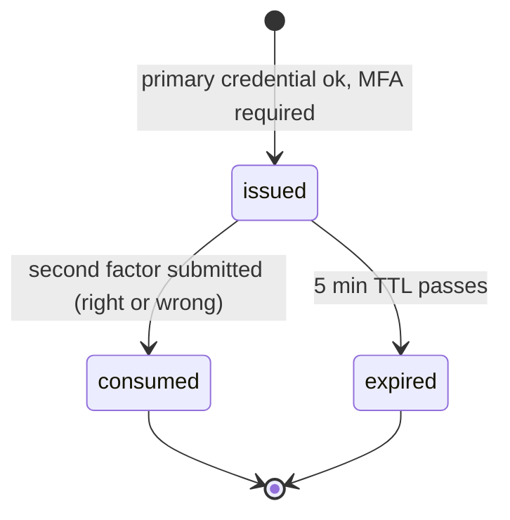

`src/domains/auth/sub-domains/auth-mfa-session/`

# MFA challenge ticket store

Parent: [auth](../../auth.overview.md)

## Purpose

Redis-backed store for the short-lived "user has proven primary credential, awaiting second factor" tickets that bridge primary auth and second-factor verification. `completeFirstFactorAuth` (`src/domains/auth/shared/complete-first-factor-auth.ts`) mints a ticket after any first factor — password, email code, OAuth or a [auth-webauthn](../auth-webauthn/auth-webauthn.overview.md) passkey — when the user has MFA enabled or belongs to an organization that requires it; the [auth-mfa](../auth-mfa/auth-mfa.overview.md) login-verify step (TOTP or recovery code) consumes it.

## Key invariants

- **Stored shape**: `mfa:session:<token>` (a random 32-byte hex token) holds only `{ user_public_id }` — no privileges are granted until the second factor passes.
- **TTL exactly `MFA_SESSION_TTL_SECONDS`** (5 min). Tickets cannot be refreshed — a slow user must restart login.
- **Single-use**: the login-verify step reads the ticket with an atomic `GETDEL` before it checks the code, so the first submission consumes it whether the code is right or wrong; a replay, or a retry after a wrong code, yields 401 and the user restarts login.
- **Bound to the user only**: the ticket records no IP address or user agent, and none is checked on submission — possession of the token within its TTL is the whole binding.

## Lifecycle

## Failure modes

- **Missing, expired or already-consumed ticket** → 401 `errors:mfaInvalidOrExpiredSession`.
- **Malformed stored payload** (not JSON, or no `user_public_id`) → 401 `errors:mfaInvalidOrExpiredSession`; the entry is consumed all the same.

## Policy constants

- `MFA_SESSION_TTL_SECONDS = 300`
