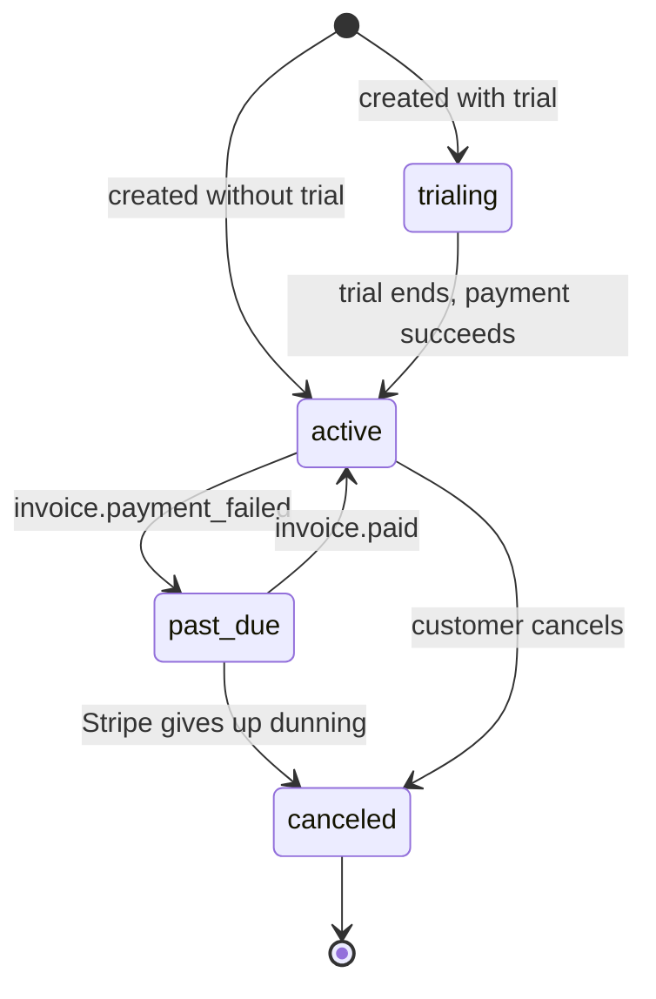

`src/domains/billing/sub-domains/subscription/`

# Subscription

Parent: [billing](../../billing.overview.md)

## Purpose

The organization's active subscription record. One row per organization, bound to a Stripe customer and Stripe subscription. State changes always flow Stripe webhook → service → DB; we never write subscription state to DB without a Stripe-confirmed webhook behind it.

## Key invariants

- **One subscription per organization**: enforced at the service layer; concurrent create attempts resolve to a single Stripe subscription via the forwarded idempotency key.
- **State changes are Stripe-driven**: `subscriptions.status` only transitions in response to a webhook event whose `event.created_at` is newer than the row's last update.
- **Stale-event rejection**: out-of-order webhooks are rejected so state cannot roll backward.
- **Network I/O outside RLS contexts**: Stripe API calls run **outside** `withAppDatabaseContext`. The service interleaves: `withAppDatabaseContext(read)` → Stripe call → `withAppDatabaseContext(write)`.
- **Retained mutable state (not an immutable ledger)** (audit-#B2): subscription rows are updated in place as status transitions (Stripe syncs, cancel/resume, plan changes, seat counts) and are never soft- or hard-deleted — cancellation transitions to `canceled` and the row stays for forensic + invoice-history value. DB-level append-only enforcement (as on `audit.logs`) is intentionally NOT applied, because in-place status transitions are the table's purpose; immutability is scoped to the monotonic `last_stripe_event_created_at` watermark that blocks stale/out-of-order events, not to the row as a whole.

## Lifecycle

## Seats (REQ-4)

- The public subscription response carries `seats_total` (the seats the subscription pays for: the plan's `included_seats`, raised by a Stripe quantity bought above it — `max(included_seats, seats)`; `null` = unlimited plan) and `seats_used` (count of ACTIVE + INVITED memberships, resolved cross-domain via the tenancy membership service).
- **Seat enforcement** lives in tenancy's `MembershipService.create`: it calls back into `SubscriptionService.reserveSeatCeilingForMemberAdd` (a `SELECT ... FOR UPDATE` on the active subscription row) and rejects the add with `409 seat_limit_reached` when `used >= ceiling`. The ceiling is the same resolution as `seats_total` (`resolvePaidSeatCeiling`). No-op when the plan is unlimited; an organization with no active subscription falls to the Free-tier ceiling.
- **`seats` is the billed quantity, never the limit on its own.** The seat sync writes the member count into it after every add, so reading it as the limit capped a subscribed organization at its current size after one add, and an unlimited plan at its headcount (launch ROUTE #165, pinned by `__tests__/integration/subscription-seat-ceiling.integration.test.ts`). A quantity bought above the plan in Stripe still raises the ceiling — until the next seat sync lowers the quantity to the member count again (the sync pushes the headcount; there is no separate "purchased extra seats" record).
- **Stripe quantity sync** is out-of-band: every operation that moves the ACTIVE + INVITED count enqueues a `subscription-seat-sync` job (`queues/` + `workers/`); the worker pushes the member count to Stripe (`updateSubscriptionQuantity`) and persists `subscriptions.seats`. The `customer.subscription.updated` webhook also reconciles `seats` from the Stripe item quantity. A Stripe outage never fails member management.
- **One seat sync per organization at a time.** The enqueue deduplicates on `seat-sync-<organization>` with `keepLastIfActive` (`subscriptionSeatSyncDeduplication`): while the organization's job waits, further changes add nothing (it has not read the count yet); while it runs, the latest change is kept and runs once after it. Without it two replicas could sync one organization at once and the run that read the older count could finish last, leaving Stripe on the wrong quantity. A lost enqueue (Redis down) is not recovered until the next membership change — there is no periodic seat reconciliation.
  - The operations that move it: member add, member remove, leave-organization, change-plan, **suspend / reactivate** (SUSPENDED does not occupy a seat, so crossing that line in either direction counts), and **invitation revoke** (an INVITED membership holds a seat). The last two used to be silent, which left Stripe billing a suspended seat until some unrelated member change happened to reconcile it.
  - The one definition of "occupies a seat" is `SEAT_CONSUMING_MEMBERSHIP_STATUSES` in tenancy's `membership.types.ts`, used by both the `seats_used` count query and the status-transition check — keeping those apart is what let the suspend path drift.
- **Cross-domain DI**: membership↔subscription is a true cycle (billing reads `seats_used` from tenancy; tenancy enforces the limit via billing), broken by late-wiring `SubscriptionService` into `MembershipService.wireSeatEnforcement` in the composition root. `MembershipInvitationService.wireSeatQuantitySync` takes the enqueue half of the same port, for revoke.

## Events

- Emits: none — subscription state transitions are persisted directly from Stripe webhook events; no in-process domain events are published.

## External integrations

- **Stripe** — wrapped by [src/infrastructure/payment/stripe.client.ts](src/infrastructure/payment/stripe.client.ts) with circuit breaker + Sentry instrumentation.

## Failure modes

- **Stripe API failure on a user-initiated mutation (`create` / `cancel` / `resume`)** → the provider adapter is **fail-closed**: it logs and throws `ServiceUnavailableError` (503, `errors:paymentProviderUnavailable`) *before* any local write, so subscription state in DB is unchanged (no row created, no `cancel_at_period_end` / `status` flip). The Stripe webhook reconciles once Stripe recovers.
- **Stripe `Idempotency-Key` reuse with different payload** → Stripe returns 400; we surface as 400 to the client.
- **Webhook event timestamp older than the row** → service rejects the change (logs at info), Stripe retry will eventually pass with the latest event.

## Policy constants

- `IDEMPOTENCY_RESPONSE_CACHE_TTL_SECONDS = 86 400`
