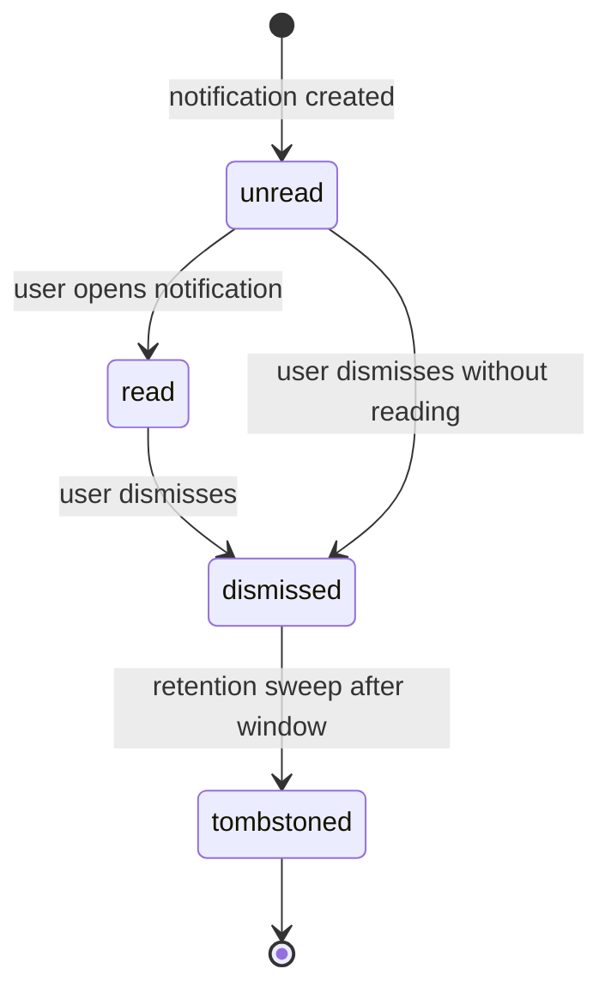

`src/domains/notify/sub-domains/notification/`

# Notification

Parent: [notify](../../notify.overview.md)

## Purpose

In-app notification rows: the user-visible feed. Rows are created via `createAndDispatchNotification` (persist the row + enqueue channel dispatch); users mark them read or dismiss them via the API. There is no cross-domain event handler creating notifications today.

## Key invariants

- **No insert-time dedupe key**: the `notifications` table has no `source_event_id` column and no `(user, …)` uniqueness, so creating the same logical notification twice yields two rows. Idempotency is enforced **downstream** (dispatch + email), not at insert.
- **Public ids in the job, never a bigserial**: the dispatch job carries the notification's public id, its organization's (`null` for a notification without one) and its recipient's. The worker reads the row under the organization's scope, or — for a notification without one — under the recipient's (`notifications_owner_select`); no SECURITY DEFINER lookup, no wide maintenance scope. A row that is gone (deleted, erased, lost to a restore) completes the job as skipped.
- **Idempotent dispatch enqueue**: the dispatch job's `jobId` is the notification's public id (`ntf_…`), so a recovery/redelivery re-enqueue of the same persisted notification is a BullMQ no-op within the retention window — one notification row never fans out (or emails) twice. Not the bigserial: it restarts at 1 after `TRUNCATE ... RESTART IDENTITY` or a database restore while Redis keeps finished jobs for 7 days, and BullMQ silently drops an add whose job id still exists — a new notification reusing the id would never be dispatched. The email channel's `notification:email-dispatched:` marker and its mail-outbox `dedupe_key` are keyed by the public id for the same reason.
- **Bounded mark-all-read**: `markAllReadForUser` marks the unread backlog in `NOTIFICATION_MARK_ALL_READ_BATCH_SIZE`-row batches (looping until drained), so a huge backlog cannot become one unbounded, long-held write that stalls concurrent inserts for that user; the returned count is summed from each statement's `RETURNING` (never a separate pre-count).
- **Email outcome is honest**: the worker reports `email:outbox_pending` (not `email:queued`) when the mail-outbox row persisted but its BullMQ enqueue failed — the mail-outbox sweeper re-enqueues it and the `mail_outbox_pending` gauge tracks the depth.
- **Tenant-scoped**: notifications belong to a `(user, organization)` pair. Reads are scoped through the standard tenant context.
- **Read state is monotonic**: `unread → read → dismissed`. Marking a dismissed notification "unread" is not allowed.
- **Best-effort fan-out**: a notification fan-out failure does not roll back the originating transaction (it's a downstream side effect).
- **The unread count is cached, and the error only goes one way**: `GET /notify/notifications/unread-count` is served from Redis (`notify:unread-count:<userPublicId>`, 60 s) because every open tab polls it. Every write that names a user invalidates after commit — mark-read, mark-all-read, delete, the invite-accepted fan-out, and the enqueue-rollback delete (the post-commit task carries the recipient's public id). The one writer that cannot name a user — the retention sweep, which deletes by `created_at` — is bounded by the TTL alone, and only ever removes rows — so a stale badge reads **high**, never low. It can show a notification that is gone; it cannot hide one that arrived. Contract: [read-caching](src/PATTERNS.md).

## Lifecycle

## Events

- Consumes: `MEMBERSHIP_INVITATION_EVENT.ACCEPTED` — the one cross-domain producer, fanning a notification out to the organization's `membership:create` holders and invalidating each recipient's cached unread count. Every other notification row is created directly via `createAndDispatchNotification` (persist + enqueue channel dispatch), then delivered asynchronously by the `notification` BullMQ worker.

## Failure modes

- **Worker crash during fan-out** → BullMQ retries the dispatch job (keyed by the notification's public id), which re-reads the **same** persisted row rather than inserting a new one; the email channel's mail-outbox `dedupeKey` collapses duplicate sends. (The in-app row is created once by the handler, not by the dispatch worker.)
- **Recipient user soft-deleted** → for a notification without an organization the recipient's scope no longer matches (the owner arms require an active user), so the job completes as skipped (`notification.worker.not_found`).
- **Enqueue fails after commit** → the post-commit dispatch deletes the never-dispatched row under its recipient's scope and invalidates their cached unread count.
