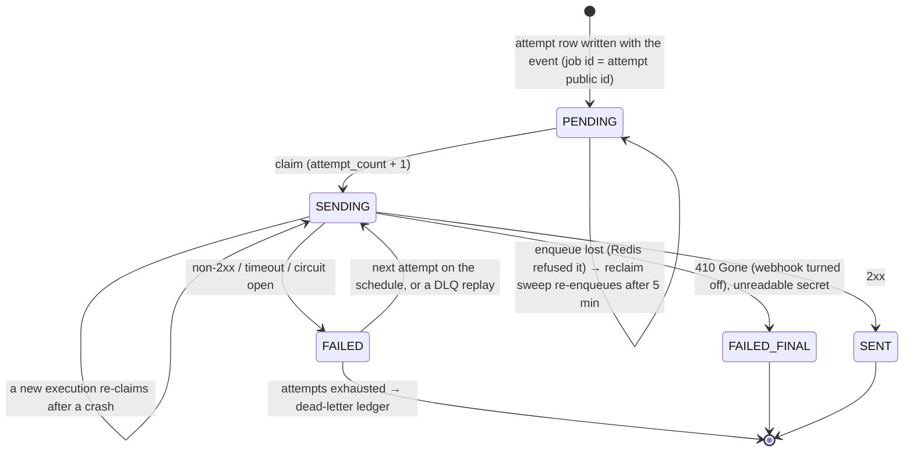

`src/domains/notify/sub-domains/webhook/webhook-delivery/`

# Webhook delivery (nested implementation)

Parent: [webhook](../webhook.overview.md)

## Purpose

Outbound webhook HTTP delivery: durable attempt records, BullMQ queue/worker, circuit breaker, and event-bus handlers that enqueue delivery jobs after the subscription service commits.

## Layout

- `webhook-delivery.repository.ts` / `webhook-delivery-attempt.repository.ts` — persistence
- `queues/` — BullMQ job schema, enqueue helper and the retry schedule (`WEBHOOK_DELIVERY_RETRY_DELAYS_MS`)
- `workers/` — delivery processor + outbound circuit breaker, and the `webhook-delivery-reclaim` sweep that re-enqueues attempts whose job was lost
- `events/` — in-process emit + handlers (types remain in parent `webhook/events/notify.events.ts`)

## Lifecycle

`FAILED_FINAL` is the `FAILED` status with `next_retry_at` null — no attempt follows it.

## Key invariants

- The job carries the attempt's **public id** (`deliveryAttemptPublicId`, also the BullMQ job id) and `organizationPublicId` — never a bigserial. The worker loads the row by public id under the organization's RLS scope.
- **A lost enqueue is re-sent, never failed.** The job is enqueued after the transaction commits, and producers fail fast while Redis is unreachable or full; the attempt then stays `PENDING` with no job. The `webhook-delivery-reclaim` sweep (every 5 min, `webhook` family) re-enqueues attempts still `PENDING` after 5 minutes, across organizations under the global-retention scope, then adds the jobs outside any database context. An attempt whose job still exists (queued behind a backlog, retained after a dead-letter) is left alone — BullMQ drops the add for an existing job id.
- **Claim unless `SENT`.** BullMQ runs one execution of a job at a time, so an execution that finds its row `SENDING` is looking at one that crashed or lost its lock; it claims the row again. No lease, no "in flight" skip — that used to complete the job and drop the event. `attempt_count` counts every claim and has no upper bound.
- Delivery is **at-least-once**: every POST of an attempt carries the same `X-Webhook-Delivery-Id` (the attempt's public id); receivers dedupe on it. Nothing POSTs an attempt once it is `SENT`, and `recordOutcome` never overwrites `SENT`.
- **One destination host cannot fill the workers.** At most `WEBHOOK_DELIVERY_MAX_IN_FLIGHT_PER_HOST` deliveries (default 2) to the same host and port are in flight across every worker replica, held as a Redis lease (`webhook:host-slots:<host>`, member = the attempt public id, lease = the webhook BullMQ lock). A further delivery is moved back onto the queue (`moveToDelayed`, five seconds plus jitter) before Postgres is opened, without a `FAILED` outcome and without spending a BullMQ attempt. The host is stored on the job at enqueue (the event handler and the reclaim sweep). A Redis error while taking the lease fails open and the delivery still runs. Other hosts keep the rest of the pool.
- **Retry schedule**: eight attempts — after 1 min, 5 min, 30 min, 2 h, 5 h, 10 h, 10 h (about 28 h in all), plus up to 20% jitter. The row's `next_retry_at` uses the same base delay.
- **Outcomes**: 2xx → `SENT`. `410 Gone` → `FAILED` with no retry, the webhook is turned off (its owner re-enables it), the job completes. Any other receiver failure → `FAILED` + retry; the final one reaches the dead-letter ledger at warn level without a Sentry page (`WebhookEndpointFailure.expectedFinalFailure`). An unreadable or empty signing secret, or a missing attempt row, is our fault: `UnrecoverableError`, recorded and alerted.
- A disabled or deleted webhook is re-checked at claim time: the attempt is recorded `FAILED` (`webhook_disabled`) and skipped.
- The dashboard history read (`listByWebhook`) takes a `webhook_id` the controller already resolved for the active organization (`getWebhookId(public_id, organization_id)`), and the `webhook_delivery_attempts_tenant_isolation` RLS policy backstops it — a foreign `webhook_id` returns zero rows, so no extra organization predicate is needed on the page read.
- SSRF protections and pinned DNS apply in the worker outbound fetch path.
- Tombstone retention for old delivery rows stays on the parent `webhook/workers/` aggregate.
