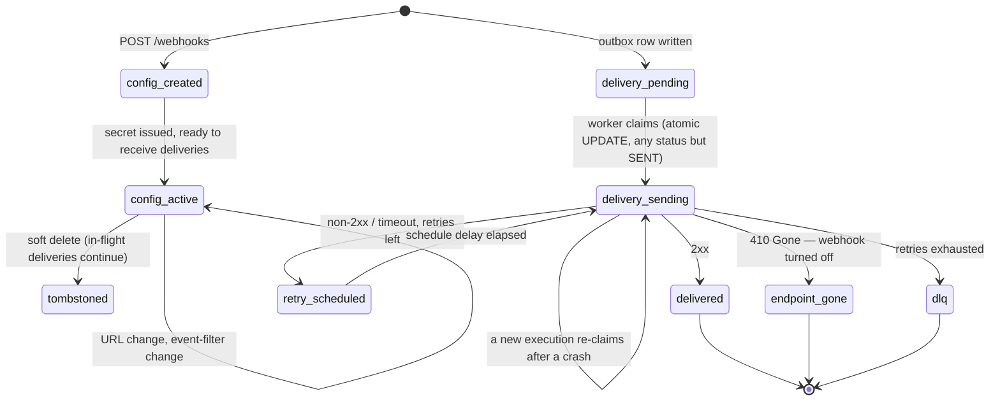

`src/domains/notify/sub-domains/webhook/`

# Webhook

Parent: [notify](../../notify.overview.md)

## Purpose

Customer-configured outbound webhook endpoints + the entire delivery pipeline: per-organization webhook configurations (URL, secret, event filter), the `webhook_delivery_attempts` table (both the PENDING outbox row and the delivery/attempt record), and the delivery worker with its retry schedule and DLQ. The nested [webhook-event](src/domains/notify/sub-domains/webhook/webhook-event/) resource models the catalog of event types customers can subscribe to.

## Key invariants

- **At-least-once delivery**: a PENDING `webhook_delivery_attempts` row is written inside the originating transaction (the outbox). The worker claims it (any status but `SENT`) and retries on failure; every POST of an attempt carries the same `X-Webhook-Delivery-Id`, so receivers dedupe redeliveries. Detail: [webhook-delivery](webhook-delivery/webhook-delivery.overview.md).
- **Enqueue after commit**: the `WEBHOOK_DELIVERY_REQUESTED` handler calls `runEnqueueAfterCommit` so BullMQ jobs are not published until `eventBus.flushOnCommit` runs (HTTP `onResponse` after the request transaction commits). Workers and scripts without an HTTP onCommit scope enqueue immediately.
- **Delivery record**: the `webhook_delivery_attempts` row records status, HTTP status code, response body, `next_retry_at` and `attempt_count` (every claim, no upper bound); the delivery history is forensically queryable.
- **Request-id propagation**: outbound deliveries carry the originating `X-Request-Id` so customers can correlate their server logs with our audit.
- **HMAC signature on every payload**: each delivery is signed with the per-webhook secret; customers verify signature in their handler.
- **Retry schedule**: eight attempts over about a day (1 min, 5 min, 30 min, 2 h, 5 h, 10 h, 10 h, plus up to 20% jitter); the final receiver failure reaches the dead-letter ledger at warn level, without a Sentry page. `410 Gone` stops retrying and turns the webhook off.
- **Tenant-scoped**: webhook configurations belong to organizations; deliveries fire only to URLs that organization owns.
- **Secrets never logged in URLs**: structured logs and circuit-breaker events record origin, path, and a short hash of the full URL — never query strings, fragments, or embedded credentials.

## Lifecycle

## Events

- Consumes: `NOTIFY_EVENT.WEBHOOK_DELIVERY_REQUESTED` (internal) — emitted by the outbox dispatcher and consumed by the delivery enqueuer. Webhook payloads derive from the originating organization's data.

## External integrations

- **Customer webhook endpoints** (HTTP/HTTPS). Outbound calls use the standard Node fetch + a circuit breaker via `opossum` to protect us from a long-tail of bad endpoints.

## Failure modes

- **Customer endpoint slow but responsive** → bounded by per-attempt timeout (env-tunable); latency captured.
- **Customer endpoint returns non-2xx / times out** → retries on the schedule; final failure → dead-letter ledger (warn, no page). Customer can also rotate the URL while deliveries are in flight.
- **Customer endpoint returns 410 Gone** → the attempt fails with no retry and the webhook is turned off; its owner re-enables it once the endpoint is back.
- **Worker crash mid-delivery** → BullMQ stalls the job; another worker picks it up after `BULLMQ_WEBHOOK_LOCK_DURATION_MS = 60 000` and re-claims the `SENDING` row (the receiver may see the delivery twice, with the same `X-Webhook-Delivery-Id`).
- **Webhook secret rotation while a delivery is in flight** → in-flight payload uses the secret it was signed with; subsequent attempts use the new secret.

## Policy constants

- `BULLMQ_WEBHOOK_LOCK_DURATION_MS = 60 000`
- `BULLMQ_RETENTION_LOCK_DURATION_MS = 120 000` (used by attempt-log retention sweep)
