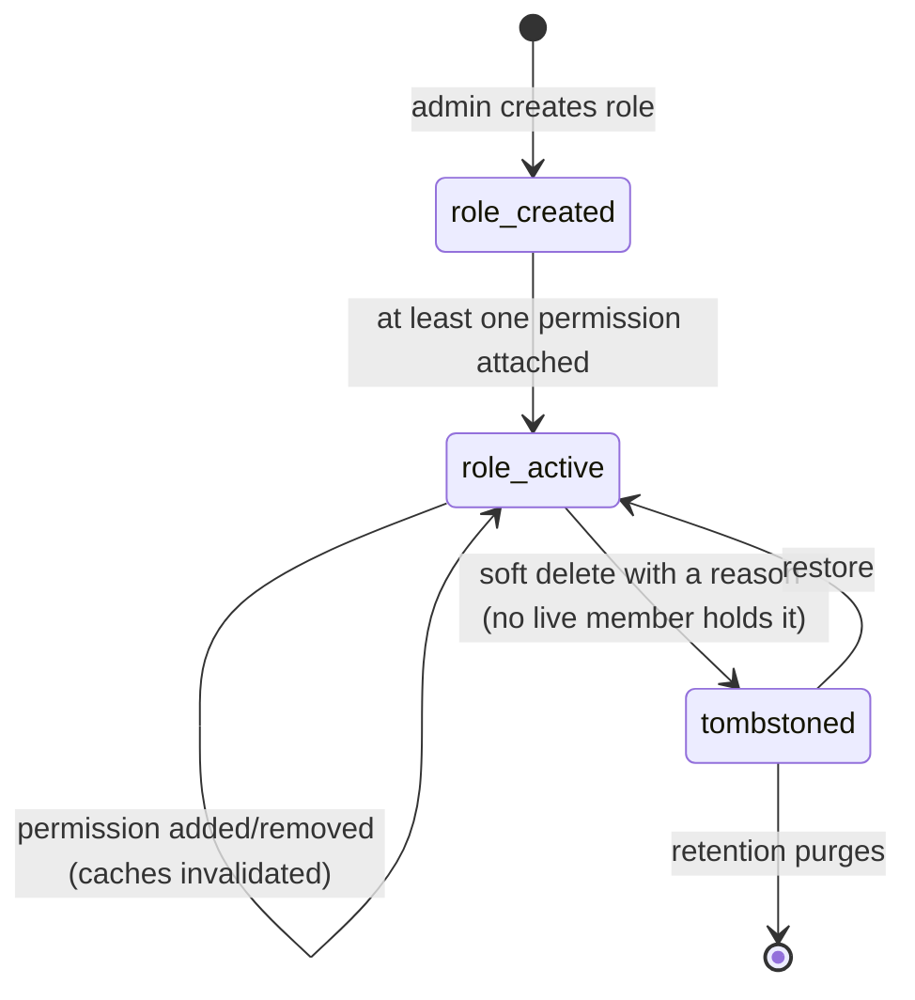

`src/domains/tenancy/sub-domains/member-roles/`

# Member roles

Parent: [tenancy](../../tenancy.overview.md)

## Purpose

Per-organization role definitions and the role ↔ permission join table (launch §2.D). A role is a
named bundle of permission codes an organization assigns to memberships. The nested
[member-role-permission](member-role-permission/member-role-permission.overview.md) resource is the
join table that ties roles to the catalog of permission codes.

| Route | Gate |
| --- | --- |
| `GET /tenancy/organization/roles` (`q`, `sort` `name` / `created_at`, paged) · `GET …/roles/{role_id}` | `role:read` |
| `POST /tenancy/organization/roles` (optionally `permission_codes`, `copy_from_role_id`) | `role:create` |
| `PATCH /tenancy/organization/roles/{role_id}` (`expected_updated_at`, T14) | `role:update` |
| `DELETE /tenancy/organization/roles/{role_id}?reason=&note=` | `role:delete` |
| `POST /tenancy/organization/roles/{role_id}/restore` (T12) | `role:delete` |
| `GET` / `PUT /tenancy/organization/roles/{role_id}/permissions` — `[{ permission_code, created_at }]` both ways (T15) | `role:read` / `role:update` |

## Key invariants

- **Roles are organization-scoped**: every role row carries `organization_id`; cross-organization reads are forbidden by RLS.
- **Permission catalog is global, role assignments are scoped**: the permission constants (`TENANCY_PERMISSIONS`, `BILLING_PERMISSIONS`, etc.) are platform-defined; what a role grants is per-organization.
- **Updating a role's permissions invalidates every member's cache**: role-permission replacement and role deletion bump the organization permission cache version (`invalidateOrganizationPermissions`), orphaning every `(user, organization)` cache key in the organization in O(1) — a role change can affect many members, so the whole organization namespace is invalidated rather than enumerating holders.
- **System roles keep their name and are never deleted (T3)**: provisioning creates "Owner" in every organization and the clinic roles (Admin, Doctor, Therapist, Front desk, Counsellor, Pharmacist, Accountant, Marketing) in a TEAM one ([`organization-provisioning.ts`](../organization/organization-provisioning.ts)), all `is_system` — their tone and description stay editable, they can be copied. Admin is `is_locked` and the Owner role's codes never change either. Owner holds every permission code; Admin holds every code except `organization:delete`, which is what keeps the two tiers distinct.
- **Deleted with why, restorable (T12)**: a custom role's delete carries `delete_reason` (+ `delete_note` for `other`); `POST …/restore` brings it back until the role tombstone retention purges it (409 when live or when its name was taken meanwhile).
- **Role reads project a live `member_count`**: the list / get / create / update role responses include `member_count` — the number of `active` or `invited` memberships holding the role, main or extra (a `suspended` member is excluded, matching the seat count), resolved per request from a single membership aggregate (`GROUP BY role_id`), never stored. The organization owner is a normal membership on the `Owner` role, so it counts naturally. `PUT /roles/:role_id/permissions` returns the permission set (not a role object), so it carries no `member_count`; a repeated code is a 400 (TC14).

## Lifecycle

## Failure modes

- **Deleting a role someone holds** (any status) → 409; reassign the members first.
- **Granting a permission constant that doesn't exist** → 400.
- **Concurrent role-permission writes** → second write merges; the organization permission cache version is bumped so every affected member re-resolves.
