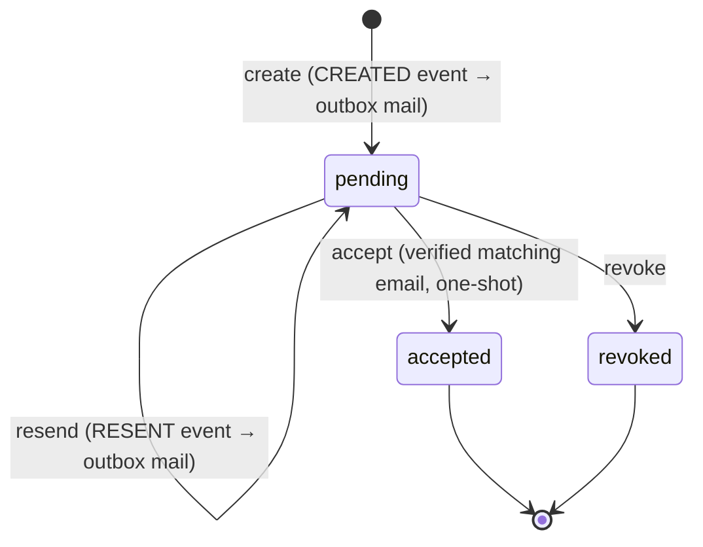

`src/domains/tenancy/sub-domains/membership/membership-invitation/`

# Membership invitations (nested resource)

Parent: [membership](../membership.overview.md)

## Purpose

The invite of an invited member (launch §2.C, T9) — table `tenancy.membership_invitations`, ids
`inv_…`. Issues it as the invitation half of add-member-by-email, resends it (an expired one too,
T11), revokes it for the membership (`MembershipService.revokeInvitation` ends the invited
membership in the same transaction) and accepts it. Emits domain events whose handlers enqueue the
invitation email through the transactional mail outbox.

| Route | Gate |
| --- | --- |
| `DELETE /tenancy/organization/memberships/{membership_id}/invitation` | `membership:delete` |
| `POST /tenancy/organization/memberships/{membership_id}/invitation/resend` | `membership:update` |
| `POST /tenancy/membership-invitations/{membership_invitation_id}/accept` | signed in (the invitee) |

There is no separate invitations list — an invited member is in the team list (`status=invited`)
with its `invitation` (T4).

## Layout

- `membership-invitation.controller.ts` / `membership-invitation.service.ts` — thin HTTP + application layer (issue, resend, revoke-for-membership, accept)
- `membership-invitation.token.ts` — token generation + hashing (raw token emailed, hash stored)
- `membership-invitation.repository.ts` / `membership-invitation.schema.ts` — persistence
- `membership-invitation.dto.ts` / `membership-invitation.validator.ts` / `membership-invitation.serializer.ts` / `membership-invitation.types.ts` — request/response shaping
- `events/` — `MEMBERSHIP_INVITATION_EVENT.CREATED` / `.RESENT` types, emit helpers, and handlers (registered in `register-event-handlers.ts`; they call `recordOutboxEmail()` post-commit, carrying `requestId`)
- `seed/` — seed contribution
- `__tests__/unit/` — validator/serializer/service and `unit/events/` handler suites

## Key invariants

- Invitation tokens are stored only as `sha256(raw)` — the raw token exists solely in the emailed link.
- Accept is atomic and one-shot, and is gated on a **verified** email that matches the invitation; a suspended member cannot self-restore via accept (activation requires status `invited`).
- Event handlers only enqueue mail via the outbox — they never fail the originating HTTP request.

## Lifecycle

