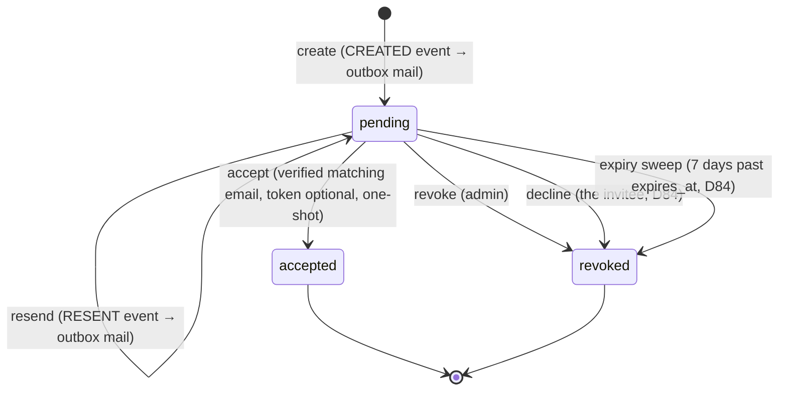

`src/domains/tenancy/sub-domains/membership/membership-invitation/`

# Membership invitations (nested resource)

Parent: [membership](../membership.overview.md)

## Purpose

The invite of an invited member (launch §2.C, T9) — table `tenancy.membership_invitations`, ids
`inv_…`. Issues it as the invitation half of add-member-by-email, resends it (an expired one too,
T11), revokes it for the membership (`MembershipService.revokeInvitation` ends the invited
membership in the same transaction) and accepts it. Emits domain events whose handlers enqueue the
invitation email through the transactional mail outbox.

| Route | Gate |
| --- | --- |
| `DELETE /tenancy/organization/memberships/{membership_id}/invitation` | `membership:delete` |
| `POST /tenancy/organization/memberships/{membership_id}/invitation/resend` | `membership:update` |
| `POST /tenancy/membership-invitations/{membership_invitation_id}/accept` | signed in (the invitee) |
| `POST /tenancy/membership-invitations/{membership_invitation_id}/decline` | signed in (the invitee) |
| `GET /users/me/membership-invitations` | signed in (the invitee's own) |

The organization has no separate invitations list — an invited member is in the team list
(`status=invited`) with its `invitation` (T4). The invitee reads their own pending invitations at
`GET /users/me/membership-invitations` (launch D84 (1)): matched on their verified email across
organizations through the SECURITY DEFINER read `tenancy.list_pending_membership_invitations_for_email`,
each with the clinic, the role names and who invited them — none for an unverified email.

## Layout

- `membership-invitation.controller.ts` / `membership-invitation.service.ts` — thin HTTP + application layer (issue, resend, revoke-for-membership, accept)
- `membership-invitation.token.ts` — token generation + hashing (raw token emailed, hash stored)
- `membership-invitation.repository.ts` / `membership-invitation.schema.ts` — persistence
- `membership-invitation.dto.ts` / `membership-invitation.validator.ts` / `membership-invitation.serializer.ts` / `membership-invitation.types.ts` — request/response shaping
- `events/` — `MEMBERSHIP_INVITATION_EVENT.CREATED` / `.RESENT` types, emit helpers, and handlers (registered in `register-event-handlers.ts`; they call `recordOutboxEmail()` post-commit, carrying `requestId`); `.ACCEPTED` / `.DECLINED` are consumed by notify's `membership-invitation.event-handlers.ts` (the in-app notices)
- `workers/` — `membership-invitation-expiry`: the daily sweep ending invited memberships whose invitation expired more than 7 days ago (launch D84 (4))
- `seed/` — seed contribution
- `__tests__/unit/` — validator/serializer/service and `unit/events/` handler suites
- `__tests__/integration/` — the dev-only accept-token echo through the real add, resend and accept routes

## Key invariants

- Invitation tokens are stored only as `sha256(raw)` — the raw token exists solely in the emailed link,
  and, on a developer's machine only, in the issue and resend answers: with
  `MEMBERSHIP_INVITATION_TOKEN_ECHO_ENABLED` on, the add-member answer carries
  `invitation.debug_invitation_token` and the resend answer `debug_invitation_token`, so a test member
  accepts through the real accept route (launch ROUTE #164, D82 — the email never arrives locally).
  The env schema refuses the flag outside the `local` and `development` targets; it defaults off and
  the test harness pins it off. A token-bearing answer is never cached (idempotency cache skip,
  `cache-control: no-store`).
- Accept is atomic and one-shot, and is gated on a **verified** email that matches the invitation; a suspended member cannot self-restore via accept (activation requires status `invited`). The emailed token is optional (launch D84 (2)): signing in with the invited, verified email proves what holding the token proves, so the invitee accepts in the app; a token that is sent must still match.
- Declining (launch D84 (3)) runs through `MembershipService.declineInvitation`, under the same verified-email binding: the invitation is revoked and the invited membership ends (`declined`) through the one leave step in one transaction, which frees its seat; the inviter — or, when they are no longer an active member, whoever can add members — gets an in-app `membership.invite_declined`. An expired invitation can be declined too.
- An invitation left 7 days past its expiry frees its seat: the daily `membership-invitation-expiry` sweep ends the invited membership (`invitation_expired`) through `MembershipService.endExpiredInvitation`, re-checking every condition in the organization's own context, so anything resent, accepted or removed since the scan is a skip. Until then an admin can resend it (T11); afterwards they invite the person again.
- Event handlers only enqueue mail via the outbox — they never fail the originating HTTP request.

## Lifecycle

