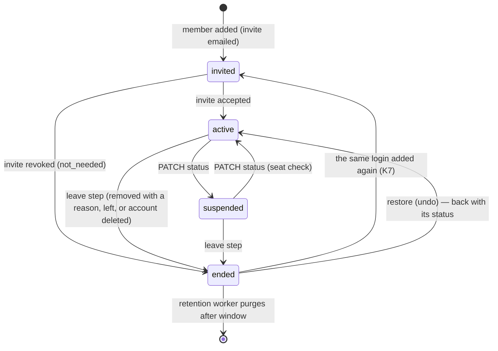

`src/domains/tenancy/sub-domains/membership/`

# Membership

Parent: [tenancy](../../tenancy.overview.md)

## Purpose

The link between users and organizations: who is in which organization with which roles (launch
§2.B). Includes the nested [membership-invitation](membership-invitation/membership-invitation.overview.md)
resource — the invite of an invited member — and the nested
[membership-additional-roles](membership-additional-roles/membership-additional-roles.overview.md)
persistence module (the roles a person holds besides the main one).

## Staff profile (launch ROUTE #4)

A membership is also the person's staff profile in the organization: `staff_number` (the "#12" of
the team table — per organization, assigned at insert by the `trg_memberships_staff_number` trigger
under a per-organization advisory lock, never reused), `phone`, `tone`, `working_days`,
`work_starts_at` / `work_ends_at` and `commission_percent`. A person holds **several roles** (D5):
the main one stays `role_id`, the rest live in `tenancy.membership_additional_roles`, and the API
speaks `role_ids` (main first — there is no separate `role_id` / `role`, T16). Access is the union
of every role held — the permission resolution, the permission holder lookup, the role member counts
and the role delete guard all read both (`membershipHoldsRole`). The branches a member works in are
`app.branch_members`, read, filtered and written as `branch_ids` through the app domain's late-wired
`MembershipBranchAccessPort`.

## Routes

One code set (launch T8): `membership:read|create|update|delete`; every `POST` takes
`X-Idempotency-Key` (T13).

| Route | Gate | Note |
| --- | --- | --- |
| `GET /tenancy/organization/memberships` | `membership:read` | every status; `q`, `status`, `role_id`, `branch_id` (T2), `include_ended` (D58), `sort` `created_at` / `name`; `estimated_total` on the first page; a bad filter is 400 invalid input on the field (USERS-M5) |
| `POST /tenancy/organization/memberships` | `membership:create` | invite + `role_ids` + profile + `branch_ids`; the same login added again gets its ended membership back (K7); the dev-only `invitation.debug_invitation_token` echo (ROUTE #164) |
| `GET /tenancy/organization/memberships/{membership_id}` | `membership:read` | live or ended (D58) |
| `PATCH /tenancy/organization/memberships/{membership_id}` | `membership:update` | live: `status` `active` ↔ `suspended` (T10), `role_ids`, profile; ended: `display_name` only (K6, D58); `expected_updated_at` (T14) |
| `DELETE /tenancy/organization/memberships/{membership_id}?reason=&note=` | `membership:delete` | soft delete with `delete_reason` (+ `delete_note` for `other`) |
| `POST /tenancy/organization/memberships/{membership_id}/restore` | `membership:delete` | undo a removal; 409 when live, rejoined or no seat; API keys stay revoked |
| `GET /tenancy/organization/memberships/{membership_id}/permissions` | `membership:read` | `{ permission_codes }` — every code of every role held (T15) |
| `DELETE /tenancy/organization/memberships/{membership_id}/invitation` | `membership:delete` | revoke the pending invite; the invited membership ends (`not_needed`) |
| `POST /tenancy/organization/memberships/{membership_id}/invitation/resend` | `membership:update` | new token and expiry, an expired invite too (T11); returns the invitation (+ the dev-only `debug_invitation_token`, ROUTE #164) |

## Response shape

The Membership object (launch §2.B.6) carries the staff profile (`staff_number`, `phone`, `tone`,
`role_ids`, `branch_ids`, `working_days`, `work_starts_at`, `work_ends_at`, `commission_percent`),
the organization's name for the member (`display_name`, K3), `ended_at` / `end_reason` (D58) and
the member's `user` summary (`id`, `email`, `first_name`, `last_name`, presigned `avatar_url`), so a
members table renders without an N+1 per-row fetch. `is_owner` names the organization's owner (from
`organizations.owner_user_id`, launch D81 (4)); the organization object names them too
(`owner_user_id`). User summaries are resolved via the
`auth.resolve_user_summaries_by_ids` SECURITY DEFINER function (auth.users is FORCE RLS, unreachable
by a plain join under organization-only context). Live `invited` rows also carry
`invitation: { id, expires_at }` (the pending invite) so the frontend can Resend/Revoke straight
from the row; other rows have `invitation: null`. Status values are lowercase (T17).

## Key invariants

- **One live membership per login and organization** (`idx_memberships_user_org_unique`): the same
  login added again revives its ended membership — same id, staff number and history (K7); a
  different login is always a new member.
- **Membership change invalidates the permission cache**: every create / update / soft-delete
  invalidates the `(user, organization)` Redis key after commit.
- **The owner's membership (sec-new-T1, launch D81 (4))**: their status and main role never change
  and they are never removed — 403 `reason: owner_membership_fixed` (transfer ownership first); they
  cannot leave — 403 `reason: owner_cannot_leave`. They **may hold extra roles** (the owner is often
  the clinic's doctor): a `role_ids` that keeps their main role first is taken, through the same
  grant guard as any member's (the caller must hold every code of every role in the set — so in
  practice the owner sets their own). Their staff profile stays editable.
- **Accept is gated on proven email control**: the accept route requires authentication, an email
  **matching** the invitee, **and a verified email** (`403 errors:invitationRequiresVerifiedEmail`
  otherwise). This stops a forwarded invite token from joining the organization.
- **Activation is invitation-driven only (T10)**: accepting the invite flips the membership to
  `active` and stamps `joined_at` in the same transaction as `accepted_at`. A `PATCH` moves status only
  between `active` and `suspended` (`400` on `status` otherwise) and never touches `joined_at`.
  While a member is `suspended`, every organization API key they created stops authenticating (the
  key resolver requires an `active` creator membership).
- **Invitation tokens are hashed at rest**: same construction as email verification-code /
  verification tokens (`sha256(raw)`).
- **One leave step (launch K4)**: a removal (the manager's reason), revoking the invite
  (`not_needed`), leaving (`left`) and a deleted account (`account_deleted`, every membership of the
  login) all end a membership the same way — the guarded soft delete, the person's API keys revoked,
  then the app's part (`MembershipLeavePort`, wired from `src/domains/app/app-membership-leave.ts`) —
  in one organization transaction.
- **The organization keeps the name (launch K3)**: `display_name` is copied from the login when the
  membership is created or comes back (`trg_memberships_display_name`, on insert and on restore) and
  follows every profile name change while the membership is live
  (`trg_users_sync_membership_display_names` on `auth.users`); once it ends it is frozen, and only
  a rename of the ended membership changes it (K6).
- **`(organization_id, id)` is unique (launch K8)** — the target of the app's composite membership
  foreign keys, so a record can only name a member of its own organization.

## Lifecycle

## Events

- Emits: `MEMBERSHIP_INVITATION_EVENT.CREATED`, `MEMBERSHIP_INVITATION_EVENT.RESENT` (each handler
  enqueues mail), `MEMBERSHIP_INVITATION_EVENT.ACCEPTED` (notifies the `membership:create` holders).

## External integrations

- **Resend** (via mail outbox) for invitation emails.

## Failure modes

- **Login already a live member** (any status) → 409 `membership_already_exists`.
- **Disposable email blocked on invite** → 400 `disposable_email`.
- **Stale save** → 409 `record_changed` (T14).
- **Ended member** → `PATCH` takes `display_name` only (400 `membership_ended`); `DELETE` and the
  permissions read are 404.
- **Invitation** → resend of an accepted / revoked invite is 400 (`invitation_already_accepted` /
  `invitation_revoked`); accept of a revoked / accepted / expired one is 400, a bad token 400, a
  member no longer invited 404.
