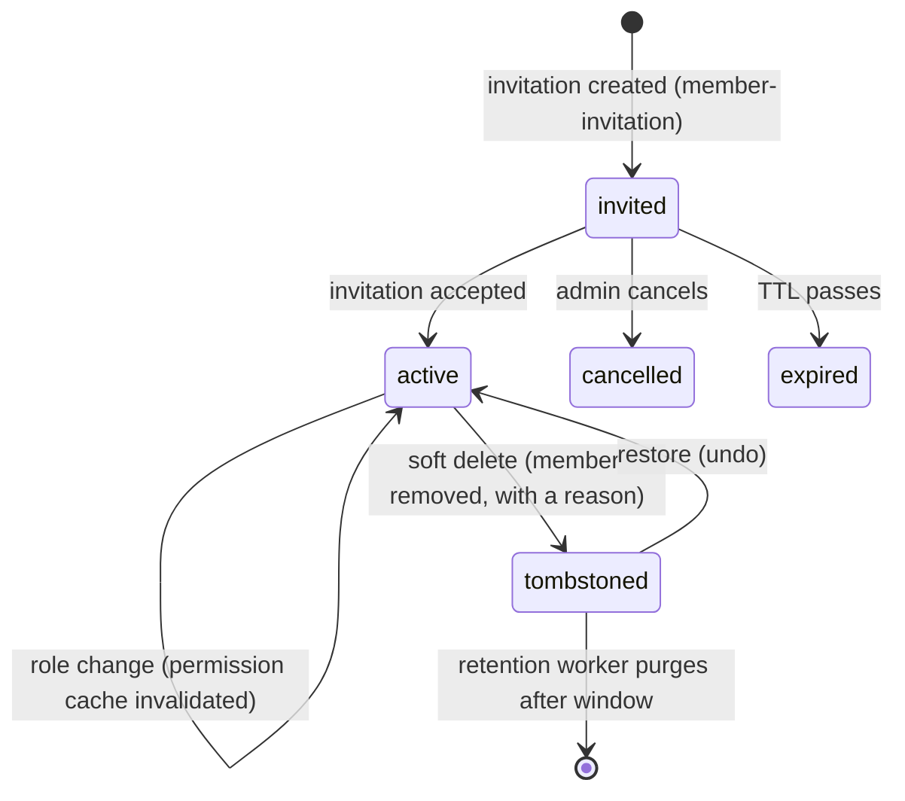

`src/domains/tenancy/sub-domains/membership/`

# Membership

Parent: [tenancy](../../tenancy.overview.md)

## Purpose

The link between users and organizations: who is in which organization with which role. Includes the nested [member-invitation](src/domains/tenancy/sub-domains/membership/member-invitation/) resource for inviting users (signed-up or not) to an organization, and the nested [membership-additional-roles](membership-additional-roles/membership-additional-roles.overview.md) persistence module (the roles a person holds besides the main one).

## Staff profile (launch ROUTE #4)

A membership is also the person's staff profile in the organization: `staff_number` (the "#12" of the team table — per organization, assigned at insert by the `trg_memberships_staff_number` trigger under a per-organization advisory lock, never reused), `phone`, `tone`, `working_days`, `work_starts_at` / `work_ends_at` and `commission_percent`. A person holds **several roles** (D5): the main one stays `role_id`, the rest live in `tenancy.membership_additional_roles`, and the API speaks `role_ids` (main first). Access is the union of every role held — the permission resolution, the permission holder lookup, the role member counts and the role delete guard all read both (`membershipHoldsRole`). The branches a member works in are `app.branch_user_accesses`, read and written as `branch_ids` through the app domain's late-wired `MembershipBranchAccessPort`.

| Route | Gate | Note |
| --- | --- | --- |
| `POST /tenancy/organization/memberships` | `membership:manage` | invite + `role_ids` + profile + `branch_ids` |
| `PATCH /tenancy/organization/memberships/{membership_id}` | `membership:manage` | `role_ids` / `branch_ids` replace the list; the owner's status and roles are locked, their profile is not |
| `DELETE /tenancy/organization/memberships/{membership_id}?reason=&note=` | `membership:manage` | soft delete with `delete_reason` (+ `delete_note` for `other`) |
| `POST /tenancy/organization/memberships/{membership_id}/restore` | `membership:manage` | undo a removal; 409 when live, rejoined or no seat; API keys stay revoked |

## Response shape

`GET /organization/memberships` (and `/:membership_id`) carry the staff profile (`staff_number`, `phone`, `tone`, `role_ids`, `branch_ids`, `working_days`, `work_starts_at`, `work_ends_at`, `commission_percent`) and embed each member's `user` summary (`id`, `email`, `first_name`, `last_name`, presigned `avatar_url`) and `role` summary (`id`, `name`) alongside the flat `user_id`/`role_id` public ids, so a members table renders without an N+1 per-row fetch. User summaries are resolved via the `auth.resolve_user_summaries_by_ids` SECURITY DEFINER function (auth.users is FORCE RLS, unreachable by a plain join under organization-only context). `INVITED` rows also carry `invitation: { id, expires_at }` (the live pending invite) so the frontend can Resend/Revoke straight from the row; `ACTIVE`/`SUSPENDED` rows have `invitation: null`.

## Key invariants

- **Unique `(user_id, organization_id)`**: a user has at most one membership per organization (soft-delete + re-add reuses the same logical row).
- **Membership change invalidates the permission cache**: every create / update / soft-delete invalidates the `(user, organization)` Redis key before responding.
- **Invitations are one-shot**: atomic accept consumes the row exactly once.
- **Accept is gated on proven email control**: the accept route requires authentication, an email **matching** the invitee, **and a verified email** (`403 errors:invitationRequiresVerifiedEmail` otherwise) — email verification-code / OAuth onboarding both verify the address before a session is issued. This stops a forwarded invite token from joining the organization.
- **Initial activation is invitation-driven only**: accepting an invitation atomically flips the linked membership to `ACTIVE` and stamps `joined_at` in the same transaction as `accepted_at`. A manager `PATCH /memberships/:id` **cannot** set a never-joined (`joined_at IS NULL`) membership to `ACTIVE` — that returns `403 errors:membershipActivationRequiresInvitationAccept`. Reactivating a previously-active member (`SUSPENDED -> ACTIVE`, which already has `joined_at`) stays allowed so admin suspend/reactivate flows keep working. While a member is `SUSPENDED`, every organization API key they created stops authenticating (the key resolver requires an `ACTIVE` creator membership), so a retained key cannot be used to reactivate them; the keys work again once an administrator reactivates the member. This keeps onboarding consent/audit unambiguous: a membership only becomes active when its invitee accepts.
- **Invitation tokens are hashed at rest**: same construction as email verification-code / verification tokens (`sha256(raw)`).

## Lifecycle

## Events

- Emits: `MEMBER_INVITATION_EVENT.CREATED`, `MEMBER_INVITATION_EVENT.RESENT` (each handler enqueues mail).

## External integrations

- **Resend** (via mail outbox) for invitation emails.

## Failure modes

- **Invitee already a member** (ACTIVE or live INVITED) → 409 `errors:membershipAlreadyExists` (add-member-by-email path).
- **Disposable email blocked on invite** → 400 `errors:disposableEmail`.
- **Revoke** removes the auto-created INVITED membership too (soft-delete) so the members table shows no ghost invitee.
- **Invitation token expired** → 401 `errors:invitationTokenExpired`.
- **Invitation accepted twice** → 409 (atomic accept consumed the row on the first call).
- **Invitation cancelled before accept** → 410 `errors:invitationCancelled`.
