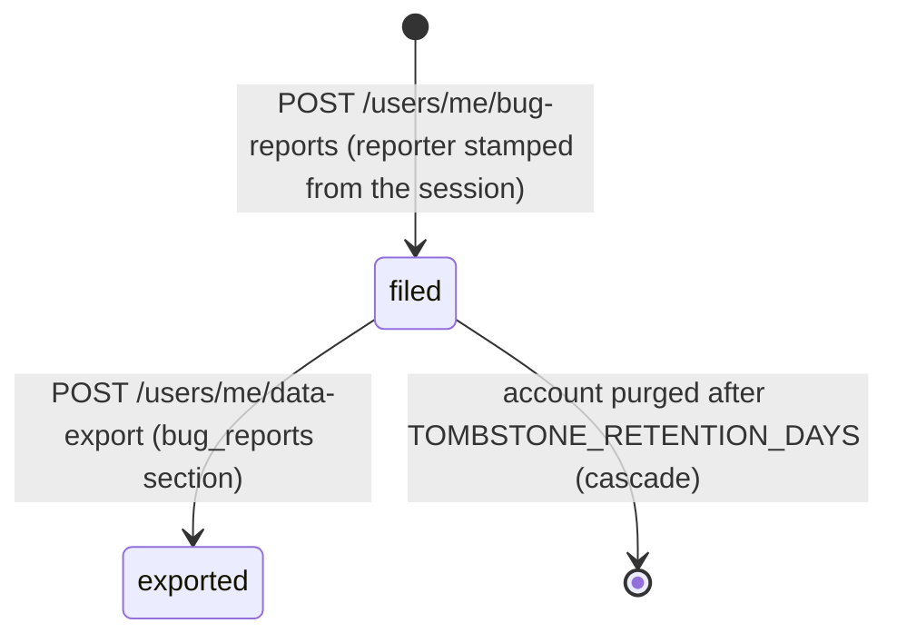

`src/domains/user/sub-domains/user-bug-report/`

# User bug report

Parent: [user](../../user.overview.md)

## Purpose

Keeps every bug report a signed-in person files from the frontend's "Report a bug" panel — one
textbox with a native voice (speech-to-text) button that replaced Sentry's feedback widget
(iteration `feat-bug-report-2026-10-13-dgnx`). One route, `POST /api/v1/users/me/bug-reports`,
writes one row in `auth.user_bug_reports`; the person's data export reads them back.

## Key invariants

- **The reporter comes from the session, never the body** (BR4): the service reads the person's
  own account row under their context and stamps `user_id`, `reporter_name` (first + last name,
  `null` when the account has none yet — BR5) and `reporter_email`. The DTO is `.strict()`, so a
  body with `user_id`, `name` or `email` is a 400.
- **Owner-only row-level security** (BR8): ENABLE + FORCE, one policy on
  `app.current_user_public_id` with `USING` and `WITH CHECK`, no bypass arm. Triage reads reports
  through the operator connection.
- **Append-only**: no update or delete route; a report goes when its account is purged
  (`ON DELETE CASCADE`, BR10). The workspace is `organization_public_id`, a snapshot of the token's
  `org` claim with no foreign key.
- **Nothing else is set off** (BR9): no audit row, event, notification or job.
- **Bounded**: `STRICT_AUTHED_RATE_LIMIT` (10 a minute per person); description 1–5000 characters
  after trimming (`chk_user_bug_reports_description`); `User-Agent` cut to 512.

## Lifecycle

## Failure modes

- **Blank, missing or too-long description; unknown `input_method`; `page_path` not starting with
  `/`; any extra field** → 400 Validation error.
- **No session, or an API key** → 401.
- **Account gone or deleted between the token and the insert** → 404.
- **More than 10 reports a minute** → 429.

## Tests

- `__tests__/unit/user-bug-report.validator.unit.test.ts` — the body contract.
- `__tests__/unit/user-bug-report.serializer.unit.test.ts` — the reply, the export entry, the
  reporter's name.
- `__tests__/unit/user-bug-report.service.unit.test.ts` — the stamp from the session.
- `src/domains/user/__tests__/integration/user-bug-report.integration.test.ts` — the route end to
  end against Postgres.
- `src/tests/security/rls/rls-matrix.security.test.ts` — one person cannot see another's report.
