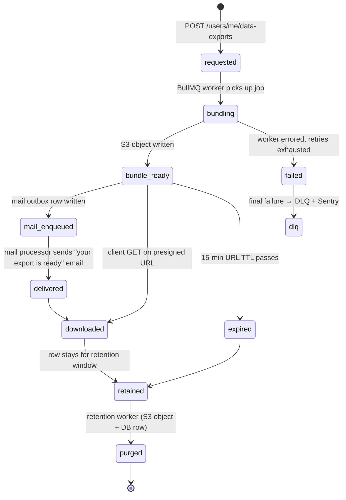

`src/domains/user/sub-domains/user-data-export/`

# User data export

Parent: [user](../../user.overview.md)

## Purpose

GDPR data export pipeline. A user requests an export; a BullMQ worker bundles every row this user owns across the platform into a single S3 object, presigns a 15-minute download URL (sec-U6), and emails the link via the mail outbox. The bundle includes a `metadata.json` describing what was exported and what was truncated.

## Key invariants

- **Cross-domain reads via services only**: {@link UserDataExportService} calls `list*ForUserDataExport` on auth-session, membership, notification, and audit services (wired in `domain-containers.plugin.ts` / `worker-containers.ts`). It uses its own `UserDataExportRepository` for export job rows only.
- **Per-table row cap**: `GDPR_EXPORT_MAX_ROWS_PER_TABLE = 1 000`. Exceeding the cap truncates with a metadata note rather than failing the export.
- **15-minute download URL TTL** (`USER_DATA_EXPORT_PRESIGNED_DOWNLOAD_EXPIRY_SECONDS = 900`): shortened from 24 h to 15 min in sec-U6 to collapse the stolen-token replay window. Every mint is audited as `user.data_export.url_minted` so post-hoc forensics retain the trail even when the URL has expired. AWS SigV4 caps presigned URLs at 7 days; the prior 24 h ceiling reflected legacy posture and has been superseded.
- **One open export per user**: a request while the user's previous export is still `pending` or `processing` returns that export instead of creating another (a partial unique index settles a concurrent race the same way).
- **Public ids in the job, never a bigserial**: the job carries the export's and its owner's public ids; the worker reads the owner's internal id inside the owner's own scope. The job id is the export's public id, so a post-commit dispatch the recovery sweeper replays is dropped while the first job is retained instead of building the export twice. An enqueue that fails after commit marks the still-`pending` export `failed` (`enqueue_failed`) under the owner's scope.
- **No retroactive deletion of completed exports**: a soft-deleted user can still hold a completed export bundle in S3 until retention purges it (forensic / regulatory value).

## Lifecycle

## External integrations

- **S3** — bundle written to a per-user prefix; presigned download URL issued.
- **Resend** (via mail outbox) — "your export is ready" email.

## Failure modes

- **S3 write failure** → BullMQ retries the worker job, the export staying `processing`; only the final attempt marks it `failed` (DLQ + Sentry; the user does not receive the email). Marking it failed on every attempt let the user request a second export mid-retry, and two were built.
- **S3 down** → the `user-data-export` queue pauses on every replica and probes every five minutes; the job waits without spending an attempt and the export stays `processing` until S3 is back.
- **Redis refuses the enqueue** (the post-commit add fails, or the process dies before it runs) → the row stays `pending` — an enqueue error never fails it — and `reclaim-pending-user-data-exports`, a repeatable job on this queue run by the export worker every five minutes, re-adds exports still `pending` after five minutes (job id = the export's public id, so a live job absorbs the add). A deleted user's exports are skipped. It used to mark the row `failed` — or, with the dispatch task lost, leave it `pending` with no job, which every new request then returned.
- **Export bundling** → the four data categories are read one after another, each in its own short user-scoped context: one pool connection per export job, as the worker budget counts it (read in parallel they took four).
- **One table exceeds 1 000 rows** → bundle includes the first 1 000 rows + a metadata note; logged at info; user receives the export.
- **User soft-deleted while export is in flight** → export still completes (read path is a user principal scope on the user public id; soft-delete does not revoke history reads).
- **Mail enqueue failure** → does not fail the export; the bundle exists in S3 and the status route can re-mint a fresh 15-minute presigned URL on demand (every mint is audited), but the user won't receive the original email link.

## Policy constants

- `GDPR_EXPORT_MAX_ROWS_PER_TABLE = 1 000`
- `USER_DATA_EXPORT_PRESIGNED_DOWNLOAD_EXPIRY_SECONDS = 900` (15 minutes — sec-U6)
